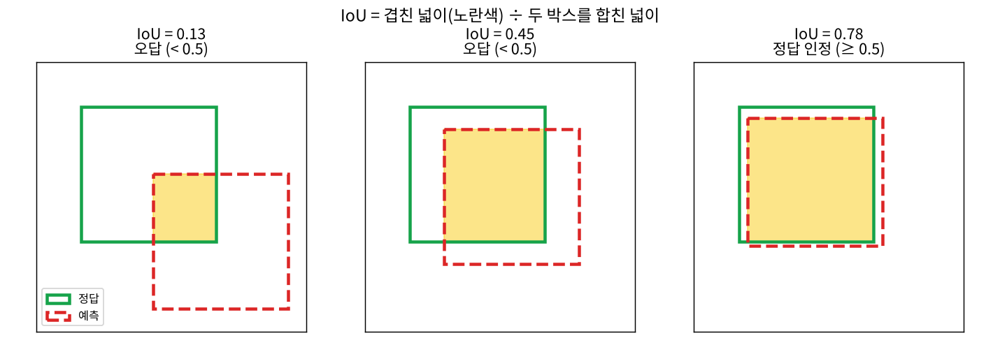
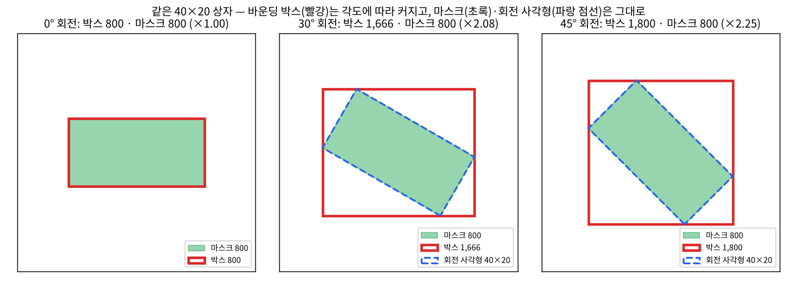
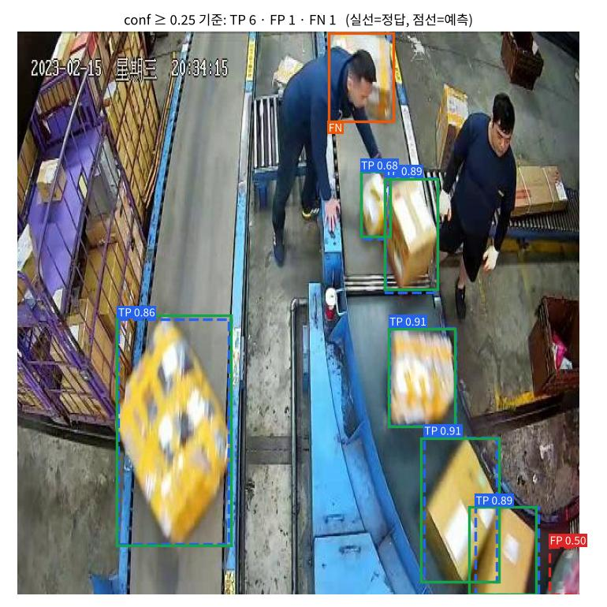
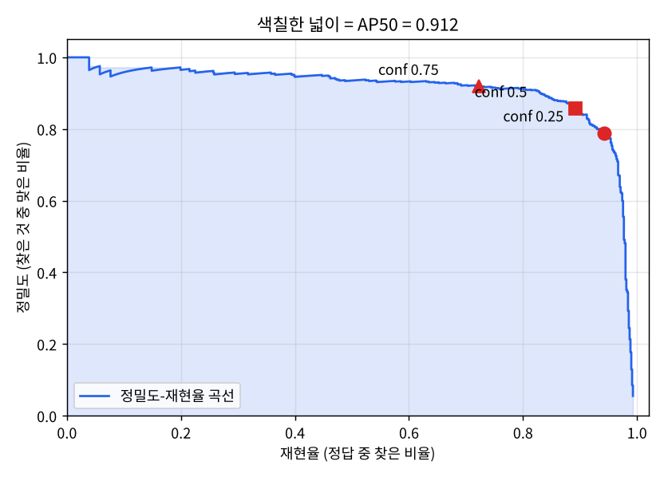
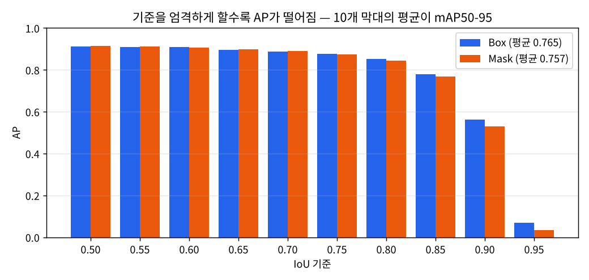
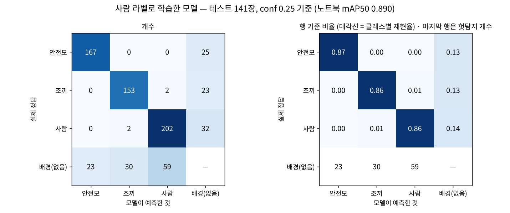
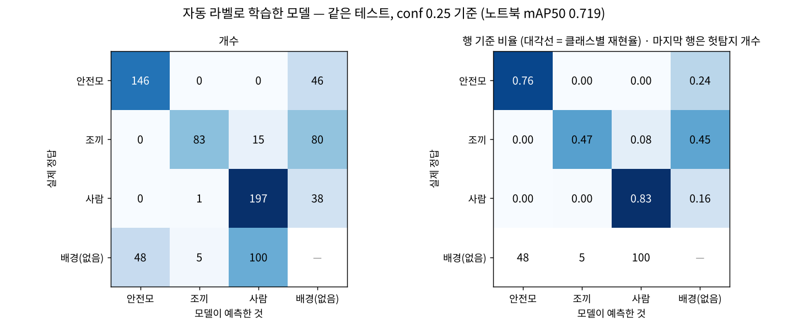
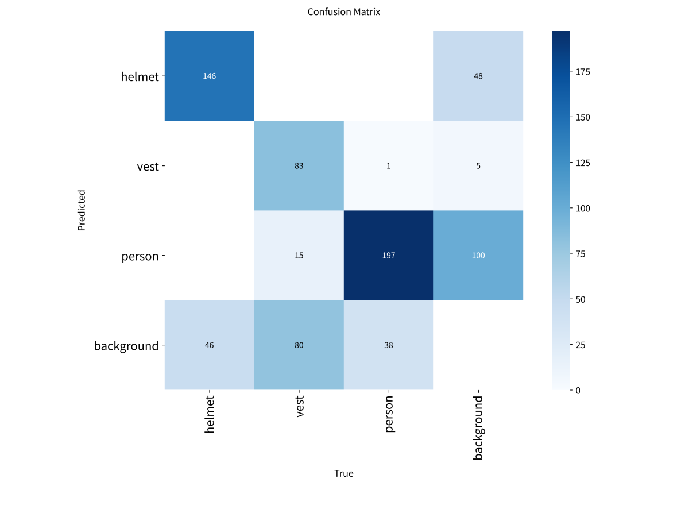

# 탐지 성능 지표 읽기 — mAP와 혼동 행렬

_실습 01(상자)과 06(오토 라벨링)의 실제 결과로 IoU부터 mAP50-95, 혼동 행렬까지 차례로 읽어 봅니다._

## 한눈에 보기

| 알고 싶은 것 | 보는 지표 | 이 자료의 위치 |
|---|---|---|
| 예측 박스가 정답과 같은 물체를 가리키나? | IoU | 1장 |
| 맞힌 것·헛짚은 것·놓친 것은 몇 개? | TP · FP · FN | 2장 |
| 찾은 것 중 몇 %가 맞았나? 정답 중 몇 %를 찾았나? | 정밀도 · 재현율 | 3장 |
| 신뢰도 기준과 상관없이 모델 실력은? | AP · mAP50 | 4장 |
| 위치·윤곽까지 얼마나 정확한가? | mAP50-95, Box vs Mask | 5장 |
| 어떤 클래스를 무엇으로 헷갈리나? 무엇을 놓치나? | 혼동 행렬 | 7장 |

> **예시 데이터** 1~5장은 실습 01의 상자 세그멘테이션 모델(짧은 학습, imgsz 416)을 검증 이미지 188장, 정답 상자 693개로 평가한 결과입니다. 7~8장은 실습 06에서 사람 라벨과 자동 라벨로 각각 학습한 안전모·조끼·사람 탐지 모델을 테스트 이미지 141장으로 평가한 결과입니다.

## 1. 정답 판정의 기준 — IoU

탐지 모델은 '상자가 있다'뿐 아니라 '어디에 있다'까지 답합니다. 그래서 예측이 맞았는지 판정하려면 먼저 **예측 박스와 정답 박스가 얼마나 겹치는지**를 재야 합니다. 이것이 **IoU(Intersection over Union, 겹침 비율)** 입니다.

```
IoU = 겹친 넓이 ÷ (두 박스를 합친 넓이)
    = 0 (전혀 안 겹침) ~ 1 (완전히 일치)
```



*그림 1. IoU 0.5를 기준으로 하면 왼쪽 두 예측은 오답, 오른쪽만 정답으로 인정됩니다.*

**mAP50의 '50'** 이 바로 이 기준입니다. IoU가 0.5 이상이면 맞힌 것으로 칩니다. 같은 클래스여야 하고, 정답 하나에는 예측 하나만 짝지어집니다. 같은 상자에 박스를 두 번 그리면 두 번째는 헛탐지가 됩니다.

### 박스 IoU와 마스크 IoU

세그멘테이션 모델은 물체마다 **바운딩 박스(축에 맞춰 똑바로 선 사각형)** 와 **마스크(물체가 차지한 픽셀 영역, 다각형 윤곽)** 를 함께 내놓습니다. 그래서 IoU도 두 가지로 잽니다. 박스 IoU는 사각형끼리, 마스크 IoU는 픽셀 영역끼리 겹친 비율입니다. 이후 계산은 둘이 완전히 같고, 결과표에 Box(...)와 Mask(...)로 따로 나옵니다.



*그림 2. 같은 상자도 기울면 바운딩 박스 면적은 최대 2배 넘게 커집니다. 마스크와 회전 사각형(cv2.minAreaRect)은 그대로입니다.*

- **바운딩 박스:** 물체를 *찾고 추적*하는 데 충분합니다. 하지만 크기를 재면 각도에 따라 부풀어 오릅니다. 실습 01에서 실제로 잰 박스/마스크 면적비는 중앙값 1.41, 최대 3.2배였습니다.
- **마스크:** 실제로 차지한 넓이를 잽니다. 실습 01의 S/M/L 판정은 마스크 면적을 씁니다.
- **회전 사각형(`cv2.minAreaRect`):** 윤곽선을 감싸는 가장 작은 사각형을 각도까지 돌려 찾습니다. 기울어진 상자의 실제 긴 변·짧은 변을 알 수 있습니다.

## 2. 맞힘·헛짚음·놓침 — TP · FP · FN

| 이름 | 뜻 | 예 |
|---|---|---|
| TP (True Positive) | 정답과 IoU 0.5 이상으로 짝지어진 예측 = 맞게 찾음 | 상자를 상자로 찾음 |
| FP (False Positive) | 짝지을 정답이 없는 예측 = 헛탐지 | 바닥 무늬를 상자로, 같은 상자를 두 번 |
| FN (False Negative) | 어떤 예측과도 짝지어지지 않은 정답 = 놓침 | 가려진 상자를 못 찾음 |

분류 문제에서 쓰는 **TN(맞게 '아니다'라고 한 것)은 탐지에는 없습니다.** 사진 속 '상자가 아닌 곳'은 셀 수 없이 많기 때문입니다. 그래서 탐지 지표는 TP·FP·FN만으로 만듭니다.



*그림 3. 실습 01 검증 이미지 한 장(conf 0.25 이상 예측). TP 6, FP 1, FN 1. 숫자는 예측의 신뢰도(conf)입니다.*

그림 3에서 FN(주황)은 작업자가 손에 든 상자입니다. 컨베이어 위 상자와 모양·위치가 달라 모델이 놓쳤습니다. 오른쪽 끝 FP(빨강)는 화면 가장자리에 걸친 물체를 상자로 본 경우입니다. 이렇게 **틀린 예측을 직접 보는 것**이 지표 숫자보다 많은 것을 알려 줍니다.

## 3. 정밀도·재현율과 신뢰도 기준(conf)

| 지표 | 질문 | 계산 |
|---|---|---|
| 정밀도 (Precision) | 모델이 '상자'라고 한 것 중 진짜 상자는 몇 %? | TP ÷ (TP + FP) |
| 재현율 (Recall) | 진짜 상자 중 모델이 찾아낸 것은 몇 %? | TP ÷ (TP + FN) |

모델은 예측마다 **신뢰도(conf, 0~1)** 를 붙입니다. 신뢰도가 기준 이상인 예측만 남기는데, 이 기준을 바꾸면 정밀도와 재현율이 **서로 반대로** 움직입니다. 실습 01 모델로 직접 세어 본 결과입니다.

| conf 기준 | 남은 예측 | TP | FP | FN | 정밀도 | 재현율 |
|---|---|---|---|---|---|---|
| 0.1 | 974 | 670 | 304 | 23 | 0.688 | 0.967 |
| 0.25 | 828 | 653 | 175 | 40 | 0.789 | 0.942 |
| 0.5 | 721 | 618 | 103 | 75 | 0.857 | 0.892 |
| 0.75 | 545 | 501 | 44 | 192 | 0.919 | 0.723 |
| 0.9 | 101 | 98 | 3 | 595 | 0.970 | 0.141 |

- 기준을 **낮추면**(0.1): 거의 다 찾지만(재현율 0.97) 헛탐지가 많습니다(정밀도 0.69).
- 기준을 **높이면**(0.9): 남긴 것은 거의 다 맞지만(정밀도 0.97) 대부분을 놓칩니다(재현율 0.14).
- 어느 기준이 좋은지는 **현장의 비용**이 정합니다. 놓치면 큰일인 안전 경보는 재현율, 헛경보가 업무를 방해하는 자동 집계는 정밀도를 우선합니다. 실습 01의 2-5, 워크숍 노트북의 '임계값 정하기'가 이 결정을 하는 단계입니다.

> **참고** 학습·검증 결과표의 P와 R(예: Box P 0.867, R 0.889)은 Ultralytics가 **F1(정밀도·재현율의 조화 평균)이 가장 높은 conf 기준**에서 잰 값입니다. 서비스에서 쓸 기준과는 다를 수 있습니다.

## 4. 기준 하나에 얽매이지 않는 점수 — PR 곡선과 AP

conf 기준마다 정밀도·재현율이 다르니 기준 하나로 모델을 비교하기 어렵습니다. 그래서 **모든 기준을 한꺼번에 훑는 점수**를 만듭니다. 방법은 간단합니다.

1. 아주 낮은 기준(conf 0.001)으로 검증 이미지 전체를 예측합니다. 실습 01에서는 예측 12,467개가 나왔습니다.
2. 모든 예측을 **신뢰도 높은 순서로 줄 세웁니다.**
3. 위에서부터 하나씩 내려가며 TP인지 FP인지 판정하고, 그때까지의 **누적 정밀도·재현율**을 계산합니다.
4. 재현율(가로)과 정밀도(세로)로 점을 찍어 이은 것이 **PR 곡선**이고, 그 **아래 넓이가 AP**입니다.

| 순위 | conf | 판정 | 누적 TP | 누적 FP | 정밀도 | 재현율 |
|---|---|---|---|---|---|---|
| 1 | 0.937 | TP | 1 | 0 | 1.000 | 0.001 |
| 2 | 0.934 | TP | 2 | 0 | 1.000 | 0.003 |
| 3 | 0.934 | TP | 3 | 0 | 1.000 | 0.004 |
| 4 | 0.929 | TP | 4 | 0 | 1.000 | 0.006 |
| 5 | 0.929 | TP | 5 | 0 | 1.000 | 0.007 |
| 100 | 0.900 | TP | 97 | 3 | 0.970 | 0.140 |
| 300 | 0.859 | TP | 284 | 16 | 0.947 | 0.410 |
| 500 | 0.782 | TP | 464 | 36 | 0.928 | 0.670 |
| 600 | 0.700 | FP | 548 | 52 | 0.913 | 0.791 |
| 650 | 0.642 | FP | 581 | 69 | 0.894 | 0.838 |
| 700 | 0.561 | TP | 610 | 90 | 0.871 | 0.880 |
| 800 | 0.286 | TP | 644 | 156 | 0.805 | 0.929 |
| 1000 | 0.087 | FP | 671 | 329 | 0.671 | 0.968 |

순위가 내려갈수록(신뢰도가 낮아질수록) 재현율은 0에서 1 쪽으로 꾸준히 오르고, 정밀도는 1에서 조금씩 떨어집니다. 이 궤적이 아래 곡선입니다.



*그림 4. 실습 01 모델의 PR 곡선(IoU 0.5 기준). 색칠한 넓이가 AP50 = 0.912. 빨간 점은 conf 0.25 / 0.5 / 0.75 기준의 위치입니다.*

- **좋은 모델**은 곡선이 오른쪽 위 모서리에 붙어 있습니다. 많이 찾아도(재현율↑) 정밀도가 떨어지지 않으므로 넓이가 1에 가깝습니다.
- 곡선이 오른쪽 끝에서 뚝 떨어지는 부분은 신뢰도가 아주 낮은 예측들입니다. 여기서 남은 상자 몇 개를 찾느라 헛탐지가 급격히 늘어납니다.
- **mAP의 m(평균)** 은 클래스별 AP의 평균입니다. 실습 01은 클래스가 package 하나라서 AP = mAP입니다.

> **계산 방식** AP는 재현율 0~1을 101개 점으로 나눠 그 점에서의 최대 정밀도를 평균하는 방식(COCO 방식)으로 계산합니다. 이 자료에서 직접 계산한 AP50 0.912은 노트북 출력(0.910)과 계산 세부 차이로 소수점 셋째 자리가 조금 다릅니다.

## 5. 더 엄격하게 — mAP50-95, 그리고 Box와 Mask

mAP50은 '대략 맞는 위치'면 정답으로 칩니다. **mAP50-95**는 IoU 기준을 0.50, 0.55, …, 0.95까지 10단계로 올려 가며 AP를 구하고 평균합니다. 기준이 엄격해질수록 박스 테두리·윤곽선까지 정확해야 점수를 받습니다.



*그림 5. IoU 기준별 AP. 0.85까지는 잘 버티다가 0.9 이상에서 급격히 떨어집니다. 10개 막대의 평균이 mAP50-95입니다.*

| 실습 01 노트북 출력 | P | R | mAP50 | mAP50-95 |
|---|---|---|---|---|
| Box (바운딩 박스 기준) | 0.867 | 0.889 | 0.910 | 0.761 |
| Mask (윤곽 기준) | 0.873 | 0.895 | 0.912 | 0.719 |

- **mAP50이 거의 같음:** 상자를 *찾는* 능력은 두 기준에서 비슷합니다.
- **mAP50-95는 Mask가 낮음:** 윤곽을 픽셀 단위로 맞히는 쪽이 더 어렵습니다. 흐린 모서리, 붙어 있는 상자에서 윤곽이 조금씩 어긋납니다.
- 실습 01처럼 마스크 면적으로 크기를 판정할 때는 **Mask mAP50-95**를 눈여겨봅니다. 2-7 개선 실험도 이 값을 중심으로 비교합니다.

## 6. mAP를 읽을 때 자주 하는 오해

| 오해 | 실제 |
|---|---|
| mAP가 높으면 그대로 서비스에 쓸 수 있다 | mAP는 신뢰도 '순위'만 봅니다. 실습 05(말로 찾는 탐지기)처럼 신뢰도가 전부 0.1 이하여도 mAP는 높게 나올 수 있습니다. 실제 사용에는 conf 기준 하나를 정하고 그때의 정밀도·재현율을 따로 확인해야 합니다. |
| conf 0.25로 검증하면 더 현실적인 mAP가 나온다 | mAP는 아주 낮은 기준(0.001)에서 곡선 전체를 그려야 정확합니다. 기준을 0.25로 올리면 곡선 끝이 잘려 mAP가 낮게 나옵니다. 실습 06의 사람 라벨 모델은 0.890 → 0.829, 자동 라벨 모델은 0.719 → 0.604로 떨어졌습니다. |
| 전체 mAP만 보면 된다 | 클래스별 AP를 꼭 봅니다. 실습 06의 자동 라벨 모델은 전체 mAP50 0.719였지만 클래스별로는 안전모 0.669, 조끼 0.707, 사람 0.781로 차이가 납니다. |
| 다른 데이터셋의 mAP와 비교할 수 있다 | mAP는 같은 데이터·같은 분할에서만 비교할 수 있습니다. 데이터가 바뀌면 문제 난이도가 바뀝니다. |
| val 점수가 높으면 끝 | 학습에 쓰지 않은 test 점수가 val과 비슷한지 확인합니다. 같은 원본의 증강 사본이 train과 test에 나뉘어 들어가면 점수가 부풀려집니다(데이터 누수). |

## 7. 무엇을 무엇으로 헷갈리나 — 혼동 행렬

mAP는 '얼마나 잘하나'를 숫자 하나로 알려 주지만, **어떻게 틀리는지**는 알려 주지 않습니다. 혼동 행렬(confusion matrix)은 정답 클래스와 예측 클래스를 표로 맞대어 틀리는 방식을 보여 줍니다. 클래스가 여럿일 때 특히 유용합니다.

### 탐지용 혼동 행렬의 구조

- **행 = 실제 정답, 열 = 모델이 예측한 것** (이 자료의 그림 기준).
- 탐지에는 **배경(없음)** 칸이 하나 더 붙습니다. '정답이 있는데 아무 예측도 짝지어지지 않음'과 '예측이 있는데 정답이 없음'을 담기 위해서입니다.
- 판정 조건은 **conf 0.25 이상인 예측만, IoU 0.45 이상이면 짝**입니다(Ultralytics 기본값). 그래서 mAP와 달리 혼동 행렬은 conf 기준에 따라 달라집니다.

| 칸의 위치 | 뜻 | 고치는 방향 |
|---|---|---|
| 대각선 (안전모→안전모 …) | 맞게 찾은 개수(TP). 행 비율로 보면 **클래스별 재현율** | 높을수록 좋음 |
| 대각선 밖, 클래스끼리 | **클래스 혼동** — 찾기는 했는데 이름을 틀림 (조끼→사람) | 두 클래스의 라벨 기준 명확히, 헷갈리는 사례 추가 |
| 마지막 열 (예측 = 배경) | **놓침(FN)** — 정답이 있는데 못 찾음 | 작은 물체·가림 사례 추가, imgsz 올리기, conf 낮추기 |
| 마지막 행 (정답 = 배경) | **헛탐지(FP)** — 없는 것을 찾음 | 비슷한 배경 사례 추가, conf 올리기. **라벨 누락**일 수도 있음 |



*그림 6. 실습 06 — 사람이 그린 라벨로 학습한 모델. 왼쪽은 개수, 오른쪽은 각 정답 행을 1로 맞춘 비율입니다.*

### 그림 6 읽기 — 사람 라벨 모델

- **대각선:** 안전모 167/192 (0.87), 조끼 153/178 (0.86), 사람 202/236 (0.86). 세 클래스 모두 비슷하게 잘 찾습니다.
- **클래스 혼동이 거의 없음:** 조끼↔사람 각 2개뿐입니다. 안전모·조끼·사람은 모양이 달라 서로 헷갈리지 않습니다.
- **틀리는 방식은 주로 놓침과 헛탐지:** 마지막 열(놓침) 25·23·32, 마지막 행(헛탐지) 23·30·59개입니다.
- 사람 헛탐지 59개가 가장 많습니다. 사진 가장자리에 일부만 보이는 사람, 멀리 작은 사람을 라벨에서 뺐는데 모델은 찾은 경우가 섞여 있을 수 있습니다. 이런 FP는 모델이 아니라 **라벨 기준**을 점검할 신호입니다.



*그림 7. 같은 테스트 이미지, 자동 라벨(YOLOE가 만든 라벨)로 학습한 모델.*

### 그림 7 읽기 — 두 행렬을 나란히 비교하기

| 칸 | 사람 라벨 | 자동 라벨 | 해석 |
|---|---|---|---|
| 조끼 재현율 (대각선) | 153 (0.86) | 83 (0.47) | 자동 라벨 모델이 조끼를 절반밖에 못 찾음 |
| 조끼 놓침 (마지막 열) | 23 | 80 | 가장 큰 차이 — 자동 라벨에 조끼가 많이 빠져 있었음 |
| 조끼 → 사람 혼동 | 2 | 15 | 조끼 입은 상체를 '사람'으로만 보는 경우가 늘어남 |
| 안전모 헛탐지 (마지막 행) | 23 | 48 | 모자·머리를 안전모로 보는 경우가 두 배 |
| 사람 헛탐지 (마지막 행) | 59 | 100 | 자동 라벨이 사람 라벨보다 사람을 더 많이 표시해 둔 영향으로 보임 — 라벨 기준 차이 |

실습 06의 3단계(라벨 품질 검사)에서 자동 라벨의 조끼 F1이 0.517로 가장 낮았습니다. 혼동 행렬은 그 영향이 **학습된 모델에서 '조끼 놓침'으로 그대로 나타난다**는 것을 보여 줍니다. 그래서 하이브리드 검수로 애매한 이미지만 사람이 고치자 조끼 AP가 0.707에서 0.887로 회복되었습니다.

### 노트북이 만드는 confusion_matrix.png와의 차이

Ultralytics가 검증 폴더에 저장하는 `confusion_matrix.png`는 **세로축이 예측(Predicted), 가로축이 정답(True)** 으로, 이 자료의 그림과 행·열이 반대입니다. 그래서 놓침은 마지막 **행**(background 행), 헛탐지는 마지막 **열**(background 열)에 있습니다. 축 이름을 먼저 확인하는 습관을 들이세요.



*그림 8. 그림 7과 같은 결과를 Ultralytics 기본 그림으로 본 것. 숫자는 같고 행·열만 바뀌었습니다.*

- `confusion_matrix_normalized.png`는 **열(정답) 기준 비율**입니다. 대각선 값이 클래스별 재현율입니다.
- 검증할 때 `plots=True`(기본값)여야 혼동 행렬이 만들어집니다.

## 8. 결과를 읽는 순서 — 체크리스트

1. **mAP50** — 물체를 찾는 기본 실력. 비슷한 실험끼리 비교합니다.
2. **클래스별 AP** — 약한 클래스를 찾습니다. 전체 평균에 가려진 문제가 여기서 보입니다.
3. **mAP50-95 (세그멘테이션이면 Mask)** — 위치·윤곽 정확도가 중요한 작업인지 판단합니다.
4. **혼동 행렬** — 약한 클래스가 *놓침* 때문인지, *헛탐지* 때문인지, *다른 클래스와 혼동* 때문인지 가립니다.
5. **틀린 사진 직접 보기** — 원인을 확인합니다(가림, 작은 물체, 라벨 누락, 라벨 기준 차이).
6. **conf 기준 정하기** — 현장에서 놓침과 헛탐지 중 무엇이 더 비싼지로 정합니다.

## 용어 정리

| 용어 | 뜻 |
|---|---|
| IoU | Intersection over Union. 예측과 정답이 겹친 넓이 ÷ 합친 넓이. 0~1 |
| 바운딩 박스 | 물체를 감싸는, 화면 축에 맞춰 똑바로 선 사각형. 꼭짓점 2개(x1, y1, x2, y2)로 표현 |
| 마스크 | 물체가 차지한 픽셀 영역. Ultralytics는 윤곽 다각형 좌표(`r.masks.xy`)로도 제공 |
| 회전 사각형 | 기울어질 수 있는 사각형. `cv2.minAreaRect`는 윤곽을 감싸는 가장 작은 회전 사각형을 찾음 |
| TP · FP · FN | 맞게 찾음 · 없는 것을 찾음(헛탐지) · 있는 것을 놓침 |
| conf (신뢰도) | 모델이 예측마다 붙이는 0~1 확신 점수. 기준 이상인 예측만 남김 |
| 정밀도 (Precision) | TP ÷ (TP + FP). 찾은 것 중 맞은 비율 |
| 재현율 (Recall) | TP ÷ (TP + FN). 정답 중 찾은 비율 |
| F1 | 정밀도와 재현율의 조화 평균. 둘 중 하나만 높으면 낮게 나옴 |
| PR 곡선 | 신뢰도 기준을 내려가며 (재현율, 정밀도)를 이은 곡선 |
| AP | Average Precision. 한 클래스의 PR 곡선 아래 넓이 |
| mAP50 | IoU 0.5 기준 AP를 클래스별로 평균한 값 |
| mAP50-95 | IoU 0.50~0.95(0.05 간격) 10개 기준의 mAP 평균. 위치·윤곽 정확도까지 반영 |
| 혼동 행렬 | 정답 클래스와 예측 클래스를 맞대어 센 표. 탐지에서는 배경(없음) 칸이 추가됨 |
| 데이터 누수 | 평가 데이터의 정보(같은 원본 사본 등)가 학습에 섞여 점수가 부풀려지는 것 |
