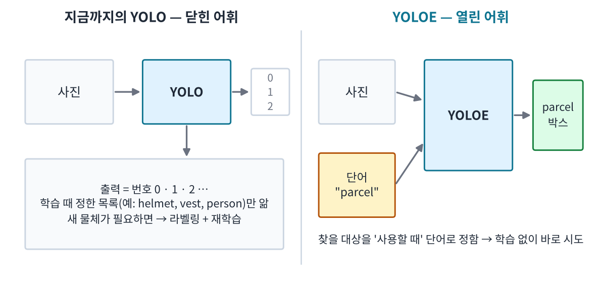
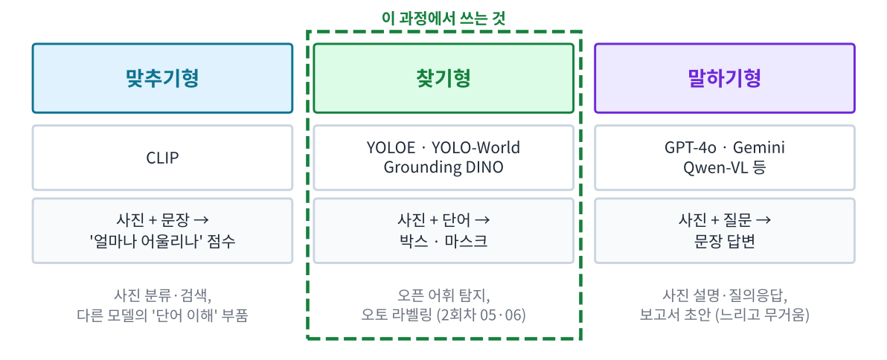
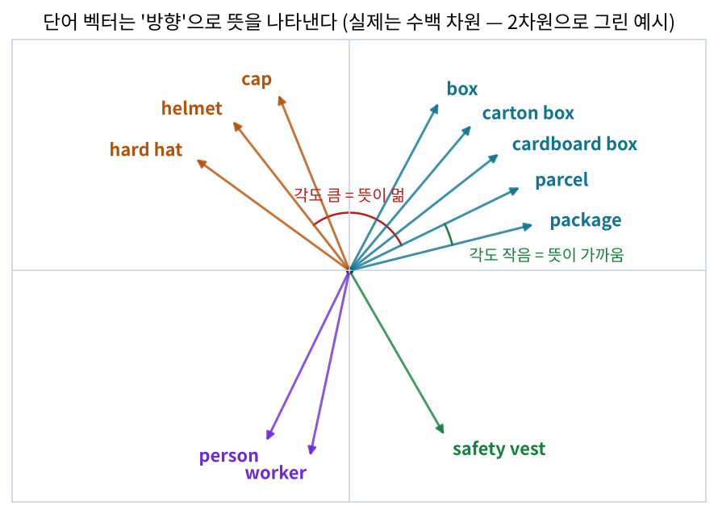
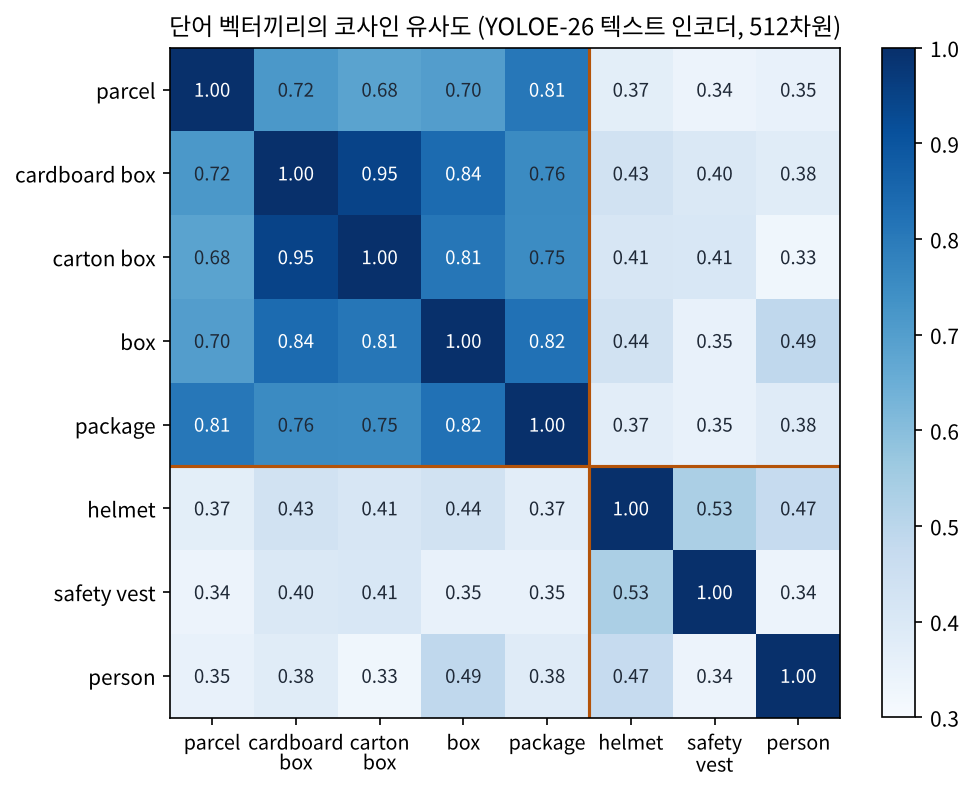
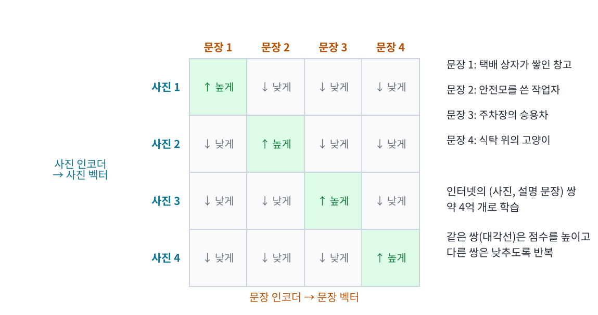
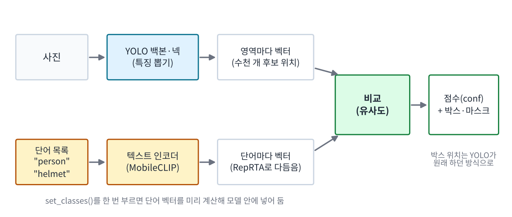
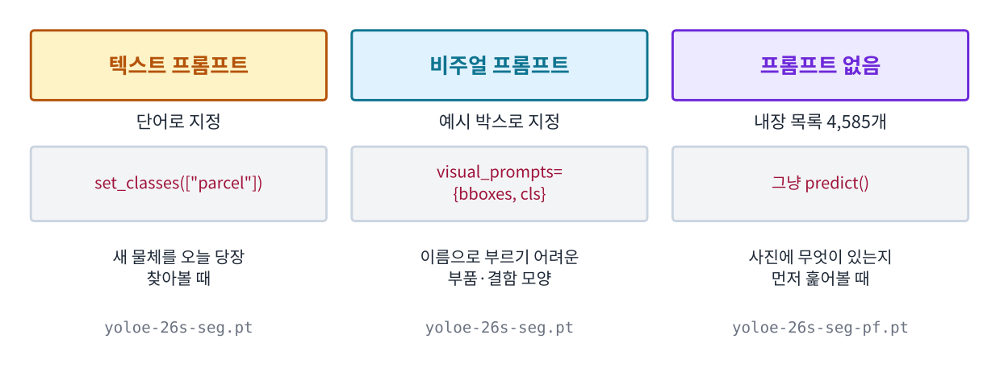
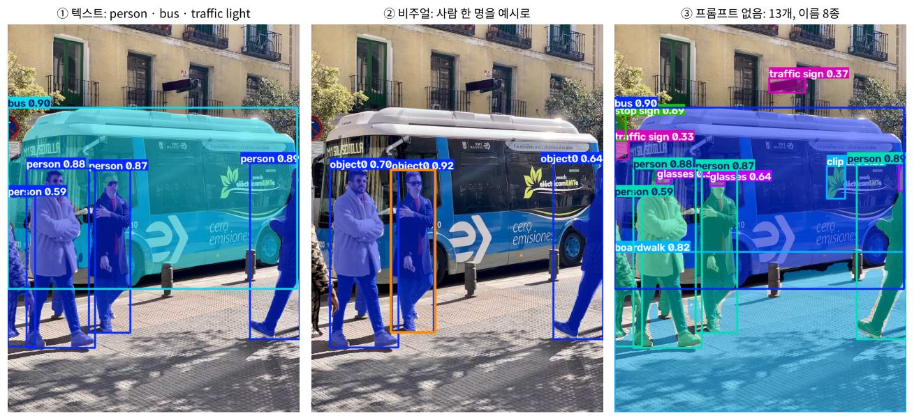

# 말로 찾는 탐지기의 원리 — VLM 입문과 YOLOE

_2회차 05(말로 찾는 탐지기)와 06(오토 라벨링)에서 쓰는 YOLOE가 어떻게 단어를 알아듣는지, 그림과 실습 결과로 차근차근 풀어 봅니다._

## 한눈에 보기

| 궁금한 것 | 핵심 답 | 위치 |
|---|---|---|
| YOLOE는 지금까지 쓴 YOLO와 무엇이 다른가? | 찾을 대상을 학습 때가 아니라 **쓸 때 단어로** 정한다 | 1장 |
| VLM이 뭐고, 어떤 종류가 있나? | 사진과 글을 함께 다루는 모델. 맞추기형·찾기형·말하기형 | 2장 |
| 모델은 단어의 뜻을 어떻게 다루나? | 단어를 **숫자 목록(벡터)** 으로 바꾸고 방향을 비교한다 | 3장 |
| 사진과 단어를 어떻게 비교할 수 있나? | CLIP이 사진·문장을 **같은 공간**의 벡터로 만들도록 배웠다 | 4장 |
| YOLOE 안에서는 무슨 일이 일어나나? | 영역마다 벡터를 만들어 단어 벡터와 비교한다 | 5장 |
| 단어 말고 다른 방법도 있나? | 예시 박스(비주얼 프롬프트), 프롬프트 없이 훑어보기 | 6장 |
| 실습에서 본 낮은 점수·단어별 차이는 왜? | 벡터가 얼마나 닮았는지가 곧 점수이기 때문 | 7장 |
| 좋은 단어는 어떻게 고르나? | 영어 명사구 후보 여러 개 → 검증 데이터로 대결 | 8장 |
| 제로샷·직접 학습·생성형 VLM 중 무엇을? | 속도·정확도·준비 비용으로 고른다 | 9장 |

> **먼저 보면 좋은 자료** conf(신뢰도)·정밀도·재현율·mAP50이 낯설면 [탐지 성능 지표 읽기](01_yolo_metrics_mAP_confusion_v1.0.md)의 1~4장을 먼저 읽으세요. 이 자료의 숫자는 2회차 05·06 실습의 검증 실행 결과입니다.

## 1. 닫힌 어휘에서 열린 어휘로

1회차의 안전장비 모델, 2회차 01의 상자 모델은 모두 **정해진 목록 안에서만** 답합니다. 모델의 마지막 칸이 '0번 helmet일 확률, 1번 vest일 확률, 2번 person일 확률'처럼 **클래스 번호마다 하나씩** 있기 때문입니다. 목록에 없는 물체(예: 소화기)를 찾으려면 사진을 모아 라벨을 달고 다시 학습해야 합니다. 이런 모델을 **닫힌 어휘(closed-vocabulary)** 모델이라고 합니다.

YOLOE는 이 마지막 칸을 바꿨습니다. 번호 대신 **단어를 받아서**, 사진 속 영역이 그 단어와 얼마나 어울리는지를 점수로 냅니다. 그래서 찾을 대상을 **사용하는 순간에** 정할 수 있습니다. 이것이 **열린 어휘(open-vocabulary)** 탐지입니다.



*그림 1. 닫힌 어휘 모델은 학습 때 정한 번호로만 답하고, 열린 어휘 모델은 사용할 때 준 단어로 찾습니다.*

|  | 닫힌 어휘 (지금까지의 YOLO) | 열린 어휘 (YOLOE) |
|---|---|---|
| 찾을 대상 정하기 | 학습 전에 클래스 목록 확정 | 사용할 때 `set_classes([...])`로 지정 |
| 새 물체 추가 | 라벨링 + 재학습 (몇 시간~며칠) | 단어 한 줄 추가 (몇 초) |
| 내 현장 정확도 | 내 데이터로 배워서 높음 | 낯선 장면에서는 낮을 수 있음 |
| 2회차 실습 예 | 01 상자 모델 mAP50 0.910 | 05 YOLOE 'parcel' mAP50 0.639 |

**제로샷(zero-shot)** 은 '이 데이터로 따로 학습하지 않고 바로 쓴다'는 뜻입니다. 05에서 YOLOE는 택배 상자 라벨을 한 장도 보지 않았는데 상자를 찾았습니다. 대신 정확도는 직접 학습한 모델보다 낮았습니다. 이 차이가 왜 생기는지가 이 자료의 나머지 내용입니다.

## 2. VLM — 사진과 글을 함께 다루는 모델

**VLM(Vision-Language Model, 비전-언어 모델)** 은 사진(비전)과 글(언어)을 함께 입력으로 받는 모델을 통틀어 부르는 말입니다. 하는 일에 따라 크게 세 갈래로 나눌 수 있습니다.



*그림 2. VLM의 세 갈래. YOLOE는 '찾기형'이고, 안에 '맞추기형'(CLIP 계열) 부품이 들어 있습니다.*

| 갈래 | 입력 → 출력 | 대표 모델 | 잘하는 것 | 약한 것 |
|---|---|---|---|---|
| 맞추기형 | 사진 + 문장 → 어울림 점수 | CLIP, MobileCLIP | 사진 분류·검색, 다른 모델의 단어 이해 부품 | 위치(어디에?)를 모름 |
| 찾기형 | 사진 + 단어 → 박스·마스크 | YOLOE, YOLO-World, Grounding DINO | 학습 없이 새 물체 찾기, 라벨 초안 | 낯선 장면·전문 용어에서 정확도 하락 |
| 말하기형 | 사진 + 질문 → 문장 | GPT-4o, Gemini, Qwen-VL 등 | 장면 설명, 질의응답, 보고서 문장 | 크고 느려 영상 매 프레임에 쓰기 어려움, 위치가 부정확 |

이 과정에서 직접 쓰는 것은 **찾기형인 YOLOE**입니다. YOLOE는 YOLO의 빠른 탐지 구조에 **맞추기형 모델(MobileCLIP)의 단어 이해 능력**을 붙인 모델입니다. 그래서 YOLOE를 이해하려면 먼저 맞추기형이 단어와 사진을 어떻게 비교하는지 알면 됩니다(3·4장). 말하기형은 9장에서 '언제 쓰면 좋은지'만 짧게 다룹니다.

## 3. 뜻을 숫자로 — 벡터와 유사도

컴퓨터는 'parcel'이라는 글자를 그대로 이해하지 못합니다. 그래서 VLM은 단어를 **숫자 여러 개를 줄 세운 목록**으로 바꿉니다. 이 목록을 **벡터(vector)**, 단어를 벡터로 바꾸는 일을 **임베딩(embedding)** 이라고 합니다.

```
"parcel"  →  [0.019, 0.018, 0.006, 0.036, …]   ← 숫자 512개
"helmet"  →  [0.011, 0.022, -0.015, -0.011, …]
```

숫자 하나하나에 사람이 읽을 수 있는 뜻이 있는 것은 아닙니다. 중요한 것은 **뜻이 비슷한 단어는 비슷한 방향을 가리키도록** 학습되었다는 점입니다. 두 벡터가 얼마나 같은 방향인지는 **코사인 유사도(cosine similarity)** 로 잽니다.

```
코사인 유사도 = 두 벡터 사이 각도의 코사인
            =  1 : 완전히 같은 방향 (같은 뜻)
            =  0 : 직각 (관계없음)
            = -1 : 정반대 방향
```



*그림 3. 개념을 보여 주려고 2차원으로 그린 예시입니다. 실제 벡터는 수백 차원이지만, '비슷한 뜻 = 작은 각도'라는 원리는 같습니다.*

### 실제로 재 보기 — YOLOE가 쓰는 텍스트 인코더로

그림 4는 05 실습의 단어들을 YOLOE에 넣었을 때 실제로 만들어지는 단어 벡터(텍스트 인코더 MobileCLIP2 + 다듬기 RepRTA를 거친 것, 5장)끼리의 코사인 유사도입니다. 아래 10장의 코드로 똑같이 재 볼 수 있습니다.



*그림 4. 실측한 단어 벡터 유사도. 상자 계열 단어끼리(왼쪽 위 칸)는 0.68~0.95로 가깝고, 상자와 안전모·조끼·사람 사이는 0.33~0.49로 멉니다.*

- **뜻이 비슷한 단어는 실제로 가깝습니다.** 'cardboard box'와 'carton box'는 0.95로 거의 같은 방향이고, 05 Step 3의 mAP50도 0.457과 0.425로 비슷했습니다.
- **가깝다고 성능이 같지는 않습니다.** 'parcel'과 'package'는 0.81로 꽤 가깝지만, mAP50은 0.639와 0.332로 두 배 가까이 차이 났습니다. 단어끼리의 거리만으로는 '어느 단어가 **사진 속 상자**와 더 잘 맞는지' 알 수 없습니다. 그래서 단어는 실제 사진으로 시험해서 골라야 합니다(7·8장).
- **다른 물체는 멀리 떨어져 있습니다.** 'box'와 'helmet'은 0.44, 'parcel'과 'person'은 0.35입니다. 이 거리 덕분에 한 모델 안에서 여러 단어를 동시에 구분할 수 있습니다.

## 4. 사진과 글을 같은 공간에 — CLIP

단어끼리 비교할 수 있게 되었으니, 이제 **사진과 단어를 비교**할 차례입니다. 2021년 OpenAI가 발표한 **CLIP(Contrastive Language-Image Pre-training)** 은 사진을 벡터로 바꾸는 **사진 인코더**와 문장을 벡터로 바꾸는 **문장 인코더**를 함께 학습시켜, 둘을 **같은 공간**에 놓았습니다.



*그림 5. CLIP의 학습 방법. 한 묶음의 사진·문장을 모두 짝지어 점수를 매기고, 원래 짝(대각선)은 높게, 나머지는 낮게 만들도록 학습합니다.*

1. 인터넷에서 **사진과 그 사진의 설명 문장** 쌍을 약 4억 개 모읍니다. 사람이 박스를 그리거나 클래스를 정하지 않습니다.
2. 사진 여러 장과 문장 여러 개를 한 묶음으로 넣고, 모든 (사진, 문장) 조합의 유사도를 계산합니다.
3. 원래 짝인 조합은 점수가 높아지고, 짝이 아닌 조합은 낮아지도록 두 인코더를 고칩니다. 이렇게 **맞는 짝 찾기** 시험을 반복하는 학습을 **대조 학습(contrastive learning)** 이라고 합니다.
4. 학습이 끝나면 '안전모 사진'의 벡터와 'a photo of a helmet'의 벡터가 가까운 방향을 가리키게 됩니다.

### 제로샷 분류 — 후보 문장과 비교하기

CLIP으로 사진을 분류할 때는 학습이 필요 없습니다. 후보 문장을 여러 개 만들고, 사진 벡터와 가장 가까운 문장을 고르면 됩니다.

```
안전모 사진의 벡터  vs  "a photo of a helmet"         → 유사도 가장 높음 → 답: helmet
                    vs  "a photo of a safety vest"    → 낮음
                    vs  "a photo of a cardboard box"  → 낮음
```

CLIP 원 논문은 이 방법으로 ImageNet 사진 분류에서, ImageNet 학습 사진 128만 장을 한 장도 쓰지 않고 그 사진으로 직접 학습한 ResNet-50과 비슷한 정확도를 냈다고 보고했습니다.

### CLIP이 배운 것의 그림자 — 알아 두면 실습 결과가 이해되는 한계

| 한계 | 왜 생기나 | 실습에서 보이는 모습 |
|---|---|---|
| 흔한 장면에 강하고 낯선 장면에 약함 | 인터넷 사진은 정면에서 또렷하게 찍은 것이 많다 | 05 Step 1: 공사 현장 사진은 잘 찾고, 위에서 내려다본 붉은 조명의 CCTV 상자는 거의 못 찾음 |
| 단어 선택에 민감함 | 사람에게 같은 물건이라도 인터넷 문장에서 쓰이는 맥락이 단어마다 다르다 | 05 Step 3: 단어만 바꿔 mAP50 0.33 ~ 0.64 |
| 부정·관계 표현에 약함 | '없는', '않은' 같은 말은 설명 문장에 드물고, 학습 목표도 '어울림' 하나뿐이다 | 05 도전 과제 1에서 직접 확인해 볼 수 있음 |
| 영어 위주 | 학습 문장 대부분이 영어 | 한글 단어는 8장 참고 |
| 전문 용어·미세한 차이에 약함 | PCB 결함·주조 불량 같은 사진과 설명은 인터넷에 적다 | 워크숍 T8(PCB 결함) 같은 주제는 직접 학습이 필요 |

## 5. YOLOE 안에서 일어나는 일

CLIP은 **사진 한 장 전체**를 벡터 하나로 만듭니다. 그래서 '이 사진에 안전모가 있다'는 알아도 '어디에' 있는지는 모릅니다. YOLOE는 YOLO가 원래 하던 일, 즉 **사진의 수천 개 후보 위치마다 특징을 뽑는 일**을 그대로 하고, 각 위치의 특징을 **영역 벡터**로 만들어 단어 벡터와 비교합니다.



*그림 6. YOLOE의 흐름. 위쪽은 YOLO가 원래 하던 일, 아래쪽은 CLIP 계열 텍스트 인코더가 하는 일, 둘이 만나는 곳이 '비교'입니다.*

1. **사진 → 영역 벡터:** YOLO 백본(특징을 뽑는 앞부분)과 넥(여러 크기의 특징을 섞는 중간 부분)이 사진의 각 후보 위치마다 벡터를 만듭니다.
2. **단어 → 단어 벡터:** `set_classes(['person', 'helmet'])`를 부르면 텍스트 인코더(YOLOE-26은 MobileCLIP2)가 단어마다 벡터를 만듭니다. 처음 부를 때 인코더 파일(약 254MB)을 내려받아 시간이 걸립니다.
3. **다듬기(RepRTA):** 인터넷 문장으로 배운 단어 벡터를 탐지에 맞게 살짝 고치는 작은 신경망입니다. 이 계산도 `set_classes()` 때 한 번만 합니다.
4. **비교:** 영역 벡터와 단어 벡터의 유사도가 그 영역의 **클래스 점수(conf)** 가 됩니다. 박스 위치·마스크는 YOLO가 원래 하던 방식으로 계산합니다.
5. **정리:** 점수가 기준(`conf`) 이상인 영역만 남기고, 겹치는 박스를 NMS(겹친 박스 중 점수 높은 것만 남기기)로 정리합니다.

> **왜 빠른가** 단어 벡터는 `set_classes()`를 부를 때 한 번만 계산해 모델 안에 넣어 둡니다. 그래서 사진을 처리할 때는 텍스트 인코더를 다시 돌리지 않고, 일반 YOLO처럼 동작합니다. 다만 단어 수가 아주 많아지면 비교할 상대가 늘어 조금씩 느려집니다.

YOLOE는 2025년 칭화대 연구진이 발표한 모델입니다(논문 *YOLOE: Real-Time Seeing Anything*). 논문은 클래스 1,203종짜리 LVIS 데이터셋에서 YOLOE-v8-S가 이전의 오픈 어휘 탐지 모델 YOLO-Worldv2-S보다 AP가 3.5 높으면서, 학습 비용은 3분의 1, 추론 속도는 1.4배라고 보고했습니다. 실습에서 쓰는 `yoloe-26s-seg.pt`는 같은 방식을 Ultralytics의 YOLO26 구조에 적용한 세그멘테이션(마스크) 모델입니다.

## 6. YOLOE의 세 가지 사용법



*그림 7. 같은 YOLOE를 세 가지 방법으로 쓸 수 있습니다. 프롬프트 없음 모드는 이름 끝이 -pf인 별도 가중치를 씁니다.*

| 사용법 | 찾을 대상을 정하는 방법 | 안에서 하는 일 | 알맞은 상황 |
|---|---|---|---|
| 텍스트 프롬프트 | 단어 목록 `set_classes([...])` | 단어 벡터(RepRTA로 다듬음)와 영역 벡터 비교 | 새 물체를 바로 시도, 라벨 초안 (05·06) |
| 비주얼 프롬프트 | 사진 속 예시 박스 몇 개 | 예시 영역의 특징으로 '찾을 대상 벡터'를 만듦 (SAVPE) | 이름으로 부르기 어려운 부품·결함·특정 제품 |
| 프롬프트 없음 | 필요 없음 (내장 단어 4,585개) | 모든 영역을 내장 목록과 비교 (LRPC) | 사진에 무엇이 있는지 먼저 훑어보기 |

### ① 텍스트 프롬프트

```python
# 설치: !pip -q install ultralytics git+https://github.com/ultralytics/CLIP.git
from ultralytics import YOLOE

model = YOLOE('yoloe-26s-seg.pt')                      # 텍스트·비주얼 프롬프트용 가중치
model.set_classes(['person', 'bus', 'traffic light'])  # 찾을 단어 목록 (영어 명사)
r = model.predict('https://ultralytics.com/images/bus.jpg', conf=0.25)[0]
print([r.names[int(c)] for c in r.boxes.cls])          # 찾은 물체 이름들
```

### ② 비주얼 프롬프트 — 예시 박스로 찾기

'이것과 같은 것을 찾아 줘'라고 보여 주는 방법입니다. 예시 박스의 좌표는 `[x1, y1, x2, y2]`(왼쪽 위, 오른쪽 아래 꼭짓점의 픽셀 좌표)이고, `cls`는 예시끼리 묶는 번호(0부터 차례로)입니다. 결과 이름은 `object0`, `object1`…로 나옵니다.

```python
import numpy as np
from ultralytics import YOLOE
from ultralytics.models.yolo.yoloe import YOLOEVPSegPredictor  # 예시 박스용 예측기

model = YOLOE('yoloe-26s-seg.pt')
visual_prompts = dict(
    bboxes=np.array([[221, 405, 344, 857]]),  # 예시로 줄 사람 한 명의 박스 [x1, y1, x2, y2]
    cls=np.array([0]),                        # 예시 묶음 번호 (0부터 차례로)
)
r = model.predict('https://ultralytics.com/images/bus.jpg', visual_prompts=visual_prompts,
                  predictor=YOLOEVPSegPredictor)[0]
print(len(r.boxes), '개 찾음:', [r.names[int(c)] for c in r.boxes.cls])
```

### ③ 프롬프트 없음 — 무엇이 있는지 훑어보기

```python
from ultralytics import YOLOE

model = YOLOE('yoloe-26s-seg-pf.pt')  # 프롬프트 없음 전용 가중치 (-pf)
r = model.predict('https://ultralytics.com/images/bus.jpg', conf=0.25)[0]
print(sorted({r.names[int(c)] for c in r.boxes.cls}))  # 내장 목록에서 고른 이름들
```



*그림 8. 6장의 코드 세 개를 Ultralytics 예제 사진에 그대로 실행한 결과. ②의 주황 테두리가 예시로 준 박스입니다.*

- **① 텍스트:** 'person' 4명과 'bus'를 찾았습니다. 'traffic light'(신호등)는 사진에 보이지 않아 찾지 않았습니다.
- **② 비주얼:** 사람 한 명을 예시로 주자 그 사람을 포함해 3명을 같은 것(`object0`)으로 찾았습니다. 화면 왼쪽 끝에 몸이 반쯤 잘린 사람은 놓쳤습니다.
- **③ 프롬프트 없음:** 내장 목록 4,585개 중에서 8종(boardwalk, bus, clip art, glasses, helmet, person, stop sign, traffic sign)을 골라 13개를 표시했습니다. 'boardwalk'(보도)처럼 그럴듯한 이름도 있지만, 버스 광고 그림을 'clip art'로 부르는 등 엉뚱한 이름도 섞입니다. **목록을 훑어보는 용도**로 쓰고, 실제 탐지는 텍스트 프롬프트로 단어를 정해서 합니다.

## 7. 실습에서 본 결과를 원리로 읽기

### 7-1. 단어 하나로 mAP50이 두 배 가까이 달라진 이유

| 단어 (05 Step 3) | mAP50 | 정밀도 | 재현율 |
|---|---|---|---|
| parcel | 0.639 | 0.501 | 0.811 |
| cardboard box | 0.457 | 0.325 | 0.716 |
| carton box | 0.425 | 0.411 | 0.593 |
| box | 0.359 | 0.473 | 0.491 |
| package (데이터셋의 원래 클래스 이름) | 0.332 | 0.451 | 0.456 |

모델·사진·정답 라벨은 같고 **단어만** 다릅니다. 단어마다 벡터의 방향이 다르니, 같은 상자 영역과의 유사도도 달라지고, 그 결과 점수 순서와 mAP가 달라집니다. 사람에게는 같은 물건이어도, 모델에게는 '인터넷에서 그 단어와 함께 나온 사진들'이 뜻의 전부입니다. 'package'처럼 뜻이 여러 갈래(포장, 소포, 소프트웨어 패키지 등)인 단어는 상자 사진 쪽을 덜 가리킬 수 있습니다. 데이터셋을 만든 사람이 붙인 이름이 모델에게 좋은 단어라는 보장은 없습니다. **단어도 검증 데이터로 고르는 하이퍼파라미터**입니다.

### 7-2. mAP는 0.64인데 점수(conf)는 0.1 안팎인 이유

YOLOE의 conf는 '영역 벡터와 단어 벡터가 얼마나 닮았나'를 0~1로 바꾼 값입니다. 위에서 내려다본 CCTV 상자처럼 학습 때 드물던 장면은 벡터가 덜 닮아서, 정답 상자라도 점수가 0.01~0.1 수준으로 낮게 나옵니다. 그래서 기본 기준 `conf=0.25`로는 아무것도 보이지 않고, 05에서는 `LOW_CONF = 0.003`까지 낮췄습니다.

반면 mAP는 점수의 **크기**가 아니라 **순서**(정답 박스가 헛박스보다 높은 점수를 받는가)로 계산합니다. 점수가 모두 낮아도 정답이 헛박스보다 위에 있으면 mAP는 높게 나옵니다. 그러니 제로샷 모델을 실제로 쓸 때는 **mAP와 별도로, 검증 데이터로 conf 기준을 다시 정해야** 합니다.

### 7-3. 직접 학습한 모델이 여전히 앞서는 이유

05 Step 4에서 01의 학습 모델(yolo26n-seg, 라벨 1,920장)은 mAP50 0.910, YOLOE 제로샷('parcel')은 0.639였습니다. 학습 모델은 **바로 이 CCTV, 이 조명, 이 각도**의 상자만 보고 배웠고, YOLOE는 인터넷 전체의 '상자'를 넓게 배웠기 때문입니다. 또 YOLOE s 모델은 학습한 n 모델보다 커서 사진 한 장 처리 시간도 더 깁니다. 넓게 아는 모델과 좁게 깊이 아는 모델의 차이입니다.

### 7-4. 오토 라벨링에서 조끼가 가장 약했던 이유

| 06 결과 (테스트 mAP50) | 사람 라벨 | 자동 라벨 (YOLOE) | 하이브리드 (58% 검수) |
|---|---|---|---|
| mAP50 | 0.890 | 0.719 | 0.855 |
| 라벨링 시간 (가정값 포함) | 8.52시간 | 0.10시간 | 3.75시간 |

자동 라벨의 클래스별 품질에서 조끼(`safety vest`) F1이 0.517로 가장 낮았습니다. 현장 조끼는 형광 줄무늬, 망사, 색이 다양한 작업복과 섞여 있어 인터넷 사진 속 '안전 조끼'와 모습이 다를 수 있습니다. 그 결과 자동 라벨에 조끼가 많이 빠졌고, 이 라벨로 학습한 모델도 조끼를 놓쳤습니다. 애매한 이미지만 사람이 고친 하이브리드는 시간 44%로 사람 라벨 성능의 96%를 냈습니다. **VLM이 초안을 만들고 사람이 약한 곳을 고치는 것**이 현업에서 가장 흔한 사용 방식입니다.

### 7-5. 탐지 + 규칙으로 현장 질문에 답하기

05 Step 5는 YOLOE로 `person`과 `helmet`을 찾고, '머리 영역에 안전모가 있는가'라는 **규칙**으로 미착용자를 판정했습니다. 테스트 141장에서 재현율 0.92, 정밀도 0.37 — 놓침은 적고 헛경보가 많은 결과였습니다. '안전모를 쓰지 않은 사람'처럼 부정이 들어간 질문은 단어 하나로 묻기보다, **잘 찾는 단어로 탐지하고 판단은 규칙에 맡기는** 편이 원리상 유리합니다. 2회차 전체를 관통하는 '모델이 찾고, 규칙이 판단한다' 구조가 VLM에도 그대로 통합니다.

## 8. 좋은 단어를 고르는 요령

1. **영어 명사구로 쓰기** — YOLOE의 텍스트 인코더는 주로 영어 문장으로 배웠습니다. 한글 단어를 넣어 보면 이 장 끝의 표처럼 어느 영어 단어와도 0.3~0.4 정도로만 닮아, 뜻을 또렷하게 가리키지 못합니다('cardboard box'와 'carton box'는 0.95). '조끼'는 오히려 'safety vest'보다 'helmet'·'person'에 더 가깝습니다. 단어는 영어로 쓰고, 결과 표의 이름만 한글로 바꾸세요.
2. **후보를 여러 개 만들어 대결시키기** — 05 Step 3처럼 단어마다 데이터셋 설정 파일의 이름만 바꿔 `val()`로 mAP를 잽니다. 사진 한두 장으로 고르면 우연에 휘둘립니다.
3. **구체적인 수식어 시도하기** — 'box'(0.359)보다 'cardboard box'(0.457)가 나았습니다. 색·재질·용도를 붙여 봅니다. 예: `'brown cardboard box'`, `'shipping box'`, `'hard hat'`, `'high-visibility vest'`.
4. **동의어를 함께 넣고 나중에 합치기** — `set_classes(['helmet', 'hard hat'])`로 둘 다 찾은 뒤, 결과에서 두 클래스를 같은 것으로 취급합니다.
5. **부정·관계는 규칙으로** — '안전모를 쓰지 않은 사람', '컨베이어 위의 상자'처럼 조건이 붙은 질문은 물체를 찾은 뒤 위치 규칙으로 판정합니다(7-5).
6. **conf 기준은 단어마다 따로** — 같은 모델이라도 단어마다 점수 분포가 다릅니다. 기본값 0.25를 그대로 믿지 말고 검증 데이터로 정합니다.
7. **이름으로 안 되면 예시로** — 단어가 떠오르지 않거나 잘 안 맞는 물체는 비주얼 프롬프트(6장 ②)로 예시 박스를 줍니다.

| 한글 단어 ↓ / 영어 단어 → | helmet | safety vest | box | person |
|---|---|---|---|---|
| 안전모 | 0.37 | 0.32 | 0.32 | 0.39 |
| 조끼 | 0.38 | 0.33 | 0.35 | 0.39 |
| 상자 | 0.28 | 0.31 | 0.35 | 0.27 |

표 — 한글 단어와 영어 단어 벡터의 코사인 유사도 (YOLOE-26 실측). 각 행에서 가장 큰 값이 그 한글 단어가 가장 가깝게 가리키는 영어 단어입니다.

## 9. 언제 무엇을 쓸까

| 상황 | 알맞은 선택 | 이유 |
|---|---|---|
| 새 물체를 오늘 당장 찾아봐야 함, 라벨 없음 | YOLOE 텍스트 프롬프트 | 단어 한 줄로 시작, 학습 0분 |
| 이름으로 부르기 어려운 특정 부품·제품 | YOLOE 비주얼 프롬프트 | 예시 박스 몇 개로 지정 |
| 처음 받은 데이터에 무엇이 찍혔는지 파악 | YOLOE 프롬프트 없음 | 내장 목록으로 훑어보고 클래스 후보 정하기 |
| 라벨링 비용을 줄이고 싶음 | YOLOE 자동 라벨 + 사람 검수 + 직접 학습 | 06: 시간 44%로 성능 96% |
| 정확도가 서비스 품질을 좌우함 (집계·과금·안전 경보) | 내 데이터로 직접 학습한 YOLO | 05: 0.910 vs 0.639 |
| 탐지 결과를 문장 보고서로 정리, 애매한 장면 한 장 다시 확인 | 말하기형 VLM (클라우드 API 등) | 설명·요약은 잘하지만 느려서 영상 매 프레임에는 부적합 |

> **워크숍에 적용하기** 워크숍 주제 데이터에 라벨이 부족하면, 시작 노트북으로 학습하기 전에 YOLOE로 몇 장 찍어 보세요. 잘 찾히는 물체(사람, 안전모, 쓰레기 종류 등)는 06처럼 라벨 초안을 만들 수 있고, 잘 안 찾히는 물체(PCB 결함, 작물 해충의 미세한 차이 등)는 '직접 학습이 필요한 이유'를 리포트에 근거로 남길 수 있습니다.

## 10. 직접 해 보기 — 단어끼리 닮은 정도 재기

Colab에서 아래 셀을 실행하면 그림 4 같은 유사도 표를 직접 만들 수 있습니다. `words`에 내 워크숍 주제의 후보 단어를 넣어 서로 얼마나 닮았는지 확인해 보세요. 서로 너무 닮은 단어를 두 클래스로 나누면 모델이 헷갈리기 쉽다는 신호입니다.

```python
# YOLOE의 텍스트 인코더로 단어끼리 닮은 정도(코사인 유사도) 재기
import pandas as pd
from ultralytics import YOLOE

model = YOLOE('yoloe-26s-seg.pt')
words = ['parcel', 'cardboard box', 'package', 'box', 'helmet', 'safety vest']  # 비교할 단어

emb = model.get_text_pe(words)[0]           # 단어마다 벡터 하나 → (단어 수, 차원 수)
emb = emb / emb.norm(dim=-1, keepdim=True)  # 길이를 1로 맞춤 → 내적 = 코사인 유사도
sim = (emb @ emb.T).cpu().numpy()           # 모든 단어 쌍의 유사도 표
print('벡터 차원 수:', emb.shape[-1])
pd.DataFrame(sim, index=words, columns=words).round(2)
```

## 용어 정리

| 용어 | 뜻 |
|---|---|
| VLM (Vision-Language Model) | 사진과 글을 함께 다루는 모델. 맞추기형(CLIP)·찾기형(YOLOE)·말하기형(GPT-4o 등)으로 나눌 수 있음 |
| 닫힌 어휘 (closed-vocabulary) | 학습 때 정한 클래스 목록 안에서만 답하는 방식. 지금까지의 YOLO |
| 열린 어휘 (open-vocabulary) | 사용할 때 준 단어로 찾을 대상을 정하는 방식. YOLOE, YOLO-World |
| 제로샷 (zero-shot) | 해당 데이터로 추가 학습 없이 바로 쓰는 것 |
| 프롬프트 (prompt) | 모델에게 찾을 대상을 알려 주는 입력. 텍스트(단어)·비주얼(예시 박스) |
| 벡터 (vector) | 숫자 여러 개를 줄 세운 목록. VLM은 단어·사진·영역을 모두 벡터로 바꿈 |
| 임베딩 (embedding) | 단어·사진을 뜻이 담긴 벡터로 바꾸는 일, 또는 그렇게 만든 벡터 |
| 코사인 유사도 | 두 벡터 방향이 얼마나 같은지. 1이면 같은 방향, 0이면 무관 |
| 인코더 (encoder) | 입력을 벡터로 바꾸는 신경망. 사진 인코더·텍스트 인코더 |
| CLIP | 사진·문장 쌍 약 4억 개로 '맞는 짝 찾기'를 학습해, 사진과 문장을 같은 공간의 벡터로 만드는 모델 (OpenAI, 2021) |
| MobileCLIP | CLIP을 작고 빠르게 만든 모델. YOLOE-26은 MobileCLIP2의 텍스트 인코더를 씀 |
| 대조 학습 (contrastive learning) | 맞는 짝은 가깝게, 틀린 짝은 멀게 만드는 학습 방법 |
| 영역 벡터 | 사진의 한 후보 위치에서 뽑은 특징 벡터. 단어 벡터와 비교해 점수를 냄 |
| RepRTA | YOLOE가 단어 벡터를 탐지에 맞게 다듬는 작은 신경망. set_classes() 때 한 번 계산해 모델에 합쳐 넣음 |
| SAVPE | YOLOE가 예시 박스(비주얼 프롬프트)에서 '찾을 대상 벡터'를 만드는 부분 |
| LRPC | YOLOE 프롬프트 없음 모드에서 영역을 내장 단어 목록(4,585개)과 비교하는 방식 |
| 백본·넥 | 탐지 모델에서 특징을 뽑는 앞부분(백본)과 여러 크기의 특징을 섞는 중간 부분(넥) |
| NMS | Non-Maximum Suppression. 같은 물체에 겹친 박스 중 점수가 가장 높은 것만 남기는 정리 단계 |
| 하이퍼파라미터 | 학습으로 정해지지 않고 사람이 골라야 하는 설정값. conf 기준, 프롬프트 단어도 여기에 해당 |

## 출처

- Radford et al., *Learning Transferable Visual Models From Natural Language Supervision* (CLIP), 2021 — arxiv.org/abs/2103.00020
- Wang et al., *YOLOE: Real-Time Seeing Anything*, 2025 — arxiv.org/abs/2503.07465
- Ultralytics 문서 YOLOE — docs.ultralytics.com/models/yoloe
- 실습 수치: 2회차 05·06 노트북 검증 실행 (해설서 05·06, 참고자료 01)
