# YOLO 포트폴리오 — 현업 사례 네 가지 (특강 1회차 핸즈온 가이드)

KDT 심화 · YOLO 기반 부트캠프 · 특강 1회차 · Google Colab 핸즈온 가이드
안전장비 미착용 감지 · 물류 박스 카운팅 · 운동 자세와 낙상 · 주차장과 대기열

2026. 10. 20 · 이정환 · 버전 1.1

## 이 가이드의 구성

이 가이드는 YOLO로 **현장에서 실제로 하는 일 네 가지**를 Google Colab에서 직접 돌려 보고, 그 결과로 **포트폴리오 한 장**을 만드는 과정을 순서대로 안내합니다. 실습 1은 학습부터 포트폴리오까지 끝까지 해 보고, 실습 2~4는 준비된 노트북을 따라 실행하며 결과를 읽습니다.

| **실습** | **현장 사례**                 | **YOLO가 하는 일** | **노트북**                        | **결과물**                            |
|----------|-------------------------------|--------------------|-----------------------------------|---------------------------------------|
| 1        | 건설현장 안전장비 미착용 감지 | 탐지 + 판정 규칙   | yolo_day1_ppe_lab_v1.1 (1~8장)    | portfolio_ppe.zip                     |
| 2        | 물류센터 박스 카운팅          | 분할 + 추적        | yolo_day1_case_demos_v1.1 (0·2장) | package_counts.csv, line_counting.mp4 |
| 3        | 운동 자세 카운터와 낙상 감지  | 포즈               | yolo_day1_case_demos_v1.1 (3장)   | pushup_counter.mp4, fall_rule_log.csv |
| 4        | 주차장 빈자리와 매장 대기열   | 탐지 + 추적 + 영역 | yolo_day1_case_demos_v1.1 (4장)   | parking.mp4, roi_summary.csv          |

## 오늘의 한 문장

> **팁** **모델이 찾고, 규칙이 판단합니다.** YOLO는 “어디에 무엇이 있다”까지 알려 줍니다. “그래서 경고할까, 몇 개라고 할까”는 우리가 붙이는 규칙이 정합니다. 네 실습이 모두 이 구조입니다.

## 표기 방법

| **표시** | **뜻**                                                         |
|----------|----------------------------------------------------------------|
| 실행     | 노트북에서 실행할 셀과 바꿀 값                                 |
| 확인     | 제대로 됐을 때 보이는 결과. 숫자가 다르면 같은 경향인지 봅니다 |
| 질문     | 포트폴리오에 쓸 생각거리. 답을 메모해 두세요                   |
| 팁       | 알아 두면 시간을 아끼는 내용                                   |

가이드의 결과 그림과 숫자는 이 자료를 만들며 노트북을 실제로 실행해 얻은 **예시**입니다. 학습 횟수와 환경에 따라 여러분의 숫자는 달라질 수 있습니다. 학습량에 따라 달라지는 숫자에는 “예시”라고 적었습니다.

## 1. 시작하기

## 1-1. 준비물

- Google 계정과 Chrome 브라우저

- 노트북 파일 두 개: yolo_day1_ppe_lab_v1.1.ipynb, yolo_day1_case_demos_v1.1.ipynb

- 데이터와 예제 영상은 노트북이 실행 중에 자동으로 내려받습니다. 따로 준비할 것은 없습니다.

## 1-2. 노트북 열기

1.  브라우저에서 colab.research.google.com 에 접속합니다.

2.  메뉴 **파일 → 노트북 업로드**를 누르고 yolo_day1_ppe_lab_v1.1.ipynb를 고릅니다.

3.  실습 2~4를 할 때는 같은 방법으로 yolo_day1_case_demos_v1.1.ipynb를 새 탭에 엽니다.

## 1-3. GPU 켜기

> **실행** 메뉴 **런타임 → 런타임 유형 변경 → 하드웨어 가속기: T4 GPU → 저장**을 누릅니다. GPU 없이 학습하면 수십 배 느립니다.

## 1-4. 설치 셀 실행

> **실행** 노트북 1장의 첫 셀을 실행합니다. 1~2분 걸립니다. 셀은 선택한 뒤 **Shift + Enter**로 실행합니다.
>
> > !pip install -q ultralytics shapely lap

> **확인** 다음 셀을 실행하면 버전과 GPU 이름이 나옵니다. GPU: Tesla T4가 보이면 준비 끝입니다. GPU: 없음이 나오면 1-3을 다시 하고 설치 셀부터 다시 실행합니다.

> **팁** 셀은 **위에서 아래로 순서대로** 실행합니다. 중간 셀만 실행하면 앞에서 만든 변수가 없어 오류가 납니다.
>
> Colab은 한동안 쓰지 않으면 연결이 끊기고, 런타임이 초기화되면 설치와 학습 결과가 모두 사라집니다. 결과물은 각 실습 마지막 셀에서 바로 내려받아 두세요.

## 2. 실습 1 · 건설현장 안전장비 미착용 감지

현장 CCTV 사진에서 사람과 헬멧·조끼를 찾고, **장비를 안 쓴 사람이 있으면 경고**하는 시스템을 만듭니다. 마지막에 결과를 모아 포트폴리오 초안을 자동으로 만듭니다.

| **항목** | **내용**                                                                                               |
|----------|--------------------------------------------------------------------------------------------------------|
| 노트북   | yolo_day1_ppe_lab_v1.1.ipynb                                                                           |
| 데이터   | Ultralytics Construction-PPE · 학습 1,132장 / 검증 143장 / 테스트 141장 · 11클래스 · 라이선스 AGPL-3.0 |
| 모델     | YOLO26n (사전학습 가중치에서 출발하는 전이학습)                                                        |
| 결과물   | portfolio_ppe.zip (포트폴리오 초안, 결과 이미지 3장, CSV 2개, best.pt)                                 |

## 2-1. 데이터 살펴보기 · 노트북 2장

> **실행** 2장 첫 셀을 실행합니다. 약 178MB를 내려받으며 1분 안팎 걸립니다.

> **확인** 클래스 11개 목록과 함께 train 이미지 1132장, val 이미지 143장, test 이미지 141장이 출력됩니다.

클래스 11개의 뜻은 다음과 같습니다.

| **클래스**          | **뜻**                                      | **학습 박스 수** |
|---------------------|---------------------------------------------|------------------|
| Person              | 사람                                        | 1,790            |
| helmet / no_helmet  | 헬멧 착용 / 미착용                          | 1,357 / 400      |
| vest                | 조끼 착용 (미착용 클래스는 없음)            | 1,283            |
| boots / no_boots    | 안전화 착용 / 미착용                        | 1,251 / 88       |
| gloves / no_gloves  | 장갑 착용 / 미착용                          | 1,162 / 442      |
| goggles / no_goggle | 보안경 착용 / 미착용                        | 427 / 337        |
| none                | 공식 문서에 정의가 없음 (2-2에서 직접 확인) | 654              |

> **확인** 막대그래프에서 Person(1,790개)이 가장 많고 no_boots(88개)가 가장 적습니다. 20배가 넘는 차이입니다. 2장 마지막 셀은 클래스별 크기를 보여 주는데, 사람은 사진 한 변의 약 47%, 보안경 미착용은 약 7%로 작습니다.

> **질문** 헬멧은 착용·미착용 클래스가 둘 다 있는데 조끼는 착용(vest)만 있습니다. 조끼를 안 입은 사람은 어떻게 찾을 수 있을까요? (답은 2-5에서)

## 2-2. 라벨 직접 열어 보기 · 노트북 3장

공식 문서는 none을 “일반적인 none 클래스”라고만 적고 정의를 주지 않습니다. 3장 셀을 실행해 none 라벨이 붙은 사진 세 장을 직접 봅니다.

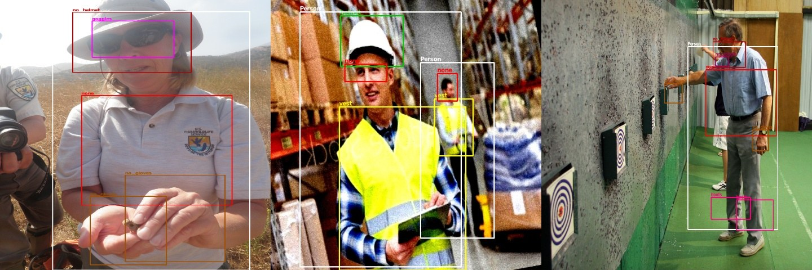

*라벨을 그려 본 예시: 빨간 none 박스가 조끼 없는 상체에도, 얼굴에도 붙어 있습니다*

라벨을 그려 본 예시: 빨간 none 박스가 조끼 없는 상체에도, 얼굴에도 붙어 있습니다

> **질문** 같은 이름의 라벨이 사진마다 다른 곳에 붙어 있으면, 모델은 none을 무엇으로 배울까요? 내가 이 데이터를 쓴다면 none을 어떻게 해석할지 한 문장으로 적어 두세요. 포트폴리오의 “데이터” 칸에 그대로 들어갑니다.

> **팁** 현업에서는 이런 혼선을 막으려고 라벨링 전에 **라벨 기준서**를 씁니다. 클래스마다 “무엇을, 어디까지, 애매하면 어떻게” 그릴지를 한 줄씩 정한 문서입니다.

## 2-3. 학습 · 노트북 4장

> **실행** 4장 셀의 값을 확인하고 실행합니다. T4 GPU에서 약 6~10분 걸리는 것으로 예상합니다.
>
> > EPOCHS = 30 \# 시간이 남으면 50
> >
> > IMGSZ = 640
> >
> > model = YOLO("yolo26n.pt")
> >
> > model.train(data="construction-ppe.yaml", epochs=EPOCHS, patience=10,
> >
> > imgsz=IMGSZ, batch=16, seed=0, project="runs_ppe", name="baseline")

> **확인** 에포크마다 진행 막대와 손실(box_loss, cls_loss, l1_loss), mAP가 찍힙니다. 끝나면 다음 셀의 학습 곡선(results.png)에서 손실이 내려가고 mAP가 올라가는지 봅니다.

> **팁** 학습 중에는 브라우저 탭을 닫지 마세요. 다른 탭에서 2-4의 설명을 미리 읽어 두면 좋습니다.
>
> GPU를 쓸 수 없는 상황이면 EPOCHS = 3, IMGSZ = 320으로 줄입니다. 결과 숫자는 낮아지지만 이후 단계는 모두 따라 할 수 있습니다.

## 2-4. 결과 읽기 · 노트북 5장

| **지표**           | **뜻**                                                                                           |
|--------------------|--------------------------------------------------------------------------------------------------|
| mAP50              | 예측 박스가 정답과 절반 이상 겹치면(IoU 0.5 이상) 맞은 것으로 치고 매긴 점수. 0~1, 높을수록 좋음 |
| mAP50-95           | 겹침 기준을 0.50에서 0.95까지 점점 엄격하게 올려 가며 매긴 점수의 평균. 항상 mAP50보다 낮음      |
| 클래스별 AP        | 위 점수를 클래스마다 따로 본 것. mAP는 이 값들의 평균                                            |
| precision / recall | 찾았다고 한 것 중 맞은 비율 / 실제 정답 중 찾아낸 비율                                           |

> **실행** 5장 첫 셀은 클래스별 성능표를 점수 낮은 순으로 보여 주고 metrics_by_class.csv로 저장합니다. 두 번째 셀은 “학습 박스 수 대 AP” 산점도를 그립니다.

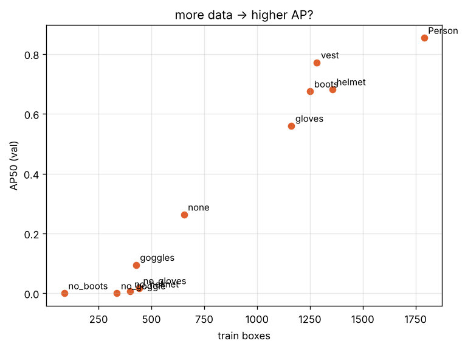

*예시: 짧은 학습(2에폭, 320px) 결과. 학습 데이터가 적은 클래스일수록 AP가 낮습니다*

예시: 짧은 학습(2에폭, 320px) 결과. 학습 데이터가 적은 클래스일수록 AP가 낮습니다

> **팁** precision 1.000 · recall 0.000인 클래스는 잘 맞힌 것이 아니라 **그 클래스를 하나도 예측하지 않았다**는 뜻입니다. 학습을 더 하거나 데이터를 늘리면 바뀝니다.

> **질문** ① AP가 가장 낮은 클래스 세 개는 무엇인가요? 2-1의 박스 수·크기와 관련이 있나요?
>
> ② 현장에서 가장 놓치면 안 되는 것은 헬멧 미착용자입니다. no_helmet의 recall은 얼마인가요?

## 2-5. 판정 로직 · 노트북 6장

모델의 출력은 “여기 사람, 저기 헬멧”이라는 박스 목록일 뿐입니다. **“이 사람은 헬멧을 안 썼다”**는 판정은 규칙으로 붙입니다. 두 방법을 비교합니다.

| **방법** | **규칙**                                                                                                | **장점**                                                        | **약점**                        |
|----------|---------------------------------------------------------------------------------------------------------|-----------------------------------------------------------------|---------------------------------|
| A        | no_helmet 박스가 보이면 경고                                                                            | 간단함                                                          | no_helmet 학습 데이터가 400개뿐 |
| B        | 사람 박스의 위쪽 1/3 안에 헬멧 박스 중심이 없으면 경고. 조끼는 사람 박스 안에 조끼 중심이 있는지로 판정 | 데이터가 많은 클래스를 조합. 미착용 클래스가 없는 조끼에도 적용 | 사람이 겹쳐 서 있으면 헷갈림    |

> **실행** 6장 첫 셀은 검증 사진 전체에 두 방법을 적용하고, 사람마다 helmet · vest · alert를 적은 violation_report.csv를 저장합니다. 두 번째 셀은 경고가 난 사진 한 장을 그려 alert_example.jpg로 저장합니다.

> **확인** 검증 사진 143장 · 감지된 사람 ○명, 방법 B: 헬멧 없음 ○명 · 조끼 없음 ○명, 방법 A: no_helmet 박스가 있는 사진 ○장 형태로 출력됩니다. 예시(2에폭 학습)에서는 방법 A가 no_helmet을 하나도 찾지 못해 0장이었고, 방법 B는 이미 판정을 내렸습니다.

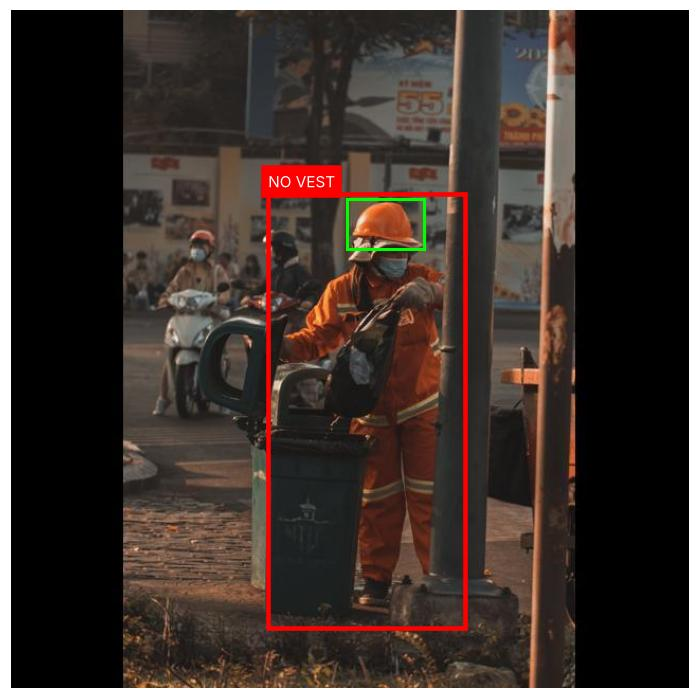

*예시: 헬멧(초록)은 찾았지만 조끼가 없다고 판정해 빨간 경고가 난 사람*

예시: 헬멧(초록)은 찾았지만 조끼가 없다고 판정해 빨간 경고가 난 사람

> **질문** 위 사진의 사람은 반사띠가 달린 주황색 작업복을 입고 있습니다. 이것을 조끼로 봐야 할까요? 모델의 실수일까요, 라벨 기준의 문제일까요?
>
> 현장에 설치한다면 방법 A와 B 중 무엇을 쓰고, 그 이유는 무엇인가요? **한 문장으로** 써 두세요. 포트폴리오의 “설계 판단” 칸입니다.

## 2-6. 실패 사례 보기 · 노트북 7장

> **실행** 7장 첫 셀은 사진마다 TP(맞춤) · FP(헛탐지) · FN(놓침)을 세어 오류가 많은 순으로 보여 줍니다. 두 번째 셀은 오류가 가장 많은 두 장을 failure_cases.jpg로 저장합니다.

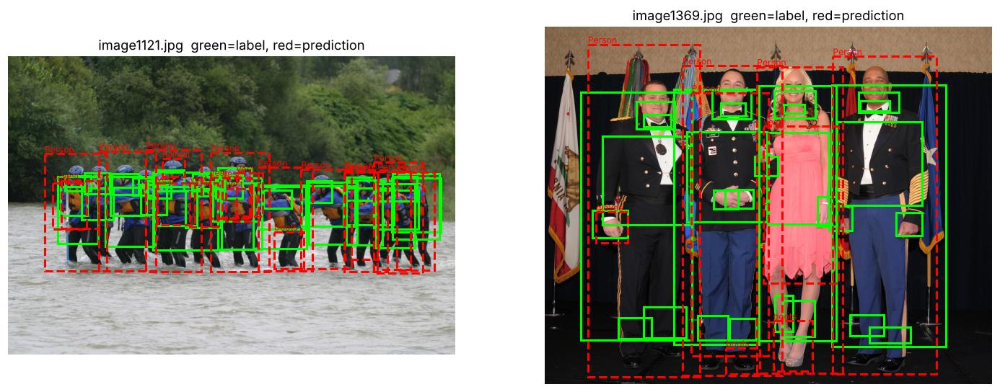

*예시: 초록은 정답, 빨간 점선은 예측. 초록만 있으면 놓친 것, 빨강만 있으면 없는 것을 찾은 것*

예시: 초록은 정답, 빨간 점선은 예측. 초록만 있으면 놓친 것, 빨강만 있으면 없는 것을 찾은 것

틀린 원인을 세 갈래로 나눠 보세요.

| **원인**        | **예**                                 | **다음 행동**                             |
|-----------------|----------------------------------------|-------------------------------------------|
| 작아서          | 멀리 있는 사람의 장갑·보안경           | 해상도를 올리거나 가까운 사진을 더 모은다 |
| 비슷해서        | 모자를 헬멧으로, 밝은 옷을 조끼로      | 헷갈리는 사진을 일부러 더 넣는다          |
| 라벨이 이상해서 | 정답이 빠졌거나 none처럼 기준이 흔들림 | 라벨 기준서를 정하고 다시 단다            |

## 2-7. 포트폴리오 한 장 만들기 · 노트북 8장

> **실행** 8장 세 셀을 차례로 실행합니다. 예측 결과 4장을 모은 sample_predictions.jpg, 지금까지의 숫자로 채운 portfolio_ppe.md, 결과물 전체를 묶은 portfolio_ppe.zip이 만들어지고 zip이 자동으로 내려받아집니다.

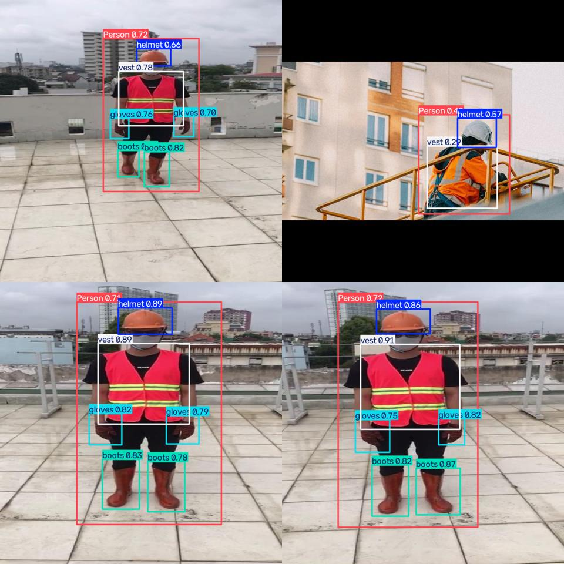

*예시: sample_predictions.jpg*

예시: sample_predictions.jpg

> **확인** zip 안에 alert_example.jpg, ap_vs_data.png, best.pt, failure_cases.jpg, metrics_by_class.csv, portfolio_ppe.md, sample_predictions.jpg, violation_report.csv 8개 파일이 있습니다.

> **질문** portfolio_ppe.md를 열면 밑줄 칸이 세 곳 있습니다. 2-2(none 해석), 2-5(A/B 선택 이유), 2-6(실패 원인)에서 메모한 내용으로 채우면 포트폴리오 초안이 완성됩니다.

## 3. 실습 2 · 물류센터 박스 카운팅

입고된 박스가 몇 개인지, 컨베이어로 몇 개가 지나갔는지 자동으로 셉니다. 박스는 서로 붙어 쌓이기 때문에 사각형 대신 **윤곽선(분할)**으로 찾고, 영상에서는 **추적 번호**로 중복 없이 셉니다.

| **항목** | **내용**                                                                           |
|----------|------------------------------------------------------------------------------------|
| 노트북   | yolo_day1_case_demos_v1.1.ipynb · 0장(준비), 2장                                   |
| 데이터   | Ultralytics Package-seg · 학습 1,920장 / 검증 188장 / 테스트 89장 · 클래스 package |
| 모델     | YOLO26n-seg (분할 모델)                                                            |

## 3-0. 준비 · 노트북 0장

> **실행** 0장의 설치 셀과 예제 영상 내려받기 셀, 공통 함수 셀을 차례로 실행합니다. 런타임 유형이 T4 GPU인지 먼저 확인하세요.

> **확인** 예제 영상 세 개의 정보가 출력됩니다: 보행자 영상 62프레임, 팔굽혀펴기 영상 60프레임, 주차장 영상 82프레임 (모두 640×360, 30fps).

## 3-1. 학습 · 노트북 2-1

> **실행** EPOCHS_PKG = 10, IMGSZ_PKG = 640으로 학습합니다. T4에서 약 5~8분으로 예상합니다.

> **확인** 학습이 끝나면 박스(bbox) mAP50 ○ · 마스크(mask) mAP50 ○ 두 숫자가 나옵니다. 박스는 사각형 기준, 마스크는 윤곽선 기준 점수입니다.

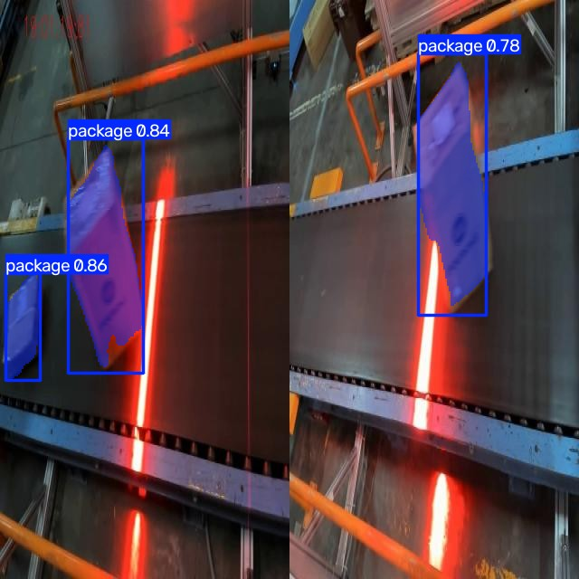

*예시: 컨베이어 위 박스를 윤곽선으로 칠한 분할 결과*

예시: 컨베이어 위 박스를 윤곽선으로 칠한 분할 결과

## 3-2. 사진 한 장의 박스 수 · 노트북 2-2

> **실행** 2-2의 셀들을 차례로 실행합니다. 테스트 사진 89장마다 정답 개수와 예측 개수를 비교해 package_counts.csv로 저장하고, 잘 맞은 사진과 크게 틀린 사진을 나란히 보여 줍니다.

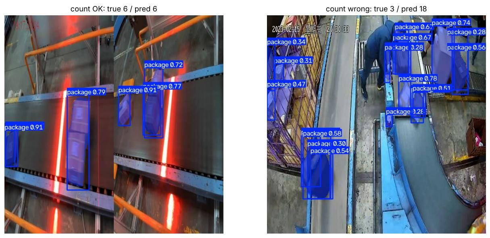

*예시: 왼쪽은 개수가 맞은 사진, 오른쪽은 정답 3개에 예측 18개로 크게 틀린 사진*

예시: 왼쪽은 개수가 맞은 사진, 오른쪽은 정답 3개에 예측 18개로 크게 틀린 사진

> **확인** 다음 셀은 틀린 사진의 정답 윤곽을 초록색으로 그립니다. 정답은 **컨베이어 위의 박스에만** 붙어 있고, 사람이 들고 있는 박스나 카트 안의 박스에는 없습니다. 모델이 틀렸다기보다 **무엇을 셀지 정하지 않은 것**이 원인입니다.

다음 셀은 확신도 기준(conf)을 바꿔 가며 개수 오차를 비교해 package_conf_sweep.csv로 저장합니다. 아래는 짧은 학습(1에폭, 320px) 예시입니다.

| **conf** | **평균 오차** | **개수가 정확히 맞은 사진** |
|----------|---------------|-----------------------------|
| 0.25     | 4.25개        | 12%                         |
| 0.40     | 2.16개        | 17%                         |
| 0.50     | 1.48개        | 33%                         |
| 0.60     | 1.01개        | 36%                         |

> **질문** 여러분 결과에서 오차가 가장 작은 기준값은 무엇인가요? 물류 현장에서는 박스를 **덜 세는 것**과 **더 세는 것** 중 어느 쪽이 더 곤란할까요? 그 답이 기준값을 고르는 근거, 곧 설계 판단입니다.

## 3-3. 영상에서 선을 넘을 때 한 번만 세기 · 노트북 2-3

영상은 1초에 30장이라 매 프레임 개수를 더하면 같은 박스를 여러 번 셉니다. **추적**으로 물체마다 번호를 붙이고, 그 번호가 선을 넘을 때 한 번만 셉니다. 공개된 박스 영상이 없어 보행자 영상으로 원리를 확인합니다.

> **실행** 2-3 셀을 실행합니다. 화면 가운데 가로선을 넘는 사람을 세고 결과 영상 line_counting.mp4를 저장합니다.

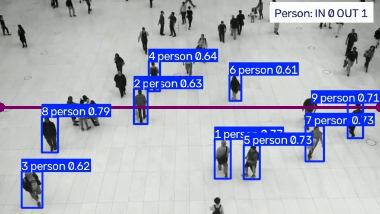

*예시: 사람마다 추적 번호가 붙고, 보라색 선을 넘은 수가 오른쪽 위에 표시됩니다*

예시: 사람마다 추적 번호가 붙고, 보라색 선을 넘은 수가 오른쪽 위에 표시됩니다

> **확인** 예시 출력: 선을 넘은 수 — IN 0 · OUT 1 · 추적한 사람 9명 (62프레임). 영상이 2초로 짧아 숫자가 작습니다.

> **팁** 박스 영상으로 바꾸려면 model=을 3-1에서 학습한 박스 분할 모델로, classes=\[0\](package)으로 바꾸고 VIDEO_CROWD 경로만 내 영상으로 바꾸면 같은 코드가 동작합니다. 휴대폰으로 박스가 지나가는 짧은 영상을 찍어 보세요.

## 4. 실습 3 · 운동 자세 카운터와 낙상 감지

포즈 모델은 사람마다 **관절 점 17개**(코·눈·귀·어깨·팔꿈치·손목·엉덩이·무릎·발목)의 좌표를 줍니다. 학습 없이 사전학습 모델 yolo26n-pose.pt를 그대로 쓰고, 좌표에 규칙을 붙입니다.

## 4-1. 관절 점 보기 · 노트북 3-1

> **실행** 3-1 셀을 실행하면 팔굽혀펴기 영상 첫 프레임의 관절 17개 좌표가 표로 나오고, 관절을 이은 그림이 그려집니다.

## 4-2. 운동 횟수 세기 · 노트북 3-2

어깨(6번)–팔꿈치(8번)–손목(10번) 세 점의 각도가 **145° 위로 펴졌다가 100° 아래로 굽혀지면 1회**로 셉니다. Ultralytics의 AIGym 기능을 씁니다.

> **실행** 3-2 셀을 실행합니다. 결과 영상 pushup_counter.mp4와 프레임별 팔꿈치 각도 그래프가 나옵니다.

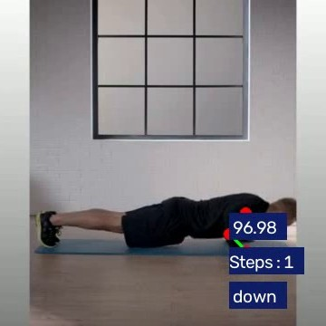

*예시: 관절 각도와 단계(down), 횟수가 화면에 표시됩니다*

예시: 관절 각도와 단계(down), 횟수가 화면에 표시됩니다

> **확인** 2초짜리 영상에서 팔굽혀펴기 횟수 1이 나옵니다. 각도 그래프에서 내려갔다 올라오는 골이 한 번 보입니다.

> **팁** kpts=\[11, 13, 15\](엉덩이–무릎–발목)로 바꾸면 스쿼트를 셀 수 있습니다. 팔꿈치 각도가 잘 보이도록 카메라를 사람 옆에 두는 것도 설계의 일부입니다.

## 4-3. 낙상 감지 · 노트북 3-3

간단한 규칙부터 만들어 팔굽혀펴기 영상에 걸어 봅니다.

| **규칙** | **내용**                                                        | **팔굽혀펴기 60프레임 결과**       |
|----------|-----------------------------------------------------------------|------------------------------------|
| 규칙 1   | 어깨–엉덩이 선이 수평에서 30° 미만이면(누워 있으면) 낙상        | 60프레임 모두 낙상으로 판정 (오탐) |
| 규칙 2   | 규칙 1 + 0.5초 안에 엉덩이가 화면 높이의 15% 이상 갑자기 내려감 | 0프레임 (오탐 사라짐)              |

> **확인** 규칙 1 … 60/60, 규칙 2 … 0/60이 출력되고 프레임별 기록이 fall_rule_log.csv로 저장됩니다. 팔굽혀펴기 자세의 몸통 각도는 약 12~13°라 규칙 1에 모두 걸립니다.

> **질문** 이 예제 영상에는 실제 낙상 장면이 없습니다. 규칙 2가 진짜 낙상을 잘 잡는지 확인하려면 무엇이 더 필요할까요? “넘어진 뒤 일어나지 못함” 같은 조건을 더한다면 어떻게 코드로 쓸 수 있을까요?

## 5. 실습 4 · 주차장 빈자리와 매장 대기열

사전학습 모델에 **영역**만 그려 주면 학습 없이 현장 숫자가 나옵니다. 이 사례의 핵심은 “어떤 모델을 고르고 영역을 어떻게 정했는가”입니다.

## 5-1. 주차장 빈자리 · 노트북 4-1

주차면 13개를 꼭짓점 4개씩으로 정의한 JSON 파일과, 드론 시점 데이터(VisDrone, 10클래스)로 학습된 탐지 모델을 씁니다. 주차면 안에 차가 있으면 찬 자리로 봅니다.

> **실행** 4-1 셀들을 실행합니다. 결과 영상 parking.mp4와 프레임별 빈자리 그래프가 나옵니다.

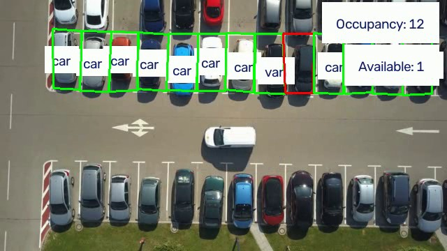

*예시: 초록 주차면은 차가 있는 자리, 오른쪽 위에 점유 수와 빈자리 수가 표시됩니다*

예시: 초록 주차면은 차가 있는 자리, 오른쪽 위에 점유 수와 빈자리 수가 표시됩니다

> **확인** 예시: 첫 프레임 찬 자리 10 · 빈자리 3, 마지막 프레임 찬 자리 13 · 빈자리 0 (총 13면). 3초가 안 되는 영상이라 숫자 변화에 탐지 흔들림이 섞여 있을 수 있습니다.

> **실행** 다음 셀은 같은 첫 프레임에 COCO로 학습된 일반 모델(yolo26n.pt)과 드론 시점 모델을 각각 돌려 찾은 차량 수를 비교합니다.

> **확인** 예시: COCO 일반 모델 0대 · 드론 시점 모델 44대. 위에서 내려다본 차는 일반 사진 속 차와 모양이 달라서, **카메라 시점에 맞는 데이터로 학습된 모델**이 필요합니다.

## 5-2. 매장 대기열 · 노트북 4-2

> **실행** 4-2 셀을 실행합니다. 화면 가운데를 계산대 앞 영역으로 정하고, 그 안의 사람 수를 프레임마다 셉니다. 결과 영상은 queue.mp4입니다.

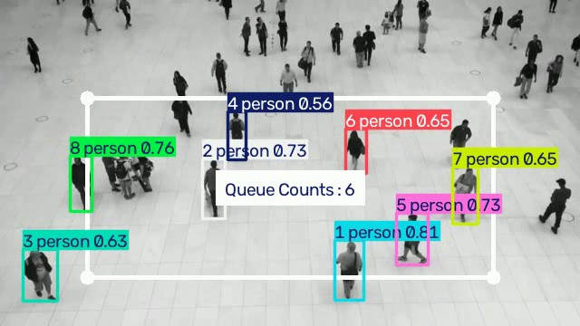

*예시: 흰 사각형이 대기 영역, 가운데에 영역 안 인원(Queue Counts)이 표시됩니다*

예시: 흰 사각형이 대기 영역, 가운데에 영역 안 인원(Queue Counts)이 표시됩니다

> **확인** 예시: 영역 안 인원 — 평균 4.5명 · 최대 6명. 다음 셀이 주차장과 대기열 요약을 roi_summary.csv로 저장합니다(열 이름은 영문이라 Excel에서 깨지지 않습니다).

## 5-3. 결과물 내려받기

> **실행** 노트북 마지막 셀을 실행하면 실습 2~4의 결과물이 demo_outputs.zip으로 묶여 내려받아집니다.

> **확인** zip 안에 fall_rule_log.csv, line_counting.mp4, package_conf_sweep.csv, package_count_examples.jpg, package_counts.csv, parking.mp4, pushup_counter.mp4, queue.mp4, roi_summary.csv가 있습니다.

## 6. 문제가 생겼을 때

| **증상**                             | **원인**                   | **해결**                                                         |
|--------------------------------------|----------------------------|------------------------------------------------------------------|
| GPU: 없음이 나옴                     | 런타임 유형이 CPU          | 런타임 → 런타임 유형 변경 → T4 GPU 후 설치 셀부터 다시 실행      |
| No module named 'shapely' 또는 'lap' | 설치 셀을 건너뜀           | 설치 셀(!pip install -q ultralytics shapely lap)을 다시 실행     |
| NameError: name … is not defined     | 앞 셀을 실행하지 않음      | 위에서부터 순서대로 다시 실행                                    |
| CUDA out of memory                   | GPU 메모리 부족            | 학습 셀의 batch=16을 batch=8로 줄임                              |
| 데이터 내려받기가 멈춤               | 일시적인 네트워크 문제     | 셀을 중지(■)하고 다시 실행                                       |
| “GPU 사용량 한도” 안내               | Colab 무료 사용량 초과     | 잠시 후 다시 시도하거나 EPOCHS와 IMGSZ를 줄여 CPU로 진행         |
| 갑자기 연결이 끊기고 결과가 사라짐   | 런타임 초기화              | 처음부터 다시 실행. 결과물은 각 실습 마지막 셀에서 바로 내려받기 |
| zip이 자동으로 내려받아지지 않음     | 브라우저가 다운로드를 막음 | 왼쪽 폴더 아이콘 → 파일에서 오른쪽 클릭 → 다운로드               |

## 7. 포트폴리오 정리

포트폴리오 한 장은 아래 여섯 칸이면 충분합니다. 특히 **설계 판단**과 **한계와 개선** 칸이 다른 지원자와 차이를 만듭니다. 같은 데이터, 같은 모델이면 누구나 비슷한 mAP가 나오기 때문입니다.

| **칸**        | **쓸 내용**                             | **실습 1에서 가져올 것**                                    |
|---------------|-----------------------------------------|-------------------------------------------------------------|
| 1 문제        | 누가, 무엇 때문에 곤란한가              | 관리자가 CCTV로 미착용자를 놓친다                           |
| 2 데이터      | 출처, 라이선스, 규모, 불균형, 라벨 문제 | Construction-PPE, AGPL-3.0, 1,416장, 불균형 20배, none 해석 |
| 3 모델        | 무엇을 어떻게 학습했나                  | YOLO26n 전이학습, 에포크, 이미지 크기                       |
| 4 결과        | 숫자와 그림                             | mAP50, 약한 클래스 3개, sample_predictions.jpg              |
| 5 설계 판단   | 규칙을 왜 이렇게 정했나                 | 방법 A/B 중 선택과 그 이유                                  |
| 6 한계와 개선 | 어디서 틀리고 다음엔 무엇을             | failure_cases.jpg, 원인 세 갈래 중 무엇                     |

## 실습 2~4로 포트폴리오를 만든다면

| **사례**    | **핵심 문장**                                         | **내 데이터로 확장**                       |
|-------------|-------------------------------------------------------|--------------------------------------------|
| 박스 카운팅 | 셀 범위를 영역으로 정하고, 추적 번호로 중복 없이 셌다 | 직접 찍은 택배 영상으로 집계               |
| 운동·낙상   | 단순 규칙의 오탐을 찾아 시간 조건으로 줄였다          | 스쿼트·재활 동작으로 바꾸기                |
| 주차·대기열 | 카메라 시점에 맞는 모델과 영역 설계로 숫자를 냈다     | 학원·학교 주차장 사진으로 영역 직접 정하기 |

## 제출 전 점검

> □ 문제를 “YOLO로 헬멧 탐지”가 아니라 “누가 무엇 때문에 곤란한가”로 썼다
>
> □ 데이터 출처와 라이선스를 적었다
>
> □ mAP 하나가 아니라 약한 클래스와 그 이유를 적었다
>
> □ 규칙(기준값)을 두 가지 이상 비교해서 골랐다고 쓸 수 있다
>
> □ 실패 사례 사진 한 장과 원인 한 줄이 있다
>
> □ 결과 이미지에 데이터 출처를 적었다 (공개 데이터 이미지를 쓸 때)

## 부록 · 용어

| **용어**       | **뜻**                                                                       |
|----------------|------------------------------------------------------------------------------|
| 탐지 (detect)  | 사진 속 물체를 사각형 박스와 이름, 확신도로 알려 주는 일                     |
| 분할 (segment) | 사각형 대신 물체 윤곽을 픽셀 단위로 칠하는 일. 붙어 있는 물체를 가를 때 유리 |
| 포즈 (pose)    | 사람의 관절 점 17개 좌표를 찾는 일                                           |
| 추적 (track)   | 영상에서 같은 물체에 프레임이 바뀌어도 같은 번호를 붙이는 일                 |
| 확신도 (conf)  | 모델이 그 예측을 얼마나 확신하는지 0~1. 기준값보다 낮은 예측은 버림          |
| IoU            | 두 박스가 겹친 넓이 ÷ 합친 넓이. 예측과 정답이 얼마나 겹치는지 재는 값       |
| 영역 (ROI)     | 화면에서 관심 있는 구역. 그 안의 물체만 세거나 판정할 때 씀                  |
| 전이학습       | 이미 많은 사진으로 학습된 모델에서 출발해 내 데이터만 추가로 가르치는 방법   |
| 에포크 (epoch) | 학습 데이터 전체를 한 번 다 보는 단위                                        |
| 라벨 기준서    | 클래스마다 무엇을, 어디까지, 애매하면 어떻게 라벨할지 정한 문서              |

데이터와 예제 영상 출처: Ultralytics Construction-PPE, Package-seg 데이터셋과 Ultralytics 공개 예제 영상(AGPL-3.0). 가이드의 결과 그림은 이 자료를 만들며 노트북을 실행해 얻은 화면입니다.
