# YOLO 2회차 실습 A — 컨베이어 상자 '크기별' 자동 집계

노트북: [`01_yolo_day2_box_lab_v1.2.ipynb`](../01_yolo_day2_box_lab_v1.2.ipynb) · [Colab에서 열기](https://colab.research.google.com/github/jhjwlee/yolo-training/blob/main/day2/01_yolo_day2_box_lab_v1.2.ipynb)

| 항목 | 내용 |
|---|---|
| 실행 환경 | Google Colab, 런타임 유형 T4 GPU (메뉴 → 런타임 → 런타임 유형 변경). 결과는 Google Drive MyDrive/yolo_day2 폴더에 저장 |
| 예상 소요 시간 | 약 1시간 30분 (T4 GPU 기준, 학습 15~20분 포함) |
| 사용 데이터 | Ultralytics 공개 Package Segmentation 데이터셋 (택배 분류장 CCTV 이미지, 클래스 1개 package, 학습 1,920장 · 검증 188장 · 테스트 89장, 약 100MB) |
| 주요 결과 파일 | box_seg_best.pt, conveyor_clip.mp4, box_count_log.csv, size_rules.json, box_size_log.csv, size_counting.mp4, size_summary.png, experiments.csv (모두 MyDrive/yolo_day2에 저장. box_seg_best.pt, conveyor_clip.mp4, size_rules.json은 통합 실습 yolo_day2_monitor_lab에서 다시 사용) |

## 목차

- [0. 준비](#0-준비)
- [Step 1. 사전학습 모델 그대로 써 보기](#step-1-사전학습-모델-그대로-써-보기)
- [Step 2. 세그멘테이션 모델 파인튜닝과 성능 평가](#step-2-세그멘테이션-모델-파인튜닝과-성능-평가)
- [Step 3. 트래킹 — 같은 상자에 같은 ID 붙이기](#step-3-트래킹--같은-상자에-같은-id-붙이기)
- [Step 4. 라인 카운팅](#step-4-라인-카운팅)
- [Step 5. 크기 분류 — 크기별로 세기](#step-5-크기-분류--크기별로-세기)
- [도전 과제](#도전-과제) · [자주 겪는 문제](#자주-겪는-문제) · [용어 정리](#용어-정리)

## 이 실습에서 배우는 것

- COCO 사전학습 모델이 새 대상(택배 상자)을 왜 찾지 못하는지 확인하고, 세그멘테이션 모델을 파인튜닝하는 방법
- 박스·마스크 mAP, Precision, Recall을 읽고, TP·FP·FN을 직접 세어 신뢰도 임계값(conf)을 F1 기준으로 고르는 방법
- 틀린 이미지를 골라 오류 원인을 분류하는 오류 분석 방법
- ByteTrack 트래킹으로 프레임이 바뀌어도 같은 상자에 같은 ID를 붙이고, 기준선 통과로 중복 없이 세는 방법
- 마스크 윤곽선으로 면적·긴 변·짧은 변을 재고, 정답 라벨의 분포(분위수)로 S/M/L 기준을 정해 파일로 남기는 방법
- 추적 결과를 관측 표로 남긴 뒤 표만으로 집계·분류·영상 생성을 하는 구조

## 실습 흐름

| 단계 | 만드는 것 | 결과물 |
|---|---|---|
| Step 1 | 사전학습 모델 그대로 써 보기 — 무엇을 못 하는지 확인 | 탐지 결과 비교 |
| Step 2 | 세그멘테이션 모델 파인튜닝 + 성능 평가 (박스·마스크 mAP, 임계값, 오류 분석) | box_seg_best.pt, 평가 지표 표, experiments.csv |
| Step 3 | 트래킹 — 프레임이 바뀌어도 같은 상자에 같은 ID 붙이기 | conveyor_clip.mp4, tracked.mp4 |
| Step 4 | 라인 카운팅 — 기준선을 넘은 상자 수 세기 | counting.mp4, box_count_log.csv |
| Step 5 | 크기 분류 — 마스크로 크기를 재고 S/M/L 기준을 데이터로 정해 크기별로 세기 | size_counting.mp4, box_size_log.csv, size_rules.json, size_summary.png |

각 셀은 **위에서부터 순서대로** 실행합니다. 셀마다 코드 원문, 코드 설명, 실행 결과, 막혔을 때 확인할 점을 차례로 정리했습니다.

---

## 0. 준비

**목표** 라이브러리를 설치하고, 결과 저장 위치와 학습 설정을 정합니다. 뒤 단계에서 계속 쓰는 화면 표시 함수도 미리 만듭니다.

Colab 런타임은 일정 시간 쓰지 않거나 사용량 한도에 걸리면 끊기고, 그때 /content 아래 파일은 모두 사라집니다. 그래서 결과를 Google Drive의 MyDrive/yolo_day2 폴더에 함께 저장합니다. 이 폴더의 파일은 마지막 통합 실습에서 다시 읽어 옵니다. QUICK_RUN은 시간이 부족할 때 학습을 짧게 줄이는 스위치입니다. 이 해설서의 성능 수치는 QUICK_RUN = True(3 epoch, imgsz 416)로 실행한 검증 실행 예시입니다. 기본 설정(20 epoch, imgsz 640)으로 실행하면 수치가 달라집니다.

### 셀 1. 실습에 필요한 라이브러리를 설치합니다

```python
# ultralytics: YOLO 라이브러리 / lap: 트래커 짝짓기 계산 / shapely: 다각형 계산
!pip -q install ultralytics lap shapely
```

**코드 설명**

- `!pip -q install` — 맨 앞 `!`는 파이썬이 아닌 셸 명령으로 실행하라는 뜻입니다. `-q`는 설치 메시지를 줄입니다.
- `ultralytics` — YOLO 모델의 학습·평가·추론·트래킹을 모두 담당하는 라이브러리입니다.
- `lap` — 트래커(ByteTrack)가 새 프레임의 탐지 결과와 기존 트랙을 짝지을 때 쓰는 할당 계산 라이브러리입니다. 없으면 Step 3에서 오류가 납니다.
- `shapely` — 다각형 계산 라이브러리입니다. 이 노트북 코드에서 직접 부르지는 않지만 다각형 영역 관련 기능에 대비해 함께 설치합니다.

**실행 결과**

`-q` 옵션 때문에 출력이 거의 없이 끝납니다. 오류 메시지가 없으면 정상입니다.

> **막혔을 때** 설치 뒤 세션 다시 시작(Restart session) 안내가 뜨면 재시작하고, 설치 셀은 건너뛴 채 다음 셀부터 실행합니다.

### 셀 2. 라이브러리를 불러오고 GPU 사용 여부를 확인합니다

```python
# 파이썬 기본 도구 — 파일·경로·시간·정규식 등
import os, json, shutil, base64, subprocess, re, time, glob
from pathlib import Path
from collections import Counter, defaultdict  # Counter: 개수 세기 / defaultdict: 기본값 딕셔너리

# 이미지·영상 처리, 배열 계산, 표, 그래프, 딥러닝 프레임워크
import cv2
import numpy as np
import pandas as pd
import matplotlib.pyplot as plt
import torch
from IPython.display import HTML, Image, display  # 노트북 안에 영상·그림 표시
from ultralytics import YOLO  # 모델 불러오기·학습·추론·트래킹 핵심 클래스

# GPU 확인 — False면 런타임 유형을 T4 GPU로 바꿀 것
print('GPU 사용 가능:', torch.cuda.is_available())
if torch.cuda.is_available():
    print('GPU:', torch.cuda.get_device_name(0))
```

**코드 설명**

- `from pathlib import Path` — 파일 경로를 `/` 연산자로 이어 붙일 수 있는 경로 객체입니다. 노트북 전체에서 경로를 이것으로 다룹니다.
- `from collections import Counter, defaultdict` — `Counter`는 항목별 개수 세기, `defaultdict`는 없는 키에 기본값(빈 리스트 등)을 자동으로 만드는 딕셔너리입니다.
- `import cv2, numpy, pandas, matplotlib` — 각각 이미지·영상 처리, 배열 계산, 표 정리, 그래프 그리기에 씁니다.
- `from IPython.display import HTML, Image, display` — 노트북 안에 영상(HTML)과 그림 파일을 표시할 때 씁니다.
- `from ultralytics import YOLO` — 모델을 불러오고 학습·추론하는 핵심 클래스입니다.
- `torch.cuda.is_available()` — GPU를 쓸 수 있으면 `True`입니다. `True`일 때만 GPU 이름을 출력합니다.

**실행 결과**

T4 GPU 런타임이면 `GPU 사용 가능: True`와 GPU 이름이 출력됩니다. `False`가 나오면 런타임 유형이 CPU인 상태입니다.

> **막혔을 때** `False`가 나오면 메뉴 → 런타임 → 런타임 유형 변경에서 T4 GPU를 고른 뒤 처음부터 다시 실행합니다. CPU로는 학습이 매우 오래 걸립니다.

### 셀 3. 결과 저장 폴더(SAVE_DIR)를 정하고 Google Drive를 연결합니다

```python
# 결과 저장 위치 — Google Drive를 연결하면 런타임이 끊겨도 결과가 남습니다
USE_DRIVE = True  # False로 바꾸면 런타임 안 outputs 폴더에 저장 (끊기면 사라짐)

# google.colab 모듈을 불러올 수 있으면 Colab 환경으로 판단
try:
    from google.colab import drive
    IN_COLAB = True
except ImportError:
    IN_COLAB = False

if IN_COLAB and USE_DRIVE:
    drive.mount('/content/drive')            # 처음 한 번 Google 계정 접근 허용 창이 뜹니다
    SAVE_DIR = Path('/content/drive/MyDrive/yolo_day2')  # 통합 실습도 이 폴더를 씀
else:
    SAVE_DIR = Path('outputs')
SAVE_DIR.mkdir(parents=True, exist_ok=True)  # 상위 폴더까지 생성, 이미 있으면 그냥 통과
print('결과 저장 위치:', SAVE_DIR.resolve())
```

**코드 설명**

- `USE_DRIVE = True` — Drive에 저장할지 정하는 스위치입니다. `False`면 런타임 안의 `outputs` 폴더에 저장합니다.
- `try: from google.colab import drive` — 이 모듈을 불러올 수 있으면 Colab 환경으로 판단해 `IN_COLAB = True`로 둡니다. Colab이 아니면 `ImportError`가 나므로 `False`가 됩니다.
- `drive.mount('/content/drive')` — Google Drive를 `/content/drive` 아래에 연결합니다. 처음 한 번 계정 접근 허용 창이 뜹니다.
- `SAVE_DIR = Path('/content/drive/MyDrive/yolo_day2')` — 모든 결과 파일을 모을 폴더입니다. 통합 실습도 이 경로를 씁니다.
- `SAVE_DIR.mkdir(parents=True, exist_ok=True)` — 상위 폴더까지 함께 만들고, 이미 있으면 오류 없이 넘어갑니다.

**실행 결과**

Colab에서 Drive 연결을 허용하면 `결과 저장 위치: /content/drive/MyDrive/yolo_day2`가 출력됩니다.

> **막혔을 때** 접근 허용 창에서 모든 권한 항목을 선택하지 않으면 마운트가 실패합니다. 다시 실행해 모두 허용합니다. Drive를 쓸 수 없으면 `USE_DRIVE = False`로 실행하되, 런타임이 끊기면 결과가 사라진다는 점에 주의합니다.

### 셀 4. 학습 설정(CFG)을 정합니다

```python
# 학습 설정 — 시간이 부족하면 QUICK_RUN = True (학습을 짧게 줄입니다)
QUICK_RUN = False  # True: 3 epoch·416px로 빨리 끝나지만 정확도는 낮아짐

# epochs: 전체 데이터 반복 횟수 / imgsz: 입력 이미지 크기(px) / batch: 한 번에 넣는 장수
CFG = dict(epochs=20, imgsz=640, batch=16) if not QUICK_RUN else dict(epochs=3, imgsz=416, batch=16)
# 이후 학습·평가·추론·트래킹 모두 CFG 값을 같이 씀
print(CFG)
```

**코드 설명**

- `QUICK_RUN = False` — 기본값은 충분히 학습하는 설정입니다. 시간이 부족하면 `True`로 바꿉니다.
- `dict(epochs=20, imgsz=640, batch=16)` — 기본 설정입니다. 데이터 전체를 20번 반복 학습하고, 이미지를 640픽셀 크기로 맞춰 넣으며, 한 번에 16장씩 처리합니다.
- `dict(epochs=3, imgsz=416, batch=16)` — QUICK_RUN 설정입니다. 반복 횟수와 입력 크기를 줄여 학습 시간을 크게 줄이는 대신 정확도가 낮아질 수 있습니다.
- `CFG` — 이후 학습(`train`), 평가(`val`), 추론, 트래킹에서 모두 `CFG['imgsz']` 등으로 같은 값을 꺼내 씁니다.

**실행 결과**

기본 설정이면 `{'epochs': 20, 'imgsz': 640, 'batch': 16}`, QUICK_RUN이면 `{'epochs': 3, 'imgsz': 416, 'batch': 16}`이 출력됩니다.

### 셀 5. 화면 표시와 결과 저장에 쓰는 도우미 함수를 정의합니다

```python
# 화면 표시용 도우미 함수
# show_bgr: OpenCV 이미지(BGR) 한 장을 화면에 표시 (반환값 없음)
def show_bgr(img, title=None, size=(9, 6)):
    plt.figure(figsize=size)
    plt.imshow(img[..., ::-1]); plt.axis('off')  # [..., ::-1]: 색 순서 BGR→RGB로 뒤집기
    if title:
        plt.title(title)
    plt.show()

# show_grid: 여러 이미지를 cols열 격자로 한 번에 표시
def show_grid(imgs, titles=None, cols=2, size=4.5):
    rows = (len(imgs) + cols - 1) // cols  # 필요한 행 수 (올림 나눗셈)
    fig, axes = plt.subplots(rows, cols, figsize=(size * cols, size * rows))
    for ax, i in zip(np.array(axes).ravel(), range(rows * cols)):  # 격자 칸을 1줄로 펴서 차례로 채움
        ax.axis('off')
        if i < len(imgs):  # 이미지가 없는 남는 칸은 빈칸으로
            ax.imshow(imgs[i][..., ::-1])
            if titles:
                ax.set_title(titles[i], fontsize=9)
    plt.tight_layout(); plt.show()

# show_video: mp4 경로 → 노트북 안에서 재생 (반환값 없음)
def show_video(path, width=360):
    """mp4 영상을 브라우저에서 재생 가능한 H.264로 바꿔 노트북에 표시"""
    h264 = str(Path(path).with_name(Path(path).stem + '_h264.mp4'))  # 변환본 파일 이름: 원본이름_h264.mp4
    # OpenCV가 만든 mp4v 영상은 브라우저 재생 불가 → ffmpeg로 H.264 재인코딩
    subprocess.run(['ffmpeg', '-y', '-loglevel', 'error', '-i', str(path),
                    '-vcodec', 'libx264', '-pix_fmt', 'yuv420p', h264], check=True)
    data = base64.b64encode(open(h264, 'rb').read()).decode()  # 영상 파일을 문자열로 바꿔 HTML에 직접 넣음
    display(HTML(f'<video width="{width}" controls loop autoplay muted>'
                 f'<source src="data:video/mp4;base64,{data}" type="video/mp4"></video>'))

# save_out: 파일 경로 → SAVE_DIR에 복사한 경로
def save_out(path):
    """결과 파일을 저장 폴더(SAVE_DIR)에 복사"""
    dst = SAVE_DIR / Path(path).name
    if Path(path).resolve() != dst.resolve():  # 원본과 대상이 같은 파일이면 복사 생략
        shutil.copy(path, dst)
    return dst
```

**코드 설명**

- `show_bgr(img, title, size)` — OpenCV 이미지(BGR 순서)를 `img[..., ::-1]`로 RGB 순서로 뒤집어 matplotlib으로 보여 줍니다. 반환값은 없습니다.
- `show_grid(imgs, titles, cols, size)` — 여러 이미지를 `cols`열 격자로 한 번에 보여 줍니다. 행 수는 `(len(imgs) + cols - 1) // cols`로 올림 계산합니다.
- `show_video(path, width)` — OpenCV가 만든 mp4(mp4v 코덱)는 브라우저에서 재생되지 않으므로, `ffmpeg`로 H.264(`_h264.mp4`)로 다시 인코딩합니다.
- `base64.b64encode(...)` — 변환한 영상을 문자열로 바꿔 `<video>` 태그 안에 직접 넣어 노트북에 표시합니다.
- `save_out(path)` — 파일을 `SAVE_DIR`에 같은 이름으로 복사하고 복사된 경로를 반환합니다. 원본과 대상이 같은 파일이면 복사하지 않습니다.

**실행 결과**

함수 정의만 하므로 출력은 없습니다.

**정리 · 확인해 보기**

확인해 보기: `SAVE_DIR`가 Drive 경로로 출력되었나요? `CFG`에 찍힌 epochs와 imgsz가 내가 의도한 설정과 같은가요?

---

## Step 1. 사전학습 모델 그대로 써 보기

**목표** 데이터셋을 내려받아 라벨 구조를 확인하고, COCO 사전학습 모델이 택배 상자를 얼마나 찾는지 확인합니다.

이 데이터셋의 라벨은 상자 테두리를 다각형 꼭짓점 좌표로 적어 둡니다. 한 줄이 상자 하나이고, `클래스번호 x1 y1 x2 y2 ...` 형식이며 좌표는 0~1로 정규화되어 있습니다. 다각형은 사각형 박스보다 정보가 많아서 Step 5에서 상자의 실제 크기를 잴 때 씁니다. COCO는 사람·자동차·가방 등 80개 클래스로 이루어진 데이터셋이고, 여기에는 '택배 상자' 클래스가 없습니다.

### 셀 6. 데이터셋을 내려받고 분할별 이미지·라벨 수를 셉니다

```python
from ultralytics.data.utils import check_det_dataset

data = check_det_dataset('package-seg.yaml')  # 설정 읽기 + 데이터 없으면 자동 다운로드 → 딕셔너리
DATA_ROOT = Path(data['path'])  # 데이터셋 최상위 폴더 (images/, labels/ 아래 분할별 폴더)
print('데이터 위치:', DATA_ROOT)
print('클래스:', data['names'])  # 클래스 번호 → 이름 대응표
# 분할마다 이미지 수와 라벨 수가 맞는지 확인
for split in ['train', 'val', 'test']:
    n_img = len(list((DATA_ROOT / 'images' / split).glob('*.jpg')))
    n_lbl = len(list((DATA_ROOT / 'labels' / split).glob('*.txt')))
    print(f'{split:5s}: 이미지 {n_img:5d}장 / 라벨 {n_lbl:5d}개')  # :5s, :5d → 5칸 폭으로 맞춰 출력
```

**코드 설명**

- `check_det_dataset('package-seg.yaml')` — 데이터셋 설정 파일을 읽고, 데이터가 없으면 자동으로 내려받은 뒤 설정 내용을 딕셔너리로 돌려줍니다.
- `DATA_ROOT = Path(data['path'])` — 데이터셋 최상위 폴더입니다. 아래에 `images/train`, `labels/train`처럼 분할별 폴더가 있습니다.
- `data['names']` — 클래스 번호와 이름의 대응표입니다.
- `glob('*.jpg')`, `glob('*.txt')` — 분할마다 이미지 파일과 라벨 파일 개수를 세어 짝이 맞는지 확인합니다.
- `f'{split:5s} ... {n_img:5d}'` — 문자열과 숫자를 5칸 폭으로 맞춰 줄을 가지런히 출력합니다.

**실행 결과**

검증 실행 예시: `클래스: {0: 'package'}`, train 이미지 1920장/라벨 1920개, val 188장/188개, test 89장/89개가 출력됩니다. 이미지 수와 라벨 수가 같으면 정상입니다.

> **막혔을 때** 내려받기 중 네트워크 오류가 나면 셀을 다시 실행합니다. 이미 받은 파일은 다시 받지 않습니다.

### 셀 7. 정답 라벨(다각형과 박스)을 읽어 샘플 이미지 4장에 그립니다

```python
# read_gt: 이미지 경로 → 라벨 파일을 읽어 정답 박스·다각형(픽셀 좌표) 반환
def read_gt(img_path):
    """이미지 경로 → (정답 박스 (N,4) [x1,y1,x2,y2], 정답 다각형 목록) 픽셀 좌표"""
    img_path = Path(img_path)
    lbl = img_path.parent.parent.parent / 'labels' / img_path.parent.name / (img_path.stem + '.txt')  # images/val/a.jpg → labels/val/a.txt
    h, w = cv2.imread(str(img_path)).shape[:2]  # 이미지 높이·폭 (픽셀)
    boxes, polys = [], []
    if lbl.exists():
        for line in lbl.read_text().strip().splitlines():
            v = np.array(line.split()[1:], float)  # 맨 앞 클래스 번호를 빼고 좌표만
            xs, ys = v[0::2] * w, v[1::2] * h  # 짝수 번째=x, 홀수 번째=y, 0~1 → 픽셀
            polys.append(np.stack([xs, ys], 1))  # (꼭짓점 수, 2) 모양 다각형
            boxes.append([xs.min(), ys.min(), xs.max(), ys.max()])  # 다각형을 감싸는 사각형 [x1,y1,x2,y2]
    return np.array(boxes).reshape(-1, 4), polys  # 상자가 0개여도 (0,4) 모양 유지

# draw_boxes: 박스마다 사각형(+글자)을 그려 같은 이미지 반환
def draw_boxes(img, boxes, color, label=None, thick=2):
    for b in boxes:
        x1, y1, x2, y2 = map(int, b[:4])  # 앞 4개 값(좌상단·우하단)을 정수 픽셀로
        cv2.rectangle(img, (x1, y1), (x2, y2), color, thick)
        if label:
            cv2.putText(img, label, (x1, max(15, y1 - 5)), cv2.FONT_HERSHEY_SIMPLEX, 0.5, color, 2)  # 박스 위에 글자, 화면 밖으로 안 나가게
    return img

# draw_polys: 다각형을 반투명하게 칠하고 테두리를 그린 이미지 반환
def draw_polys(img, polys, color, alpha=0.35):
    overlay = img.copy()  # 칠할 사본 — 나중에 원본과 섞음
    for p in polys:
        cv2.fillPoly(overlay, [p.astype(np.int32)], color)
        cv2.polylines(img, [p.astype(np.int32)], True, color, 2)
    return cv2.addWeighted(overlay, alpha, img, 1 - alpha, 0)  # 사본 35% + 원본 65% 섞기 → 반투명

# 검증 이미지 목록과 고정 샘플 4장 (매번 같은 이미지)
VAL_IMAGES = sorted((DATA_ROOT / 'images' / 'val').glob('*.jpg'))
SAMPLES = [VAL_IMAGES[i] for i in (3, 40, 95, 150)]

# 샘플마다 정답 다각형(초록)과 감싸는 박스(주황)를 그려 비교
gt_imgs = []
for p in SAMPLES:
    b, poly = read_gt(p)
    gt_imgs.append(draw_boxes(draw_polys(cv2.imread(str(p)), poly, (0, 255, 0)), b, (0, 200, 255), thick=1))
show_grid(gt_imgs, [f'GT: {len(read_gt(p)[1])} packages (polygon + box)' for p in SAMPLES])
```

**코드 설명**

- `read_gt(img_path)` — 이미지 경로를 받아 라벨 파일 경로를 만들고(`images` → `labels`, 확장자 `.txt`), (정답 박스 배열 (N,4), 다각형 목록)을 픽셀 좌표로 돌려줍니다.
- `v[0::2] * w, v[1::2] * h` — 숫자 목록에서 짝수 번째는 x, 홀수 번째는 y입니다. 정규화된 좌표에 이미지 폭·높이를 곱해 픽셀 좌표로 바꿉니다.
- `[xs.min(), ys.min(), xs.max(), ys.max()]` — 다각형을 감싸는 가장 작은 사각형 박스 `[x1, y1, x2, y2]`입니다.
- `np.array(boxes).reshape(-1, 4)` — 상자가 하나도 없을 때도 (0,4) 모양 배열을 돌려주기 위한 처리입니다.
- `draw_boxes(img, boxes, color, label, thick)` — 박스마다 사각형과(선택) 글자를 그려 같은 이미지를 반환합니다.
- `draw_polys(img, polys, color, alpha)` — 다각형을 반투명하게 채우고 테두리를 그립니다. `cv2.addWeighted`로 채운 사본과 원본을 `alpha` 비율로 섞습니다.
- `VAL_IMAGES[i] for i in (3, 40, 95, 150)` — 검증 이미지 중 4장을 고정 번호로 골라 매번 같은 샘플을 봅니다.

**실행 결과**

2×2 격자로 4장이 표시됩니다. 초록색 반투명 영역이 다각형 정답, 주황색 얇은 선이 다각형을 감싸는 사각형입니다. 제목에 이미지별 정답 상자 수가 나옵니다. 비스듬한 상자일수록 사각형이 실제 상자보다 훨씬 크게 잡힙니다.

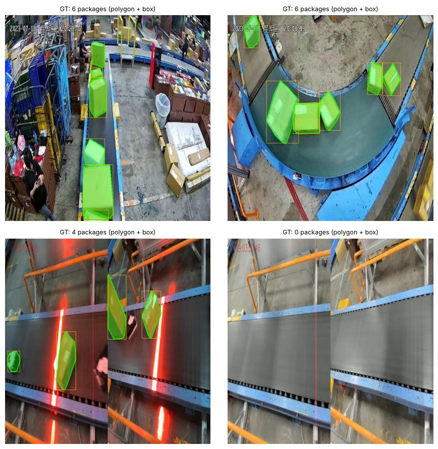

### 셀 8. COCO 사전학습 탐지 모델로 같은 샘플을 탐지합니다

```python
coco_model = YOLO('yolo26n.pt')  # COCO 80클래스 사전학습 탐지 모델 (n = 가장 작은 크기)

# [0]: 이미지 1장의 결과 / conf=0.25: 신뢰도 0.25 미만 버림 / .plot(): 결과 그림
pred_imgs = [coco_model(str(p), verbose=False, conf=0.25)[0].plot() for p in SAMPLES]
show_grid(pred_imgs, ['COCO pretrained'] * len(SAMPLES))
```

**코드 설명**

- `YOLO('yolo26n.pt')` — COCO 80개 클래스로 학습된 가장 작은(n) 탐지 모델입니다. 처음 실행하면 가중치를 내려받습니다.
- `coco_model(str(p), verbose=False, conf=0.25)[0]` — 이미지 한 장을 추론해 결과 목록의 첫 번째(유일한) 결과를 꺼냅니다. `conf=0.25` 미만인 탐지는 버립니다.
- `.plot()` — 탐지 결과(박스, 클래스 이름, 신뢰도)를 이미지에 그려 BGR 배열로 돌려줍니다.

**실행 결과**

검증 실행 예시: 4장 모두에서 택배 상자는 거의 표시되지 않습니다. 대신 컨베이어 벨트 장면 전체에 `train`(기차) 박스가 0.50, 0.48 정도의 신뢰도로 잡힙니다.

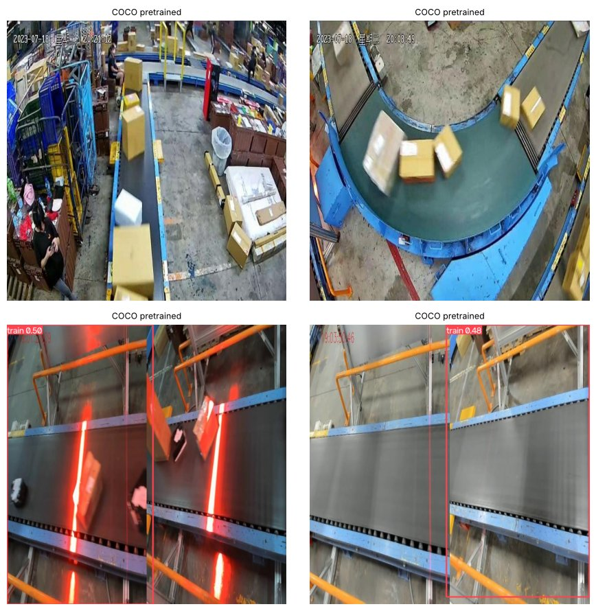

### 셀 9. 검증 이미지 전체에서 COCO 모델이 어떤 클래스로 탐지하는지 셉니다

```python
# 검증 이미지 전체에서 어떤 클래스로 탐지하는지 세어 봅니다
cls_counter, no_det, total_gt = Counter(), 0, 0  # 클래스별 탐지 수, 빈 이미지 수, 정답 상자 수
for p in VAL_IMAGES:
    r = coco_model(str(p), verbose=False, conf=0.25)[0]
    names = [r.names[int(c)] for c in r.boxes.cls]  # r.boxes.cls: 클래스 번호 → 이름으로 변환
    cls_counter.update(names)
    no_det += (len(names) == 0)  # 탐지 0개면 True(=1)가 더해짐
    total_gt += len(read_gt(p)[0])  # 이 이미지의 정답 박스 수

print(f'검증 이미지 {len(VAL_IMAGES)}장, 정답 상자 {total_gt}개')
print(f'아무것도 찾지 못한 이미지: {no_det}장')
pd.DataFrame(cls_counter.most_common(10), columns=['coco_class', 'count'])  # 많이 나온 클래스 10개 표 (마지막 줄이라 화면 출력)
```

**코드 설명**

- `cls_counter, no_det, total_gt = Counter(), 0, 0` — 클래스별 탐지 수, 아무것도 못 찾은 이미지 수, 정답 상자 수를 셀 변수입니다.
- `r.names[int(c)] for c in r.boxes.cls` — 탐지된 박스의 클래스 번호를 이름으로 바꿉니다.
- `no_det += (len(names) == 0)` — 탐지가 하나도 없으면 `True`(1)가 더해집니다.
- `total_gt += len(read_gt(p)[0])` — 이미지마다 정답 박스 수를 더합니다.
- `pd.DataFrame(cls_counter.most_common(10), ...)` — 가장 많이 나온 클래스 10개를 표로 만듭니다. 셀의 마지막 줄이 표이므로 그대로 화면에 출력됩니다.

**실행 결과**

검증 실행 예시: `검증 이미지 188장, 정답 상자 693개`, `아무것도 찾지 못한 이미지: 51장`이 출력됩니다. 표(`coco_class`, `count`)의 1위는 `train` 191건이고 `person` 36, `book` 13, `horse` 5 등이 뒤따릅니다. 상자 693개를 상자로 찾은 경우는 사실상 없습니다.

**정리 · 확인해 보기**

COCO 모델은 '물체처럼 보이는 것'을 찾는 능력은 이미 갖고 있습니다. 부족한 것은 우리 대상의 이름과 모양입니다. 이것을 우리 데이터로 가르치는 과정이 Step 2의 파인튜닝입니다. 확인해 보기: 컨베이어를 `train`으로 착각하는 이유는 무엇일까요?

---

## Step 2. 세그멘테이션 모델 파인튜닝과 성능 평가

**목표** 세그멘테이션 모델을 상자 데이터로 파인튜닝하고, 박스·마스크 지표와 직접 센 TP·FP·FN으로 성능을 평가합니다. 서비스에 쓸 신뢰도 임계값(BEST_CONF)도 이 단계에서 정합니다.

탐지(detect) 모델은 사각형 박스만 돌려주고, 세그멘테이션(segment) 모델은 박스와 함께 물체 모양 그대로의 마스크를 돌려줍니다. 비스듬한 상자의 박스 면적은 실제보다 크게 나오므로 크기를 재려면 마스크가 필요합니다. 그래서 Step 2~5 전체에서 `yolo26n-seg.pt`를 씁니다. 파인튜닝은 사전학습 가중치에서 출발해 우리 데이터로 추가 학습하는 것입니다. T4 GPU 기준 20 epoch에 15~20분 정도 걸립니다. 지표는 다음과 같습니다. Precision(정밀도)은 TP / (TP + FP), Recall(재현율)은 TP / (TP + FN)입니다. mAP50은 IoU 0.5 기준 정밀도-재현율 곡선 아래 면적이고, mAP50-95는 IoU 0.5~0.95 구간의 평균입니다. IoU는 예측과 정답이 겹치는 비율이며, 마스크 지표는 픽셀 단위 모양끼리 겹침을 계산하므로 박스 지표보다 엄격합니다.

### 셀 10. yolo26n-seg 모델을 상자 데이터로 파인튜닝하고 최고 가중치를 Drive에 복사합니다

```python
model = YOLO('yolo26n-seg.pt')  # COCO 사전학습 세그멘테이션 모델 — 학습 출발점
t0 = time.time()  # 학습 시간 측정 시작
# 파인튜닝: 결과는 runs_box/seg_baseline, 같은 폴더 있으면 덮어씀(exist_ok), seed=0 고정
model.train(data='package-seg.yaml', epochs=CFG['epochs'], imgsz=CFG['imgsz'], batch=CFG['batch'],
            project='runs_box', name='seg_baseline', exist_ok=True, seed=0, verbose=False)
TRAIN_MIN = (time.time() - t0) / 60  # 학습 시간(분) — 2-7 실험 표에 기록
RUN_DIR = Path(model.trainer.save_dir)  # 실제로 저장된 학습 결과 폴더
BEST = RUN_DIR / 'weights' / 'best.pt'  # 검증 점수가 가장 좋았던 epoch의 가중치
print(f'학습 시간: {TRAIN_MIN:.1f}분')
print('최고 성능 가중치:', BEST)
shutil.copy(BEST, SAVE_DIR / 'box_seg_best.pt')  # Drive 폴더에 복사 (통합 실습에서 사용)
print('저장 폴더에 복사:', SAVE_DIR / 'box_seg_best.pt')
```

**코드 설명**

- `YOLO('yolo26n-seg.pt')` — COCO로 사전학습된 세그멘테이션 모델을 불러옵니다. 학습의 출발점입니다.
- `model.train(data='package-seg.yaml', epochs=..., imgsz=..., batch=...)` — `CFG` 값으로 학습합니다. 매 epoch이 끝날 때 val 세트로 검증도 함께 합니다.
- `project='runs_box', name='seg_baseline', exist_ok=True` — 결과를 `runs_box/seg_baseline` 아래에 저장하고, 같은 이름 폴더가 있으면 덮어씁니다(`seg_baseline2`처럼 새로 만들지 않음).
- `seed=0` — 난수 시드를 고정해 다시 학습해도 결과가 비슷하게 나오게 합니다.
- `TRAIN_MIN = (time.time() - t0) / 60` — 학습에 걸린 시간을 분 단위로 계산합니다. 2-7 실험 표에 기록됩니다.
- `RUN_DIR = Path(model.trainer.save_dir)` — 실제 저장된 학습 폴더입니다. `BEST = RUN_DIR / 'weights' / 'best.pt'`는 검증 점수가 가장 좋았던 epoch의 가중치입니다.
- `shutil.copy(BEST, SAVE_DIR / 'box_seg_best.pt')` — 최고 가중치를 Drive 폴더에 `box_seg_best.pt` 이름으로 복사합니다. 런타임이 끊겨도 이 파일은 남습니다.

**실행 결과**

학습 초반에 `Overriding model.yaml nc=80 with nc=1`(클래스 수를 80개에서 1개로 바꿈)과 `Transferred 830/844 items from pretrained weights`(사전학습 가중치 대부분을 가져옴)가 출력됩니다. 이어서 epoch마다 진행 막대와 손실값(`box_loss`, `seg_loss`, `cls_loss` 등), 검증 지표 줄이 나옵니다. 마지막에 학습 시간, 최고 가중치 경로, Drive 복사 경로가 출력됩니다.

> **막혔을 때** 학습 중 런타임이 끊기면 처음부터 다시 실행해야 합니다. 시간이 부족하면 셀 4에서 `QUICK_RUN = True`로 바꿉니다. GPU 메모리 부족(CUDA out of memory)이 나면 `batch`를 8로 줄입니다.

### 셀 11. epoch별 손실과 지표 변화 그래프를 표시합니다

```python
# epoch별 손실과 지표 변화
display(Image(filename=str(RUN_DIR / 'results.png'), width=900))  # Ultralytics가 학습 중 자동 저장한 그래프
```

**코드 설명**

- `RUN_DIR / 'results.png'` — Ultralytics가 학습 중 자동으로 그려 저장하는 요약 그래프입니다.
- `display(Image(filename=..., width=900))` — 그림 파일을 노트북에 900픽셀 폭으로 표시합니다.

**실행 결과**

train/val 손실(`box_loss`, `seg_loss`, `cls_loss` 등)과 지표(`metrics/mAP50(B)`, `metrics/mAP50(M)` 등)의 epoch별 변화가 작은 그래프 여러 개로 표시됩니다. (B)는 박스, (M)은 마스크 기준입니다. QUICK_RUN 검증 실행 예시는 3 epoch뿐이라 점이 3개씩만 찍힙니다.

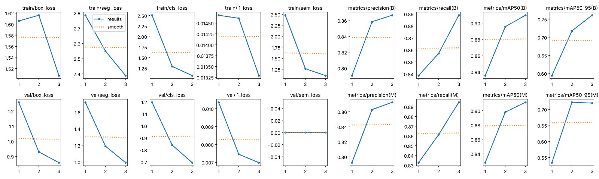

> **막혔을 때** train 손실만 내려가고 val 손실이 올라가면 과적합입니다. `seg_loss`는 마스크 모양이 정답과 얼마나 다른지를 나타내는, 세그멘테이션 모델에만 있는 손실입니다.

### 셀 12. 최고 가중치로 val·test 세트를 평가해 지표 표를 만듭니다

```python
best_model = YOLO(BEST)  # 학습한 최고 가중치 — Step 5까지 이 모델 사용

# evaluate: 모델, 분할 이름('val'/'test') → (지표 객체, 요약 딕셔너리)
def evaluate(weights_model, split):
    m = weights_model.val(data='package-seg.yaml', split=split, imgsz=CFG['imgsz'], batch=CFG['batch'],
                          project='runs_box', name=f'val_{split}', exist_ok=True, verbose=False)
    # box.mp/mr: 박스 Precision/Recall, map50·map: mAP50·mAP50-95, seg: 마스크 기준
    return m, {'split': split,
               'box_precision': round(m.box.mp, 3), 'box_recall': round(m.box.mr, 3),
               'box_map50': round(m.box.map50, 3), 'box_map50_95': round(m.box.map, 3),
               'mask_map50': round(m.seg.map50, 3), 'mask_map50_95': round(m.seg.map, 3)}

# 검증(val)과 테스트(test) 세트 각각 평가 후 한 표로
val_metrics, val_row = evaluate(best_model, 'val')
test_metrics, test_row = evaluate(best_model, 'test')
metrics_table = pd.DataFrame([val_row, test_row])
metrics_table
```

**코드 설명**

- `best_model = YOLO(BEST)` — 학습한 최고 가중치를 불러옵니다. Step 5까지 이 모델을 씁니다.
- `evaluate(weights_model, split)` — 모델과 분할 이름(`'val'` 또는 `'test'`)을 받아 `val()`을 실행하고, (지표 객체, 요약 딕셔너리)를 돌려줍니다.
- `m.box.mp`, `m.box.mr` — 박스 기준 평균 Precision과 Recall입니다.
- `m.box.map50`, `m.box.map` — 박스 기준 mAP50과 mAP50-95입니다.
- `m.seg.map50`, `m.seg.map` — 마스크 기준 mAP50과 mAP50-95입니다.
- `pd.DataFrame([val_row, test_row])` — 두 분할의 결과를 한 표로 모읍니다.

**실행 결과**

QUICK_RUN 검증 실행 예시: val은 `box_precision` 0.867, `box_recall` 0.889, `box_map50` 0.910, `box_map50_95` 0.761, `mask_map50` 0.912, `mask_map50_95` 0.719입니다. test는 각각 0.898, 0.893, 0.939, 0.772, 0.946, 0.729입니다. 학습에 쓰지 않은 test 점수가 val과 비슷하므로 모델이 일반화되었다고 볼 수 있습니다.

### 셀 13. 박스와 마스크의 정밀도-재현율(PR) 곡선을 표시합니다

```python
VAL_DIR = Path(val_metrics.save_dir)  # val 평가 결과가 저장된 폴더
for name in ['BoxPR_curve.png', 'MaskPR_curve.png']:  # 박스·마스크 기준 정밀도-재현율(PR) 곡선
    if (VAL_DIR / name).exists():  # 파일이 있을 때만 표시
        display(Image(filename=str(VAL_DIR / name), width=480))
```

**코드 설명**

- `VAL_DIR = Path(val_metrics.save_dir)` — val 평가 결과가 저장된 폴더입니다.
- `'BoxPR_curve.png', 'MaskPR_curve.png'` — 박스 기준, 마스크 기준 PR 곡선 그림입니다. 파일이 있을 때만 표시합니다.

**실행 결과**

PR 곡선 그림 2장이 표시됩니다. 곡선이 오른쪽 위 모서리에 가까울수록 좋고, 곡선 아래 면적이 mAP50입니다.

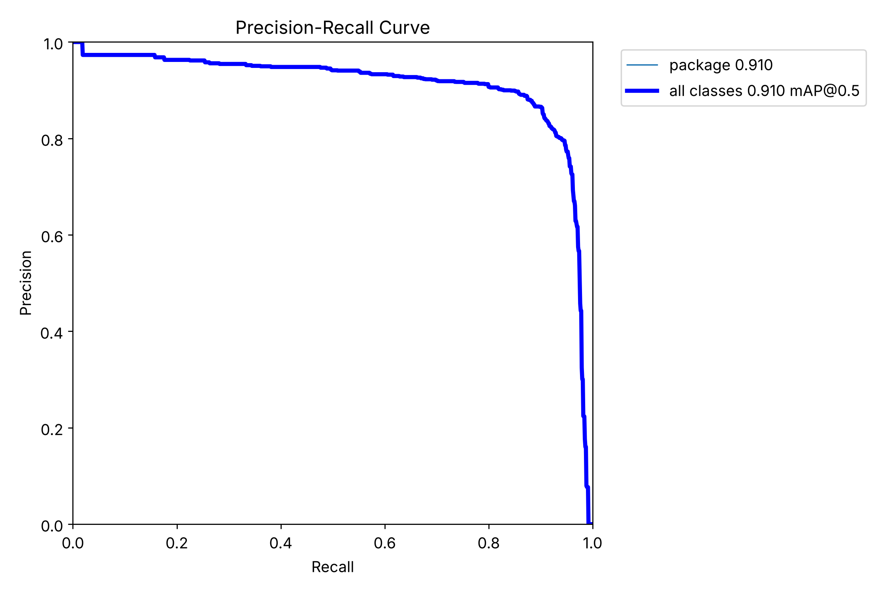

### 셀 14. 예측마다 박스 면적과 마스크 면적의 비를 계산해 분포와 최악 사례를 봅니다

```python
ratios, worst = [], None  # 면적비 목록, 차이가 가장 큰 예측
for p in VAL_IMAGES:
    r = best_model(str(p), conf=0.4, imgsz=CFG['imgsz'], verbose=False)[0]  # 신뢰도 0.4 이상 예측만
    if r.masks is None:  # 탐지가 하나도 없으면 masks가 None
        continue
    for b, poly in zip(r.boxes.xyxy.cpu().numpy(), r.masks.xy):  # xyxy: 박스 [x1,y1,x2,y2] / masks.xy: 마스크 윤곽선 좌표
        if len(poly) < 3:  # 꼭짓점 3개 미만이면 면적 계산 불가 → 건너뜀
            continue
        mask_area = cv2.contourArea(poly.astype(np.float32))  # 윤곽선 내부 면적 = 마스크 면적 (px²)
        box_area = (b[2] - b[0]) * (b[3] - b[1])  # 박스 면적 = 폭 × 높이
        if mask_area > 500:  # 너무 작은 마스크는 비율이 튀므로 제외
            ratio = box_area / mask_area
            ratios.append(ratio)
            if worst is None or ratio > worst[0]:  # 가장 큰 비율의 예측을 기억
                worst = (ratio, p, b, poly)

ratios = np.array(ratios)
print(f'예측 {len(ratios)}개 | 박스/마스크 면적비 중앙값 {np.median(ratios):.2f} | '
      f'1.5배 이상인 예측 {np.mean(ratios >= 1.5) * 100:.0f}%')

# 차이가 가장 큰 예측: 빨강 = 박스, 초록 = 마스크
ratio, p, b, poly = worst
im = draw_polys(cv2.imread(str(p)), [poly], (0, 255, 0))
draw_boxes(im, [b], (0, 0, 255), thick=2)
fig, axes = plt.subplots(1, 2, figsize=(11, 4))
axes[0].hist(ratios, bins=30, color='tab:blue'); axes[0].axvline(1.5, ls='--', c='gray')  # 비율 분포 + 1.5배 기준선
axes[0].set_xlabel('box area / mask area'); axes[0].set_ylabel('count')
axes[1].imshow(im[..., ::-1]); axes[1].axis('off')  # BGR→RGB로 뒤집어 표시
axes[1].set_title(f'largest gap: box is {ratio:.1f}x the mask (red = box, green = mask)', fontsize=9)
plt.tight_layout(); plt.show()
```

**코드 설명**

- `best_model(str(p), conf=0.4, ...)` — 검증 이미지마다 신뢰도 0.4 이상인 예측을 구합니다.
- `r.masks.xy` — 각 마스크의 윤곽선 꼭짓점 좌표(픽셀)입니다. 꼭짓점이 3개 미만이면 면적을 잴 수 없어 건너뜁니다.
- `cv2.contourArea(poly)` — 윤곽선 내부 면적, 즉 마스크 면적입니다.
- `box_area = (b[2] - b[0]) * (b[3] - b[1])` — 사각형 박스 면적입니다.
- `if mask_area > 500` — 너무 작은 마스크는 비율이 크게 튀므로 제외합니다.
- `worst` — 비율이 가장 큰 예측의 (비율, 경로, 박스, 윤곽선)을 기억해 오른쪽 그림에 씁니다.
- `axes[0].hist(...)`, `axvline(1.5)` — 비율 분포 히스토그램과 1.5배 기준선을 그립니다.

**실행 결과**

QUICK_RUN 검증 실행 예시: `예측 756개 | 박스/마스크 면적비 중앙값 1.38 | 1.5배 이상인 예측 31%`가 출력됩니다. 왼쪽은 비율 히스토그램, 오른쪽은 차이가 가장 큰 사례(이 예시에서 박스가 마스크의 2.9배)입니다. 빨간 사각형이 박스, 초록이 마스크입니다.

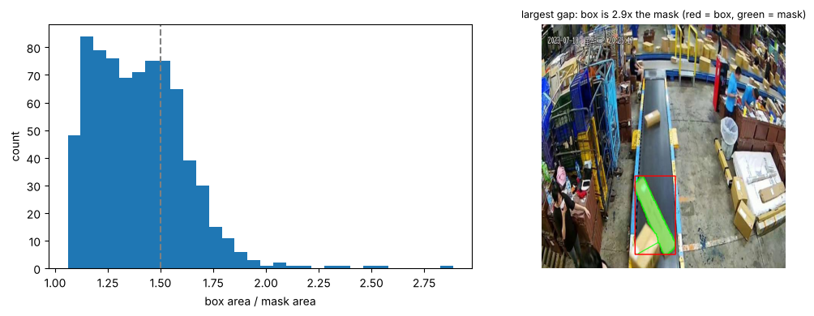

### 셀 15. TP·FP·FN을 직접 세어 임계값별 Precision·Recall·F1 표를 만듭니다

```python
# box_iou: 박스 a (N,4), b (M,4) → 모든 짝의 IoU (N,M) 행렬
def box_iou(a, b):
    """a: (N,4), b: (M,4) → (N,M) IoU 행렬"""
    if len(a) == 0 or len(b) == 0:
        return np.zeros((len(a), len(b)))
    x1 = np.maximum(a[:, None, 0], b[None, :, 0]); y1 = np.maximum(a[:, None, 1], b[None, :, 1])  # 겹친 영역 좌상단
    x2 = np.minimum(a[:, None, 2], b[None, :, 2]); y2 = np.minimum(a[:, None, 3], b[None, :, 3])  # 겹친 영역 우하단
    inter = np.clip(x2 - x1, 0, None) * np.clip(y2 - y1, 0, None)  # np.clip: 음수(안 겹침)는 0으로
    area_a = (a[:, 2] - a[:, 0]) * (a[:, 3] - a[:, 1]); area_b = (b[:, 2] - b[:, 0]) * (b[:, 3] - b[:, 1])
    return inter / (area_a[:, None] + area_b[None, :] - inter + 1e-9)  # 겹친 넓이 ÷ 합친 넓이, 1e-9는 0 나눗셈 방지

# pred (N,5) [x1,y1,x2,y2,conf], gt (M,4) → TP·FP·FN 개수와 예측별 정답 여부
def match(pred, gt, iou_thr=0.5):
    """신뢰도 높은 예측부터 정답과 1:1로 짝짓기 → (TP, FP, FN, 맞은 예측 여부)"""
    order = np.argsort(-pred[:, 4]) if len(pred) else []  # 신뢰도 높은 순서의 인덱스
    ious = box_iou(pred[:, :4], gt) if len(pred) else np.zeros((0, len(gt)))
    used, hit = set(), np.zeros(len(pred), bool)  # 이미 짝지은 정답 번호, 예측별 맞음 여부
    for i in order:
        if len(gt) == 0:
            break
        j = int(np.argmax(np.where([k in used for k in range(len(gt))], -1, ious[i])))  # 쓴 정답은 -1로 가리고 IoU 최대인 정답
        if ious[i, j] >= iou_thr and j not in used:  # IoU 0.5 이상이면 TP (정답 1개당 1번만)
            used.add(j); hit[i] = True
    tp = int(hit.sum())
    return tp, len(pred) - tp, len(gt) - tp, hit  # FP = 예측 - TP, FN = 정답 - TP

# 예측은 낮은 임계값(0.05)으로 한 번만 수행해 저장
cache = []
for p in VAL_IMAGES:
    r = best_model(str(p), conf=0.05, imgsz=CFG['imgsz'], verbose=False)[0]
    pred = np.hstack([r.boxes.xyxy.cpu().numpy(), r.boxes.conf.cpu().numpy()[:, None]])  # 박스 4열 + 신뢰도 1열 = (N,5)
    cache.append((p, pred, read_gt(p)[0]))  # (경로, 예측, 정답 박스) 저장 — 모델 재실행 불필요

# 임계값 6개마다 전체 TP·FP·FN을 합산해 precision·recall·F1 계산
rows = []
for thr in [0.1, 0.25, 0.4, 0.55, 0.7, 0.85]:
    tp = fp = fn = 0
    for _, pred, gt in cache:
        t, f, n, _ = match(pred[pred[:, 4] >= thr], gt)  # 신뢰도 thr 이상인 예측만 남겨 매칭
        tp += t; fp += f; fn += n
    prec, rec = tp / max(tp + fp, 1), tp / max(tp + fn, 1)  # max(..., 1): 분모 0 방지
    rows.append({'conf': thr, 'tp': tp, 'fp': fp, 'fn': fn, 'precision': round(prec, 3),
                 'recall': round(rec, 3), 'f1': round(2 * prec * rec / max(prec + rec, 1e-9), 3)})
thr_table = pd.DataFrame(rows)
BEST_CONF = float(thr_table.loc[thr_table['f1'].idxmax(), 'conf'])  # F1이 가장 큰 줄의 conf 값
print('F1이 가장 높은 임계값:', BEST_CONF)
thr_table
```

**코드 설명**

- `box_iou(a, b)` — 박스 배열 a (N,4)와 b (M,4)를 받아 모든 짝의 IoU를 (N,M) 행렬로 돌려줍니다. 겹친 영역 넓이 ÷ (두 넓이 합 − 겹친 넓이)입니다.
- `match(pred, gt, iou_thr=0.5)` — 예측 (N,5) [x1,y1,x2,y2,conf]와 정답 (M,4)를 받아 (TP, FP, FN, 맞은 예측 여부 배열)을 돌려줍니다.
- `np.argsort(-pred[:, 4])` — 신뢰도가 높은 예측부터 차례로 짝을 짓습니다.
- `np.where([k in used ...], -1, ious[i])` — 이미 짝지어진 정답은 IoU를 -1로 가려 두 번 쓰이지 않게 합니다(1:1 매칭). 남은 정답 중 IoU가 가장 큰 것이 0.5 이상이면 TP입니다.
- `conf=0.05`로 한 번만 예측해 `cache`에 저장 — 낮은 임계값으로 모든 후보를 받아 두고, 임계값별로는 `pred[pred[:, 4] >= thr]`로 걸러 씁니다. 모델을 여러 번 돌리지 않아도 됩니다.
- `for thr in [0.1, 0.25, 0.4, 0.55, 0.7, 0.85]` — 임계값 6개에 대해 전체 TP·FP·FN을 합산하고 precision, recall, f1을 계산합니다.
- `BEST_CONF = ... thr_table['f1'].idxmax()` — F1이 가장 높은 임계값을 고릅니다. Step 3~5의 모든 추론·트래킹이 이 값을 씁니다.

**실행 결과**

QUICK_RUN 검증 실행 예시: `F1이 가장 높은 임계값: 0.55`가 출력됩니다. 표 열은 `conf, tp, fp, fn, precision, recall, f1`입니다. conf 0.10에서는 tp 670, fp 304, fn 23(f1 0.804)이고, 0.55에서는 tp 612, fp 90, fn 81(f1 0.877), 0.85에서는 tp 318, fp 17, fn 375(f1 0.619)입니다.

> **막혔을 때** 이 셀의 TP·FP·FN은 박스 IoU로만 셉니다. 그래서 `val()`이 낸 Precision·Recall과 값이 조금 다를 수 있습니다.

### 셀 16. 임계값에 따른 Precision·Recall·F1 변화를 그래프로 그립니다

```python
# 임계값(x축)에 따른 precision·recall·F1 변화
plt.figure(figsize=(7, 3.5))
plt.plot(thr_table['conf'], thr_table['precision'], '-o', label='precision')
plt.plot(thr_table['conf'], thr_table['recall'], '-o', label='recall')
plt.plot(thr_table['conf'], thr_table['f1'], '-o', label='f1')
plt.axvline(BEST_CONF, ls='--', c='gray')  # 선택한 임계값 위치에 점선
plt.xlabel('confidence threshold'); plt.ylim(0, 1.05); plt.grid(alpha=.3); plt.legend(); plt.show()  # 세로축 0~1 고정
```

**코드 설명**

- `plt.plot(thr_table['conf'], thr_table['precision'], '-o', ...)` — 임계값을 x축으로 세 지표를 선과 점으로 그립니다.
- `plt.axvline(BEST_CONF, ls='--')` — 선택한 임계값 위치에 회색 점선을 긋습니다.
- `plt.ylim(0, 1.05)` — 세로축을 0~1 범위로 고정해 지표끼리 비교하기 쉽게 합니다.

**실행 결과**

임계값이 오를수록 precision은 올라가고 recall은 떨어지는 두 선, 그리고 중간에서 가장 높아지는 f1 선이 그려집니다. 점선이 BEST_CONF 위치입니다.

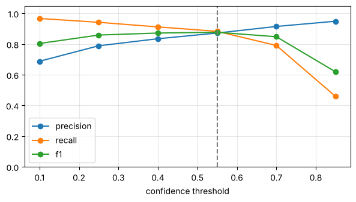

### 셀 17. 틀린 개수가 가장 많은 이미지 4장을 골라 오류를 직접 봅니다

```python
# 이미지마다 BEST_CONF 기준 오류 수(FP + FN)를 세어 많은 순으로 정렬
err_rows = []
for p, pred, gt in cache:
    pr = pred[pred[:, 4] >= BEST_CONF]  # 선택한 임계값 이상인 예측만
    tp, fp, fn, hit = match(pr, gt)
    err_rows.append((fp + fn, fp, fn, p, pr, gt, hit))
err_rows.sort(key=lambda x: -x[0])  # 오류 개수 내림차순

# 오류가 가장 많은 4장: 초록 = 정답, 파랑 = 맞은 예측, 빨강 = FP
imgs, titles = [], []
for err, fp, fn, p, pr, gt, hit in err_rows[:4]:
    im = cv2.imread(str(p))
    draw_boxes(im, gt, (0, 255, 0), thick=3)
    draw_boxes(im, pr[hit], (255, 128, 0))  # hit=True인 예측 (BGR 파랑)
    draw_boxes(im, pr[~hit], (0, 0, 255), 'FP')  # ~hit: 맞지 않은 예측 = FP (빨강)
    imgs.append(im); titles.append(f'FP {fp} / FN {fn} | {p.name[:28]}')
show_grid(imgs, titles)
print('오류가 하나도 없는 이미지 비율:', round(np.mean([e[0] == 0 for e in err_rows]), 3))  # True 비율 = 평균
```

**코드 설명**

- `pr = pred[pred[:, 4] >= BEST_CONF]` — 앞에서 고른 임계값으로 예측을 거릅니다.
- `err_rows.append((fp + fn, fp, fn, p, pr, gt, hit))` — 이미지마다 오류 개수와 그리기에 필요한 정보를 모읍니다.
- `err_rows.sort(key=lambda x: -x[0])` — 오류(FP + FN)가 많은 순서로 정렬합니다.
- `draw_boxes(im, gt, (0, 255, 0))`, `pr[hit]`, `pr[~hit]` — 초록 = 정답, 파랑 = 맞은 예측, 빨강 = 틀린 예측(FP, 글자 `FP` 표시)입니다.
- `np.mean([e[0] == 0 for e in err_rows])` — 오류가 하나도 없는 이미지의 비율입니다.

**실행 결과**

QUICK_RUN 검증 실행 예시: 4장이 제목 `FP n / FN n | 파일 이름`과 함께 표시되고, `오류가 하나도 없는 이미지 비율: 0.574`가 출력됩니다. 이 예시에서는 상자가 빽빽이 줄지어 FN이 17개인 장면, 정답 라벨이 없는데 모델이 상자를 찾아 FP 8개로 잡힌 장면(라벨 누락 의심), 곡선 컨베이어에서 겹친 상자가 섞인 장면이 나왔습니다.

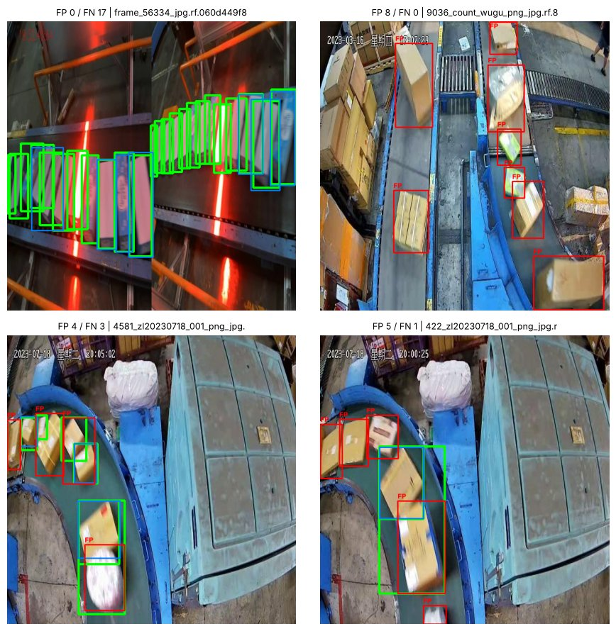

> **막혔을 때** FP라고 표시되어도 실제로는 모델이 맞고 라벨이 빠진 경우가 있습니다. 그림을 직접 보고 판단합니다.

### 셀 18. 개선 실험(선택)을 실행하고 실험별 성능 비교 표를 저장합니다

```python
RUN_EXPERIMENT = False  # True: 개선안 2개 추가 학습 (T4 기준 약 40분 추가)

# 한 번에 하나만 바꾼 개선안 — epoch 2배 / 모델 크기 n→s
EXPERIMENTS = [
    {'exp_name': 'more_epochs', 'model': 'yolo26n-seg.pt', 'epochs': CFG['epochs'] * 2, 'imgsz': CFG['imgsz']},
    {'exp_name': 'bigger_model', 'model': 'yolo26s-seg.pt', 'epochs': CFG['epochs'], 'imgsz': CFG['imgsz']},
]
METRIC_KEYS = ['box_map50', 'box_map50_95', 'mask_map50', 'mask_map50_95']  # 비교할 지표 이름

# 첫 줄 = 2-2에서 학습한 기준 모델 (설정 + val 지표 + 학습 시간)
exp_rows = [{'exp_name': 'baseline', 'model': 'yolo26n-seg.pt', 'epochs': CFG['epochs'], 'imgsz': CFG['imgsz'],
             **{k: val_row[k] for k in METRIC_KEYS}, 'train_min': round(TRAIN_MIN, 1)}]

if RUN_EXPERIMENT:
    for e in EXPERIMENTS:
        m = YOLO(e['model']); t0 = time.time()
        m.train(data='package-seg.yaml', epochs=e['epochs'], imgsz=e['imgsz'], batch=CFG['batch'],
                project='runs_box', name=e['exp_name'], exist_ok=True, seed=0, verbose=False)
        mins = (time.time() - t0) / 60  # 실험별 학습 시간(분)
        _, row = evaluate(YOLO(Path(m.trainer.save_dir) / 'weights' / 'best.pt'), 'val')  # 실험 모델의 최고 가중치로 val 평가
        exp_rows.append({**e, **{k: row[k] for k in METRIC_KEYS}, 'train_min': round(mins, 1)})  # 설정 + 지표를 한 줄로 합침

exp_table = pd.DataFrame(exp_rows)
exp_table.to_csv('experiments.csv', index=False); save_out('experiments.csv')  # CSV 저장 + Drive 복사
exp_table
```

**코드 설명**

- `RUN_EXPERIMENT = False` — 기본은 실험을 건너뛰고 기준 모델 한 줄만 표로 만듭니다. `True`로 바꾸면 T4 기준 약 40분이 추가로 걸립니다.
- `EXPERIMENTS` — 개선안 두 가지입니다. `more_epochs`는 epoch만 두 배, `bigger_model`은 모델만 `yolo26s-seg.pt`(s 크기)로 바꿉니다. 한 번에 하나만 바꿔야 효과를 구분할 수 있습니다.
- `exp_rows = [{'exp_name': 'baseline', ... 'train_min': round(TRAIN_MIN, 1)}]` — 2-2에서 학습한 기준 모델의 설정·val 지표·학습 시간을 첫 줄로 넣습니다.
- `{**e, **{k: row[k] for k in METRIC_KEYS}, ...}` — 실험 설정 딕셔너리와 지표 딕셔너리를 하나로 합쳐 표의 한 줄을 만듭니다.
- `exp_table.to_csv('experiments.csv'); save_out(...)` — 비교 표를 CSV로 저장하고 Drive 폴더에도 복사합니다.

**실행 결과**

`RUN_EXPERIMENT = False`이면 `baseline` 한 줄짜리 표가 나옵니다. 열은 `exp_name, model, epochs, imgsz, box_map50, box_map50_95, mask_map50, mask_map50_95, train_min`입니다. QUICK_RUN 검증 실행 예시의 baseline 지표는 box_map50 0.91, mask_map50 0.912입니다.

> **막혔을 때** 개선안의 점수가 올라도 학습 시간과 추론 속도가 함께 늘어나는지 확인해야 합니다. 3회차에서 다룰 Jetson 같은 엣지 장비에서는 작은 모델의 속도가 더 중요할 수 있습니다.

**정리 · 확인해 보기**

오류 분석 결과는 원인 유형별로 나눠 봅니다. 겹침·밀집은 imgsz를 올리거나 겹친 장면 데이터를 추가하고, 화면 가장자리 잘림은 라벨 기준을 통일하거나 집계 영역에서 가장자리를 뺍니다. 비닐 포대·작업자 손 같은 비슷한 물체는 헷갈리는 사례를 라벨링해 추가하고, 라벨 누락은 라벨을 검수합니다. 확인해 보기: 카운팅 서비스에서 F1을 기준으로 임계값을 고른 이유는 무엇일까요? 상자를 놓치는 것(FN)과 없는 상자를 세는 것(FP)이 모두 숫자를 틀리게 만든다는 점을 생각해 봅니다.

---

## Step 3. 트래킹 — 같은 상자에 같은 ID 붙이기

**목표** 데이터셋의 연속 프레임으로 실습용 컨베이어 영상을 만들고, ByteTrack으로 상자마다 ID를 붙여 프레임이 바뀌어도 같은 상자를 따라갑니다.

이 데이터셋에는 같은 CCTV에서 연속으로 뽑은 프레임(`frame_1` ~ `frame_307`)이 있습니다. CCTV 화면은 좌우 두 화면이 한 장에 붙어 있어, 상자가 왼쪽에서 오른쪽으로 흐르는 오른쪽 화면만 잘라 씁니다. 학습 세트에는 같은 프레임에 밝기·회전 등 변형(augmentation)을 준 사본이 3장씩 있으므로, 바로 앞 프레임과 가장 비슷한 사본을 골라 잇습니다. 이 영상에는 학습에 쓰인 프레임이 섞여 있으므로 정확도 평가가 아니라 트래킹·집계 기능을 구현하는 연습용입니다. 트래커는 이전 프레임의 박스 위치와 움직임을 기억했다가 새 프레임의 탐지 결과와 짝을 지어 같은 물체에 같은 ID를 붙입니다.

### 셀 19. 연속 프레임을 이어 붙여 실습용 컨베이어 영상(conveyor_clip.mp4)을 만듭니다

```python
# build_conveyor_clip: frame_1~307 이미지를 이어 영상 생성 → (파일명, 프레임 수, fps, (폭, 높이))
def build_conveyor_clip(root, out='conveyor_clip.mp4', first=1, last=307, fps=15, panel='right'):
    by_num = defaultdict(list)  # 프레임 번호 → 같은 번호 파일들(원본+변형 사본)
    for f in glob.glob(str(root / 'images' / '*' / 'frame_*_jpg*')):
        n = int(re.search(r'frame_(\d+)_jpg', f).group(1))  # 파일 이름에서 프레임 번호 추출
        if first <= n <= last:
            by_num[n].append(f)
    nums = sorted(by_num)
    load = lambda f: cv2.imread(f).astype(np.float32)  # 픽셀 차이 계산용 실수형 읽기
    anchor = next(n for n in nums if '/train/' not in by_num[n][0])   # 변형이 없는 val/test 프레임에서 출발
    chosen = {anchor: by_num[anchor][0]}  # 프레임 번호 → 고른 파일
    a = nums.index(anchor)
    for seq in (nums[a + 1:], nums[:a][::-1]):                         # 앞쪽·뒤쪽으로 이어 가며 선택
        prev = load(chosen[anchor])
        for n in seq:
            diffs = [np.abs(load(c) - prev).mean() for c in by_num[n]]  # 직전 프레임과의 평균 픽셀 차이
            chosen[n] = by_num[n][int(np.argmin(diffs))]  # 차이가 가장 작은 사본 선택
            prev = load(chosen[n])
    crop = lambda im: im[:, im.shape[1] // 2:] if panel == 'right' else im[:, :im.shape[1] // 2]  # 폭 절반 기준 오른쪽/왼쪽 화면만
    h, w = crop(cv2.imread(chosen[nums[0]])).shape[:2]
    writer = cv2.VideoWriter(out, cv2.VideoWriter_fourcc(*'mp4v'), fps, (w, h))  # mp4v 코덱, 초당 fps장
    for n in nums:
        writer.write(np.ascontiguousarray(crop(cv2.imread(chosen[n]))))  # 잘라 낸 배열을 메모리상 연속으로 만들어 기록
    writer.release()
    return out, len(nums), fps, (w, h)

CLIP, n_frames, CLIP_FPS, (W, H) = build_conveyor_clip(DATA_ROOT)
save_out(CLIP)  # Drive에도 복사 (통합 실습에서 사용)
print(f'{CLIP}: {n_frames}프레임, {CLIP_FPS}fps, {W}x{H}, 약 {n_frames / CLIP_FPS:.1f}초')
show_video(CLIP)
```

**코드 설명**

- `build_conveyor_clip(root, out, first, last, fps, panel)` — 데이터셋 폴더를 받아 `frame_first` ~ `frame_last` 프레임을 `fps` 속도의 영상으로 만들고, (파일 이름, 프레임 수, fps, (폭, 높이))를 돌려줍니다. `panel`은 쓸 화면(`'right'` 또는 왼쪽)입니다.
- `re.search(r'frame_(\d+)_jpg', f)` — 파일 이름에서 프레임 번호를 뽑아 `by_num[번호]`에 같은 번호의 파일(원본과 변형 사본)을 모읍니다.
- `anchor = next(n for n in nums if '/train/' not in by_num[n][0])` — 변형이 없는 val/test 프레임 하나를 출발점으로 잡습니다.
- `for seq in (nums[a + 1:], nums[:a][::-1])` — 출발점에서 앞쪽과 뒤쪽으로 한 프레임씩 이어 가며 고릅니다.
- `np.abs(load(c) - prev).mean()` — 후보 사본마다 직전에 고른 프레임과의 픽셀 차이 평균을 구하고, 차이가 가장 작은 사본을 고릅니다. 그래서 영상이 끊김 없이 이어집니다.
- `im[:, im.shape[1] // 2:]` — 이미지 폭의 절반부터 끝까지, 즉 오른쪽 화면만 잘라 냅니다.
- `cv2.VideoWriter(out, cv2.VideoWriter_fourcc(*'mp4v'), fps, (w, h))` — mp4v 코덱으로 영상을 씁니다. 프레임마다 `writer.write()`, 끝나면 `release()`로 파일을 닫습니다.
- `CLIP, n_frames, CLIP_FPS, (W, H) = ...` — 영상 경로와 크기를 전역 변수로 받아 이후 모든 단계에서 씁니다.

**실행 결과**

검증 실행 예시: `conveyor_clip.mp4: 256프레임, 15fps, 320x640, 약 17.1초`가 출력되고 그 아래에 영상이 재생됩니다. 폭 320, 높이 640인 세로 영상이며 상자가 왼쪽에서 오른쪽으로 지나갑니다. 프레임 번호 중 데이터셋에 없는 번호가 있어 307보다 적은 256프레임이 됩니다.

> **막혔을 때** 영상이 재생되지 않으면 `show_video()` 안의 ffmpeg 변환이 실패한 경우입니다. 오류 메시지를 확인하고, 파일은 Drive 폴더에서 내려받아 직접 재생해 봅니다.

### 셀 20. 프레임별 탐지 수를 모두 더해 '탐지만으로는 셀 수 없음'을 확인합니다

```python
# stream=True: 프레임별 결과를 하나씩 꺼냄 (메모리 절약) / len(r.boxes): 그 프레임 탐지 수
per_frame = [len(r.boxes) for r in best_model(CLIP, stream=True, conf=BEST_CONF, imgsz=CFG['imgsz'], verbose=False)]
print('프레임별 탐지 수 합계:', sum(per_frame), '| 프레임당 평균:', round(np.mean(per_frame), 2))
```

**코드 설명**

- `best_model(CLIP, stream=True, conf=BEST_CONF, ...)` — 영상을 프레임 단위로 하나씩 추론하는 생성기입니다. `stream=True`는 결과를 한꺼번에 메모리에 쌓지 않게 합니다.
- `len(r.boxes)` — 각 프레임에서 탐지된 상자 수입니다.
- `sum(per_frame)`, `np.mean(per_frame)` — 전체 합계와 프레임당 평균입니다.

**실행 결과**

검증 실행 예시: `프레임별 탐지 수 합계: 510 | 프레임당 평균: 1.99`가 출력됩니다. Step 4에서 실제로 기준선을 통과한 상자는 8개였습니다. 같은 상자가 수십 프레임에 걸쳐 반복해서 잡히므로 단순 합계는 지나간 상자 수와 전혀 다릅니다.

### 셀 21. ByteTrack으로 트래킹해 ID와 이동 궤적을 그린 영상(tracked.mp4)을 만듭니다

```python
# id_color: ID 번호 → 항상 같은 BGR 색 (ID를 난수 시드로 사용)
def id_color(tid):
    rng = np.random.default_rng(int(tid))
    return tuple(int(c) for c in rng.integers(60, 255, 3))

# run_tracking: 영상 트래킹 → 결과 영상 저장, ID별 중심점 이력 반환 (trail = 궤적 길이)
def run_tracking(src, dst='tracked.mp4', tracker='bytetrack.yaml', trail=25):
    writer = cv2.VideoWriter(dst, cv2.VideoWriter_fourcc(*'mp4v'), CLIP_FPS, (W, H))
    history = defaultdict(list)      # track_id → [(frame, cx, cy), ...]
    # 영상 전체를 넘기면 트래커가 처음~끝까지 ID 상태를 이어 감
    for i, r in enumerate(best_model.track(src, stream=True, tracker=tracker,
                                           conf=BEST_CONF, imgsz=CFG['imgsz'], verbose=False)):
        frame = r.orig_img.copy()  # 원본 프레임 사본 위에 그림
        if r.boxes.id is not None:  # ID가 아직 안 붙은 프레임은 id가 None
            # 박스 좌표와 트래킹 ID를 짝지어 하나씩 (GPU 텐서 → 파이썬 값)
            for (x1, y1, x2, y2), tid in zip(r.boxes.xyxy.cpu().numpy(), r.boxes.id.int().cpu().tolist()):
                cx, cy = (x1 + x2) / 2, (y1 + y2) / 2  # 박스 중심 좌표 (픽셀)
                history[tid].append((i, cx, cy))
                col = id_color(tid)
                cv2.rectangle(frame, (int(x1), int(y1)), (int(x2), int(y2)), col, 2)
                cv2.putText(frame, f'ID {tid}', (int(x1), int(y1) - 6), cv2.FONT_HERSHEY_SIMPLEX, 0.6, col, 2)
                pts = np.array([(int(x), int(y)) for _, x, y in history[tid][-trail:]], np.int32)  # 최근 trail개 중심점
                cv2.polylines(frame, [pts], False, col, 2)  # 중심점을 이어 이동 궤적 그리기
        writer.write(frame)
    writer.release()
    return history

track_hist = run_tracking(CLIP)
# ID별 등장 프레임 수, 처음·마지막 프레임, 이동량(dx, dy) 표
life = pd.DataFrame([{'track_id': t, 'frames': len(h), 'first_frame': h[0][0], 'last_frame': h[-1][0],
                      'dx': round(float(h[-1][1] - h[0][1]), 1), 'dy': round(float(h[-1][2] - h[0][2]), 1)}
                     for t, h in track_hist.items()]).sort_values('first_frame')
print('부여된 ID 수:', len(life), '| 5프레임 이상 이어진 ID 수:', int((life['frames'] >= 5).sum()))
show_video('tracked.mp4')
life.head(10)  # 첫 등장 순 앞 10개 ID
```

**코드 설명**

- `id_color(tid)` — ID 번호를 시드로 난수를 만들어 ID마다 항상 같은 색을 돌려줍니다.
- `run_tracking(src, dst, tracker, trail)` — 영상을 트래킹해 결과 영상을 `dst`에 저장하고, ID별 중심점 이력 `history`를 돌려줍니다. `trail`은 화면에 남길 궤적 길이(프레임 수)입니다.
- `best_model.track(src, stream=True, tracker='bytetrack.yaml', ...)` — 영상 전체를 넘기면 트래커가 처음부터 끝까지 상태를 이어 가며 ID를 붙입니다.
- `if r.boxes.id is not None` — 트래커가 아직 ID를 붙이지 않은 프레임에서는 `id`가 `None`이므로 건너뜁니다.
- `history[tid].append((i, cx, cy))` — ID마다 (프레임 번호, 중심 x, 중심 y)를 쌓습니다.
- `cv2.polylines(frame, [pts], False, col, 2)` — 최근 `trail`개 중심점을 이은 선으로 이동 궤적을 그립니다.
- `life` 표 — ID별 등장 프레임 수(`frames`), 처음·마지막 프레임, 처음 대비 마지막 위치의 이동량(`dx`, `dy`)을 정리합니다.

**실행 결과**

검증 실행 예시: `부여된 ID 수: 11 | 5프레임 이상 이어진 ID 수: 11`이 출력되고, ID와 궤적이 그려진 영상이 재생됩니다. 아래 표(`track_id, frames, first_frame, last_frame, dx, dy`)의 대부분 ID는 `dx`가 270~290 정도의 양수로, 오른쪽으로 움직였습니다. ID 1(8프레임, dx 18.0)처럼 영상 시작 때 이미 화면 오른쪽에 있던 상자는 조금만 움직입니다.

> **막혔을 때** `lap` 관련 ModuleNotFoundError가 나면 셀 1의 설치를 다시 실행합니다. 카메라 프레임을 한 장씩 넘기는 방식에서는 `track(frame, persist=True)`처럼 `persist=True`를 꼭 줘야 ID가 이어집니다. 통합 실습에서 이 방식을 씁니다.

**정리 · 확인해 보기**

`dx`의 부호로 상자의 이동 방향을 알 수 있습니다. 확인해 보기: ID 번호가 1부터 빠짐없이 이어지지 않는 이유는 무엇일까요? 몇 프레임만 살다 사라진 짧은 ID가 있다면, 상자가 가려졌다 다시 보이며 새 ID를 받는 현상(ID switch)인지 영상에서 확인합니다. ID switch는 집계 오차의 주요 원인입니다.

---

## Step 4. 라인 카운팅

**목표** 화면에 가상의 세로 기준선을 긋고, 트래킹 ID의 중심점이 선을 넘는 순간을 한 번씩만 세어 통과 기록(box_count_log.csv)을 남깁니다.

어떤 ID의 중심점이 이전 프레임에는 선의 한쪽에, 현재 프레임에는 반대쪽에 있으면 '통과'로 봅니다. ID마다 한 번만 세므로 같은 상자를 중복해서 세지 않습니다. 흐름은 '트래킹 ID별 중심점 이력 → 선을 넘었는가? → 처음 넘은 ID만 카운트 → 화면 표시 + 로그 기록'입니다.

### 셀 22. 상자의 주 이동 방향을 구하고 기준선 위치를 미리 그려 봅니다

```python
moving = life[(life['frames'] >= 5) & (life['dx'].abs() > W * 0.1)]   # 충분히 오래, 충분히 멀리 움직인 ID만
main_dir = 'right_to_left' if moving['dx'].median() < 0 else 'left_to_right'  # dx 중앙값 음수 = 오른쪽→왼쪽
print('상자의 주 이동 방향:', main_dir, '| dx 중앙값:', moving['dx'].median())

# 0.5 → 0.3이면 선이 왼쪽으로 이동, Step 4·5 카운트와 size_rules.json에 반영
LINE_X = int(W * 0.5)    # 화면 가운데에 세로 기준선 (필요하면 비율을 바꿔 보세요)
cap = cv2.VideoCapture(CLIP); cap.set(cv2.CAP_PROP_POS_FRAMES, 100); _, preview = cap.read(); cap.release()  # 100번째 프레임 1장
cv2.line(preview, (LINE_X, 0), (LINE_X, H), (0, 255, 255), 3)  # 노란 세로선 (BGR)
show_bgr(preview, f'Counting line at x={LINE_X}', size=(4, 7))
```

**코드 설명**

- `life[(life['frames'] >= 5) & (life['dx'].abs() > W * 0.1)]` — 5프레임 이상 이어졌고 화면 폭의 10% 넘게 움직인 ID만 고릅니다. 잠깐 나타난 잡음 ID를 빼기 위해서입니다.
- `moving['dx'].median() < 0` — 이동량 중앙값이 음수면 오른쪽→왼쪽, 아니면 왼쪽→오른쪽이 주 방향입니다.
- `LINE_X = int(W * 0.5)` — 화면 가운데에 세로 기준선을 둡니다. 비율을 바꿔 선 위치를 옮길 수 있습니다.
- `cap.set(cv2.CAP_PROP_POS_FRAMES, 100)` — 영상의 100번째 프레임으로 이동해 한 장을 읽습니다.
- `cv2.line(preview, (LINE_X, 0), (LINE_X, H), (0, 255, 255), 3)` — 노란색 세로선을 그려 위치를 확인합니다.

**실행 결과**

검증 실행 예시: `상자의 주 이동 방향: left_to_right | dx 중앙값: 277.9`가 출력되고, 제목 `Counting line at x=160`과 함께 노란 세로선이 그려진 프레임이 표시됩니다.

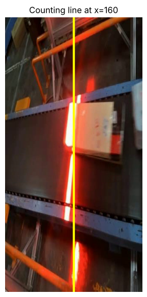

### 셀 23. 기준선 통과를 세어 카운트 영상(counting.mp4)과 통과 기록 CSV를 만듭니다

```python
# run_counting: 영상 트래킹 + 기준선 통과 카운트 → 결과 영상 저장, 통과 기록 DataFrame 반환
def run_counting(src, dst='counting.mp4', line_x=LINE_X, tracker='bytetrack.yaml'):
    writer = cv2.VideoWriter(dst, cv2.VideoWriter_fourcc(*'mp4v'), CLIP_FPS, (W, H))
    last_x, counted, log = {}, {}, []  # ID별 직전 중심 x, 센 ID→방향, 통과 기록
    for i, r in enumerate(best_model.track(src, stream=True, tracker=tracker,
                                           conf=BEST_CONF, imgsz=CFG['imgsz'], verbose=False)):
        frame = r.orig_img.copy()
        if r.boxes.id is not None:
            for (x1, y1, x2, y2), tid in zip(r.boxes.xyxy.cpu().numpy(), r.boxes.id.int().cpu().tolist()):
                cx = (x1 + x2) / 2  # 박스 중심 x좌표 (픽셀)
                prev = last_x.get(tid)
                if prev is not None and tid not in counted:  # 직전 위치가 있고 아직 안 센 ID만 → ID당 1번
                    if prev < line_x <= cx:  # 직전엔 선 왼쪽, 지금은 선 위/오른쪽
                        counted[tid] = 'left_to_right'
                    elif prev >= line_x > cx:  # 직전엔 선 위/오른쪽, 지금은 선 왼쪽
                        counted[tid] = 'right_to_left'
                    if tid in counted:  # 이번 프레임에 방금 셌으면 기록
                        log.append({'frame': i, 'time_s': round(i / CLIP_FPS, 2), 'track_id': tid,
                                    'direction': counted[tid]})
                last_x[tid] = cx  # 다음 프레임 비교용으로 현재 위치 저장
                col = (0, 200, 0) if tid in counted else (0, 165, 255)  # 센 상자 초록, 아직 안 센 상자 주황
                cv2.rectangle(frame, (int(x1), int(y1)), (int(x2), int(y2)), col, 2)
                cv2.putText(frame, f'ID {tid}', (int(x1), int(y1) - 6), cv2.FONT_HERSHEY_SIMPLEX, 0.6, col, 2)
        flash = log and log[-1]['frame'] >= i - 2          # 방금 카운트되면 선을 잠깐 빨갛게
        cv2.line(frame, (line_x, 0), (line_x, H), (0, 0, 255) if flash else (0, 255, 255), 3)
        # 왼쪽 위 검은 상자(-1 = 속 채우기)에 누적 카운트 표시
        cv2.rectangle(frame, (8, 8), (200, 48), (0, 0, 0), -1)
        cv2.putText(frame, f'COUNT: {len(counted)}', (20, 40), cv2.FONT_HERSHEY_SIMPLEX, 0.9, (255, 255, 255), 2)
        writer.write(frame)
    writer.release()
    return pd.DataFrame(log, columns=['frame', 'time_s', 'track_id', 'direction'])

count_log = run_counting(CLIP)
count_log.to_csv('box_count_log.csv', index=False); save_out('box_count_log.csv')  # CSV 저장 + Drive 복사
print('통과한 상자 수:', len(count_log))
show_video('counting.mp4')
count_log
```

**코드 설명**

- `run_counting(src, dst, line_x, tracker)` — 영상을 트래킹하며 기준선 통과를 세고, 결과 영상을 `dst`에 저장한 뒤 통과 기록을 DataFrame으로 돌려줍니다.
- `last_x, counted, log = {}, {}, []` — ID별 직전 중심 x, 이미 센 ID와 방향, 통과 기록 목록입니다.
- `if prev is not None and tid not in counted` — 직전 위치가 있고 아직 세지 않은 ID만 검사합니다. 그래서 한 ID는 한 번만 셉니다.
- `prev < line_x <= cx` — 직전에는 선 왼쪽, 지금은 선 위나 오른쪽이면 `left_to_right` 통과입니다. 반대 조건이면 `right_to_left`입니다.
- `log.append({'frame', 'time_s', 'track_id', 'direction'})` — 통과 순간의 프레임, 초(프레임 ÷ fps), ID, 방향을 기록합니다.
- `col = (0, 200, 0) if tid in counted else (0, 165, 255)` — 이미 센 상자는 초록, 아직 안 센 상자는 주황으로 그립니다.
- `flash = log and log[-1]['frame'] >= i - 2` — 방금(2프레임 안) 카운트되면 기준선을 빨간색으로 잠깐 바꿉니다. 왼쪽 위에는 `COUNT: n`을 표시합니다.
- `pd.DataFrame(log, columns=[...])` — 통과가 하나도 없어도 열 이름이 있는 빈 표를 돌려주도록 열을 지정합니다.

**실행 결과**

검증 실행 예시: `통과한 상자 수: 8`이 출력되고 카운트 영상이 재생됩니다. 표 열은 `frame, time_s, track_id, direction`이며, ID 2(프레임 9, 0.60초)부터 ID 9(프레임 229, 15.27초)까지 8줄이 모두 `left_to_right`입니다. ID 1은 시작부터 선 오른쪽에 있었고, ID 13은 영상 끝까지 선에 닿지 않아 세지 않았습니다.

> **막혔을 때** 영상을 보며 직접 센 수와 다르면, 상자가 붙어서 하나로 잡혔는지, 선 근처에서 ID가 바뀌었는지 확인합니다. ID가 바뀌면 같은 상자가 두 번 셀 수 있습니다.

**정리 · 확인해 보기**

여기까지가 '몇 개 지나갔나'입니다. 현장에서는 '어떤 크기의 상자가 몇 개 지나갔나'를 알아야 분류 라인과 적재 공간을 계획할 수 있습니다. 확인해 보기: `LINE_X`를 `int(W * 0.3)`이나 `int(W * 0.7)`로 옮기면 카운트가 달라지나요? 영상 처음이나 끝에 걸린 상자가 어떻게 처리되는지 생각해 봅니다.

---

## Step 5. 크기 분류 — 크기별로 세기

**목표** 마스크로 상자의 면적과 가로·세로를 재고, 정답 라벨의 분포로 S/M/L 기준을 정해 size_rules.json으로 남깁니다. 트래킹 관측 표로 상자별 크기를 확정하고 크기별 통과 수를 집계합니다.

마스크 윤곽선(`r.masks.xy`)에서 세 값을 구합니다. `area_px`는 `cv2.contourArea`로 구한 윤곽선 내부 면적이고, `long_px`, `short_px`는 윤곽선을 가장 작게 감싸는 회전 사각형(`cv2.minAreaRect`)의 긴 변과 짧은 변입니다. 회전 사각형은 상자가 놓인 각도와 상관없이 가로·세로를 잴 수 있습니다. S/M/L 경계는 정답 라벨 면적 분포의 33%, 67% 분위수로 정합니다. 상자가 화면 가장자리에 걸리면 일부만 보여 실제보다 작게 재지므로, 가장자리에 걸리지 않은 관측만 모아 중앙값으로 크기를 정합니다. 흐름은 '마스크 → 크기 측정 → S/M/L 기준 정하기 → 트랙별 크기 확정 → 크기별 카운트 + 영상 + 로그'입니다.

### 셀 24. 마스크 측정 함수를 만들고 영상 한 프레임에서 확인합니다

```python
# measure_mask: 윤곽선 (N,2) → 면적, 긴 변, 짧은 변, 회전 사각형 꼭짓점 4개
def measure_mask(poly):
    """마스크 윤곽선 (N,2) → (면적, 긴 변, 짧은 변, 회전 사각형 꼭짓점)"""
    pts = np.asarray(poly, np.float32)
    area = float(cv2.contourArea(pts))  # 윤곽선 내부 면적 (px²)
    rect = cv2.minAreaRect(pts)  # 가장 작은 회전 사각형 ((중심), (폭, 높이), 각도)
    (w_, h_) = rect[1]  # 회전 사각형의 폭·높이
    return area, float(max(w_, h_)), float(min(w_, h_)), cv2.boxPoints(rect)  # 큰 값=긴 변, 작은 값=짧은 변

# 영상의 한 프레임에서 확인
cap = cv2.VideoCapture(CLIP); cap.set(cv2.CAP_PROP_POS_FRAMES, 100); _, frame = cap.read(); cap.release()
r = best_model(frame, conf=BEST_CONF, imgsz=CFG['imgsz'], verbose=False)[0]  # 프레임 1장 추론
vis = frame.copy()
# 탐지가 없으면 masks가 None → 빈 목록으로 대신
for b, poly in zip(r.boxes.xyxy.cpu().numpy(), r.masks.xy if r.masks is not None else []):
    if len(poly) < 3:
        continue
    area, long_px, short_px, corners = measure_mask(poly)
    vis = draw_polys(vis, [poly], (0, 255, 0))
    cv2.polylines(vis, [corners.astype(np.int32)], True, (255, 0, 255), 2)  # 회전 사각형 (자홍색)
    draw_boxes(vis, [b], (0, 0, 255), thick=1)
    # 박스 위에 면적과 '긴 변x짧은 변' 표시
    cv2.putText(vis, f'{area:.0f}px2', (int(b[0]), int(b[1]) - 22), cv2.FONT_HERSHEY_SIMPLEX, 0.5, (255, 255, 255), 2)
    cv2.putText(vis, f'{long_px:.0f}x{short_px:.0f}', (int(b[0]), int(b[1]) - 6), cv2.FONT_HERSHEY_SIMPLEX, 0.5, (255, 255, 255), 2)
show_bgr(vis, 'green = mask, magenta = rotated rect, red = box', size=(4, 7))
```

**코드 설명**

- `measure_mask(poly)` — 윤곽선 (N,2) 좌표를 받아 (면적, 긴 변, 짧은 변, 회전 사각형 꼭짓점 4개)를 돌려줍니다.
- `cv2.contourArea(pts)` — 윤곽선 내부 면적(px²)입니다.
- `rect = cv2.minAreaRect(pts)` — 윤곽선을 감싸는 가장 작은 회전 사각형을 ((중심), (폭, 높이), 각도)로 돌려줍니다. `rect[1]`이 (폭, 높이)입니다.
- `max(w_, h_)`, `min(w_, h_)` — 폭·높이 중 큰 값을 긴 변, 작은 값을 짧은 변으로 씁니다. 각도에 따라 폭과 높이가 뒤바뀌어도 같은 결과가 나옵니다.
- `cv2.boxPoints(rect)` — 회전 사각형의 꼭짓점 4개 좌표입니다. 그림에 그릴 때 씁니다.
- `r.masks.xy if r.masks is not None else []` — 상자가 하나도 탐지되지 않으면 `masks`가 `None`이므로 빈 목록으로 대신합니다.
- `cv2.putText(vis, f'{area:.0f}px2', ...)` — 상자 위에 면적과 `긴 변x짧은 변`을 적습니다.

**실행 결과**

검증 실행 예시: 100번째 프레임에서 상자 하나에 초록 마스크, 자홍색 회전 사각형, 빨간 박스가 겹쳐 그려집니다. 상자 위에 `16749px2`, `140x135`가 표시됩니다.

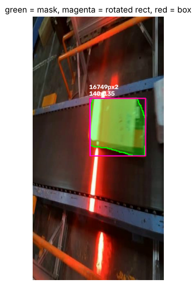

### 셀 25. 정답 라벨 면적 분포로 S/M/L 경계를 정하고 size_rules.json으로 저장합니다

```python
# 키우면 가장자리 판정이 넓어져 제외되는 상자가 늘어남
EDGE = 4   # 이 픽셀 안쪽으로 가장자리에 닿으면 '잘린 상자'로 봅니다

label_rows = []
for split in ['val', 'test']:  # 변형이 없는 val/test 라벨만 (train 사본은 회전·확대 변형)
    for img_path in (DATA_ROOT / 'images' / split).glob('frame_*.jpg'):  # 같은 카메라 프레임만
        _, polys = read_gt(img_path)
        for poly in polys:
            xs, ys = poly[:, 0] - 320, poly[:, 1]          # 오른쪽 화면 기준 좌표 (영상과 같은 좌표계)
            if xs.min() < EDGE or xs.max() > W - EDGE or ys.min() < EDGE or ys.max() > H - EDGE:
                continue                                    # 왼쪽 화면 상자이거나 가장자리에 잘린 상자
            area, long_px, short_px, _ = measure_mask(np.stack([xs, ys], 1))
            label_rows.append({'image': img_path.name, 'area_px': area, 'long_px': long_px, 'short_px': short_px})
label_sizes = pd.DataFrame(label_rows)  # 라벨 상자별 면적·긴 변·짧은 변 표

q33, q67 = np.percentile(label_sizes['area_px'], [33.3, 66.7])  # 하위 1/3, 상위 1/3 경계값
# S 상한, M 상한과 측정 조건을 한 딕셔너리로 → 통합 실습도 같은 기준 사용
SIZE_RULES = {'measure': 'mask_area_px', 'small_max': round(float(q33)), 'medium_max': round(float(q67)),
              'edge_margin_px': EDGE, 'line_x': LINE_X, 'conf': BEST_CONF, 'imgsz': CFG['imgsz']}
json.dump(SIZE_RULES, open('size_rules.json', 'w'), indent=2); save_out('size_rules.json')  # JSON 파일로 저장 + Drive 복사
print(f'라벨 상자 {len(label_sizes)}개로 기준을 정했습니다:', SIZE_RULES)

# 면적 분포 히스토그램과 S|M, M|L 경계선
plt.figure(figsize=(8, 3.2))
plt.hist(label_sizes['area_px'], bins=40, color='tab:gray')
for v, name in [(q33, 'S | M'), (q67, 'M | L')]:
    plt.axvline(v, c='red', ls='--'); plt.text(v, plt.ylim()[1] * 0.9, f' {name}\n {v:.0f}', color='red')  # 경계선 + 위쪽에 값 표시
plt.xlabel('mask area (px^2)'); plt.ylabel('labels'); plt.title('Package size distribution (ground truth)')
plt.show()
```

**코드 설명**

- `EDGE = 4` — 상자가 가장자리에서 4픽셀 안쪽에 닿으면 '잘린 상자'로 봅니다.
- `for split in ['val', 'test']` + `glob('frame_*.jpg')` — 같은 카메라의 프레임 중 변형이 없는 val/test 라벨만 씁니다. train 사본은 회전·확대 변형으로 크기가 달라질 수 있기 때문입니다.
- `xs = poly[:, 0] - 320` — 원본 이미지(폭 640)에서 오른쪽 화면의 시작점 320을 빼서, 영상과 같은 좌표계로 옮깁니다.
- `if xs.min() < EDGE or xs.max() > W - EDGE or ...: continue` — 왼쪽 화면에 있는 상자(x가 음수)와 가장자리에 잘린 상자를 뺍니다.
- `np.percentile(label_sizes['area_px'], [33.3, 66.7])` — 면적을 크기순으로 세웠을 때 하위 1/3과 상위 1/3을 가르는 두 값입니다.
- `SIZE_RULES = {...}` — 측정 방식, S 상한(`small_max`), M 상한(`medium_max`), 가장자리 여백, 기준선 위치, 임계값, 입력 크기를 한 딕셔너리에 모읍니다.
- `json.dump(SIZE_RULES, open('size_rules.json', 'w'), indent=2)` — 기준을 파일로 남겨 통합 실습 등 다른 프로그램도 같은 기준을 쓰게 합니다.
- `plt.hist(...)`, `plt.axvline(v, c='red', ls='--')` — 면적 분포와 두 경계선을 그립니다.

**실행 결과**

QUICK_RUN 검증 실행 예시: `라벨 상자 264개로 기준을 정했습니다: {'measure': 'mask_area_px', 'small_max': 3506, 'medium_max': 7762, 'edge_margin_px': 4, 'line_x': 160, 'conf': 0.55, 'imgsz': 416}`이 출력됩니다. 아래에 회색 면적 히스토그램과 빨간 점선 두 개(`S | M`, `M | L`)가 표시됩니다. 경계값은 라벨에서 정하므로 학습 설정과 무관하지만, `conf`와 `imgsz`는 실행 설정에 따라 달라집니다.

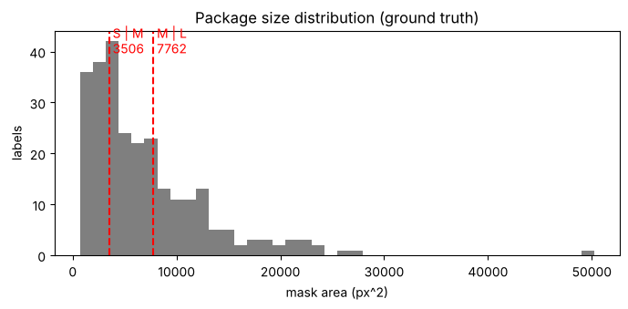

### 셀 26. 면적을 S/M/L로 바꾸는 함수와 크기별 색을 정합니다

```python
# size_class: 면적 → 'S'(small_max 이하) / 'M'(medium_max 이하) / 'L'
def size_class(area, rules=SIZE_RULES):
    if area <= rules['small_max']:
        return 'S'
    if area <= rules['medium_max']:
        return 'M'
    return 'L'

SIZE_COLOR = {'S': (255, 200, 0), 'M': (0, 200, 255), 'L': (60, 60, 255)}   # BGR: 하늘색, 주황, 빨강
print([size_class(a) for a in [1000, 5000, 15000]])  # 경계 아래·사이·위 값으로 동작 확인
```

**코드 설명**

- `size_class(area, rules=SIZE_RULES)` — 면적을 받아 `small_max` 이하면 `'S'`, `medium_max` 이하면 `'M'`, 그보다 크면 `'L'`을 돌려줍니다.
- `SIZE_COLOR` — 크기별 그리기 색입니다. OpenCV는 BGR 순서이므로 S는 하늘색, M은 주황, L은 빨강입니다.
- `[size_class(a) for a in [1000, 5000, 15000]]` — 경계 아래·사이·위 값으로 함수가 맞게 동작하는지 확인합니다.

**실행 결과**

검증 실행 예시: `['S', 'M', 'L']`이 출력됩니다.

### 셀 27. 트래킹을 한 번 돌리며 프레임·상자별 위치와 크기를 관측 표로 기록합니다

```python
# collect_observations: 영상 1회 트래킹 → (관측 표, (프레임, ID)→윤곽선 딕셔너리)
def collect_observations(src, tracker='bytetrack.yaml'):
    obs, polys = [], {}
    for i, r in enumerate(best_model.track(src, stream=True, tracker=tracker,
                                           conf=BEST_CONF, imgsz=CFG['imgsz'], verbose=False)):
        if r.boxes.id is None or r.masks is None:  # ID나 마스크가 없는 프레임은 건너뜀
            continue
        for b, tid, poly in zip(r.boxes.xyxy.cpu().numpy(), r.boxes.id.int().cpu().tolist(), r.masks.xy):  # 박스·ID·윤곽선을 같은 순서로
            if len(poly) < 3:
                continue
            area, long_px, short_px, _ = measure_mask(poly)  # 이 관측의 크기
            x1, y1, x2, y2 = b
            # 관측 1줄 — at_edge: 박스가 화면 가장자리에 닿았는지 (크기 결정에서 제외)
            obs.append({'frame': i, 'track_id': tid, 'cx': (x1 + x2) / 2, 'cy': (y1 + y2) / 2,
                        'area_px': area, 'long_px': long_px, 'short_px': short_px,
                        'at_edge': bool(x1 < EDGE or y1 < EDGE or x2 > W - EDGE or y2 > H - EDGE)})
            polys[(i, tid)] = poly  # 5-5 영상 다시 그리기용
    return pd.DataFrame(obs), polys

obs, obs_polys = collect_observations(CLIP)
print('관측 행 수:', len(obs), '| 트랙 수:', obs['track_id'].nunique(),
      '| 가장자리에 걸린 관측 비율:', round(obs['at_edge'].mean(), 2))
obs.round(1).head()  # 소수점 1자리, 앞 5줄
```

**코드 설명**

- `collect_observations(src, tracker)` — 영상을 트래킹하며 (관측 DataFrame, 윤곽선 딕셔너리)를 돌려줍니다. 윤곽선은 `(프레임, ID)`를 키로 저장해 5-5에서 영상을 다시 그릴 때 씁니다.
- `if r.boxes.id is None or r.masks is None: continue` — ID나 마스크가 없는 프레임은 건너뜁니다.
- `zip(r.boxes.xyxy..., r.boxes.id..., r.masks.xy)` — 박스, ID, 윤곽선을 같은 순서로 하나씩 꺼냅니다.
- `measure_mask(poly)` — 매 관측의 면적과 긴 변·짧은 변을 잽니다.
- `'at_edge': bool(x1 < EDGE or ... y2 > H - EDGE)` — 박스가 화면 가장자리에 닿았는지 기록합니다. 이 관측은 크기 결정에서 뺍니다.
- `obs.round(1).head()` — 소수점 한 자리로 반올림해 앞 5줄을 보여 줍니다.

**실행 결과**

검증 실행 예시: `관측 행 수: 498 | 트랙 수: 11 | 가장자리에 걸린 관측 비율: 0.18`이 출력됩니다. 표 열은 `frame, track_id, cx, cy, area_px, long_px, short_px, at_edge`입니다. 3-2의 탐지 합계(510)보다 조금 적은 것은 트래커가 ID를 붙이지 않은 탐지가 빠지기 때문입니다.

### 셀 28. 관측이 가장 많은 상자 하나의 면적 변화를 그래프로 봅니다

```python
# 한 상자의 면적이 시간에 따라 어떻게 재지는지 확인
tid_example = obs.groupby('track_id').size().idxmax()  # groupby: ID별로 묶어 관측 수 → 가장 많은 ID
one = obs[obs['track_id'] == tid_example]  # 그 ID의 관측만
plt.figure(figsize=(8, 3))
plt.plot(one['frame'], one['area_px'], '-', c='gray', lw=1)
plt.scatter(one['frame'], one['area_px'], c=np.where(one['at_edge'], 'red', 'tab:blue'), s=12)  # 가장자리=빨강, 나머지=파랑
plt.xlabel('frame'); plt.ylabel('mask area (px^2)')
plt.title(f'track {tid_example}: red = touching frame edge (excluded)')
plt.grid(alpha=.3); plt.show()
```

**코드 설명**

- `obs.groupby('track_id').size().idxmax()` — 관측 수가 가장 많은 ID를 고릅니다.
- `one = obs[obs['track_id'] == tid_example]` — 그 ID의 관측만 꺼냅니다.
- `np.where(one['at_edge'], 'red', 'tab:blue')` — 가장자리에 걸린 관측은 빨강, 나머지는 파랑 점으로 표시합니다.

**실행 결과**

검증 실행 예시: `track 5`의 프레임별 마스크 면적이 그려집니다. 화면에 들어오는 처음과 나가는 끝의 빨간 점은 상자가 잘려 면적이 작게 잽니다. 파란 점 구간에서도 상자가 오른쪽으로 갈수록 면적이 점점 커집니다. 화면 위치에 따라 카메라와의 거리가 달라지기 때문입니다.

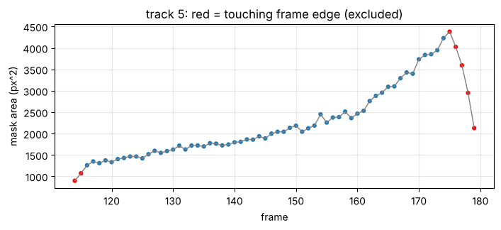

### 셀 29. 트랙별로 통과 시점과 크기를 확정해 크기별 통과 수를 집계합니다

```python
# summarize_tracks: 관측 표 → 기준선을 넘은 트랙별 통과 시점·방향·크기 표 (모델 재실행 없음)
def summarize_tracks(obs, line_x=LINE_X, fps=CLIP_FPS, rules=SIZE_RULES):
    rows = []
    for tid, g in obs.sort_values('frame').groupby('track_id'):  # 프레임 순 정렬 후 ID별로 묶음 (g = 한 ID의 관측)
        prev = g['cx'].shift()  # 바로 앞 관측의 중심 x를 같은 줄에
        # 앞·현재 관측이 선의 양쪽이면 통과 (&가 |보다 먼저 계산)
        crossed = g[(prev < line_x) & (g['cx'] >= line_x) | (prev >= line_x) & (g['cx'] < line_x)]
        if crossed.empty:
            continue                                     # 기준선을 넘지 않은 트랙은 집계하지 않음
        first = crossed.iloc[0]  # 처음 넘은 관측
        direction = 'left_to_right' if first['cx'] >= line_x else 'right_to_left'
        full = g[~g['at_edge']]  # 가장자리에 걸리지 않은 관측만
        use = full if len(full) >= 3 else g             # 온전한 관측이 3개 미만이면 전체 사용
        area = float(use['area_px'].median())  # 중앙값 — 순간적으로 튀는 값에 강함
        rows.append({'track_id': tid, 'cross_frame': int(first['frame']),
                     'time_s': round(first['frame'] / fps, 2), 'direction': direction,
                     'size_class': size_class(area, rules), 'area_px': round(area),
                     'long_px': round(float(use['long_px'].median())),
                     'short_px': round(float(use['short_px'].median())),
                     'n_obs': len(use), 'edge_only': len(full) < 3})
    cols = ['track_id', 'cross_frame', 'time_s', 'direction', 'size_class', 'area_px',
            'long_px', 'short_px', 'n_obs', 'edge_only']
    return pd.DataFrame(rows, columns=cols).sort_values('cross_frame').reset_index(drop=True)

size_log = summarize_tracks(obs)
size_log.to_csv('box_size_log.csv', index=False); save_out('box_size_log.csv')

size_counts = size_log['size_class'].value_counts().reindex(['S', 'M', 'L'], fill_value=0)  # S/M/L 순서, 없는 등급은 0
print('크기별 통과 수:', size_counts.to_dict(), '| 합계:', int(size_counts.sum()))
print('Step 4 카운트와 같은가:', int(size_counts.sum()) == len(count_log))
size_log
```

**코드 설명**

- `summarize_tracks(obs, line_x, fps, rules)` — 관측 표를 받아 기준선을 넘은 트랙마다 한 줄씩, 통과 시점·방향·크기를 담은 DataFrame을 돌려줍니다. 모델을 다시 돌리지 않습니다.
- `prev = g['cx'].shift()` — 같은 트랙 안에서 바로 앞 관측의 중심 x를 같은 줄에 붙입니다.
- `(prev < line_x) & (g['cx'] >= line_x) | (prev >= line_x) & (g['cx'] < line_x)` — 앞 관측과 현재 관측이 선의 양쪽에 있으면 통과입니다. 파이썬에서 `&`가 `|`보다 먼저 계산되므로 '오른쪽 통과 또는 왼쪽 통과'로 읽힙니다.
- `if crossed.empty: continue` — 선을 넘지 않은 트랙은 집계하지 않습니다. `first = crossed.iloc[0]`은 처음 넘은 관측입니다.
- `full = g[~g['at_edge']]`, `use = full if len(full) >= 3 else g` — 가장자리에 걸리지 않은 관측이 3개 이상이면 그것만 쓰고, 부족하면 전체를 씁니다. 이 경우 `edge_only`가 `True`로 기록됩니다.
- `area = float(use['area_px'].median())` — 중앙값으로 크기를 정합니다. 평균과 달리 마스크가 순간적으로 튀는 값에 흔들리지 않습니다.
- `size_counts = ...value_counts().reindex(['S', 'M', 'L'], fill_value=0)` — 크기별 개수를 S, M, L 순서로 세고, 없는 크기는 0으로 채웁니다.
- `int(size_counts.sum()) == len(count_log)` — 크기별 합계가 Step 4의 카운트와 같은지 확인합니다.

**실행 결과**

검증 실행 예시: `크기별 통과 수: {'S': 3, 'M': 2, 'L': 3} | 합계: 8`과 `Step 4 카운트와 같은가: True`가 출력됩니다. 표 열은 `track_id, cross_frame, time_s, direction, size_class, area_px, long_px, short_px, n_obs, edge_only`입니다. 예를 들어 ID 2는 면적 14208로 L, ID 3은 3968로 M, ID 5는 1936으로 S입니다. 8개 모두 `edge_only`가 `False`입니다.

> **막혔을 때** 합계가 Step 4와 다르면 `collect_observations()`에서 마스크가 없는 상자를 건너뛴 경우인지 확인합니다. 같은 모델·트래커·기준선을 쓰므로 원래는 같아야 합니다.

### 셀 30. 관측 표와 집계 결과로 크기별 색과 S/M/L 카운터가 있는 영상을 만듭니다

```python
# render_size_video: 저장된 윤곽선·집계로 영상을 다시 그려 dst에 저장, 파일명 반환 (모델 재실행 없음)
def render_size_video(src, obs_polys, size_log, dst='size_counting.mp4', line_x=LINE_X):
    cls_of = dict(zip(size_log['track_id'], size_log['size_class']))  # ID → 크기 등급
    cross_at = dict(zip(size_log['track_id'], size_log['cross_frame']))  # ID → 기준선 통과 프레임
    by_frame = defaultdict(list)  # 프레임 번호 → [(ID, 윤곽선), ...]
    for (i, tid), poly in obs_polys.items():
        by_frame[i].append((tid, poly))
    cap = cv2.VideoCapture(src)
    writer = cv2.VideoWriter(dst, cv2.VideoWriter_fourcc(*'mp4v'), CLIP_FPS, (W, H))
    i = 0
    while True:
        ok, frame = cap.read()  # ok=False면 영상 끝
        if not ok:
            break
        overlay = frame.copy()
        for tid, poly in by_frame[i]:
            c = cls_of.get(tid)
            col = SIZE_COLOR[c] if c else (180, 180, 180)          # 집계 대상이 아닌 상자는 회색
            cv2.fillPoly(overlay, [poly.astype(np.int32)], col)
            x, y = poly[:, 0].min(), poly[:, 1].min()
            label = f'{c} #{tid}' if c else f'#{tid}'
            cv2.putText(frame, label, (int(x), int(max(14, y - 4))), cv2.FONT_HERSHEY_SIMPLEX, 0.55, col, 2)
        frame = cv2.addWeighted(overlay, 0.45, frame, 0.55, 0)  # 칠한 사본 45% + 원본 55% → 반투명
        cv2.line(frame, (line_x, 0), (line_x, H), (0, 255, 255), 2)
        done = [cls_of[t] for t, f in cross_at.items() if f <= i]  # 현재 프레임까지 선을 넘은 상자들의 등급
        # 위쪽 검은 띠에 'S:n M:n L:n =합계' 표시
        cv2.rectangle(frame, (6, 6), (W - 6, 40), (0, 0, 0), -1)
        for k, s in enumerate(['S', 'M', 'L']):
            cv2.putText(frame, f'{s}:{done.count(s)}', (14 + k * 72, 32), cv2.FONT_HERSHEY_SIMPLEX, 0.75, SIZE_COLOR[s], 2)
        cv2.putText(frame, f'={len(done)}', (14 + 3 * 72, 32), cv2.FONT_HERSHEY_SIMPLEX, 0.75, (255, 255, 255), 2)
        writer.write(frame)
        i += 1
    cap.release(); writer.release()
    return dst

render_size_video(CLIP, obs_polys, size_log)
save_out('size_counting.mp4')  # Drive에도 복사
show_video('size_counting.mp4')
```

**코드 설명**

- `render_size_video(src, obs_polys, size_log, dst, line_x)` — 원본 영상을 다시 읽으며 저장해 둔 윤곽선과 집계 결과로 그림을 그려 `dst`에 저장하고 파일 이름을 돌려줍니다. 모델은 다시 돌리지 않습니다.
- `cls_of`, `cross_at` — ID별 크기 등급과 기준선 통과 프레임을 찾아보는 딕셔너리입니다.
- `by_frame[i].append((tid, poly))` — `(프레임, ID)` 키로 저장된 윤곽선을 프레임별 목록으로 다시 묶습니다.
- `col = SIZE_COLOR[c] if c else (180, 180, 180)` — 집계 대상(선을 넘은 상자)은 크기별 색, 그 밖의 상자는 회색으로 칠합니다.
- `cv2.addWeighted(overlay, 0.45, frame, 0.55, 0)` — 마스크를 칠한 사본과 원본을 섞어 반투명하게 보이게 합니다.
- `done = [cls_of[t] for t, f in cross_at.items() if f <= i]` — 현재 프레임까지 선을 넘은 상자들의 크기 목록입니다. 위쪽 검은 띠에 `S:n M:n L:n =합계`로 표시합니다.

**실행 결과**

크기별 색으로 칠해진 상자와 `S #ID` 같은 라벨, 노란 기준선, 위쪽의 S/M/L 카운터가 있는 영상이 재생됩니다. 상자가 선을 넘는 순간 해당 크기의 숫자가 올라갑니다. 영상은 `save_out()`으로 Drive 폴더에도 복사됩니다.

### 셀 31. 크기별 개수와 상자별 면적을 요약 그래프로 그려 저장합니다

```python
fig, axes = plt.subplots(1, 2, figsize=(11, 3.4), gridspec_kw={'width_ratios': [1, 2]})
bar_colors = ['#00c8ff', '#ffc800', '#ff3c3c']  # SIZE_COLOR와 같은 색 (matplotlib은 RGB 순서)
axes[0].bar(['S', 'M', 'L'], size_counts.values, color=bar_colors)
axes[0].set_title('Packages by size'); axes[0].set_ylabel('count')
for s, c in zip(['S', 'M', 'L'], bar_colors):
    d = size_log[size_log['size_class'] == s]
    axes[1].scatter(d['time_s'], d['area_px'], s=60, color=c, label=s, edgecolor='k')  # 상자별 통과 시각(x)과 면적(y)
axes[1].axhline(SIZE_RULES['small_max'], ls='--', c='gray', lw=1)  # S|M 경계
axes[1].axhline(SIZE_RULES['medium_max'], ls='--', c='gray', lw=1)  # M|L 경계
axes[1].set_xlabel('time crossing the line (s)'); axes[1].set_ylabel('mask area (px^2)')
axes[1].set_title('Each counted package'); axes[1].legend(); axes[1].grid(alpha=.3)
# show() 뒤에는 그림이 비워지므로 savefig를 먼저
plt.tight_layout(); plt.savefig('size_summary.png', dpi=120); save_out('size_summary.png'); plt.show()
```

**코드 설명**

- `plt.subplots(1, 2, ..., gridspec_kw={'width_ratios': [1, 2]})` — 왼쪽 막대그래프, 오른쪽 산점도를 1:2 폭으로 배치합니다.
- `axes[0].bar(['S', 'M', 'L'], size_counts.values, ...)` — 크기별 통과 수 막대그래프입니다.
- `axes[1].scatter(d['time_s'], d['area_px'], ...)` — 상자마다 기준선 통과 시각(x)과 면적(y)을 점으로 찍습니다.
- `axhline(SIZE_RULES['small_max'])`, `axhline(SIZE_RULES['medium_max'])` — S/M, M/L 경계를 회색 점선으로 표시합니다.
- `plt.savefig('size_summary.png', dpi=120)` — `plt.show()`보다 먼저 저장해야 합니다. `show()` 뒤에는 그림이 비워져 빈 파일이 저장됩니다.

**실행 결과**

검증 실행 예시: 왼쪽 막대그래프에 S 3, M 2, L 3이 표시되고, 오른쪽에 상자 8개가 크기별 색 점으로 찍힙니다. 점이 두 점선 사이 어디에 있는지로 각 상자의 등급을 확인할 수 있습니다.

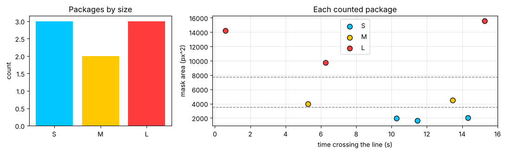

**정리 · 확인해 보기**

결과 파일은 모두 SAVE_DIR(MyDrive/yolo_day2)에 저장됩니다. 이 중 `box_seg_best.pt`, `conveyor_clip.mp4`, `size_rules.json`은 통합 실습에서 다시 씁니다. 확인해 보기: 같은 상자의 면적이 화면 위치에 따라 달라진다면, 중앙값으로 정한 등급은 언제 틀릴 수 있을까요? 관측 표를 남기는 구조 덕분에 `SIZE_RULES`만 바꾸고 셀 29부터 다시 실행하면 모델을 다시 돌리지 않고 재집계할 수 있습니다.

---

## 도전 과제

1. 긴 변 기준으로 분류 — 면적 대신 `long_px`로 S/M/L을 나눠 봅니다. 힌트: `np.percentile(label_sizes['long_px'], [33.3, 66.7])`로 새 경계를 구하고, `summarize_tracks()` 안의 `size_class(area, rules)`를 긴 변 중앙값으로 판정하도록 바꿉니다. 두 기준의 `size_class` 열을 나란히 놓고, 납작하고 긴 상자가 어느 기준에서 더 합리적으로 분류되는지 비교합니다.
2. 원근 보정 — 같은 상자도 화면 위치에 따라 면적이 달라집니다(셀 28 그래프). 힌트: `obs`에서 가장자리가 아닌 관측으로 `cx`(또는 `cy`)와 `area_px`의 관계를 산점도로 그리고, `np.polyfit`으로 직선을 맞춥니다. 기준 위치(예: `LINE_X`)에서의 예상 면적으로 나눠 면적을 보정한 뒤 다시 분류해 봅니다.
3. 실시간으로 결정하기 — 지금은 영상을 다 본 뒤 크기를 정합니다. 힌트: `summarize_tracks()`에서 `g = g[g['frame'] <= first['frame']]`처럼 기준선을 넘는 순간까지의 관측만 남긴 뒤 중앙값을 계산하도록 바꿉니다. 원래 `size_log`와 `size_class`가 몇 개나 달라지는지 셉니다.
4. 트래커 비교 — `run_counting(CLIP, tracker='botsort.yaml')`과 `collect_observations(CLIP, tracker='botsort.yaml')`로 다시 실행합니다. 부여된 ID 수(`obs['track_id'].nunique()`), 통과 수, 크기별 카운트를 ByteTrack 결과와 한 표로 정리합니다.

## 자주 겪는 문제

| 증상 | 원인 | 해결 |
|---|---|---|
| `GPU 사용 가능: False`가 나오고 학습이 매우 느립니다. | 런타임 유형이 CPU로 되어 있습니다. | 메뉴 → 런타임 → 런타임 유형 변경에서 T4 GPU를 고르고 처음 셀부터 다시 실행합니다. GPU 사용 한도에 걸렸다면 셀 4에서 `QUICK_RUN = True`로 바꿔 학습을 줄입니다. |
| 학습이 끝난 뒤 런타임이 끊겨 변수가 모두 사라졌습니다. | Colab 런타임이 재시작되면 메모리의 변수와 /content 아래 파일이 사라집니다. | Drive에 `box_seg_best.pt`가 남아 있으면 다시 학습하지 않아도 됩니다. 셀 1~10을 실행한 뒤 학습 셀(16) 대신 `BEST = SAVE_DIR / 'box_seg_best.pt'`, `TRAIN_MIN = 0`을 실행하고 셀 12부터 이어 갑니다. 셀 11은 학습 폴더가 없으므로 건너뜁니다. |
| Drive 마운트가 실패하거나 계속 접근 허용을 묻습니다. | 허용 창에서 일부 권한을 선택하지 않았거나 다른 계정으로 로그인했습니다. | 셀 3를 다시 실행해 같은 계정으로 모든 권한을 허용합니다. 계속 안 되면 `USE_DRIVE = False`로 실행하고, 끝난 뒤 `outputs` 폴더의 파일을 직접 내려받아 Drive의 `yolo_day2` 폴더에 올립니다. |
| 트래킹 셀에서 `ModuleNotFoundError: No module named 'lap'` 같은 오류가 납니다. | ByteTrack이 쓰는 `lap` 라이브러리가 설치되지 않았거나 런타임 재시작 후 설치가 사라졌습니다. | 셀 1의 설치를 다시 실행하고, 세션 재시작 안내가 뜨면 재시작한 뒤 필요한 셀을 다시 실행합니다. |
| 영상이 노트북에서 재생되지 않거나 검은 화면만 보입니다. | OpenCV가 만든 mp4v 영상은 브라우저에서 재생되지 않으며, `show_video()`의 ffmpeg 변환이 실패했을 수 있습니다. | 셀 출력의 오류 메시지를 확인합니다. 파일 자체는 저장되므로 Drive의 `yolo_day2` 폴더(또는 Colab 파일 탐색기)에서 내려받아 재생해 봅니다. |
| 학습 중 `CUDA out of memory` 오류가 납니다. | 한 번에 처리하는 이미지 수(batch)가 GPU 메모리에 비해 큽니다. | 셀 4의 `batch=16`을 8로 줄이고 런타임을 다시 시작한 뒤 실행합니다. |
| 크기별 합계가 Step 4 카운트와 다릅니다(`Step 4 카운트와 같은가: False`). | `collect_observations()`는 마스크가 없는 탐지를 건너뛰므로, 그 프레임에서 선을 넘은 상자를 놓칠 수 있습니다. | `size_log`와 `count_log`의 `track_id`를 비교해 빠진 ID를 찾고, 그 ID의 관측을 `obs`에서 확인합니다. 마스크가 빠진 프레임이 통과 시점이었는지 봅니다. |
| 모든 상자가 S 또는 L 한 가지로만 분류됩니다. | `size_rules.json`의 경계가 영상 좌표계와 맞지 않거나, 라벨 상자가 너무 적게 모였습니다. | 셀 25 출력의 라벨 상자 수와 `small_max`, `medium_max`를 확인합니다. 영상 크기가 320x640인지(셀 19 출력), `poly[:, 0] - 320`의 오프셋이 오른쪽 화면 시작점과 같은지 확인합니다. |

## 용어 정리

| 용어 | 뜻 |
|---|---|
| 파인튜닝(fine-tuning) | 사전학습된 가중치에서 출발해 우리 데이터로 추가 학습하는 것입니다. 처음부터 학습하는 것보다 적은 데이터와 시간으로 좋은 성능을 냅니다. |
| 세그멘테이션 마스크 | 물체가 차지하는 픽셀 영역을 모양 그대로 나타낸 것입니다. 이 노트북에서는 `r.masks.xy`의 윤곽선 좌표로 다룹니다. |
| IoU | Intersection over Union. 예측과 정답이 겹치는 넓이를 둘을 합친 넓이로 나눈 값입니다. 1이면 완전히 일치합니다. |
| TP / FP / FN | TP는 맞게 찾은 상자, FP는 없는 상자를 찾은 헛탐지, FN은 있는데 놓친 상자입니다. |
| Precision / Recall | Precision(정밀도)은 상자라고 한 것 중 진짜 상자의 비율, Recall(재현율)은 진짜 상자 중 찾아낸 비율입니다. |
| F1 | Precision과 Recall의 조화평균입니다. 둘 중 하나만 높아서는 커지지 않으므로 균형을 보는 지표입니다. |
| mAP50 / mAP50-95 | mAP50은 IoU 0.5 기준 정밀도-재현율 곡선 아래 면적, mAP50-95는 IoU 0.5~0.95 구간의 평균입니다. 뒤쪽이 위치·모양 정확도를 더 엄격하게 봅니다. |
| 신뢰도 임계값(conf) | 이 값보다 신뢰도가 낮은 예측은 버리는 기준입니다. 올리면 FP가 줄고 FN이 늘어납니다. |
| epoch | 학습 데이터 전체를 한 번 모두 학습하는 단위입니다. |
| 트래킹 / ByteTrack | 프레임이 바뀌어도 같은 물체에 같은 ID를 붙이는 기술입니다. ByteTrack은 빠르고 널리 쓰이는 트래커이며 `bytetrack.yaml`로 지정합니다. |
| ID switch | 같은 물체가 가려졌다 다시 보이는 등의 이유로 새 ID를 받는 현상입니다. 중복 카운트나 누락의 원인이 됩니다. |
| 라인 카운팅 | 가상의 기준선을 정하고, 트래킹 ID의 중심점이 선을 넘을 때 ID당 한 번씩 세는 방법입니다. |
| 회전 사각형(minAreaRect) | 윤곽선을 가장 작게 감싸도록 기울어질 수 있는 사각형입니다. 놓인 각도와 상관없이 물체의 가로·세로를 잴 수 있습니다. |
| 분위수(percentile) | 값을 크기순으로 세웠을 때 특정 비율 위치의 값입니다. 33.3% 분위수 아래에 전체의 약 1/3이 있습니다. |
| 중앙값(median) | 값을 크기순으로 세웠을 때 가운데 값입니다. 평균과 달리 순간적으로 튀는 값에 거의 영향을 받지 않습니다. |
