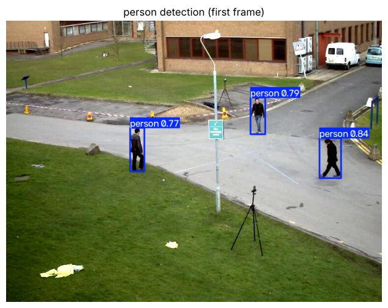
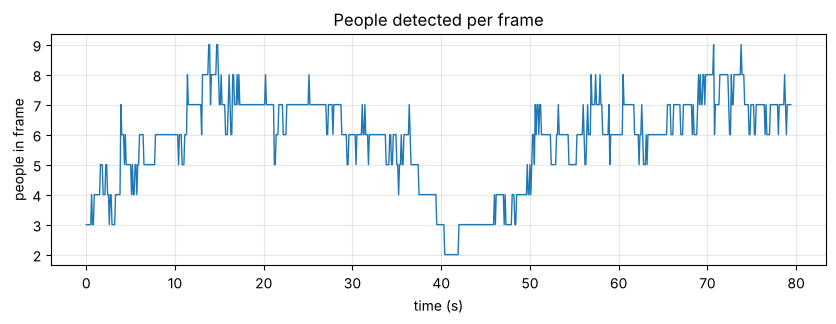
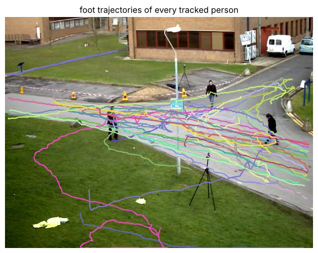
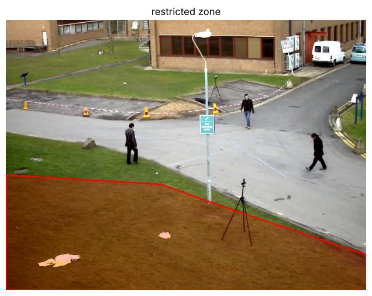
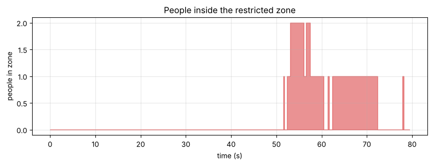
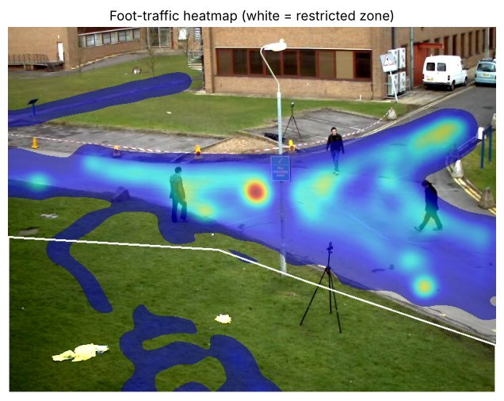
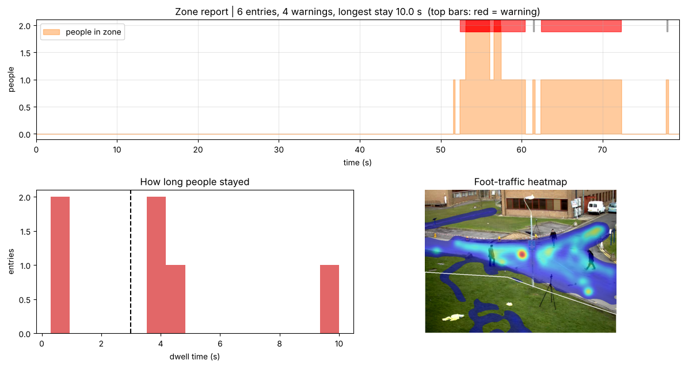

# YOLO 2회차 추가 실습 — 위험구역 침입 감시 시스템

노트북: [`02_yolo_day2_zone_lab_v1.1.ipynb`](../02_yolo_day2_zone_lab_v1.1.ipynb) · [Colab에서 열기](https://colab.research.google.com/github/jhjwlee/yolo-training/blob/main/day2/02_yolo_day2_zone_lab_v1.1.ipynb)

| 항목 | 내용 |
|---|---|
| 실행 환경 | Google Colab, 런타임 유형 T4 GPU (CPU에서도 동작하지만 느립니다) |
| 예상 소요 시간 | 약 40분 (T4 GPU 기준) |
| 사용 데이터 | OpenCV 저장소 공개 샘플 영상 vtest.avi (건물 앞 광장을 비추는 고정 카메라, 768×576, 10fps, 79.5초) |
| 주요 결과 파일 | zone_frames.csv, zone_events.csv, zone_monitor.mp4, heatmap.png, zone_report.png, zone_summary.json |

## 목차

- [0. 준비](#0-준비)
- [Step 1. 사람만 탐지하기](#step-1-사람만-탐지하기)
- [Step 2. 사람 추적과 발 위치 기록](#step-2-사람-추적과-발-위치-기록)
- [Step 3. 금지 구역 그리기와 침입 판정](#step-3-금지-구역-그리기와-침입-판정)
- [Step 4. 진입·이탈 이벤트와 체류 시간 경고](#step-4-진입이탈-이벤트와-체류-시간-경고)
- [Step 5. 동선 히트맵과 감시 리포트](#step-5-동선-히트맵과-감시-리포트)
- [도전 과제](#도전-과제) · [자주 겪는 문제](#자주-겪는-문제) · [용어 정리](#용어-정리)

## 이 실습에서 배우는 것

- classes=[0] 인자로 COCO 모델에서 사람만 골라 탐지하는 방법
- ByteTrack으로 사람을 추적하고 프레임·사람 단위 관측 표(obs)를 만드는 방법
- 박스 중심 대신 발 위치로 바닥 위 구역 침입을 판정하는 이유와 cv2.pointPolygonTest 사용법
- Colab 화면에서 클릭으로 다각형을 그리고 그 좌표를 파이썬으로 받아오는 원리
- 연속 프레임 조건으로 진입·이탈 이벤트를 만들고 체류 시간 경고를 내는 규칙 설계
- 발 위치 히트맵으로 실제 동선을 보고 금지 구역 위치를 점검하는 방법

## 실습 흐름

| 단계 | 만드는 것 | 결과물 |
|---|---|---|
| 0. 준비 | 라이브러리 설치, 저장 위치 설정, 보조 함수, 실습 영상 내려받기 | vtest.avi, 첫 프레임 FIRST |
| Step 1 | 사람만 탐지하기 | 프레임별 인원 그래프 |
| Step 2 | 사람 추적 + 발 위치 기록 | 관측 표 obs, 발 위치 궤적 그림 |
| Step 3 | 금지 구역 그리기 + 침입 판정 | 금지 구역 좌표 ZONE, 구역 안 인원 그래프 |
| Step 4 | 진입·이탈 이벤트와 체류 시간 경고 | zone_events.csv, zone_monitor.mp4 |
| Step 5 | 동선 히트맵과 감시 리포트 | heatmap.png, zone_report.png, zone_summary.json, zone_frames.csv |

각 셀은 **위에서부터 순서대로** 실행합니다. 셀마다 코드 원문, 코드 설명, 실행 결과, 막혔을 때 확인할 점을 차례로 정리했습니다.

---

## 0. 준비

**목표** 실습에 필요한 라이브러리를 설치하고 결과 저장 위치를 정합니다. 실습 영상을 내려받아 해상도·FPS·길이를 확인합니다.

이 실습은 영상 한 편을 끝까지 처리합니다. 결과 파일은 SAVE_DIR 한 곳에 모읍니다. Colab 세션이 끊기면 /content 아래 파일은 사라지므로 Google Drive에 저장하도록 기본값을 두었습니다. 영상의 FPS, 프레임 수, 가로·세로 크기는 뒤 단계 계산에 계속 쓰이므로 여기서 전역 변수로 만들어 둡니다.

### 셀 1. ultralytics와 lap 설치

```python
# 패키지 설치 — ultralytics(YOLO), lap(ByteTrack이 박스를 짝지을 때 사용)
# -q: 설치 로그 줄임. 런타임을 새로 연결하면 이 셀부터 다시 실행
!pip -q install ultralytics lap
```

**코드 설명**

- `!pip` — 맨 앞의 !는 이 줄을 파이썬이 아닌 셸 명령으로 실행하라는 Colab(Jupyter) 문법입니다.
- `-q` — 설치 로그를 짧게 줄입니다. 오류가 나면 이 옵션을 빼고 다시 실행해 메시지를 확인합니다.
- `ultralytics` — YOLO 모델을 불러오고 탐지·추적을 실행하는 라이브러리입니다.
- `lap` — 추적기(ByteTrack)가 이전 프레임의 사람과 현재 프레임의 박스를 짝지을 때 쓰는 계산 패키지입니다.

**실행 결과**

설치가 끝나면 별다른 출력 없이 셀 실행이 완료됩니다. 이미 설치된 패키지는 건너뜁니다.

> **막혔을 때** 설치 직후 '런타임 다시 시작' 안내가 나오면 따르고, 이 셀은 건너뛰고 다음 셀부터 다시 실행합니다.

### 셀 2. 라이브러리 불러오기, Colab 여부 확인, 저장 폴더 만들기

```python
import os, json, shutil, base64, subprocess
from pathlib import Path

# 영상 처리(cv2), 배열(numpy), 표(pandas), 그래프(matplotlib)
import cv2
import numpy as np
import pandas as pd
import matplotlib.pyplot as plt
import torch
from IPython.display import HTML, display  # 셀 출력에 HTML(영상 플레이어·그리기 도구) 띄우기
from ultralytics import YOLO

print('GPU 사용 가능:', torch.cuda.is_available())  # T4 런타임이면 True

try:
    from google.colab import drive, output  # Colab에만 있는 모듈 → 성공하면 Colab
    IN_COLAB = True
except ImportError:
    IN_COLAB = False

USE_DRIVE = True  # False면 Drive 대신 런타임 임시 폴더에 저장 (연결이 끊기면 사라짐)
if IN_COLAB and USE_DRIVE:
    drive.mount('/content/drive')
    SAVE_DIR = Path('/content/drive/MyDrive/yolo_day2/zone')  # Drive 안 결과 폴더
else:
    SAVE_DIR = Path('outputs/zone')
SAVE_DIR.mkdir(parents=True, exist_ok=True)  # 중간 폴더까지 생성, 이미 있으면 그냥 통과
print('결과 저장 위치:', SAVE_DIR.resolve())
```

**코드 설명**

- `import cv2, numpy, pandas, matplotlib.pyplot` — 영상 처리, 배열 계산, 표 정리, 그래프 그리기에 각각 씁니다.
- `from IPython.display import HTML, display` — 셀 출력 영역에 HTML(영상 플레이어, 그리기 도구)을 띄울 때 씁니다.
- `torch.cuda.is_available()` — GPU를 쓸 수 있으면 True를 출력합니다. T4 런타임이라면 True가 나와야 합니다.
- `try: from google.colab import drive, output` — Colab에서만 있는 모듈입니다. 불러오기에 성공하면 `IN_COLAB = True`, 실패하면 False가 됩니다.
- `USE_DRIVE = True` — True이고 Colab이면 `drive.mount('/content/drive')`로 Google Drive를 연결합니다.
- `SAVE_DIR` — Drive를 쓰면 `/content/drive/MyDrive/yolo_day2/zone`, 아니면 현재 폴더의 `outputs/zone`이 저장 위치입니다.
- `SAVE_DIR.mkdir(parents=True, exist_ok=True)` — 중간 폴더까지 한꺼번에 만들고, 이미 있으면 오류 없이 넘어갑니다.

**실행 결과**

'GPU 사용 가능: True'와 '결과 저장 위치: /content/drive/MyDrive/yolo_day2/zone' 두 줄이 출력됩니다. Colab에서는 Drive 접근 허용 창이 먼저 뜹니다.

> **막혔을 때** Drive 연결 창에서 권한을 허용하지 않으면 셀이 멈춥니다. Drive 저장이 필요 없으면 `USE_DRIVE = False`로 바꾸고 다시 실행합니다. 이때 결과는 세션이 끝나면 사라지므로 직접 내려받아 둡니다.

### 셀 3. 그림 보기·영상 보기·결과 저장 보조 함수

```python
# OpenCV(BGR) 이미지를 matplotlib로 보여 주기
def show_bgr(img, title=None, size=(9, 6)):
    plt.figure(figsize=size)
    plt.imshow(img[..., ::-1]); plt.axis('off')  # [..., ::-1]: 색 축을 뒤집어 BGR→RGB, 눈금 숨김
    if title:
        plt.title(title)
    plt.show()

# mp4 영상을 노트북 안에서 재생 (입력: 영상 경로, 표시 폭 px)
# OpenCV가 만든 mp4v 영상은 브라우저가 못 틀어서 H.264로 다시 인코딩
def show_video(path, width=640):
    h264 = str(Path(path).with_name(Path(path).stem + '_h264.mp4'))  # 예: zone_monitor.mp4 → zone_monitor_h264.mp4
    subprocess.run(['ffmpeg', '-y', '-loglevel', 'error', '-i', str(path),
                    '-vcodec', 'libx264', '-pix_fmt', 'yuv420p', h264], check=True)
    data = base64.b64encode(open(h264, 'rb').read()).decode()  # 영상 파일을 글자(base64)로 바꿔 HTML에 직접 넣음
    display(HTML(f'<video width="{width}" controls loop autoplay muted>'
                 f'<source src="data:video/mp4;base64,{data}" type="video/mp4"></video>'))

# 파일을 SAVE_DIR로 복사하고 복사된 경로를 돌려줌
def save_out(path):
    dst = SAVE_DIR / Path(path).name
    if Path(path).resolve() != dst.resolve():  # 원본과 대상이 같은 파일이면 복사 생략
        shutil.copy(path, dst)
    return dst
```

**코드 설명**

- `show_bgr(img, title=None, size=(9, 6))` — OpenCV 이미지를 matplotlib로 보여 줍니다. 반환값은 없습니다.
- `img[..., ::-1]` — OpenCV는 색을 BGR 순서로 저장합니다. 마지막 축을 뒤집어 RGB로 바꿔야 색이 제대로 보입니다.
- `show_video(path, width=640)` — mp4 파일을 노트북 안에서 재생합니다. 이름 뒤에 `_h264`를 붙인 파일을 새로 만듭니다.
- `subprocess.run(['ffmpeg', ..., '-vcodec', 'libx264', '-pix_fmt', 'yuv420p', h264], check=True)` — OpenCV가 저장한 mp4v 영상은 브라우저에서 재생되지 않아 H.264로 다시 인코딩합니다. `check=True`는 변환 실패 시 오류를 냅니다.
- `base64.b64encode(...)` — 영상 파일을 글자로 바꿔 `<video>` 태그 안에 직접 넣습니다. 그래서 별도 파일 경로 없이 재생됩니다.
- `save_out(path)` — 파일을 `SAVE_DIR`로 복사하고 복사된 경로를 돌려줍니다. 원본과 대상이 같은 파일이면 복사를 건너뜁니다.

**실행 결과**

함수 정의만 하므로 출력이 없습니다.

### 셀 4. 실습 영상 내려받기와 기본 정보 확인

```python
# 실습 영상 내려받기 (OpenCV 저장소의 공개 샘플 영상)
VIDEO = 'vtest.avi'
if not Path(VIDEO).exists():  # 이미 있으면 다시 받지 않음 (!wget: 셸 명령)
    !wget -q https://raw.githubusercontent.com/opencv/opencv/master/samples/data/vtest.avi -O {VIDEO}

cap = cv2.VideoCapture(VIDEO)  # 영상 파일 열기
FPS = cap.get(cv2.CAP_PROP_FPS) or 10  # 초당 프레임 수, 못 읽으면(0) 10
N_FRAMES = int(cap.get(cv2.CAP_PROP_FRAME_COUNT))  # 전체 프레임 수
W, H = int(cap.get(cv2.CAP_PROP_FRAME_WIDTH)), int(cap.get(cv2.CAP_PROP_FRAME_HEIGHT))  # 가로·세로 픽셀 수
ok, FIRST = cap.read()  # 첫 프레임 — 구역 그리기·결과 그림 배경용
cap.release()  # 열었던 영상 닫기
print(f'{VIDEO}: {W}x{H}, {FPS:.0f}fps, {N_FRAMES}프레임, {N_FRAMES / FPS:.1f}초')
show_bgr(FIRST, 'first frame')
```

**코드 설명**

- `if not Path(VIDEO).exists():` — 영상이 없을 때만 `!wget`으로 OpenCV 저장소에서 vtest.avi를 내려받습니다. 다시 실행해도 중복으로 받지 않습니다.
- `cv2.VideoCapture(VIDEO)` — 영상 파일을 엽니다. `cap.get(...)`으로 영상 속성을 읽습니다.
- `FPS = cap.get(cv2.CAP_PROP_FPS) or 10` — 초당 프레임 수입니다. 값을 못 읽어 0이 나오면 10을 씁니다.
- `N_FRAMES`, `W`, `H` — 전체 프레임 수, 가로·세로 픽셀 수입니다. 뒤에서 그래프 길이와 히트맵 크기에 씁니다.
- `ok, FIRST = cap.read()` — 첫 프레임 한 장을 읽어 `FIRST`에 둡니다. 구역 그리기와 결과 그림의 배경으로 씁니다.
- `cap.release()` — 열었던 영상을 닫습니다.

**실행 결과**

'vtest.avi: 768x576, 10fps, 795프레임, 79.5초'가 출력되고 첫 프레임이 표시됩니다(검증 실행 예시). 건물 앞 도로와 잔디밭, 걷는 사람 몇 명이 보입니다.

> **막혔을 때** wget이 실패하면 vtest.avi 파일이 0바이트로 남아 다음 실행 때 내려받기를 건너뜁니다. 이때는 파일을 지우고 다시 실행합니다.

---

## Step 1. 사람만 탐지하기

**목표** COCO 사전학습 모델로 사람만 탐지합니다. 영상 전체에서 프레임마다 사람이 몇 명 보이는지 그래프로 확인합니다.

yolo26n.pt는 COCO 데이터셋의 80개 클래스를 찾도록 학습된 모델입니다. 사람은 0번 클래스입니다. classes=[0]을 주면 모델이 결과를 낼 때부터 사람 이외의 박스를 빼 줍니다. 결과를 받은 뒤 걸러내는 것보다 코드가 짧고 처리도 가볍습니다.

### 셀 5. 모델을 불러와 첫 프레임에서 사람 탐지

```python
model = YOLO('yolo26n.pt')  # COCO 사전학습 모델 중 가장 작은 n 크기
PERSON = 0  # COCO 클래스 0번 = 사람
CONF = 0.3  # 신뢰도 기준 — 낮추면 더 많이 찾지만 오탐도 늘어남

r = model(FIRST, classes=[PERSON], conf=CONF, verbose=False)[0]  # classes=[0]: 사람만, [0]: 결과 리스트의 첫 이미지
print('첫 프레임에서 찾은 사람 수:', len(r.boxes))
show_bgr(r.plot(), 'person detection (first frame)')  # r.plot(): 박스를 그린 BGR 이미지
```

**코드 설명**

- `model = YOLO('yolo26n.pt')` — 가장 작은(n) COCO 사전학습 모델을 불러옵니다. 처음 실행하면 가중치 파일을 자동으로 내려받습니다.
- `PERSON = 0`, `CONF = 0.3` — 사람 클래스 번호와 신뢰도 기준입니다. 0.3보다 확신이 낮은 박스는 버립니다.
- `model(FIRST, classes=[PERSON], conf=CONF, verbose=False)[0]` — 이미지 한 장을 넣어도 결과는 리스트로 나오므로 `[0]`으로 첫 결과를 꺼냅니다.
- `len(r.boxes)` — 탐지된 박스 수, 곧 사람 수입니다.
- `r.plot()` — 박스와 클래스 이름을 그린 BGR 이미지를 돌려줍니다. 그래서 `show_bgr`로 바로 볼 수 있습니다.

**실행 결과**

'첫 프레임에서 찾은 사람 수: 3'이 출력되고 사람 3명에 person 박스가 그려진 그림이 나옵니다(검증 실행 예시).



### 셀 6. 영상 전체에서 프레임별 사람 수 그래프 그리기

```python
# 영상 전체 — 프레임마다 사람 수 세기
counts = [len(r.boxes) for r in model(VIDEO, stream=True, classes=[PERSON], conf=CONF, verbose=False)]  # stream=True: 프레임마다 결과를 하나씩 받아 메모리 절약
t = np.arange(len(counts)) / FPS  # 프레임 번호 → 초
plt.figure(figsize=(10, 3))
plt.plot(t, counts, lw=1)
plt.xlabel('time (s)'); plt.ylabel('people in frame'); plt.title('People detected per frame')
plt.grid(alpha=.3); plt.show()
print(f'프레임당 평균 {np.mean(counts):.1f}명, 최대 {max(counts)}명')
```

**코드 설명**

- `model(VIDEO, stream=True, ...)` — 영상 경로를 바로 넣습니다. `stream=True`이면 결과를 한 프레임씩 내주는 제너레이터가 되어 메모리를 아낍니다.
- `[len(r.boxes) for r in ...]` — 프레임마다 사람 수를 세어 리스트 `counts`에 담습니다. 길이는 전체 프레임 수와 같습니다.
- `t = np.arange(len(counts)) / FPS` — 프레임 번호를 FPS로 나눠 초 단위 시간축을 만듭니다.
- `plt.plot(t, counts, lw=1)` — 시간에 따른 사람 수를 선 그래프로 그립니다.
- `np.mean(counts)`, `max(counts)` — 프레임당 평균 인원과 최대 인원을 출력합니다.

**실행 결과**

'People detected per frame' 선 그래프가 나오고 '프레임당 평균 5.8명, 최대 9명'이 출력됩니다(검증 실행 예시). 그래프는 프레임마다 들쭉날쭉합니다.



> **막혔을 때** CPU 런타임에서는 795프레임을 처리하는 데 시간이 오래 걸립니다. 런타임 유형이 T4 GPU인지 먼저 확인합니다.

**정리 · 확인해 보기**

그래프가 들쭉날쭉한 이유는 사람이 서로 가리거나 화면 가장자리에서 일부만 보일 때 탐지가 끊기기 때문입니다. 탐지만으로는 '같은 사람'을 이어 붙일 수 없습니다. 이 끊김을 메우는 것이 다음 단계의 추적입니다.

---

## Step 2. 사람 추적과 발 위치 기록

**목표** 영상을 한 번 추적하면서 프레임마다, 사람마다 한 줄씩 관측 표 obs를 만듭니다. 뒤 단계는 모두 이 표만으로 계산합니다.

금지 구역은 바닥 위의 영역입니다. 박스 중심은 허리 높이에 찍히므로, 카메라가 비스듬히 내려다볼 때 실제 서 있는 곳보다 화면 위쪽에 놓입니다. 그래서 박스 아래쪽 가운데 점 ((x1 + x2) / 2, y2)를 발 위치로 씁니다. 추적은 시간이 오래 걸리므로 한 번만 실행해 표로 남깁니다. 구역 판정, 체류 시간, 히트맵은 모두 이 표를 다시 계산하므로 모델을 또 돌릴 필요가 없습니다.

### 셀 7. 사람을 추적해 프레임·사람 단위 관측 표 만들기

```python
# 영상 경로 → 관측 표 (프레임마다, 사람마다 한 줄)
def track_people(src):
    rows = []
    for i, r in enumerate(model.track(src, stream=True, classes=[PERSON], conf=CONF,  # i = 프레임 번호
                                      tracker='bytetrack.yaml', verbose=False)):  # ByteTrack으로 같은 사람에 같은 ID 부여
        if r.boxes.id is None:  # 추적 중인 사람이 없는 프레임은 건너뜀
            continue
        # 사람마다 박스 좌표(xyxy), 추적 ID, 신뢰도 (.cpu(): GPU 값을 CPU로)
        for (x1, y1, x2, y2), tid, cf in zip(r.boxes.xyxy.cpu().numpy(), r.boxes.id.int().cpu().tolist(),
                                             r.boxes.conf.cpu().numpy()):
            rows.append({'frame': i, 'time_s': round(i / FPS, 2), 'track_id': tid,
                         'x1': x1, 'y1': y1, 'x2': x2, 'y2': y2,
                         'foot_x': (x1 + x2) / 2, 'foot_y': y2, 'conf': round(float(cf), 3)})  # 발 위치 = 박스 아래 가운데
    return pd.DataFrame(rows)

obs = track_people(VIDEO)  # 영상 전체를 한 번만 추적
print('관측 행 수:', len(obs), '| 추적된 사람(ID) 수:', obs['track_id'].nunique())
obs.round(1).head()  # 앞 5행 미리보기
```

**코드 설명**

- `def track_people(src):` — 영상 경로를 받아 관측 표(DataFrame)를 돌려주는 함수입니다.
- `model.track(src, stream=True, classes=[PERSON], conf=CONF, tracker='bytetrack.yaml', verbose=False)` — 탐지에 더해 프레임 사이의 같은 사람에게 같은 번호(track ID)를 붙입니다. 추적 방식은 ByteTrack입니다.
- `enumerate(...)` — 몇 번째 프레임인지 `i`로 함께 받습니다.
- `if r.boxes.id is None: continue` — 그 프레임에 추적 중인 사람이 없으면 ID가 None이므로 건너뜁니다.
- `r.boxes.xyxy`, `r.boxes.id`, `r.boxes.conf` — 박스 좌표, 추적 ID, 신뢰도입니다. `.cpu().numpy()`나 `.tolist()`로 GPU 텐서를 일반 값으로 바꿉니다.
- `'foot_x': (x1 + x2) / 2, 'foot_y': y2` — 박스 아래 가운데 점, 곧 발 위치입니다.
- `rows.append({...})` — 한 사람의 한 프레임 관측을 사전 하나로 쌓습니다. `time_s`는 `i / FPS`를 소수 둘째 자리로 반올림한 값입니다.
- `pd.DataFrame(rows)` — 쌓은 사전을 표로 바꿔 돌려줍니다. 결과는 `obs`에 저장합니다.

**실행 결과**

'관측 행 수: 4507 | 추적된 사람(ID) 수: 45'가 출력되고 obs의 첫 5행이 표로 나옵니다(검증 실행 예시). 열은 frame, time_s, track_id, x1, y1, x2, y2, foot_x, foot_y, conf입니다.

> **막혔을 때** 'No module named lap' 오류가 나면 0. 준비의 설치 셀을 다시 실행합니다. 추적 셀을 다시 실행하면 ID 번호가 달라질 수 있으니 뒤 셀도 순서대로 다시 실행합니다.

### 셀 8. ID별로 화면에 보인 시간 요약

```python
# ID별로 몇 초 동안 보였는지
life = obs.groupby('track_id').agg(first_s=('time_s', 'min'), last_s=('time_s', 'max'), frames=('frame', 'count'))  # ID별 처음·마지막 시각, 관측 프레임 수
life['seen_s'] = (life['frames'] / FPS).round(1)  # 실제 관측된 시간(초)
print('5초 이상 추적된 ID:', int((life['seen_s'] >= 5).sum()), '/', len(life))  # True를 1로 세어 개수
life.sort_values('seen_s', ascending=False).head(8)  # 오래 보인 순으로 8개
```

**코드 설명**

- `obs.groupby('track_id').agg(first_s=('time_s', 'min'), last_s=('time_s', 'max'), frames=('frame', 'count'))` — ID마다 처음·마지막으로 보인 시각과 관측된 프레임 수를 한 번에 계산합니다.
- `life['seen_s'] = (life['frames'] / FPS).round(1)` — 실제로 관측된 프레임 수를 초로 바꿉니다. 중간에 놓친 프레임이 있으면 last_s - first_s보다 짧습니다.
- `(life['seen_s'] >= 5).sum()` — 5초 이상 추적된 ID가 몇 개인지 셉니다.
- `life.sort_values('seen_s', ascending=False).head(8)` — 가장 오래 보인 ID 8개를 보여 줍니다.

**실행 결과**

'5초 이상 추적된 ID: 28 / 45'가 출력됩니다(검증 실행 예시). 표 맨 위는 track_id 6으로 1.1초부터 37.4초까지 364프레임, seen_s 36.4초입니다. 나머지 17개 ID는 5초 미만으로 짧게 잡혔다 사라진 경우입니다.

### 셀 9. 모든 ID의 발 위치 궤적을 첫 프레임 위에 그리기

```python
# 발 위치 궤적 그리기 — ID마다 다른 색
def id_color(tid):
    rng = np.random.default_rng(int(tid))  # ID를 난수 씨앗으로 → 같은 ID는 늘 같은 색
    return tuple(int(c) for c in rng.integers(60, 255, 3))  # 60~254 사이 BGR 값 (너무 어두운 색 제외)

canvas = FIRST.copy()
for tid, g in obs.groupby('track_id'):  # ID별로 묶어 처리 (g = 그 ID의 행들)
    pts = g[['foot_x', 'foot_y']].to_numpy().astype(np.int32)  # OpenCV용 정수 좌표 배열
    cv2.polylines(canvas, [pts], False, id_color(tid), 2)  # False: 끝점을 처음 점과 잇지 않음
show_bgr(canvas, 'foot trajectories of every tracked person')
```

**코드 설명**

- `def id_color(tid):` — ID 번호를 받아 BGR 색 튜플을 돌려줍니다.
- `np.random.default_rng(int(tid))` — ID를 난수 씨앗으로 씁니다. 그래서 같은 ID는 언제 그려도 같은 색입니다.
- `rng.integers(60, 255, 3)` — 0~59 범위를 빼서 너무 어두운 색이 나오지 않게 합니다.
- `for tid, g in obs.groupby('track_id'):` — ID별로 관측 행을 묶어 하나씩 처리합니다.
- `g[['foot_x', 'foot_y']].to_numpy().astype(np.int32)` — 발 위치를 OpenCV가 받는 정수 좌표 배열로 바꿉니다.
- `cv2.polylines(canvas, [pts], False, id_color(tid), 2)` — 점들을 선으로 잇습니다. 세 번째 인자 False는 끝점을 처음으로 닫지 않는다는 뜻입니다.

**실행 결과**

첫 프레임 위에 사람마다 다른 색의 발 위치 궤적이 그려진 그림이 나옵니다. 대부분의 궤적은 화면 가운데 도로를 따라 지나갑니다.



**정리 · 확인해 보기**

궤적이 중간에 끊기고 다른 색으로 이어지는 곳을 찾아보세요. 사람끼리 겹치거나 가로등 기둥에 가려질 때 ID가 바뀌는 ID switch입니다. 한 사람이 두 ID로 나뉘면 체류 시간이 둘로 쪼개져 짧게 잡힐 수 있습니다. Step 4의 이벤트 표를 볼 때 이 점을 떠올려 보세요.

---

## Step 3. 금지 구역 그리기와 침입 판정

**목표** 첫 프레임 위에 마우스로 금지 구역 다각형을 그립니다. 관측 표의 모든 발 위치가 구역 안인지 판정해 in_zone 열을 만듭니다.

Colab 셀은 파이썬 커널(서버)에서 실행되고, 출력은 내 브라우저에 표시됩니다. 클릭은 브라우저에서 일어나므로 클릭 좌표를 파이썬으로 보내는 통로가 필요합니다. Colab은 이 통로로 두 가지를 제공합니다. 파이썬 쪽 output.register_callback(이름, 함수)은 '이 이름으로 호출이 오면 이 함수를 실행하라'고 등록합니다. 브라우저 쪽 google.colab.kernel.invokeFunction(이름, 인자목록, {})은 그 이름으로 파이썬 함수를 호출합니다. 판정에는 cv2.pointPolygonTest를 씁니다. 점이 다각형 안이면 +1, 경계 위면 0, 밖이면 -1을 돌려줍니다.

### 셀 10. 클릭으로 금지 구역을 그리는 도구 띄우기

```python
DEFAULT_ZONE = [[0, 330], [330, 350], [470, 400], [767, 500], [767, 575], [0, 575]]  # 기본 구역 꼭짓점 (x, y) — 화면 아래 잔디밭
ZONE_PICK = {'points': None}  # 그린 결과를 받을 사전 (콜백에서 값 갱신)

def pick_zone(img, max_width=768):
    """Colab 화면에서 클릭으로 다각형을 그리는 도구. 완료 버튼을 누르면 ZONE_PICK에 저장"""
    ok, buf = cv2.imencode('.jpg', img)  # 이미지를 JPEG 바이트로 압축
    b64 = base64.b64encode(buf).decode()  # 바이트 → 글자(base64), HTML에 넣기용
    # 브라우저에서 도는 그리기 도구(HTML·JavaScript) 문자열
    # 끝의 replace로 B64·MAXW 자리에 이미지 데이터와 최대 폭을 끼워 넣음
    html = '''
<canvas id="zc" style="cursor:crosshair;max-width:MAXWpx;width:100%"></canvas><br>
<button id="zundo">되돌리기</button> <button id="zdone">완료</button> <span id="zmsg"></span>
<script>
const img = new Image(); img.src = "data:image/jpeg;base64,B64";
const cv = document.getElementById("zc"), ctx = cv.getContext("2d"); let pts = [];
img.onload = () => { cv.width = img.width; cv.height = img.height; draw(); };
function draw() {
  ctx.drawImage(img, 0, 0);
  if (!pts.length) return;
  ctx.beginPath(); ctx.moveTo(pts[0][0], pts[0][1]);
  for (const p of pts.slice(1)) ctx.lineTo(p[0], p[1]);
  ctx.closePath(); ctx.fillStyle = "rgba(255,0,0,0.25)"; ctx.fill();
  ctx.strokeStyle = "red"; ctx.lineWidth = 2; ctx.stroke();
  for (const p of pts) { ctx.beginPath(); ctx.arc(p[0], p[1], 5, 0, 7); ctx.fillStyle = "yellow"; ctx.fill(); }
}
cv.onclick = (e) => {
  const r = cv.getBoundingClientRect();
  pts.push([Math.round((e.clientX - r.left) * cv.width / r.width), Math.round((e.clientY - r.top) * cv.height / r.height)]);
  draw();
};
document.getElementById("zundo").onclick = () => { pts.pop(); draw(); };
document.getElementById("zdone").onclick = async () => {
  if (pts.length < 3) { document.getElementById("zmsg").textContent = " 점을 3개 이상 찍으세요"; return; }
  await google.colab.kernel.invokeFunction("zone.set", [pts], {});
  document.getElementById("zmsg").textContent = " 저장됨: 점 " + pts.length + "개";
};
</script>'''.replace('B64', b64).replace('MAXW', str(max_width))
    display(HTML(html))  # 셀 출력 영역에 도구 띄우기

if IN_COLAB:
    output.register_callback('zone.set', lambda pts: ZONE_PICK.update(points=pts))  # 브라우저의 'zone.set' 호출 → 좌표를 ZONE_PICK에 저장
    pick_zone(FIRST)  # 첫 프레임 위에 그리기 도구 표시
else:
    print('Colab이 아니므로 그리기 도구를 건너뜁니다. 기본 구역을 사용합니다.')
```

**코드 설명**

- `DEFAULT_ZONE = [[0, 330], ..., [0, 575]]` — 그리기를 하지 않았을 때 쓸 기본 구역입니다. 화면 아래 잔디밭을 덮는 6각형이며 768×576 영상 기준 좌표입니다.
- `ZONE_PICK = {'points': None}` — 그린 결과를 담을 사전입니다. 콜백 함수 안에서 전역 변수에 직접 대입할 수 없어, 사전의 값을 고치는 방식으로 결과를 받습니다.
- `cv2.imencode('.jpg', img)` → `base64.b64encode(buf).decode()` — 첫 프레임을 JPEG로 압축한 뒤 글자로 바꿉니다. 이 글자를 HTML 안에 `data:image/jpeg;base64,...` 형태로 넣으면 브라우저가 그림으로 보여 줍니다.
- `html = '''...'''.replace('B64', b64).replace('MAXW', str(max_width))` — HTML 문자열의 자리표시자 B64와 MAXW를 실제 이미지 데이터와 최대 폭으로 바꿉니다.
- `<canvas id="zc">` 와 `draw()` — 캔버스는 브라우저의 그림판입니다. `draw()`는 매번 원본 그림을 다시 그리고, 찍은 점들을 빨간 반투명 다각형과 노란 점으로 덧그립니다.
- `cv.onclick` — 클릭 위치 `e.clientX`, `e.clientY`에서 캔버스 위치 `getBoundingClientRect()`를 빼고, `cv.width / r.width` 비율을 곱합니다. 화면에서 그림이 줄어 보여도 원본 영상의 픽셀 좌표로 바꿔 저장하기 위해서입니다.
- `zundo` 버튼 — `pts.pop()`으로 마지막 점을 지우고 다시 그립니다. `zdone` 버튼 — 점이 3개 미만이면 안내만 하고, 3개 이상이면 `google.colab.kernel.invokeFunction("zone.set", [pts], {})`로 좌표 목록을 파이썬에 보냅니다.
- `output.register_callback('zone.set', lambda pts: ZONE_PICK.update(points=pts))` — 'zone.set' 호출이 오면 받은 좌표를 `ZONE_PICK['points']`에 저장하도록 등록합니다. 그다음 `pick_zone(FIRST)`로 도구를 띄웁니다. Colab이 아니면 안내 문구만 출력합니다.

**실행 결과**

Colab에서는 첫 프레임 그림과 '되돌리기', '완료' 버튼이 나타납니다. 꼭짓점을 차례로 클릭하면 빨간 다각형이 그려지고, 완료를 누르면 버튼 옆에 '저장됨: 점 N개'가 표시됩니다. 검증 실행 예시는 Colab이 아닌 환경이라 'Colab이 아니므로 그리기 도구를 건너뜁니다. 기본 구역을 사용합니다.'가 출력되었습니다.

> **막혔을 때** 이 셀은 도구를 띄우자마자 실행이 끝납니다. 클릭과 완료는 그 뒤에 하는 일입니다. '모두 실행'으로 돌리면 다음 셀이 완료 전에 실행되어 기본 구역이 쓰입니다. 그림을 그리고 완료를 누른 다음 셀 11부터 다시 실행합니다.

### 셀 11. 사용할 구역을 정하고 첫 프레임 위에 표시

```python
# 그린 구역이 있으면 그것을, 없으면 기본 구역을 사용
ZONE = np.array(ZONE_PICK['points'] or DEFAULT_ZONE, np.int32)  # OpenCV 도형 함수용 정수 배열
print('금지 구역 꼭짓점:', ZONE.tolist())

# 구역을 반투명하게 칠하고 테두리를 그린 이미지를 돌려줌 (color는 BGR)
def draw_zone(img, zone, color=(0, 0, 255), alpha=0.25):
    overlay = img.copy()
    cv2.fillPoly(overlay, [zone], color)  # 복사본에 다각형 채우기
    img = cv2.addWeighted(overlay, alpha, img, 1 - alpha, 0)  # 칠한 그림 alpha + 원본 (1 - alpha) → 반투명
    cv2.polylines(img, [zone], True, color, 2)  # True: 다각형을 닫아 테두리
    return img

show_bgr(draw_zone(FIRST.copy(), ZONE), 'restricted zone')
```

**코드 설명**

- `ZONE_PICK['points'] or DEFAULT_ZONE` — 그린 점이 있으면 그것을, None이면 기본 구역을 씁니다.
- `np.array(..., np.int32)` — OpenCV 도형 함수는 정수 좌표 배열을 받으므로 int32로 바꿉니다.
- `def draw_zone(img, zone, color=(0, 0, 255), alpha=0.25):` — 구역을 반투명하게 칠한 이미지를 돌려줍니다. 기본 색 (0, 0, 255)는 BGR 순서라 빨강입니다.
- `cv2.fillPoly(overlay, [zone], color)` — 복사본에 다각형을 꽉 채워 칠합니다.
- `cv2.addWeighted(overlay, alpha, img, 1 - alpha, 0)` — 칠한 복사본 25%와 원본 75%를 섞어 반투명 효과를 냅니다.
- `cv2.polylines(img, [zone], True, color, 2)` — 세 번째 인자 True로 다각형을 닫아 테두리를 그립니다.

**실행 결과**

'금지 구역 꼭짓점: [[0, 330], [330, 350], [470, 400], [767, 500], [767, 575], [0, 575]]'이 출력되고, 화면 아래쪽 잔디밭이 빨갛게 칠해진 그림이 나옵니다(기본 구역 사용 시 검증 실행 예시). 직접 그렸다면 내가 찍은 꼭짓점 좌표가 출력됩니다.



### 셀 12. 발 위치로 구역 안·밖 판정하고 구역 안 인원 그래프 그리기

```python
# 발 위치 (x, y)가 구역 안(경계 포함)이면 True
def in_zone(x, y, zone=None):
    zone = ZONE if zone is None else zone          # 호출할 때의 ZONE을 사용 (구역을 다시 그려도 반영)
    # reshape(-1, 1, 2): OpenCV 윤곽선 모양으로, float32로 변환
    # False: 거리 대신 +1(안) / 0(경계) / -1(밖)만 받음
    return cv2.pointPolygonTest(zone.reshape(-1, 1, 2).astype(np.float32), (float(x), float(y)), False) >= 0

# 검산: 구역 꼭짓점의 평균점(안쪽)과 화면 왼쪽 위 모서리(바깥)
print('구역 무게중심(안):', in_zone(*ZONE.mean(0)))
print('화면 왼쪽 위(밖):', in_zone(5, 5))

obs['in_zone'] = [in_zone(x, y) for x, y in zip(obs['foot_x'], obs['foot_y'])]  # 모든 발 위치를 판정해 새 열로
per_frame = obs.groupby('frame')['in_zone'].sum().reindex(range(N_FRAMES), fill_value=0)  # 프레임별 구역 안 인원, 빈 프레임은 0
plt.figure(figsize=(10, 3))
plt.fill_between(per_frame.index / FPS, per_frame.values, step='mid', color='tab:red', alpha=.5)  # 계단 모양 면적 그래프
plt.xlabel('time (s)'); plt.ylabel('people in zone'); plt.title('People inside the restricted zone')
plt.grid(alpha=.3); plt.show()
print('구역 안 관측 비율:', round(obs['in_zone'].mean(), 3), '| 구역에 들어간 적 있는 ID:', obs.loc[obs['in_zone'], 'track_id'].nunique())
```

**코드 설명**

- `def in_zone(x, y, zone=None):` / `zone = ZONE if zone is None else zone` — 점 하나가 구역 안(경계 포함)이면 True를 돌려줍니다. 구역을 따로 주지 않으면 **호출하는 순간의** ZONE을 쓰므로, 구역을 다시 그려도 함수를 다시 정의할 필요가 없습니다.
- `zone.reshape(-1, 1, 2).astype(np.float32)` — pointPolygonTest가 받는 윤곽선 모양(점 개수, 1, 2)과 자료형으로 바꿉니다.
- `cv2.pointPolygonTest(..., (float(x), float(y)), False) >= 0` — 마지막 인자 False는 거리 대신 +1/0/-1만 받겠다는 뜻입니다. 0 이상이면 경계 위도 안으로 봅니다.
- `in_zone(*ZONE.mean(0))`, `in_zone(5, 5)` — 구역 꼭짓점의 평균점(안쪽)과 화면 왼쪽 위(바깥)로 함수를 검산합니다.
- `obs['in_zone'] = [in_zone(x, y) for x, y in zip(obs['foot_x'], obs['foot_y'])]` — 관측 표의 모든 발 위치를 판정해 새 열로 붙입니다.
- `obs.groupby('frame')['in_zone'].sum()` — True를 1로 세므로 프레임별 구역 안 인원이 됩니다.
- `.reindex(range(N_FRAMES), fill_value=0)` — 사람이 한 명도 없던 프레임은 표에 없으므로 0으로 채워 전체 프레임을 맞춥니다.
- `plt.fill_between(..., step='mid')` — 인원이 계단 모양으로 바뀌는 면적 그래프를 그립니다.

**실행 결과**

'구역 무게중심(안): True', '화면 왼쪽 위(밖): False'가 출력됩니다. 'People inside the restricted zone' 그래프가 나오고 '구역 안 관측 비율: 0.051 | 구역에 들어간 적 있는 ID: 4'가 출력됩니다(기본 구역 사용 시 검증 실행 예시). 그래프는 약 51초까지 0이다가 그 뒤로 최대 2명까지 올라갑니다.



> **막혔을 때** 구역을 다시 그렸다면 셀 11만이 아니라 이 셀도 다시 실행해야 합니다. in_zone의 기본값이 이전 ZONE으로 고정되어 있기 때문입니다.

**정리 · 확인해 보기**

기본 구역에서는 관측의 약 5%만 구역 안에 있었습니다. 내가 그린 구역에서는 비율과 ID 수가 어떻게 달라지나요? 경계에 걸친 발 위치가 많다면 구역을 조금 옮겼을 때 결과가 크게 바뀔 수 있습니다.

---

## Step 4. 진입·이탈 이벤트와 체류 시간 경고

**목표** 프레임 단위 판정을 '들어갔다 나온 한 번'이라는 이벤트로 묶습니다. 체류 시간이 기준 이상이면 경고로 표시하고 감시 영상을 만듭니다.

구역 안 프레임을 그대로 경고로 쓰면, 경계선에서 발 위치가 흔들릴 때 경고가 켜졌다 꺼졌다 합니다. 그래서 구역 안에 연속 ENTER_FRAMES 프레임 있어야 진입으로 확정합니다. 구역 밖에 연속 EXIT_FRAMES 프레임 있거나 추적이 끝나야 이탈로 확정합니다. 진입과 이탈 사이 시간이 체류 시간이며, DWELL_WARN_S초 이상이면 경고입니다. 이렇게 들어갈 때와 나올 때 기준을 따로 두면 경계 근처의 작은 흔들림을 걸러낼 수 있습니다.

### 셀 13. 이벤트 규칙 정의와 가상 데이터 검산

```python
ENTER_FRAMES = 3  # 연속 3프레임(10fps면 0.3초) 안에 있어야 진입 — 늘리면 스침을 더 무시
EXIT_FRAMES = 5  # 연속 5프레임 밖이어야 이탈 — 늘리면 잠깐 가려짐에 강함
DWELL_WARN_S = 3.0  # 체류 경고 기준(초) — 낮추면 경고가 늘어남

# in_zone 열이 있는 관측 표 → 이벤트 표 (진입·이탈 프레임, 체류 시간, 경고)
def zone_events(obs, fps=FPS):
    events = []
    for tid, g in obs.sort_values('frame').groupby('track_id'):  # ID마다 시간 순서로 훑기
        inside, run_in, run_out, start = False, 0, 0, None  # 안 확정 여부, 연속 안·밖 횟수, 진입 프레임
        frames, flags = g['frame'].to_numpy(), g['in_zone'].to_numpy()  # 프레임 번호와 안/밖 여부 배열
        for f, flag in zip(frames, flags):
            if flag:
                run_in, run_out = run_in + 1, 0
                if not inside and run_in >= ENTER_FRAMES:  # 연속으로 충분히 안에 있으면 진입 확정
                    inside, start = True, f - ENTER_FRAMES + 1  # 연속 구간이 시작된 프레임을 진입으로
            else:
                run_out, run_in = run_out + 1, 0
                if inside and run_out >= EXIT_FRAMES:  # 연속으로 충분히 밖이면 이탈 확정
                    events.append((tid, start, f - EXIT_FRAMES)); inside = False  # f - EXIT_FRAMES = 마지막으로 안에 있던 프레임
        if inside:  # 구역 안에서 추적이 끝난 경우
            events.append((tid, start, frames[-1]))
    rows = []
    for k, (tid, s, e) in enumerate(sorted(events, key=lambda x: x[1]), 1):  # 진입 순으로 정렬, 번호는 1부터
        dwell = (e - s + 1) / fps  # 체류 시간(초), 양 끝 프레임 포함
        rows.append({'event_id': k, 'track_id': tid, 'enter_frame': int(s), 'exit_frame': int(e),
                     'enter_s': round(s / fps, 1), 'exit_s': round(e / fps, 1), 'dwell_s': round(dwell, 1),
                     'warning': int(dwell >= DWELL_WARN_S)})
    return pd.DataFrame(rows, columns=['event_id', 'track_id', 'enter_frame', 'exit_frame',  # 열 이름 고정 → 0건이어도 빈 표
                                       'enter_s', 'exit_s', 'dwell_s', 'warning'])

# 검산 — 가상 관측: 2프레임만 걸친 사람(무시), 20프레임 머문 사람(이벤트 1건, 2.0초)
test = pd.DataFrame({'track_id': [1] * 10 + [2] * 30, 'frame': list(range(10)) + list(range(30)),
                     'in_zone': [0, 0, 1, 1, 0, 0, 0, 0, 0, 0] + [0] * 5 + [1] * 20 + [0] * 5})
ev = zone_events(test, fps=10)   # 검산은 10fps 기준으로 계산
print(ev)
assert len(ev) == 1 and ev.iloc[0]['track_id'] == 2 and ev.iloc[0]['dwell_s'] == 2.0  # 기대와 다르면 여기서 멈춤
print('이벤트 규칙이 기대대로 동작합니다.')
```

**코드 설명**

- `ENTER_FRAMES = 3`, `EXIT_FRAMES = 5`, `DWELL_WARN_S = 3.0` — 진입 확정 3프레임(10fps에서 0.3초), 이탈 확정 5프레임(0.5초), 경고 기준 3초입니다.
- `def zone_events(obs, fps=FPS):` — in_zone 열이 있는 관측 표를 받아 이벤트 표를 돌려줍니다.
- `for tid, g in obs.sort_values('frame').groupby('track_id'):` — ID마다 시간 순서로 관측을 훑습니다. 상태 변수는 `inside`(구역 안 확정 여부), `run_in`·`run_out`(연속 안·밖 횟수), `start`(진입 프레임)입니다.
- `if flag:` 쪽 — 안이면 `run_in`을 1 늘리고 `run_out`을 0으로 되돌립니다. 아직 밖 상태인데 `run_in >= ENTER_FRAMES`가 되면 진입으로 확정합니다.
- `start = f - ENTER_FRAMES + 1` — 확정 시점이 아니라 연속 구간이 시작된 프레임을 진입 시각으로 기록합니다.
- `else:` 쪽 — 밖이면 `run_out`을 늘리고, 안 상태에서 `run_out >= EXIT_FRAMES`가 되면 `(tid, start, f - EXIT_FRAMES)`를 이벤트로 남깁니다. `f - EXIT_FRAMES`는 마지막으로 안에 있던 프레임입니다.
- `if inside: events.append((tid, start, frames[-1]))` — 구역 안에서 추적이 끝나면 마지막 관측 프레임을 이탈로 봅니다.
- `dwell = (e - s + 1) / fps`, `'warning': int(dwell >= DWELL_WARN_S)` — 체류 시간(초)과 경고 여부(1/0)를 계산합니다. `columns=[...]`를 지정해 이벤트가 0건이어도 열 이름이 있는 빈 표가 나옵니다.
- 검산 `test` — ID 1은 2프레임만 걸쳐 무시되어야 하고, ID 2는 20프레임 머물러 이벤트 1건, 2.0초가 나와야 합니다. `assert`로 확인합니다.

**실행 결과**

track_id 2, enter_frame 5, exit_frame 24, dwell_s 2.0, warning 0인 이벤트 1행이 출력되고 '이벤트 규칙이 기대대로 동작합니다.'가 나옵니다(검증 실행 예시).

> **막혔을 때** 검산은 `fps=10`으로 계산하므로 어떤 영상을 쓰든 통과해야 합니다. 여기서 assert 오류가 나면 `zone_events()` 코드를 잘못 고친 것이니 원래 코드와 비교해 보세요.

### 셀 14. 실제 영상의 침입 이벤트 표 만들기와 저장

```python
events = zone_events(obs)
events.to_csv('zone_events.csv', index=False); save_out('zone_events.csv')  # 행 번호 없이 저장 후 Drive로 복사
print(f'침입 이벤트 {len(events)}건 | 경고(체류 {DWELL_WARN_S:.0f}초 이상) {int(events["warning"].sum())}건')
events
```

**코드 설명**

- `events = zone_events(obs)` — Step 3에서 in_zone 열을 붙인 관측 표로 이벤트를 계산합니다.
- `events.to_csv('zone_events.csv', index=False)` — 행 번호 없이 CSV로 저장하고 `save_out`으로 SAVE_DIR에 복사합니다.
- `int(events['warning'].sum())` — warning 열이 1인 행 수, 곧 경고 건수입니다.
- 마지막 줄 `events` — 표 전체를 셀 출력으로 보여 줍니다.

**실행 결과**

'침입 이벤트 6건 | 경고(체류 3초 이상) 4건'이 출력됩니다(기본 구역 사용 시 검증 실행 예시). 표의 열은 event_id, track_id, enter_frame, exit_frame, enter_s, exit_s, dwell_s, warning입니다. track_id 85는 53.1~57.4초(4.4초), 61.4~61.6초(0.3초), 62.4~72.3초(10.0초)로 이벤트가 3건입니다. 0.3초 이벤트 2건은 진입 확정 최소 길이인 3프레임만 머문 경우라 경고가 아닙니다.

### 셀 15. 구역 상태와 체류 시간을 표시한 감시 영상 만들기

```python
# 관측·이벤트 표로 감시 영상을 다시 그려 dst에 저장 (모델은 다시 돌리지 않음)
def render_monitor(src, obs, events, dst='zone_monitor.mp4'):
    by_frame = {f: g for f, g in obs.groupby('frame')}  # 프레임 번호 → 그 프레임의 관측 표
    cap = cv2.VideoCapture(src)
    writer = cv2.VideoWriter(dst, cv2.VideoWriter_fourcc(*'mp4v'), FPS, (W, H))  # 원본과 같은 fps·크기로 mp4 쓰기
    i = 0
    while True:
        ok, frame = cap.read()
        if not ok:
            break
        active = events[(events['enter_frame'] <= i) & (events['exit_frame'] >= i)]  # 지금 프레임 i에 진행 중인 이벤트
        dwell_now = {r.track_id: (i - r.enter_frame + 1) / FPS for r in active.itertuples()}  # ID → 지금까지 머문 시간(초)
        warn_ids = {t for t, d in dwell_now.items() if d >= DWELL_WARN_S}  # 경고 기준을 넘은 ID 집합
        zone_col = (0, 0, 255) if warn_ids else (0, 165, 255) if dwell_now else (0, 200, 0)  # 빨강(경고) / 주황(누군가 있음) / 초록 — BGR
        frame = draw_zone(frame, ZONE, zone_col, 0.22)
        for r in by_frame.get(i, pd.DataFrame()).itertuples():  # 이 프레임의 사람마다 (없으면 빈 표)
            col = (0, 0, 255) if r.track_id in warn_ids else (0, 165, 255) if r.track_id in dwell_now else (230, 230, 230)
            cv2.rectangle(frame, (int(r.x1), int(r.y1)), (int(r.x2), int(r.y2)), col, 2)
            cv2.circle(frame, (int(r.foot_x), int(r.foot_y)), 4, col, -1)
            label = f'#{r.track_id}' + (f' {dwell_now[r.track_id]:.1f}s' if r.track_id in dwell_now else '')
            (tw, th), _ = cv2.getTextSize(label, cv2.FONT_HERSHEY_SIMPLEX, 0.5, 2)  # 라벨 글자 크기 → 검은 배경 상자 크기
            cv2.rectangle(frame, (int(r.x1), int(r.y1) - th - 10), (int(r.x1) + tw + 4, int(r.y1) - 2), (0, 0, 0), -1)
            cv2.putText(frame, label, (int(r.x1) + 2, int(r.y1) - 6), cv2.FONT_HERSHEY_SIMPLEX, 0.5, col, 2)
        n_warn = int(((events['warning'] == 1) & (events['enter_frame'] + DWELL_WARN_S * FPS <= i)).sum())  # 진입 후 경고 시간이 이미 지난 경고만 셈
        cv2.rectangle(frame, (0, 0), (W, 34), (0, 0, 0), -1)  # 상단 정보 막대 배경 (-1: 속 채움)
        cv2.putText(frame, f'IN ZONE: {len(dwell_now)}   ALERTS: {n_warn}   t={i / FPS:5.1f}s', (10, 24),
                    cv2.FONT_HERSHEY_SIMPLEX, 0.7, (255, 255, 255), 2)
        if warn_ids:
            cv2.putText(frame, 'WARNING: STAYING IN RESTRICTED ZONE', (10, H - 16),
                        cv2.FONT_HERSHEY_SIMPLEX, 0.75, (0, 0, 255), 2)
        writer.write(frame)
        i += 1
    cap.release(); writer.release()  # release해야 영상 파일이 완성됨
    return dst

render_monitor(VIDEO, obs, events)
save_out('zone_monitor.mp4')
show_video('zone_monitor.mp4')
```

**코드 설명**

- `def render_monitor(src, obs, events, dst='zone_monitor.mp4'):` — 원본 영상에 감시 정보를 덧그려 dst에 저장하고 그 경로를 돌려줍니다. 모델은 다시 돌리지 않고 obs와 events만 씁니다.
- `by_frame = {f: g for f, g in obs.groupby('frame')}` — 프레임 번호로 그 프레임의 관측을 바로 꺼낼 수 있게 사전을 만듭니다.
- `cv2.VideoWriter(dst, cv2.VideoWriter_fourcc(*'mp4v'), FPS, (W, H))` — 원본과 같은 FPS·크기로 mp4 파일을 씁니다.
- `active = events[(events['enter_frame'] <= i) & (events['exit_frame'] >= i)]` — 지금 프레임 i에 진행 중인 이벤트만 고릅니다.
- `dwell_now`, `warn_ids` — ID별 지금까지 머문 시간과, 그중 경고 기준을 넘은 ID 집합입니다.
- `zone_col = (0, 0, 255) if warn_ids else (0, 165, 255) if dwell_now else (0, 200, 0)` — 경고 대상이 있으면 빨강, 누가 있으면 주황, 아무도 없으면 초록입니다(BGR 순서).
- 박스 반복문 — 사람마다 박스와 발 위치 점을 그리고, `#ID`와 머문 시간을 라벨로 붙입니다. `cv2.getTextSize`로 글자 크기를 재서 검은 배경 상자를 먼저 깝니다.
- `n_warn` — 경고 이벤트 중 진입 후 DWELL_WARN_S초가 이미 지난 것만 셉니다. 그래서 ALERTS 숫자가 경고 순간에 맞춰 늘어납니다. `writer.release()`를 해야 파일이 완성됩니다.

**실행 결과**

노트북 안에 감시 영상 플레이어가 나타나고 zone_monitor.mp4가 SAVE_DIR에 저장됩니다. 상단 검은 띠에 'IN ZONE: 인원 ALERTS: 건수 t=시각'이 표시됩니다. 검증 실행 예시의 이벤트 표대로라면 약 52.4초에 구역이 주황으로 바뀌고 55초 무렵부터 빨강과 'WARNING: STAYING IN RESTRICTED ZONE' 문구가 나타납니다.

> **막혔을 때** 영상이 재생되지 않으면 ffmpeg 변환이 실패했거나 브라우저가 큰 영상을 불러오는 중입니다. SAVE_DIR의 zone_monitor.mp4를 직접 내려받아 확인합니다.

**정리 · 확인해 보기**

영상과 events 표를 맞춰 보며 경고가 뜬 사람이 실제로 구역 안에 오래 있었는지 확인해 보세요. ENTER_FRAMES와 EXIT_FRAMES를 둘 다 1로 바꾸고 셀 13, 22를 다시 실행하면 이벤트 수가 어떻게 바뀌나요? 경계선을 스치듯 지나간 사람이 여러 건으로 나뉘어 잡히는지 살펴보세요.

---

## Step 5. 동선 히트맵과 감시 리포트

**목표** 모든 발 위치를 한 장에 쌓아 동선 히트맵을 만듭니다. 이벤트 결과와 함께 한 장짜리 감시 리포트와 요약 파일로 정리합니다.

히트맵은 발 위치가 많이 찍힌 곳일수록 뜨거운 색으로 칠한 밀도 지도입니다. 점 하나하나는 1픽셀이라 그대로는 잘 보이지 않습니다. 그래서 가우시안 블러로 각 점을 흐릿한 원처럼 번지게 해 부드러운 지도를 만듭니다. 히트맵의 붉은 길이 금지 구역을 가로지른다면 사람들이 그곳을 지름길로 쓴다는 뜻입니다. 이때는 경고를 늘리기보다 동선이나 구역 경계를 바꾸는 것이 더 나은 대책일 수 있습니다.

### 셀 16. 발 위치 히트맵 만들고 저장

```python
# 발 위치 → 0~1 밀도 배열(H×W). sigma가 클수록 넓게 번짐
def foot_heatmap(obs, sigma=12):
    heat = np.zeros((H, W), np.float32)  # [세로, 가로] 순서 → heat[y, x]
    for x, y in zip(obs['foot_x'].astype(int).clip(0, W - 1), obs['foot_y'].astype(int).clip(0, H - 1)):  # 정수 좌표로, 화면 밖 값은 가장자리로
        heat[y, x] += 1
    heat = cv2.GaussianBlur(heat, (0, 0), sigma)  # (0, 0): 커널 크기를 sigma에 맞춰 자동 결정
    return heat / heat.max()  # 최댓값을 1로 맞춤

heat = foot_heatmap(obs)
color = cv2.applyColorMap((heat * 255).astype(np.uint8), cv2.COLORMAP_JET)  # 0~255 값 → 파랑(낮음)~빨강(높음) 색
mask = (heat > 0.03)[..., None]  # [..., None]: 색 채널과 맞추려 축 하나 추가
heat_img = np.where(mask, cv2.addWeighted(FIRST, 0.45, color, 0.55, 0), FIRST)  # 사람이 다닌 곳만 색을 섞고 나머지는 원본
cv2.polylines(heat_img, [ZONE], True, (255, 255, 255), 2)  # 금지 구역 경계를 흰 선으로
cv2.imwrite('heatmap.png', heat_img); save_out('heatmap.png')
show_bgr(heat_img, 'Foot-traffic heatmap (white = restricted zone)')
```

**코드 설명**

- `def foot_heatmap(obs, sigma=12):` — 관측 표를 받아 0~1로 정규화된 H×W 밀도 배열을 돌려줍니다. `sigma`는 번지는 정도입니다.
- `heat = np.zeros((H, W), np.float32)` — 영상과 같은 크기의 빈 배열입니다. 배열은 [세로, 가로] 순서라 `heat[y, x]`로 접근합니다.
- `.astype(int).clip(0, W - 1)` — 좌표를 정수로 바꾸고 화면 밖 값은 가장자리로 잘라 인덱스 오류를 막습니다.
- `heat[y, x] += 1` — 발 위치가 찍힌 픽셀마다 1씩 더합니다.
- `cv2.GaussianBlur(heat, (0, 0), sigma)` — 커널 크기를 (0, 0)으로 주면 sigma에 맞춰 자동으로 정합니다. `heat / heat.max()`로 최댓값을 1로 맞춥니다.
- `cv2.applyColorMap(..., cv2.COLORMAP_JET)` — 0~255 값을 파랑(낮음)부터 빨강(높음)까지의 색으로 바꿉니다.
- `mask = (heat > 0.03)[..., None]`, `np.where(mask, ..., FIRST)` — 밀도가 거의 없는 곳은 원본 그대로 두고, 사람이 다닌 곳에만 색을 섞습니다. `[..., None]`은 색 채널 3개에 맞춰 축을 하나 늘립니다.
- `cv2.polylines(heat_img, [ZONE], True, (255, 255, 255), 2)` — 금지 구역 경계를 흰 선으로 그린 뒤 `heatmap.png`로 저장합니다.

**실행 결과**

'Foot-traffic heatmap (white = restricted zone)' 그림이 나옵니다. 검증 실행 예시(기본 구역)에서는 화면 가운데 도로를 따라 진한 띠가 이어지고, 도로 위에 빨간 점이 하나 보입니다. 흰 선 아래 잔디밭 구역에는 가는 파란 흔적만 몇 줄 지나갑니다.



### 셀 17. 요약 수치 저장과 감시 리포트 그림 만들기

```python
# 감시 요약 수치 (이벤트가 0건이면 max·sum 대신 0.0)
SUMMARY = {'video_s': round(N_FRAMES / FPS, 1), 'people_tracked': int(obs['track_id'].nunique()),
           'zone_events': len(events), 'warnings': int(events['warning'].sum()),
           'max_dwell_s': float(events['dwell_s'].max()) if len(events) else 0.0,
           'total_dwell_s': round(float(events['dwell_s'].sum()), 1) if len(events) else 0.0}
json.dump(SUMMARY, open('zone_summary.json', 'w'), indent=2); save_out('zone_summary.json')  # JSON 저장 후 Drive로 복사
display(pd.DataFrame([SUMMARY]))

fig = plt.figure(figsize=(12, 6.5))
gs = fig.add_gridspec(2, 2, height_ratios=[1, 1.2])  # 2행 2열 격자, gs[0, :] = 윗줄 전체
ax = fig.add_subplot(gs[0, :])
ax.fill_between(per_frame.index / FPS, per_frame.values, step='mid', color='tab:orange', alpha=.4, label='people in zone')  # 구역 안 인원 (Step 3의 per_frame)
for r in events.itertuples():
    ax.axvspan(r.enter_s, r.exit_s, ymin=0.9, ymax=1.0, color='red' if r.warning else 'gray', alpha=.6)  # 위쪽 10% 높이에 이벤트 구간 막대
ax.set_xlim(0, N_FRAMES / FPS); ax.set_xlabel('time (s)'); ax.set_ylabel('people')
ax.set_title(f"Zone report | {SUMMARY['zone_events']} entries, {SUMMARY['warnings']} warnings, "
             f"longest stay {SUMMARY['max_dwell_s']} s  (top bars: red = warning)")
ax.legend(loc='upper left'); ax.grid(alpha=.3)
ax2 = fig.add_subplot(gs[1, 0])
ax2.hist(events['dwell_s'], bins=15, color='tab:red', alpha=.7)  # 체류 시간 분포
ax2.axvline(DWELL_WARN_S, ls='--', c='k'); ax2.set_xlabel('dwell time (s)'); ax2.set_ylabel('entries')  # 점선 = 경고 기준
ax2.set_title('How long people stayed')
ax3 = fig.add_subplot(gs[1, 1])
ax3.imshow(heat_img[..., ::-1]); ax3.axis('off'); ax3.set_title('Foot-traffic heatmap')  # BGR → RGB로 바꿔 표시
plt.tight_layout(); plt.savefig('zone_report.png', dpi=120); save_out('zone_report.png'); plt.show()  # show 전에 저장 (show 후엔 빈 그림)
```

**코드 설명**

- `SUMMARY = {...}` — 영상 길이, 추적 인원, 이벤트 수, 경고 수, 최장·총 체류 시간을 사전으로 모읍니다. `if len(events) else 0.0`은 이벤트가 0건일 때 max·sum 오류를 막습니다.
- `json.dump(SUMMARY, open('zone_summary.json', 'w'), indent=2)` — 요약을 사람이 읽기 쉬운 JSON 파일로 저장합니다.
- `fig.add_gridspec(2, 2, height_ratios=[1, 1.2])` — 2행 2열 격자를 만들고 `gs[0, :]`로 윗줄 전체를 한 그래프에 씁니다.
- `ax.fill_between(...)` — 구역 안 인원을 주황 면적으로 그립니다. Step 3의 `per_frame`을 그대로 씁니다.
- `ax.axvspan(r.enter_s, r.exit_s, ymin=0.9, ymax=1.0, ...)` — 이벤트마다 그래프 위쪽 10% 높이에 가로 막대를 그립니다. 경고는 빨강, 아니면 회색입니다.
- `ax2.hist(events['dwell_s'], bins=15)`, `ax2.axvline(DWELL_WARN_S, ls='--')` — 체류 시간 분포와 경고 기준선(점선)을 그립니다.
- `ax3.imshow(heat_img[..., ::-1])` — 앞에서 만든 히트맵을 RGB로 바꿔 오른쪽 아래에 넣습니다.
- `plt.savefig('zone_report.png', dpi=120)` — `plt.show()`보다 먼저 저장합니다. show 뒤에는 그림이 비워져 빈 파일이 저장될 수 있습니다.

**실행 결과**

요약 표 한 줄(video_s 79.5, people_tracked 45, zone_events 6, warnings 4, max_dwell_s 10.0, total_dwell_s 22.6)과 리포트 그림이 나옵니다(기본 구역 사용 시 검증 실행 예시). 그림 제목은 'Zone report | 6 entries, 4 warnings, longest stay 10.0 s'입니다. 체류 시간 막대는 3초 점선 왼쪽에 2건, 오른쪽에 4건이 있습니다.



### 셀 18. 관측 표 저장과 결과 파일 목록 확인

```python
obs_out = obs.round(2)  # 소수 둘째 자리로 반올림 (in_zone 열 포함)
obs_out.to_csv('zone_frames.csv', index=False); save_out('zone_frames.csv')  # 저장 후 Drive로 복사
print(sorted(p.name for p in SAVE_DIR.iterdir()))
```

**코드 설명**

- `obs.round(2)` — 좌표를 소수 둘째 자리로 반올림해 파일 크기를 줄입니다. Step 3에서 붙인 in_zone 열도 함께 저장됩니다.
- `to_csv('zone_frames.csv', index=False)` — 프레임별 관측 표를 CSV로 저장하고 `save_out`으로 SAVE_DIR에 복사합니다.
- `sorted(p.name for p in SAVE_DIR.iterdir())` — SAVE_DIR 안의 파일 이름을 정렬해 출력합니다.

**실행 결과**

['heatmap.png', 'zone_events.csv', 'zone_frames.csv', 'zone_monitor.mp4', 'zone_report.png', 'zone_summary.json'] 6개 파일이 출력됩니다(검증 실행 예시). Drive를 썼다면 MyDrive/yolo_day2/zone 폴더에서 같은 파일을 볼 수 있습니다.

**정리 · 확인해 보기**

히트맵의 진한 띠가 금지 구역을 가로지르나요? 기본 구역에서는 주요 동선이 구역 밖 도로에 있었고, 구역 안 흔적은 가늘었습니다. 내가 그린 구역이 동선 한가운데에 있다면 경고가 많이 나올 것입니다. 이때 경고 기준을 바꿀지, 구역 위치를 바꿀지 리포트를 근거로 판단해 보세요.

---

## 도전 과제

1. 구역 여러 개 — 도로(차량 통행 구역)와 잔디(장비 구역)를 따로 그리고 구역마다 경고 시간을 다르게 설정합니다. 힌트: `ZONES = {'road': (좌표, 5.0), 'grass': (좌표, 3.0)}`처럼 이름별로 좌표와 경고 시간을 묶습니다. 구역마다 `in_zone_road`처럼 판정 열을 만들고, `zone_events`가 판정 열 이름과 경고 시간을 인자로 받도록 고친 뒤 결과에 zone 열을 추가합니다.
2. 방향 규칙 — '나가는 방향으로만 지나가도 되는 통로'를 만들어 봅니다. 힌트: 이벤트마다 진입 직후 몇 프레임의 `foot_x` 변화량을 `np.diff`로 구하고 평균의 부호를 봅니다. 허용 방향과 부호가 반대인 이벤트에 `wrong_way` 열을 1로 표시합니다.
3. 혼잡 경고 — 구역 안 인원이 3명 이상이면 CROWDED 경고를 내는 규칙을 추가합니다. 힌트: Step 3의 `per_frame >= 3`인 프레임을 찾고, `render_monitor` 안에서 `len(dwell_now) >= 3`일 때 문구를 그립니다. 검증 실행 예시(기본 구역)에서는 구역 안 인원이 최대 2명이었으므로, 동작 확인은 기준을 2명으로 낮춰서 해 봅니다.
4. 내 영상으로 — 공공데이터포털·캐글 등에서 받은 CCTV 영상이나 직접 찍은 영상으로 바꿔 실행합니다. 힌트: `VIDEO` 경로만 바꾸면 되지만, DEFAULT_ZONE은 768×576 기준 좌표이므로 구역은 새로 그립니다. 카메라 높이에 따라 `CONF`와 `ENTER_FRAMES`도 다시 맞춥니다.

## 자주 겪는 문제

| 증상 | 원인 | 해결 |
|---|---|---|
| 구역을 그리고 완료까지 눌렀는데 셀 11에서 기본 구역 좌표가 출력됩니다. | 셀 11이 완료 버튼을 누르기 전에 실행되었습니다. '모두 실행'을 쓰면 셀 10이 도구만 띄우고 바로 끝나, 다음 셀이 이어서 실행됩니다. | 완료 버튼 옆에 '저장됨: 점 N개'가 보이는지 확인한 뒤 셀 11부터 아래로 다시 실행합니다. |
| 셀 10에서 그림과 버튼이 나오지 않거나, 완료를 눌러도 '저장됨' 문구가 뜨지 않습니다. | Colab이 아닌 환경(로컬 Jupyter, VS Code 등)에서는 google.colab 모듈과 invokeFunction 통로가 없습니다. Colab에서도 런타임을 다시 시작한 뒤 셀 10을 실행하지 않았다면 콜백 등록이 사라진 상태입니다. | Colab에서는 셀 2과 셀 10을 다시 실행한 뒤 그립니다. Colab이 아니라면 DEFAULT_ZONE의 좌표를 직접 고쳐 원하는 구역을 정합니다. |
| 구역을 다시 그렸는데 구역 안 인원 그래프와 이벤트가 그대로임 | 구역을 그린 뒤 아래 셀들을 다시 실행하지 않았습니다. `obs['in_zone']`은 구역 판정 셀을 실행한 시점의 구역으로 계산됩니다. | 구역 확정 셀(ZONE = ...)부터 아래로 다시 실행합니다. |
| 침입 이벤트가 0건이고 리포트 그래프가 비어 있습니다. | 그린 구역에 아무도 들어가지 않았거나, 발 위치가 구역 경계 근처에서 ENTER_FRAMES만큼 연속으로 머물지 않았습니다. | 셀 9의 궤적이나 셀 16의 히트맵을 보고 사람이 실제로 지나간 곳에 구역을 다시 그립니다. 셀 12의 '구역에 들어간 적 있는 ID'가 0이면 구역 위치 문제입니다. |
| 한 사람이 구역에 계속 있었는데 이벤트가 여러 건으로 나뉘거나 체류 시간이 짧게 나옵니다. | 가려짐 때문에 ID가 바뀌었거나(ID switch), 발 위치가 경계 밖으로 EXIT_FRAMES 이상 벗어났습니다. | 감시 영상에서 라벨의 #ID가 바뀌는지 확인합니다. 경계 흔들림이 원인이면 EXIT_FRAMES를 8~10으로 늘려 봅니다. |
| 셀 6, 11 실행이 매우 오래 걸립니다. | 런타임이 CPU입니다. 셀 2의 'GPU 사용 가능'이 False로 출력됩니다. | 런타임 > 런타임 유형 변경에서 T4 GPU를 고르고 처음부터 다시 실행합니다. |
| 셀 15에서 영상 플레이어가 나오지 않거나 ffmpeg 관련 오류가 납니다. | ffmpeg가 없는 환경이거나 H.264 변환이 실패했습니다. Colab에는 ffmpeg가 기본 설치되어 있습니다. | SAVE_DIR의 zone_monitor.mp4를 내려받아 동영상 플레이어로 엽니다. 로컬 환경이면 ffmpeg를 설치합니다. |

## 용어 정리

| 용어 | 뜻 |
|---|---|
| COCO 클래스 | COCO 데이터셋의 80개 물체 종류입니다. 사람(person)은 0번이며 classes=[0]으로 사람만 남깁니다. |
| 추적(tracking)과 track ID | 프레임이 바뀌어도 같은 사람에게 같은 번호를 붙이는 기술입니다. 그 번호가 track ID입니다. |
| ByteTrack | Ultralytics가 제공하는 추적 방식 중 하나입니다. 신뢰도가 낮은 박스도 매칭에 활용해 가려짐에 비교적 강합니다. |
| ID switch | 가려짐이나 겹침 때문에 같은 사람의 track ID가 중간에 바뀌는 현상입니다. |
| 발 위치 | 박스 아래쪽 가운데 점 ((x1 + x2) / 2, y2)입니다. 사람이 서 있는 바닥 위치로 씁니다. |
| 관측 표(obs) | 프레임마다, 사람마다 한 줄씩 박스와 발 위치를 기록한 표입니다. 뒤 단계 계산은 모두 이 표로 합니다. |
| 다각형(polygon) | 꼭짓점을 차례로 이어 닫은 도형입니다. 금지 구역을 꼭짓점 좌표 목록으로 표현합니다. |
| cv2.pointPolygonTest | 점이 다각형 안이면 +1, 경계 위면 0, 밖이면 -1을 돌려주는 OpenCV 함수입니다. |
| 콜백(callback) | 어떤 일이 일어났을 때 호출되도록 미리 등록해 두는 함수입니다. 여기서는 완료 버튼이 눌리면 실행됩니다. |
| invokeFunction / register_callback | Colab에서 브라우저의 자바스크립트가 파이썬 함수를 호출하는 통로입니다. 파이썬에서 이름으로 등록하고 브라우저에서 그 이름으로 부릅니다. |
| base64 | 그림·영상 같은 바이너리 파일을 글자로 바꾸는 방식입니다. HTML 안에 파일을 직접 넣을 때 씁니다. |
| 진입·이탈 이벤트 | 한 사람이 구역에 들어갔다 나오는 한 번입니다. 연속 프레임 조건으로 확정합니다. |
| 체류 시간(dwell time) | 진입 프레임부터 이탈 프레임까지의 시간(초)입니다. DWELL_WARN_S 이상이면 경고입니다. |
| 히트맵 | 값이 많이 쌓인 곳을 뜨거운 색으로 칠한 밀도 지도입니다. 여기서는 발 위치가 자주 찍힌 곳을 보여 줍니다. |
| 가우시안 블러 | 각 점을 종 모양으로 주변에 번지게 하는 흐림 처리입니다. sigma가 클수록 넓게 번집니다. |
