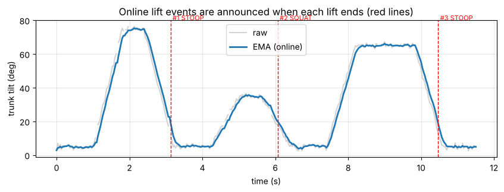

# YOLO 2회차 통합 실습 — 물류센터 실시간 모니터링 화면 만들기

노트북: [`04_yolo_day2_monitor_lab_v1.1.ipynb`](../04_yolo_day2_monitor_lab_v1.1.ipynb) · [Colab에서 열기](https://colab.research.google.com/github/jhjwlee/yolo-training/blob/main/day2/04_yolo_day2_monitor_lab_v1.1.ipynb)

| 항목 | 내용 |
|---|---|
| 실행 환경 | Google Colab, 런타임 유형 T4 GPU (실습 A·B 결과가 Google Drive MyDrive/yolo_day2에 있어야 함) |
| 예상 소요 시간 | 약 35분 (T4 GPU 기준) |
| 사용 데이터 | 실습 A 결과(box_seg_best.pt, conveyor_clip.mp4, size_rules.json, box_size_log.csv)와 실습 B 결과(lift_sample.mp4, lift_rules.json, lift_events.csv, posture_frames.csv), 사전학습 포즈 모델 yolo26n-pose.pt |
| 주요 결과 파일 | logistics_kit.py, monitor.mp4, alerts_log.csv, shift_summary.json, shift_report.png (모두 MyDrive/yolo_day2에도 저장) |

## 목차

- [0. 준비](#0-준비)
- [Step 1. 앞 실습 결과 불러오기](#step-1-앞-실습-결과-불러오기)
- [Step 2. 노트북 코드를 모듈로 정리하고, 실시간 방식으로 바꾸기](#step-2-노트북-코드를-모듈로-정리하고-실시간-방식으로-바꾸기)
- [Step 3. 실시간 판단 로직 검증](#step-3-실시간-판단-로직-검증)
- [Step 4. 두 카메라 관제 화면](#step-4-두-카메라-관제-화면)
- [Step 5. 근무 리포트](#step-5-근무-리포트)
- [도전 과제](#도전-과제) · [자주 겪는 문제](#자주-겪는-문제) · [용어 정리](#용어-정리)

## 이 실습에서 배우는 것

- 노트북에 흩어진 실습 A·B 코드를 하나의 파이썬 모듈(logistics_kit.py)로 정리하는 방법
- 사후 분석 로직을 실시간 로직으로 바꾸는 방법: 기준선 통과 순간의 크기 확정, 지수 이동 평균(EMA), 동작 종료 순간의 이벤트 확정
- track(프레임, persist=True)로 프레임을 한 장씩 넣으며 트래커 상태를 유지하는 방법
- 길이가 다른 두 카메라 영상을 같은 시각 기준으로 읽어 한 화면(monitor.mp4)으로 합성하는 방법
- 서로 다른 카메라의 이벤트를 같은 시간축 로그(alerts_log.csv)로 남기고 근무 리포트로 요약하는 방법
- 실시간 결과를 사후 분석 결과와 비교해 검증하는 방법

## 실습 흐름

| 단계 | 만드는 것 | 결과물 |
|---|---|---|
| Step 1 | 실습 A·B 결과 파일 확인과 기준값 불러오기 | SIZE_RULES, LIFT_RULES, 모델·영상 경로 |
| Step 2 | 실습 A·B 함수를 모듈로 정리하고 실시간 방식으로 변경 | logistics_kit.py |
| Step 3 | 가상 작업자와 실습 B 기록으로 실시간 판정 로직 검증 | 들기 이벤트 표, EMA 그래프, 사후 분석 비교 표 |
| Step 4 | 컨베이어·작업자 두 카메라 관제 화면 | monitor.mp4, alerts_log.csv |
| Step 5 | 근무 리포트와 사후 분석 대조 | shift_summary.json, shift_report.png, 대조 표 |

각 셀은 **위에서부터 순서대로** 실행합니다. 셀마다 코드 원문, 코드 설명, 실행 결과, 막혔을 때 확인할 점을 차례로 정리했습니다.

---

## 0. 준비

**목표** 필요한 패키지를 설치하고, 결과 폴더와 영상 재생·파일 저장 도우미 함수를 준비합니다.

이 실습은 새로 학습하지 않습니다. 실습 A에서 학습한 상자 세그멘테이션 모델과 실습 B에서 정한 판정 기준을 Google Drive에서 읽어 씁니다. 그래서 Drive를 연결하고, 실습 A·B와 같은 폴더(MyDrive/yolo_day2)를 결과 폴더로 지정하는 것이 첫 단계입니다.

### 셀 1. 실습에 필요한 패키지 설치

```python
# 패키지 설치 — ultralytics(YOLO), lap(ByteTrack 짝짓기), shapely(다각형 계산)
# -q: 설치 로그 줄임. 런타임을 새로 연결하면 이 셀부터 다시 실행
!pip -q install ultralytics lap shapely
```

**코드 설명**

- `!pip -q install` — 노트북 셀에서 셸 명령으로 pip을 실행합니다. `-q`는 설치 로그를 줄입니다.
- `ultralytics` — YOLO 모델을 불러오고 추론·트래킹하는 라이브러리입니다.
- `lap` — ByteTrack 트래커가 이전 프레임 객체와 현재 객체를 짝지을 때 쓰는 할당 알고리즘 패키지입니다.
- `shapely` — 다각형 계산용 패키지입니다. 실습 A·B와 같은 환경을 맞추기 위해 함께 설치합니다.

**실행 결과**

설치가 조용히 끝나며 별도 출력이 거의 없습니다.

> **막혔을 때** 런타임을 다시 시작하거나 새로 연결하면 설치가 사라집니다. 이후 셀에서 ModuleNotFoundError가 나면 이 셀부터 다시 실행합니다.

### 셀 2. 라이브러리 불러오기, Drive 연결, 도우미 함수 정의

```python
import os, sys, json, shutil, base64, subprocess, importlib  # importlib: 고친 모듈을 다시 읽을 때 사용
from pathlib import Path

# 영상 처리(cv2), 배열(numpy), 표(pandas), 그래프(matplotlib)
import cv2
import numpy as np
import pandas as pd
import matplotlib.pyplot as plt
import torch
from IPython.display import HTML, display
from ultralytics import YOLO  # YOLO 모델 불러오기·추론·트래킹

print('GPU 사용 가능:', torch.cuda.is_available())  # T4 런타임이면 True

# google.colab 모듈은 Colab에만 있음 → 불러오기 성공 여부로 환경 구분
try:
    from google.colab import drive
    IN_COLAB = True
except ImportError:
    IN_COLAB = False

if IN_COLAB:
    drive.mount('/content/drive')  # Google Drive 연결 (처음엔 접근 허용 창이 뜸)
    SAVE_DIR = Path('/content/drive/MyDrive/yolo_day2')  # 실습 A·B가 결과를 저장한 폴더
else:
    SAVE_DIR = Path('outputs')  # Colab이 아니면 로컬 outputs 폴더
SAVE_DIR.mkdir(parents=True, exist_ok=True)  # 중간 폴더까지 생성, 이미 있으면 그냥 통과
print('결과 폴더:', SAVE_DIR.resolve())

# mp4 영상을 노트북 안에서 재생 (입력: 영상 경로, 표시 폭 px)
# OpenCV가 만든 mp4v 영상은 브라우저가 못 틀어서 H.264로 다시 인코딩
def show_video(path, width=720):
    h264 = str(Path(path).with_name(Path(path).stem + '_h264.mp4'))  # 예: monitor.mp4 → monitor_h264.mp4
    subprocess.run(['ffmpeg', '-y', '-loglevel', 'error', '-i', str(path),
                    '-vcodec', 'libx264', '-pix_fmt', 'yuv420p', h264], check=True)
    data = base64.b64encode(open(h264, 'rb').read()).decode()  # 영상 파일을 글자(base64)로 바꿔 HTML에 직접 넣음
    display(HTML(f'<video width="{width}" controls loop autoplay muted>'
                 f'<source src="data:video/mp4;base64,{data}" type="video/mp4"></video>'))

# 파일을 SAVE_DIR로 복사하고 복사된 경로를 돌려줌
def save_out(path):
    dst = SAVE_DIR / Path(path).name
    if Path(path).resolve() != dst.resolve():  # 원본과 대상이 같은 파일이면 복사 생략
        shutil.copy(path, dst)
    return dst
```

**코드 설명**

- `torch.cuda.is_available()` — GPU를 쓸 수 있는지 확인합니다. T4 런타임이면 True가 나와야 합니다.
- `from google.colab import drive` — Colab에서만 성공합니다. 성공 여부로 `IN_COLAB`을 정합니다.
- `drive.mount('/content/drive')` — Google Drive를 연결합니다. 처음에는 계정 접근 허용 창이 뜹니다.
- `SAVE_DIR = Path('/content/drive/MyDrive/yolo_day2')` — 실습 A·B가 결과를 저장한 폴더입니다. Colab이 아니면 로컬 `outputs` 폴더를 씁니다.
- `show_video(path, width)` — OpenCV가 만든 mp4v 영상은 브라우저에서 재생되지 않을 수 있습니다. ffmpeg로 H.264(`_h264.mp4`)로 다시 인코딩한 뒤 base64로 노트북 안에 넣어 재생합니다.
- `save_out(path)` — 작업 폴더의 파일을 `SAVE_DIR`로 복사하고 복사된 경로를 돌려줍니다. 원본과 대상이 같으면 복사하지 않습니다.

**실행 결과**

GPU 사용 가능 여부와 결과 폴더 경로가 출력됩니다. Colab에서는 /content/drive/MyDrive/yolo_day2가 표시됩니다.

> **막혔을 때** GPU 사용 가능이 False이면 [런타임] → [런타임 유형 변경]에서 T4 GPU를 고르고 처음부터 다시 실행합니다. CPU로도 돌아가지만 Step 4가 매우 느립니다.

---

## Step 1. 앞 실습 결과 불러오기

**목표** 실습 A·B가 Drive에 남긴 파일 8개가 모두 있는지 확인하고, 두 실습의 판정 기준값을 불러옵니다.

size_rules.json에는 실습 A에서 정한 S/M/L 면적 경계, 기준선 위치, 신뢰도 임계값이 들어 있습니다. lift_rules.json에는 실습 B에서 정한 자세 판정 각도와 들기 동작 시작·끝 기준, 위험 등급 경계가 들어 있습니다. 이 실습은 기준값을 새로 정하지 않고 그대로 가져다 씁니다.

### 셀 3. 필요 파일 점검과 기준값(JSON) 불러오기

```python
# 필요한 파일 이름 → 만든 실습(A/B)과 용도
REQUIRED = {
    'box_seg_best.pt':   'A — 상자 세그멘테이션 모델',
    'conveyor_clip.mp4': 'A — 컨베이어 영상',
    'size_rules.json':   'A — S/M/L 기준값, 기준선, 임계값',
    'box_size_log.csv':  'A — 사후 분석 크기별 집계',
    'lift_sample.mp4':   'B — 작업자 영상',
    'lift_rules.json':   'B — 자세·동작 판정 기준값',
    'lift_events.csv':   'B — 사후 분석 들기 동작',
    'posture_frames.csv':'B — 프레임별 각도와 상태',
}
# 파일마다 SAVE_DIR에 있는지 확인해 표(file, from, found)로 만듦
status = pd.DataFrame([{'file': f, 'from': d, 'found': (SAVE_DIR / f).exists()} for f, d in REQUIRED.items()])
display(status)
missing = status.loc[~status['found'], 'file'].tolist()  # found가 False인 파일 이름만 (~: True/False 뒤집기)
assert not missing, f'먼저 실습 A·B를 실행해 주세요. 없는 파일: {missing}'  # 빠진 파일이 있으면 목록을 보여 주고 멈춤

# 앞 실습에서 정한 기준값(JSON)을 딕셔너리로 읽기
SIZE_RULES = json.load(open(SAVE_DIR / 'size_rules.json'))  # 실습 A: S/M/L 면적 기준, 기준선 line_x, conf 등
LIFT_RULES = json.load(open(SAVE_DIR / 'lift_rules.json'))  # 실습 B: 자세 각도 기준, 들기 시작·끝 기준 등
print('SIZE_RULES:', SIZE_RULES)
print('LIFT_RULES:', LIFT_RULES)
```

**코드 설명**

- `REQUIRED = {...}` — 파일 이름과 그 파일을 만든 실습(A 또는 B)·용도를 짝지은 딕셔너리입니다.
- `pd.DataFrame([... 'found': (SAVE_DIR / f).exists() ...])` — 파일마다 존재 여부를 확인해 file, from, found 열의 표로 만듭니다.
- `missing = status.loc[~status['found'], 'file'].tolist()` — found가 False인 파일 이름만 모읍니다.
- `assert not missing, ...` — 빠진 파일이 있으면 그 목록을 보여 주며 멈춥니다.
- `SIZE_RULES = json.load(open(SAVE_DIR / 'size_rules.json'))` — 실습 A의 크기 기준을 딕셔너리로 읽습니다.
- `LIFT_RULES = json.load(open(SAVE_DIR / 'lift_rules.json'))` — 실습 B의 자세·동작 기준을 딕셔너리로 읽습니다.

**실행 결과**

8개 파일의 found 열이 모두 True인 표가 나옵니다. 이어서 두 기준값이 출력됩니다. 검증 실행 예시: SIZE_RULES는 small_max 3506, medium_max 7762, edge_margin_px 4, line_x 160, conf 0.55, imgsz 416이었습니다. LIFT_RULES는 start_trunk 30, end_trunk 20, min_lift_s 0.5, high_risk 70, medium_risk 40, shin_standing 60, trunk_upright 20, trunk_stoop 45, knee_straight 150이었습니다.

> **막혔을 때** AssertionError가 나면 메시지의 파일 목록을 확인합니다. 실습 A 파일이 없으면 yolo_day2_box_lab을, B 파일이 없으면 yolo_day2_pose_lab을 끝까지 실행합니다. 같은 Google 계정의 Drive에 연결했는지도 확인합니다.

**정리 · 확인해 보기**

SIZE_RULES의 line_x와 LIFT_RULES의 start_trunk, end_trunk가 각각 어떤 판정에 쓰이는지 말로 설명해 보세요. 기준값을 코드에 직접 적지 않고 JSON 파일로 주고받으면 어떤 점이 편한지도 생각해 보세요.

---

## Step 2. 노트북 코드를 모듈로 정리하고, 실시간 방식으로 바꾸기

**목표** 실습 A·B의 함수를 logistics_kit.py 하나로 모으고, 미래 프레임 없이 지금까지의 정보만으로 판단하도록 로직을 바꿉니다.

사후 분석은 영상을 끝까지 본 뒤 계산하므로 앞뒤 프레임을 모두 쓸 수 있습니다. 관제 화면은 프레임이 들어올 때마다 바로 판단해야 하므로 미래 프레임을 볼 수 없습니다. 그래서 상자 크기는 기준선을 넘는 순간까지 모인 관측의 중앙값으로 확정합니다. 각도는 앞뒤 이동 중앙값 대신 지난 값만 쓰는 지수 이동 평균(EMA)으로 다듬습니다. EMA는 ema_t = α·x_t + (1−α)·ema_(t−1)로 계산합니다. α가 클수록 새 값을 빨리 따라가지만 흔들리고, 작을수록 부드럽지만 늦게 반응합니다. 들기 동작은 몸통 기울기가 끝 기준 아래로 내려가는 순간 하나의 이벤트로 확정해 내보냅니다.

### 셀 4. %%writefile로 logistics_kit.py 모듈 파일 만들기

```python
%%writefile logistics_kit.py
"""물류센터 모니터링 도구 모음 — 실습 A(상자 크기별 집계)와 B(들기 동작 분석)를 실시간 방식으로 정리"""
import cv2
import numpy as np

# ---------------- 공통: 그리기
# 그리기 색 — OpenCV용이라 (B, G, R) 순서
SIZE_COLOR = {'S': (255, 200, 0), 'M': (0, 200, 255), 'L': (60, 60, 255)}  # 상자 크기별 색
STATE_COLOR = {'UPRIGHT': (80, 175, 76), 'BENDING': (0, 179, 255), 'SQUAT': (154, 166, 38),  # 자세 상태별 색
               'STOOP': (53, 57, 229), 'NOT_STANDING': (158, 158, 158), 'UNKNOWN': (200, 200, 200)}
GRADE_COLOR = {'HIGH': (53, 57, 229), 'MEDIUM': (0, 179, 255), 'LOW': (71, 160, 67)}  # 위험 등급별 색
# 골격 선으로 이을 COCO 키포인트 번호 쌍 (5·6 어깨, 11·12 엉덩이, 15·16 발목)
SKELETON = [(5, 7), (7, 9), (6, 8), (8, 10), (5, 6), (5, 11), (6, 12), (11, 12),
            (11, 13), (13, 15), (12, 14), (14, 16), (0, 5), (0, 6)]

# 검은 배경 상자 위에 글자 쓰기 — 밝은 배경에서도 잘 보이게 (org: 글자 왼쪽 아래 좌표)
def put_label(img, text, org, color, scale=0.6, thick=2):
    (tw, th), _ = cv2.getTextSize(text, cv2.FONT_HERSHEY_SIMPLEX, scale, thick)  # 글자 폭·높이(px) 측정
    cv2.rectangle(img, (org[0] - 5, org[1] - th - 6), (org[0] + tw + 5, org[1] + 6), (0, 0, 0), -1)  # 두께 -1 = 속을 채운 사각형
    cv2.putText(img, text, org, cv2.FONT_HERSHEY_SIMPLEX, scale, color, thick)

# 골격 선 그리기 — 양 끝 관절 신뢰도가 모두 min_conf보다 클 때만
def draw_skeleton(img, kxy, kconf, color, min_conf=0.3):
    for a, b in SKELETON:
        if kconf[a] > min_conf and kconf[b] > min_conf:
            cv2.line(img, tuple(map(int, kxy[a])), tuple(map(int, kxy[b])), color, 3)  # 좌표를 정수 튜플로 바꿔 선 긋기

# ---------------- 실습 A: 상자 크기
# 마스크 다각형 → (면적, 긴 변, 짧은 변), 모두 픽셀 단위
def measure_mask(poly):
    pts = np.asarray(poly, np.float32)  # OpenCV가 받는 float32 배열로 변환
    area = float(cv2.contourArea(pts))  # 다각형 넓이 (px²)
    w, h = cv2.minAreaRect(pts)[1]  # 최소 외접 회전 사각형의 (폭, 높이)
    return area, float(max(w, h)), float(min(w, h))

# 면적 → 'S'/'M'/'L' (small_max·medium_max 기준)
def size_class(area, rules):
    if area <= rules['small_max']:
        return 'S'
    if area <= rules['medium_max']:
        return 'M'
    return 'L'

class OnlineSizeCounter:
    """트랙별 관측을 쌓다가 기준선을 넘는 순간 크기를 확정하고 이벤트를 돌려준다"""
    def __init__(self, rules, min_samples=3):
        self.rules, self.min_samples = rules, min_samples  # min_samples: 크기 확정에 쓸 최소 관측 수
        self.samples, self.last_x, self.size_of = {}, {}, {}  # 트랙별 관측 목록, 직전 중심 x, 확정 크기
        self.counts = {'S': 0, 'M': 0, 'L': 0}  # 크기별 누적 개수

    # 관측 1개 추가. 기준선을 넘는 순간이면 확정 이벤트(dict), 아니면 None
    # key: 트랙 구분 키, cx: 박스 중심 x, at_edge: 화면 가장자리에 걸렸는지
    def update(self, key, cx, area, at_edge):
        self.samples.setdefault(key, []).append((area, at_edge))  # 처음 보는 key면 빈 목록부터 만들고 추가
        prev, self.last_x[key] = self.last_x.get(key), cx  # 직전 x를 꺼내고 지금 x로 갱신
        line = self.rules['line_x']
        if prev is None or key in self.size_of:  # 첫 관측이거나 이미 확정된 트랙은 건너뜀
            return None
        if not (prev < line <= cx or prev >= line > cx):  # 이번 프레임에 기준선을 넘지 않았으면 대기
            return None
        full = [a for a, e in self.samples[key] if not e]  # 가장자리에 걸리지 않은 온전한 관측만
        use = full if len(full) >= self.min_samples else [a for a, _ in self.samples[key]]  # 온전한 관측이 부족하면 전체 관측 사용
        area_med = float(np.median(use))  # 면적 중앙값 — 튀는 값에 덜 흔들림
        size = size_class(area_med, self.rules)
        self.size_of[key] = size
        self.counts[size] += 1
        return {'size_class': size, 'area_px': round(area_med),
                'direction': 'left_to_right' if cx >= line else 'right_to_left', 'n_obs': len(use)}

    # counter.total처럼 괄호 없이 읽는 S/M/L 합계
    @property
    def total(self):
        return sum(self.counts.values())

# ---------------- 실습 B: 자세와 들기 동작
# 몸 왼쪽·오른쪽 관절의 COCO 키포인트 번호
LEFT = dict(shoulder=5, elbow=7, wrist=9, hip=11, knee=13, ankle=15)
RIGHT = dict(shoulder=6, elbow=8, wrist=10, hip=12, knee=14, ankle=16)

# b를 꼭짓점으로 하는 각 abc의 크기(도) — 예: 엉덩이-무릎-발목 = 무릎 각도
# np.clip으로 cos를 -1~1 범위에 가둬 arccos 오류 방지
def joint_angle(a, b, c):
    ba, bc = np.asarray(a, float) - np.asarray(b, float), np.asarray(c, float) - np.asarray(b, float)  # b→a, b→c 벡터
    cos = np.dot(ba, bc) / (np.linalg.norm(ba) * np.linalg.norm(bc) + 1e-9)  # 내적으로 cos 계산, 1e-9는 0으로 나누기 방지
    return float(np.degrees(np.arccos(np.clip(cos, -1.0, 1.0))))

# 아래 점→위 점 벡터가 수직 위쪽에서 몇 도 기울었는지 (0도 = 똑바로)
def tilt_from_vertical(lower, upper):
    v = np.asarray(upper, float) - np.asarray(lower, float)
    cos = np.dot(v, [0.0, -1.0]) / (np.linalg.norm(v) + 1e-9)  # [0, -1] = 이미지의 위쪽 (y는 아래로 커짐)
    return float(np.degrees(np.arccos(np.clip(cos, -1.0, 1.0))))

# 키포인트 → 몸통 기울기(trunk), 무릎 각도(knee), 정강이 기울기(shin)
# kxy: 좌표(17×2), kconf: 신뢰도(17). 주요 관절이 흐리면 None
def body_angles(kxy, kconf, min_conf=0.3):
    l_score, r_score = kconf[list(LEFT.values())].mean(), kconf[list(RIGHT.values())].mean()  # 왼쪽·오른쪽 관절 신뢰도 평균
    idx = LEFT if l_score >= r_score else RIGHT  # 더 잘 보이는 쪽 몸을 사용
    if kconf[[idx['shoulder'], idx['hip'], idx['knee'], idx['ankle']]].min() < min_conf:  # 어깨·엉덩이·무릎·발목 중 하나라도 흐리면 포기
        return None
    p = {n: kxy[i] for n, i in idx.items()}  # 관절 이름 → (x, y) 좌표
    return {'trunk': tilt_from_vertical(p['hip'], p['shoulder']),
            'knee': joint_angle(p['hip'], p['knee'], p['ankle']),
            'shin': tilt_from_vertical(p['ankle'], p['knee'])}

# 각도 → 자세 상태. 위에서부터 차례로 검사하므로 순서가 중요
def classify_posture(trunk, knee, shin, rules):
    if any(v is None or np.isnan(v) for v in (trunk, knee, shin)):  # 각도가 비어 있으면 판정 불가
        return 'UNKNOWN'
    if shin > rules['shin_standing']:  # 정강이가 많이 기움 → 서 있지 않음
        return 'NOT_STANDING'
    if trunk <= rules['trunk_upright']:
        return 'UPRIGHT'
    if trunk >= rules['trunk_stoop'] and knee >= rules['knee_straight']:
        return 'STOOP'
    if knee < rules['knee_straight']:
        return 'SQUAT'
    return 'BENDING'

# 들기 1회 위험 점수 0~100 = 몸통(최대 50) + 무릎(30) + STOOP 시간(20)
# np.clip(…, 0, 1): 각 항목을 0~1로 잘라 항목별 상한 고정
def risk_score(max_trunk, knee_bottom, stoop_s):
    return int(round(np.clip((max_trunk - 20) / 50, 0, 1) * 50 + np.clip((knee_bottom - 120) / 50, 0, 1) * 30
                     + np.clip(stoop_s / 2.0, 0, 1) * 20))

# 점수 → 'HIGH' / 'MEDIUM' / 'LOW' (high_risk·medium_risk 기준)
def risk_grade(score, rules):
    return 'HIGH' if score >= rules['high_risk'] else 'MEDIUM' if score >= rules['medium_risk'] else 'LOW'

class EMA:
    """지수 이동 평균. 값이 비면(None/NaN) max_gap 프레임까지 직전 값을 유지"""
    def __init__(self, alpha=0.35, max_gap=6):
        self.alpha, self.max_gap, self.value, self.gap = alpha, max_gap, None, 0  # value: 현재 평균, gap: 연속 빈 값 수

    def update(self, x):
        if x is None or np.isnan(x):  # 이번 값이 비었으면 (검출 실패)
            self.gap += 1
            if self.gap > self.max_gap:  # 너무 오래 비면 평균을 버림
                self.value = None
            return self.value
        self.gap = 0
        self.value = x if self.value is None else self.alpha * x + (1 - self.alpha) * self.value  # 첫 값은 그대로, 이후 새 값과 이전 평균을 alpha 비율로 섞음
        return self.value

class OnlinePosture:
    """프레임마다 각도를 받아 다듬고, 자세 상태와 들기 동작 이벤트를 돌려준다"""
    def __init__(self, fps, rules, alpha=0.35, hold_sec=0.5):
        self.fps, self.rules = fps, rules
        self.ema = {k: EMA(alpha, int(0.2 * fps)) for k in ('trunk', 'knee', 'shin')}  # 각도마다 EMA 하나, 빈 값 유지 약 0.2초
        self.alarm_need, self.alarm_run = max(1, int(round(fps * hold_sec))), 0  # 경고까지 필요한 STOOP 연속 프레임 수(약 hold_sec초)
        self.in_lift, self.lift_frames, self.lifts = False, [], []  # 들기 진행 여부, 진행 중 프레임 기록, 확정된 들기 목록
        self.frame = -1  # update마다 1씩 증가 → 첫 프레임 번호 0

    # 프레임 1장 판정. angles: body_angles 결과(dict 또는 None)
    # 반환: 각도·상태·경고 여부·들기 이벤트(확정된 순간에만 dict)
    def update(self, angles):
        self.frame += 1
        vals = {k: e.update(None if angles is None else angles[k]) for k, e in self.ema.items()}  # 각도를 EMA로 다듬기 (None이면 직전 값 유지)
        trunk, knee, shin = (np.nan if vals[k] is None else vals[k] for k in ('trunk', 'knee', 'shin'))  # None → NaN으로 바꿔 판정 함수에 넘김
        state = classify_posture(trunk, knee, shin, self.rules)
        self.alarm_run = self.alarm_run + 1 if state == 'STOOP' else 0  # STOOP가 이어진 프레임 수, 끊기면 0
        event = None
        if state not in ('NOT_STANDING', 'UNKNOWN'):  # 판정 불가·서 있지 않은 프레임은 동작 기록에서 제외
            if not self.in_lift and trunk > self.rules['start_trunk']:  # 허리를 숙이기 시작 → 들기 시작
                self.in_lift, self.lift_frames = True, []
            if self.in_lift:
                self.lift_frames.append((self.frame, trunk, knee, state))  # (프레임 번호, 몸통, 무릎, 상태) 기록
                if trunk < self.rules['end_trunk']:  # 다시 섰으면 동작 하나 확정
                    event = self._close()
        return {'trunk': trunk, 'knee': knee, 'state': state, 'warning': self.alarm_run >= self.alarm_need,
                'in_lift': self.in_lift, 'lift_event': event}

    # 진행 중이던 들기를 끝내고 이벤트로 확정 (너무 짧으면 None)
    def _close(self):
        self.in_lift = False
        frames = self.lift_frames
        if len(frames) / self.fps < self.rules['min_lift_s']:  # 프레임 수 ÷ fps = 지속 시간(초)
            return None
        b = max(frames, key=lambda f: f[1])  # 몸통을 가장 많이 숙인 프레임 (f[1] = trunk)
        stoop_s = sum(f[3] == 'STOOP' for f in frames) / self.fps  # STOOP였던 프레임 수 → 초
        if b[1] >= self.rules['trunk_stoop'] and b[2] >= self.rules['knee_straight']:  # b[1] 몸통 각도, b[2] 무릎 각도
            lift_type = 'STOOP'
        elif b[2] < self.rules['knee_straight']:
            lift_type = 'SQUAT'
        else:
            lift_type = 'BENDING'
        score = risk_score(b[1], b[2], stoop_s)
        ev = {'lift_id': len(self.lifts) + 1, 'start_frame': frames[0][0], 'end_frame': frames[-1][0],
              'max_trunk_deg': round(b[1], 1), 'knee_at_bottom_deg': round(b[2], 1), 'stoop_s': round(stoop_s, 2),
              'lift_type': lift_type, 'risk_score': score, 'risk_grade': risk_grade(score, self.rules)}
        self.lifts.append(ev)
        return ev

# ---------------- 검증용 가상 작업자 (실습 B와 같은 방식)
# 가상 작업자 신체 길이(px) — 정강이, 허벅지, 몸통, 위팔, 아래팔
SEG_LEN = dict(shin=95, thigh=95, torso=130, upper_arm=70, forearm=65)

# 몸통 기울기·무릎 굽힘 각도 → 가상 키포인트 (kxy 17×2, kconf 17)
# ankle: 발목 위치(px). 팔은 아래로 늘어뜨린 자세
def synth_pose(trunk_deg, bend_deg, ankle=(200, 420)):
    s, t = np.radians(bend_deg), np.radians(trunk_deg)  # 도 → 라디안 (sin·cos 계산용)
    ankle = np.array(ankle, float)
    knee = ankle + SEG_LEN['shin'] * np.array([np.sin(s), -np.cos(s)])  # 발목에서 정강이 길이만큼 위로
    hip = knee + SEG_LEN['thigh'] * np.array([-np.sin(s), -np.cos(s)])
    shoulder = hip + SEG_LEN['torso'] * np.array([np.sin(t), -np.cos(t)])
    elbow = shoulder + [0, SEG_LEN['upper_arm']]
    wrist = elbow + [0, SEG_LEN['forearm']]
    kxy, kconf = np.zeros((17, 2)), np.zeros(17)  # COCO 17개 키포인트, 처음엔 모두 0
    for name, p in dict(shoulder=shoulder, elbow=elbow, wrist=wrist, hip=hip, knee=knee, ankle=ankle).items():
        kxy[RIGHT[name]] = p; kconf[RIGHT[name]] = 1.0  # 오른쪽 관절만 채우고 신뢰도 1.0
    return kxy, kconf
```

**코드 설명**

- `%%writefile logistics_kit.py` — 셀 내용을 실행하지 않고 현재 작업 폴더에 logistics_kit.py 파일로 저장합니다. 셀 맨 첫 줄에 있어야 합니다.
- `SIZE_COLOR`, `STATE_COLOR`, `GRADE_COLOR` — 상자 크기(S/M/L), 자세 상태(UPRIGHT·BENDING·SQUAT·STOOP·NOT_STANDING·UNKNOWN), 위험 등급(HIGH·MEDIUM·LOW)별 그리기 색입니다. OpenCV용이라 (B, G, R) 순서입니다.
- `SKELETON` — COCO 17 키포인트 중 선으로 이을 번호 쌍 14개입니다. 5·6은 어깨, 11·12는 엉덩이, 13·14는 무릎, 15·16은 발목입니다.
- `put_label(img, text, org, color, scale, thick)` — `cv2.getTextSize`로 글자 크기를 잰 뒤 검은 사각형을 먼저 그리고 그 위에 글자를 씁니다. 배경이 밝아도 글자가 잘 보입니다.
- `draw_skeleton(img, kxy, kconf, color, min_conf=0.3)` — SKELETON의 두 점이 모두 신뢰도 0.3을 넘을 때만 선을 긋습니다. 가려진 관절로 엉뚱한 선이 그려지는 것을 막습니다.
- `measure_mask(poly)` — 마스크 다각형을 받아 (면적, 긴 변, 짧은 변)을 돌려줍니다. 면적은 `cv2.contourArea`, 변 길이는 최소 외접 회전 사각형 `cv2.minAreaRect`로 구합니다.
- `size_class(area, rules)` — 면적이 `small_max` 이하이면 'S', `medium_max` 이하이면 'M', 그보다 크면 'L'을 돌려줍니다.
- `OnlineSizeCounter(rules, min_samples=3)` — 실시간 상자 크기 집계기입니다. `samples`(트랙별 (면적, 가장자리 여부) 목록), `last_x`(직전 중심 x), `size_of`(확정된 크기), `counts`(S/M/L 개수)를 가집니다.
- `OnlineSizeCounter.update(key, cx, area, at_edge)` — 관측을 쌓고, 직전 x와 지금 x 사이에 기준선 `line_x`가 있을 때(`prev < line <= cx` 또는 `prev >= line > cx`) 크기를 확정합니다. 이미 확정된 트랙이나 첫 관측이면 None을 돌려줍니다.
- 크기 확정 방법 — 화면 가장자리에 걸리지 않은 관측(`full`)이 `min_samples`개 이상이면 그것만, 아니면 전체 관측의 면적 중앙값을 씁니다. 결과로 size_class, area_px, direction(left_to_right/right_to_left), n_obs가 담긴 딕셔너리를 돌려줍니다.
- `total` — `@property`로 정의해 `counter.total`처럼 괄호 없이 S/M/L 합계를 읽습니다.
- `LEFT`, `RIGHT` — 왼쪽·오른쪽 몸의 어깨·팔꿈치·손목·엉덩이·무릎·발목 키포인트 번호입니다.
- `joint_angle(a, b, c)` — b를 꼭짓점으로 한 각도(도)를 내적으로 구합니다. `1e-9`는 0으로 나누는 것을 막고, `np.clip(-1, 1)`은 arccos 범위 오류를 막습니다.
- `tilt_from_vertical(lower, upper)` — 아래 점에서 위 점으로 가는 벡터가 수직 위쪽 `[0, -1]`에서 몇 도 기울었는지 구합니다. 이미지는 y가 아래로 커지므로 위쪽이 -1입니다.
- `body_angles(kxy, kconf, min_conf=0.3)` — 왼쪽·오른쪽 중 신뢰도 평균이 높은 쪽을 고릅니다. 어깨·엉덩이·무릎·발목 중 하나라도 0.3 미만이면 None을 돌려줍니다. 아니면 trunk(몸통 기울기), knee(무릎 각도), shin(정강이 기울기)을 돌려줍니다.
- `classify_posture(trunk, knee, shin, rules)` — 위에서부터 순서대로 판정합니다. 값이 비면 UNKNOWN, shin > shin_standing이면 NOT_STANDING, trunk ≤ trunk_upright이면 UPRIGHT, trunk ≥ trunk_stoop이면서 knee ≥ knee_straight이면 STOOP, knee < knee_straight이면 SQUAT, 나머지는 BENDING입니다.
- `risk_score(max_trunk, knee_bottom, stoop_s)` — 0~100점 위험 점수입니다. 최대 몸통 기울기(20~70도 → 0~50점), 가장 숙였을 때 무릎 각도(120~170도 → 0~30점, 무릎을 펼수록 높음), STOOP 지속 시간(0~2초 → 0~20점)을 더합니다.
- `risk_grade(score, rules)` — 점수가 high_risk 이상이면 HIGH, medium_risk 이상이면 MEDIUM, 그 아래는 LOW입니다.
- `EMA(alpha=0.35, max_gap=6)` — 지수 이동 평균 클래스입니다. `update(x)`에 숫자가 오면 첫 값은 그대로, 이후는 `alpha * x + (1 - alpha) * value`로 갱신합니다. None이나 NaN이 오면 `gap`을 늘리며 직전 값을 유지하고, `max_gap` 프레임을 넘기면 값을 None으로 비웁니다.
- `OnlinePosture(fps, rules, alpha=0.35, hold_sec=0.5)` — 실시간 자세·들기 판정기입니다. trunk·knee·shin마다 EMA를 하나씩 두고 빈 값 유지 한도는 약 0.2초(`int(0.2 * fps)`)입니다. `alarm_need`는 경고를 내기 위해 STOOP가 이어져야 하는 프레임 수(약 0.5초)입니다.
- `OnlinePosture.update(angles)` — 각도를 EMA로 다듬고 자세를 판정합니다. STOOP가 연속된 프레임 수(`alarm_run`)가 `alarm_need` 이상이면 warning이 True가 됩니다. trunk가 start_trunk를 넘으면 들기를 시작하고, end_trunk 아래로 내려오면 `_close()`로 동작을 확정합니다. NOT_STANDING·UNKNOWN 프레임은 동작 기록에서 뺍니다. 반환값은 trunk, knee, state, warning, in_lift, lift_event가 담긴 딕셔너리입니다.
- `OnlinePosture._close()` — 기록된 구간이 min_lift_s보다 짧으면 버립니다(None). 아니면 trunk가 가장 컸던 프레임(가장 숙인 순간)의 각도로 유형을 정합니다. STOOP 조건이면 STOOP, 무릎이 굽었으면 SQUAT, 나머지는 BENDING입니다. 위험 점수·등급과 시작·끝 프레임을 담은 이벤트를 `lifts`에 쌓고 돌려줍니다.
- `synth_pose(trunk_deg, bend_deg, ankle)` — 검증용 가상 작업자입니다. 발목 위치에서 출발해 정강이·허벅지·몸통 길이(`SEG_LEN`)와 각도로 무릎·엉덩이·어깨 좌표를 계산하고, 팔은 아래로 늘어뜨립니다. 오른쪽 키포인트만 신뢰도 1.0으로 채운 (kxy, kconf)를 돌려줍니다.

**실행 결과**

Writing logistics_kit.py 한 줄이 출력되고, 작업 폴더에 모듈 파일이 생깁니다. 이 셀은 함수와 클래스를 정의만 하므로 다른 결과는 없습니다.

> **막혔을 때** 모듈을 고친 뒤에는 이 셀을 다시 실행해 파일을 덮어쓰고, 바로 다음 셀(importlib.reload)도 다시 실행해야 바뀐 내용이 반영됩니다. %%writefile 앞에 주석이나 빈 줄이 있으면 셀 매직으로 인식되지 않습니다.

### 셀 5. 만든 모듈 불러오기

```python
sys.path.insert(0, '.')  # 현재 폴더를 모듈 검색 경로 맨 앞에 추가
import logistics_kit as lk  # lk라는 짧은 이름으로 불러오기
importlib.reload(lk)  # 모듈 파일을 고친 뒤 최신 내용으로 다시 읽기
print('모듈 불러오기 완료:', [n for n in dir(lk) if not n.startswith('_')][:12], '...')  # 모듈 안 공개 이름 12개 미리보기
```

**코드 설명**

- `sys.path.insert(0, '.')` — 현재 작업 폴더를 모듈 검색 경로 맨 앞에 넣어 logistics_kit.py를 찾을 수 있게 합니다.
- `import logistics_kit as lk` — 모듈을 `lk`라는 짧은 이름으로 불러옵니다. 이후 `lk.OnlinePosture`처럼 씁니다.
- `importlib.reload(lk)` — 파이썬은 한 번 불러온 모듈을 다시 읽지 않습니다. 모듈 파일을 고친 뒤에도 최신 내용을 쓰도록 강제로 다시 불러옵니다.
- `[n for n in dir(lk) if not n.startswith('_')][:12]` — 모듈 안의 공개 이름을 알파벳 순으로 12개까지 보여 줍니다.

**실행 결과**

모듈 불러오기 완료 뒤에 EMA, GRADE_COLOR, LEFT, OnlinePosture, OnlineSizeCounter, RIGHT, SEG_LEN, SIZE_COLOR, SKELETON, STATE_COLOR, body_angles, classify_posture가 나열됩니다.

**정리 · 확인해 보기**

OnlineSizeCounter가 트랙 전체의 중앙값이 아니라 기준선 통과 순간까지의 중앙값을 쓰는 이유를 설명해 보세요. EMA의 alpha를 0.35에서 0.2로 줄이면 경고와 들기 확정 시점이 빨라질지 늦어질지도 예상해 보세요.

---

## Step 3. 실시간 판단 로직 검증

**목표** 실시간으로 바꾼 OnlinePosture가 정답을 아는 가상 작업자와 실습 B의 실제 기록에서 사후 분석과 같은 답을 내는지 확인합니다.

실시간 로직을 바로 관제 화면에 붙이면 문제가 생겨도 원인을 찾기 어렵습니다. 먼저 정답이 정해진 가상 데이터로 로직을 확인하고, 그다음 실제 영상에서 뽑은 각도 기록으로 사후 분석 결과와 비교합니다. 실시간 방식은 뒤 프레임을 보지 못해 반응이 조금 늦습니다. 또 EMA가 짧은 흔들림을 이동 중앙값만큼 거르지 못해 경계 근처에서 판정이 바뀔 수 있습니다.

### 셀 6. 가상 작업자의 들기 3번을 프레임 단위로 넣어 이벤트 확인

```python
# (시각 초, 몸통 각도, 무릎 굽힘 각도) 키프레임
# 들기 3번: 허리 굽혀(1.8~2.4초) → 무릎 굽혀(5.0~5.6초) → 허리 굽혀 오래(8.2~9.8초)
KEYFRAMES = [(0.0, 5, 3), (1.0, 5, 3), (1.8, 75, 4), (2.4, 75, 4), (3.2, 5, 3),
             (4.2, 5, 3), (5.0, 35, 45), (5.6, 35, 45), (6.4, 5, 3),
             (7.4, 5, 3), (8.2, 65, 6), (9.8, 65, 6), (10.6, 5, 3), (11.5, 5, 3)]
SYN_FPS = 30  # 가상 영상 초당 프레임 수
rng = np.random.default_rng(0)  # 난수 시드 고정 → 매번 같은 결과
ts, tr, bd = map(np.array, zip(*KEYFRAMES))  # 키프레임을 시각·몸통·굽힘 배열 3개로 분리

online = lk.OnlinePosture(SYN_FPS, LIFT_RULES)  # 실시간 판정기 (fps, 판정 기준)
trace, events = [], []
for i in range(int(ts[-1] * SYN_FPS) + 1):  # 0초부터 마지막 키프레임까지 한 프레임씩
    t = i / SYN_FPS
    kxy, kconf = lk.synth_pose(np.interp(t, ts, tr), np.interp(t, ts, bd))  # np.interp: 키프레임 사이 각도를 선형 보간
    kxy = kxy + rng.normal(0, 1.5, kxy.shape)  # 좌표에 표준편차 1.5px 잡음 → 검출 떨림 흉내
    a = lk.body_angles(kxy, kconf * (rng.random() > 0.05))  # 약 5% 프레임은 신뢰도 0 → 검출 실패 흉내
    out = online.update(a)  # 프레임 1장 판정
    trace.append({'time_s': t, 'trunk_raw': a['trunk'] if a else np.nan, 'trunk_ema': out['trunk']})  # 그래프용 원래 각도와 EMA 값 기록
    if out['lift_event']:  # 들기가 끝나 확정된 순간에만 값이 있음
        events.append({**out['lift_event'], 'announced_s': round(t, 2)})

events = pd.DataFrame(events)
display(events[['lift_id', 'lift_type', 'max_trunk_deg', 'knee_at_bottom_deg', 'risk_score', 'risk_grade', 'announced_s']])
assert events['lift_type'].tolist() == ['STOOP', 'SQUAT', 'STOOP'], events['lift_type'].tolist()  # 세 동작 유형 자동 확인 (다르면 멈춤)
print('실시간 로직도 들기 3번을 기대한 유형으로 판정했습니다.')

trace = pd.DataFrame(trace)
# 회색 = 원래 각도, 파랑 = EMA, 빨간 점선 = 이벤트 확정 시각
plt.figure(figsize=(10, 3))
plt.plot(trace['time_s'], trace['trunk_raw'], c='lightgray', label='raw')
plt.plot(trace['time_s'], trace['trunk_ema'], c='tab:blue', lw=2, label='EMA (online)')
for _, e in events.iterrows():  # 표의 행을 (인덱스, 행) 쌍으로 하나씩 꺼냄
    plt.axvline(e['announced_s'], c='red', ls='--', lw=1)
    plt.text(e['announced_s'], 80, f" #{e['lift_id']} {e['lift_type']}", color='red', fontsize=8)
plt.xlabel('time (s)'); plt.ylabel('trunk tilt (deg)'); plt.legend(); plt.grid(alpha=.3)
plt.title('Online lift events are announced when each lift ends (red lines)'); plt.show()
```

**코드 설명**

- `KEYFRAMES = [(시각, 몸통 각도, 무릎 굽힘 각도), ...]` — 허리 굽혀 들기(1.8~2.4초, 75도), 무릎 굽혀 들기(5.0~5.6초, 몸통 35도·굽힘 45도), 허리 굽혀 오래 들기(8.2~9.8초, 65도)를 정의합니다.
- `SYN_FPS = 30`, `rng = np.random.default_rng(0)` — 초당 30프레임으로 만들고, 난수 시드를 고정해 매번 같은 결과가 나오게 합니다.
- `np.interp(t, ts, tr)` — 키프레임 사이 시각의 각도를 선형 보간해 부드러운 움직임을 만듭니다.
- `kxy + rng.normal(0, 1.5, kxy.shape)` — 키포인트 좌표에 표준편차 1.5픽셀 잡음을 더해 실제 검출의 떨림을 흉내 냅니다.
- `kconf * (rng.random() > 0.05)` — 약 5% 프레임은 신뢰도를 모두 0으로 만들어 검출 실패를 흉내 냅니다. 이때 `body_angles`가 None을 돌려주고 EMA가 직전 값을 유지합니다.
- `out = online.update(a)` — 프레임마다 판정합니다. `out['lift_event']`가 있으면 그 순간의 시각(`announced_s`)과 함께 events에 저장합니다.
- `assert events['lift_type'].tolist() == ['STOOP', 'SQUAT', 'STOOP']` — 세 동작이 기대한 유형으로 판정됐는지 자동으로 확인합니다.
- 그래프 — 회색은 원래 몸통 각도(raw), 파란색은 EMA 값, 빨간 점선은 이벤트가 확정된 시각입니다.

**실행 결과**

검증 실행 예시: 이벤트 3개가 나왔습니다. #1 STOOP(최대 몸통 75.3도, 무릎 171.1도, 위험 점수 93, HIGH)은 3.13초, #2 SQUAT(35.6도, 무릎 89.6도, 16, LOW)는 6.07초, #3 STOOP(66.1도, 무릎 166.7도, 94, HIGH)은 10.47초에 확정됐습니다. 이어서 '실시간 로직도 들기 3번을 기대한 유형으로 판정했습니다.'가 출력됩니다. 그래프에서 빨간 선은 동작이 끝나 몸통 각도가 20도 아래로 내려온 직후에 놓입니다. 파란 EMA 선은 회색 raw보다 매끈하고 아주 조금 늦게 따라갑니다.



> **막혔을 때** AssertionError가 나면 lift_rules.json 값이 실습 B 기본값과 다르지 않은지 확인합니다. 예를 들어 trunk_stoop을 크게 올리면 첫 동작이 BENDING으로 바뀔 수 있습니다.

### 셀 7. 실습 B의 프레임별 각도 기록으로 사후 분석과 비교

```python
pf = pd.read_csv(SAVE_DIR / 'posture_frames.csv')  # 실습 B의 프레임별 시각·각도 기록
offline_lifts = pd.read_csv(SAVE_DIR / 'lift_events.csv')  # 실습 B 사후 분석의 들기 목록
B_FPS = 1 / pf['time_s'].diff().median() if len(pf) > 1 else 30  # 기록 간격(diff) 중앙값으로 fps 역산

online_b = lk.OnlinePosture(B_FPS, LIFT_RULES)
online_events = []
for _, row in pf.iterrows():  # 기록을 프레임 순서대로 한 줄씩 넣기
    a = None if np.isnan(row['trunk_deg']) else {'trunk': row['trunk_deg'], 'knee': row['knee_deg'], 'shin': row['shin_deg']}  # 사람 미검출 프레임(NaN)은 None으로
    out = online_b.update(a)
    if out['lift_event']:
        online_events.append(out['lift_event'])

# 두 방식의 동작 수와 유형 목록을 나란히 비교
compare_b = pd.DataFrame({'method': ['offline (B)', 'online'],
                          'lifts': [len(offline_lifts), len(online_events)],
                          'types': [offline_lifts['lift_type'].tolist(), [e['lift_type'] for e in online_events]]})
compare_b
```

**코드 설명**

- `pf = pd.read_csv(SAVE_DIR / 'posture_frames.csv')` — 실습 B가 저장한 프레임별 시각과 각도(trunk_deg, knee_deg, shin_deg) 기록입니다.
- `offline_lifts = pd.read_csv(SAVE_DIR / 'lift_events.csv')` — 실습 B의 사후 분석이 찾은 들기 동작 목록입니다.
- `B_FPS = 1 / pf['time_s'].diff().median()` — 이웃한 기록 사이 시간 간격의 중앙값으로 초당 프레임 수를 역산합니다. 기록이 1줄 이하이면 30을 씁니다.
- `a = None if np.isnan(row['trunk_deg']) else {...}` — 사람이 검출되지 않아 각도가 빈 프레임은 None으로 넣습니다. 실제 관제 화면과 같은 조건입니다.
- `online_b.update(a)` — 영상 대신 기록된 각도를 한 줄씩 넣어 실시간 판정을 재현합니다.
- `compare_b` — method(offline (B), online), lifts(동작 수), types(유형 목록) 열로 두 방식을 나란히 보여 줍니다.

**실행 결과**

두 줄짜리 비교 표가 나옵니다. 실제 들기 영상이라면 두 줄의 lifts가 같고 types 목록도 같은 순서로 나오는 것이 정상입니다. 예를 들어 사후 분석이 STOOP 2번을 찾았다면 실시간도 STOOP 2번이어야 합니다. 차이가 나면 대개 경계 근처 동작의 유형이 BENDING과 STOOP 사이에서 바뀐 경우입니다.

> **막혔을 때** 개수나 유형이 다르면 `OnlinePosture(B_FPS, LIFT_RULES, alpha=0.2)`처럼 alpha를 바꿔 다시 비교합니다. KeyError: 'trunk_deg'가 나면 실습 B 노트북을 최신 버전으로 다시 실행해 posture_frames.csv를 새로 만듭니다.

**정리 · 확인해 보기**

가상 작업자 그래프에서 이벤트가 동작의 가장 깊은 순간이 아니라 끝난 뒤에 확정되는 이유를 설명해 보세요. 실시간 판정의 늦음이 관제 화면 알림에서 문제가 되는 경우와 그렇지 않은 경우를 하나씩 떠올려 보세요.

---

## Step 4. 두 카메라 관제 화면

**목표** 컨베이어 카메라와 작업자 카메라의 프레임을 같은 시각 기준으로 꺼내 두 모델에 넣고, 상단 지표 막대와 함께 한 화면(monitor.mp4)으로 합성합니다. 모든 이벤트는 alerts_log.csv에 남깁니다.

시각 t마다 컨베이어 프레임은 상자 모델의 track(persist=True)과 OnlineSizeCounter를, 작업자 프레임은 포즈 모델과 OnlinePosture를 거칩니다. persist=True는 이전 프레임의 트랙 정보를 기억하라는 뜻입니다. 이 옵션이 있어야 프레임을 한 장씩 넣어도 같은 상자가 같은 ID를 유지합니다. 두 영상의 길이가 다르면 짧은 쪽을 처음부터 반복합니다. 컨베이어 영상이 처음으로 돌아가면 트래커를 새로 시작하고, 트랙 ID 앞에 재생 회차를 붙여 이전 상자와 섞이지 않게 합니다.

### 셀 8. 시각 기준 영상 리더(LoopReader)와 화면 맞춤 함수 정의

```python
OUT_FPS = 15  # 관제 영상 초당 프레임 수 (높이면 부드럽지만 처리 시간 증가)
MAX_DURATION_S = 40  # 관제 영상 최대 길이(초) — 줄이면 실행이 빨라짐

class LoopReader:
    """시각 t에 해당하는 프레임을 돌려주는 리더. 영상이 끝나면 처음부터 다시 재생"""
    def __init__(self, path):
        self.path = str(path)
        cap = cv2.VideoCapture(self.path)
        self.fps = cap.get(cv2.CAP_PROP_FPS) or 30  # fps를 못 읽으면(0) 30 사용
        self.n = int(cap.get(cv2.CAP_PROP_FRAME_COUNT))  # 전체 프레임 수
        cap.release()
        self.duration = self.n / self.fps  # 영상 길이(초)
        self.cap, self.pos, self.frame = None, -1, None  # 열린 영상, 마지막으로 읽은 프레임 번호, 그 프레임

    # 시각 t(초)의 (프레임, 반복 회차)를 돌려줌
    def read_at(self, t):
        loop, idx = divmod(int(t * self.fps), self.n)  # 전체 프레임 번호 ÷ n → (반복 회차, 그 안의 번호)
        if self.cap is None or idx < self.pos:  # 처음이거나 영상이 처음으로 돌아갔으면 새로 열기
            if self.cap is not None:
                self.cap.release()
            self.cap, self.pos = cv2.VideoCapture(self.path), -1
        while self.pos < idx:  # 원하는 프레임까지 차례로 읽기 (건너뛰기보다 정확)
            ok, f = self.cap.read()
            if not ok:
                break
            self.frame, self.pos = f, self.pos + 1
        return self.frame, loop

def fit_panel(img, w, h):
    """비율을 지키며 w×h 칸에 맞추고 남는 곳은 검게"""
    s = min(w / img.shape[1], h / img.shape[0])  # 가로·세로 중 더 많이 줄여야 하는 쪽 배율
    r = cv2.resize(img, (int(img.shape[1] * s), int(img.shape[0] * s)))
    canvas = np.zeros((h, w, 3), np.uint8)  # 검은 바탕 (높이, 폭, 색 3채널)
    y, x = (h - r.shape[0]) // 2, (w - r.shape[1]) // 2  # 가운데에 놓을 왼쪽 위 좌표
    canvas[y:y + r.shape[0], x:x + r.shape[1]] = r  # 배열 슬라이싱으로 그 자리에 붙여 넣기
    return canvas

conv = LoopReader(SAVE_DIR / 'conveyor_clip.mp4')
work = LoopReader(SAVE_DIR / 'lift_sample.mp4')
DURATION_S = min(max(conv.duration, work.duration), MAX_DURATION_S)  # 긴 영상에 맞추되 최대 길이 제한
print(f'컨베이어 {conv.duration:.1f}초, 작업자 {work.duration:.1f}초 → 관제 영상 {DURATION_S:.1f}초 ({OUT_FPS}fps)')
```

**코드 설명**

- `OUT_FPS = 15`, `MAX_DURATION_S = 40` — 관제 영상은 초당 15프레임, 최대 40초로 만듭니다.
- `LoopReader.__init__(path)` — 영상의 fps(읽지 못하면 30), 전체 프레임 수 `n`, 길이 `duration`을 미리 구합니다.
- `LoopReader.read_at(t)` — `divmod(int(t * self.fps), self.n)`으로 몇 번째 반복(`loop`)의 몇 번째 프레임(`idx`)인지 계산합니다.
- `if self.cap is None or idx < self.pos:` — 처음이거나 영상이 처음으로 돌아갔으면 VideoCapture를 새로 엽니다.
- `while self.pos < idx: ... self.cap.read()` — 원하는 프레임까지 앞으로 읽어 나갑니다. 프레임 번호로 건너뛰기(seek)보다 정확합니다. 반환값은 (프레임, 반복 회차)입니다.
- `fit_panel(img, w, h)` — 가로세로 비율을 지키며 w×h 칸에 맞게 줄이고, 남는 부분은 검은색으로 채운 이미지를 돌려줍니다.
- `DURATION_S = min(max(conv.duration, work.duration), MAX_DURATION_S)` — 둘 중 긴 영상 길이에 맞추되 40초를 넘지 않게 합니다.

**실행 결과**

두 영상의 길이와 관제 영상 길이가 한 줄로 출력됩니다. 검증 실행 예시에서 컨베이어 영상은 17.1초였습니다. 작업자 영상이 이보다 길면 관제 영상도 그 길이(최대 40초)로 늘어납니다.

### 셀 9. 관제 화면 생성 — 두 모델 실행, 이벤트 기록, 영상 합성

```python
BEST = SAVE_DIR / 'box_seg_best.pt'  # 실습 A에서 학습한 상자 세그멘테이션 모델
pose_model = YOLO('yolo26n-pose.pt')  # 사전학습 포즈 모델 (처음 실행 시 자동 다운로드)
IMGSZ = SIZE_RULES.get('imgsz', 640)  # 추론 입력 크기, 기준값에 없으면 640
EDGE = SIZE_RULES['edge_margin_px']  # 가장자리 여유(px) — 이 안에 걸린 상자는 잘린 것으로 봄
CW, CH = 320, 640            # 컨베이어 칸 폭·높이(px)
WW, WH = 720, 640            # 작업자 칸 폭·높이(px)
HEADER = 84  # 위쪽 지표 막대 높이(px) → 전체 화면 1040×724

# 위쪽 지표 막대 — 경과 시각, S/M/L 개수, 처리량, 들기 수, 최근 알림
def draw_header(canvas, t, counter, posture_lifts, alert):
    cv2.rectangle(canvas, (0, 0), (canvas.shape[1], HEADER), (30, 30, 30), -1)  # 진한 회색으로 막대 바탕 채우기
    cv2.putText(canvas, f't={t:5.1f}s', (12, 28), cv2.FONT_HERSHEY_SIMPLEX, 0.6, (200, 200, 200), 1)
    x = 12
    for s in ['S', 'M', 'L']:
        cv2.putText(canvas, f'{s} {counter.counts[s]}', (x, 64), cv2.FONT_HERSHEY_SIMPLEX, 0.9, lk.SIZE_COLOR[s], 2)
        x += 82
    tput = counter.total / max(t, 1) * 60  # 분당 처리량 추정 (1초 전에는 1초로 나눔)
    cv2.putText(canvas, f'BOXES {counter.total}  ({tput:.0f}/min)', (x + 6, 64), cv2.FONT_HERSHEY_SIMPLEX, 0.7, (255, 255, 255), 2)
    high = sum(l['risk_grade'] == 'HIGH' for l in posture_lifts)  # HIGH 등급 들기 수 (True를 1로 셈)
    cv2.putText(canvas, f'LIFTS {len(posture_lifts)}  HIGH RISK {high}', (CW + 300, 64),
                cv2.FONT_HERSHEY_SIMPLEX, 0.7, (255, 255, 255), 2)
    if alert:
        put = alert if len(alert) < 46 else alert[:45]  # 긴 알림은 45자까지만
        cv2.putText(canvas, put, (CW + 300, 30), cv2.FONT_HERSHEY_SIMPLEX, 0.6, (60, 60, 255), 2)

# 두 카메라를 같은 시각 기준으로 처리해 관제 영상(dst) 생성
# 반환: 상자 집계기, 자세 판정기, 이벤트 표
def run_monitor(dst='monitor.mp4'):
    global box_model  # 영상 반복 때 모델을 새로 바꾸기 위해 전역 변수로
    box_model = YOLO(BEST)
    counter = lk.OnlineSizeCounter(SIZE_RULES)
    posture = lk.OnlinePosture(OUT_FPS, LIFT_RULES)  # 실제로 넣는 속도(OUT_FPS) 기준으로 시간 계산
    writer = cv2.VideoWriter(dst, cv2.VideoWriter_fourcc(*'mp4v'), OUT_FPS, (CW + WW, CH + HEADER))  # mp4v 코덱, 크기 (폭, 높이)
    alerts, last_alert, prev_warn, conv_loop = [], (None, -99), False, 0  # prev_warn: 직전 프레임 경고 여부
    for i in range(int(DURATION_S * OUT_FPS)):  # 관제 영상 프레임 수만큼 반복
        t = i / OUT_FPS
        # ---- 컨베이어 카메라
        fc, loop_c = conv.read_at(t)  # 시각 t의 컨베이어 프레임과 반복 회차
        if loop_c != conv_loop:                                   # 영상이 처음으로 돌아가면 트래커 새로 시작
            box_model, conv_loop = YOLO(BEST), loop_c
        r = box_model.track(fc, persist=True, tracker='bytetrack.yaml', conf=SIZE_RULES['conf'],  # persist=True: 이전 프레임의 트랙 ID 유지
                            imgsz=IMGSZ, verbose=False)[0]  # conf 미만 박스는 버림, [0] = 첫(유일한) 결과
        vis_c, overlay = fc.copy(), fc.copy()  # 그림용 복사본 2장 (overlay는 반투명 칠하기용)
        if r.boxes.id is not None and r.masks is not None:  # 추적 ID와 마스크가 있는 프레임만
            # 상자마다 박스 좌표(x1, y1, x2, y2), 트랙 ID, 마스크 외곽 다각형
            for b, tid, poly in zip(r.boxes.xyxy.cpu().numpy(), r.boxes.id.int().cpu().tolist(), r.masks.xy):
                if len(poly) < 3:  # 점이 3개 미만이면 면적 계산 불가
                    continue
                key = (loop_c, tid)  # 반복 회차가 다르면 다른 상자로 셈
                area, _, _ = lk.measure_mask(poly)  # 마스크 면적만 사용
                at_edge = b[0] < EDGE or b[1] < EDGE or b[2] > fc.shape[1] - EDGE or b[3] > fc.shape[0] - EDGE  # 박스가 화면 가장자리 EDGE px 안에 걸렸는지
                ev = counter.update(key, (b[0] + b[2]) / 2, area, at_edge)  # (x1 + x2) / 2 = 박스 중심 x
                if ev:
                    alerts.append({'time_s': round(t, 2), 'source': 'conveyor', 'event': f"BOX_{ev['size_class']}",
                                   'detail': f"track {loop_c}-{tid}, area {ev['area_px']} px2, {ev['n_obs']} obs"})
                size = counter.size_of.get(key)  # 아직 확정 전이면 None
                cv2.fillPoly(overlay, [poly.astype(np.int32)], lk.SIZE_COLOR[size] if size else (170, 170, 170))  # 확정 전 회색, 확정 후 크기 색
        vis_c = cv2.addWeighted(overlay, 0.45, vis_c, 0.55, 0)  # 칠한 그림 45% + 원본 55% → 반투명
        cv2.line(vis_c, (SIZE_RULES['line_x'], 0), (SIZE_RULES['line_x'], vis_c.shape[0]), (0, 255, 255), 2)  # 노란 세로 기준선
        lk.put_label(vis_c, 'CAM 1  CONVEYOR', (10, 24), (255, 255, 255), 0.55)
        # ---- 작업자 카메라
        fw, _ = work.read_at(t)  # 시각 t의 작업자 프레임
        rp = pose_model(fw, verbose=False)[0]  # 포즈 추론 (사람 박스 + 키포인트 17개)
        angles, person = None, None
        if len(rp.boxes):  # 사람이 1명 이상 잡혔으면
            k = int(rp.boxes.xywh[:, 2:].prod(1).argmax())  # 박스 넓이(w×h)가 가장 큰 사람 번호
            person = (rp.keypoints.xy[k].cpu().numpy().astype(float), rp.keypoints.conf[k].cpu().numpy().astype(float))  # 그 사람의 키포인트 좌표(17×2)와 신뢰도(17)
            angles = lk.body_angles(*person)  # *person: 튜플을 풀어 두 인자로 전달
        st = posture.update(angles)  # 상태·경고·들기 이벤트 판정
        vis_w = fw.copy()
        if person is not None:
            lk.draw_skeleton(vis_w, *person, lk.STATE_COLOR[st['state']])
        scale = max(0.6, min(vis_w.shape[:2]) / 720)  # 화면 크기에 맞춘 글자 배율
        lk.put_label(vis_w, 'CAM 2  WORKER', (12, int(30 * scale)), (255, 255, 255), 0.6 * scale)
        lk.put_label(vis_w, st['state'], (12, int(72 * scale)), lk.STATE_COLOR[st['state']], 0.8 * scale)
        if st['warning'] and not prev_warn:  # 경고가 막 켜진 순간에만 기록
            alerts.append({'time_s': round(t, 2), 'source': 'worker', 'event': 'STOOP_WARNING',
                           'detail': f"trunk {st['trunk']:.0f} deg, knee {st['knee']:.0f} deg"})
        prev_warn = st['warning']
        if st['lift_event']:
            e = st['lift_event']
            alerts.append({'time_s': round(t, 2), 'source': 'worker', 'event': f"LIFT_{e['lift_type']}",
                           'detail': f"lift {e['lift_id']}, risk {e['risk_score']} {e['risk_grade']}"})
        if st['warning']:  # 경고 중에는 빨간 테두리
            cv2.rectangle(vis_w, (0, 0), (vis_w.shape[1] - 1, vis_w.shape[0] - 1), (0, 0, 255), 14)
        # ---- 합성
        canvas = np.zeros((CH + HEADER, CW + WW, 3), np.uint8)  # 전체 화면 (높이, 폭, 3)
        canvas[HEADER:, :CW] = fit_panel(vis_c, CW, CH)  # 왼쪽 칸: 컨베이어
        canvas[HEADER:, CW:] = fit_panel(vis_w, WW, CH)  # 오른쪽 칸: 작업자
        recent = [a for a in alerts if t - a['time_s'] <= 2.0 and a['source'] == 'worker']   # 최근 2초 작업자 이벤트
        draw_header(canvas, t, counter, posture.lifts, f"ALERT {recent[-1]['event']} {recent[-1]['detail']}" if recent else '')
        writer.write(canvas)  # 완성된 화면을 영상에 한 프레임 추가
    writer.release()  # 닫아야 파일이 완성됨
    return counter, posture, pd.DataFrame(alerts, columns=['time_s', 'source', 'event', 'detail'])  # 열 이름 고정 → 이벤트가 없어도 같은 열

counter, posture, alerts = run_monitor()
alerts.to_csv('alerts_log.csv', index=False); save_out('alerts_log.csv'); save_out('monitor.mp4')  # 로그·영상 저장 후 Drive로 복사
print('상자:', counter.counts, '| 들기:', len(posture.lifts), '| 이벤트:', len(alerts))
show_video('monitor.mp4', width=780)
alerts.head(15)  # 앞 15개 이벤트 보기
```

**코드 설명**

- `pose_model = YOLO('yolo26n-pose.pt')` — 사전학습 포즈 모델입니다. 처음 실행하면 자동으로 내려받습니다. `IMGSZ`와 `EDGE`는 SIZE_RULES에서 가져옵니다.
- `CW, CH = 320, 640`, `WW, WH = 720, 640`, `HEADER = 84` — 왼쪽 컨베이어 칸, 오른쪽 작업자 칸, 위쪽 지표 막대 크기입니다. 전체 화면은 1040×724입니다.
- `draw_header(canvas, t, counter, posture_lifts, alert)` — 경과 시각, S/M/L 개수(크기 색), 총 상자 수와 분당 처리량(`counter.total / max(t, 1) * 60`), 들기 수와 HIGH 등급 수를 씁니다. 알림 문구는 빨간색으로 45자까지 표시합니다.
- `counter = lk.OnlineSizeCounter(SIZE_RULES)`, `posture = lk.OnlinePosture(OUT_FPS, LIFT_RULES)` — 판정기에는 원본 영상 fps가 아니라 실제로 넣는 속도인 OUT_FPS를 줍니다. 그래야 0.5초 같은 시간 기준이 맞습니다.
- `if loop_c != conv_loop: box_model = YOLO(BEST)` — 컨베이어 영상이 처음으로 돌아가면 모델을 새로 불러 트래커 상태를 지웁니다. `key = (loop_c, tid)`로 회차가 다르면 다른 상자로 셉니다.
- `box_model.track(fc, persist=True, tracker='bytetrack.yaml', conf=..., imgsz=...)` — 프레임 한 장을 넣고 트래커 상태를 유지합니다. 각 상자의 마스크 면적, 가장자리 여부(`at_edge`), 중심 x를 `counter.update`에 넣습니다. 이벤트가 나오면 BOX_S/M/L 행을 alerts에 추가합니다.
- `cv2.fillPoly(overlay, ..., lk.SIZE_COLOR[size] if size else (170, 170, 170))` — 크기가 확정되기 전에는 회색, 기준선을 넘어 확정된 뒤에는 크기 색으로 칠합니다. `addWeighted`로 반투명하게 겹치고 노란 기준선을 그립니다.
- `k = int(rp.boxes.xywh[:, 2:].prod(1).argmax())` — 작업자 화면에서 여러 사람이 잡히면 박스 넓이(w×h)가 가장 큰 사람 한 명만 분석합니다.
- `st = posture.update(angles)` — 자세 상태를 판정하고 상태 색으로 골격과 상태 글자를 그립니다. warning이 False→True로 바뀌는 순간에만 STOOP_WARNING을 기록하고(`prev_warn`), 들기가 확정되면 LIFT_유형 행을 기록합니다. 경고 중에는 빨간 테두리를 그립니다.
- `recent = [... t - a['time_s'] <= 2.0 and a['source'] == 'worker']` — 최근 2초 안의 작업자 이벤트 중 마지막 것을 상단 막대 알림으로 띄웁니다.
- `return counter, posture, pd.DataFrame(alerts, columns=[...])` — 열 이름을 고정해 이벤트가 하나도 없어도 time_s, source, event, detail 열을 가진 표가 됩니다.
- `alerts.to_csv(...)`, `save_out(...)`, `show_video('monitor.mp4', width=780)` — 이벤트 로그와 영상을 저장하고 Drive로 복사한 뒤 노트북에서 재생합니다.

**실행 결과**

상자 개수, 들기 수, 이벤트 수가 한 줄로 출력되고 관제 영상이 재생됩니다. 그 아래에 alerts 표의 앞 15행이 나옵니다. 컨베이어 쪽 검증 실행 예시: 상자 8개(S 3, M 2, L 3)가 집계됐습니다. 첫 이벤트는 0.60초 BOX_L(track 0-2, area 12684 px2, 10 obs)이고, 마지막은 15.27초 BOX_L(track 0-9, area 15562 px2, 32 obs)이었습니다. 작업자 쪽은 실제 들기 영상에서 다음과 같이 보입니다. 작업자가 허리를 숙이면 골격 색이 BENDING·STOOP 색으로 바뀝니다. STOOP가 약 0.5초 이어지면 빨간 테두리와 STOOP_WARNING 행이 생깁니다. 몸을 다시 세우면 LIFT_STOOP나 LIFT_SQUAT 행이 위험 점수·등급과 함께 기록되고, 상단 막대의 LIFTS 수가 늘어납니다.

> **막혔을 때** CPU 런타임에서는 프레임마다 모델 두 개를 돌려 매우 오래 걸립니다. T4 GPU인지 먼저 확인합니다. 영상이 재생되지 않으면 ffmpeg 변환 결과인 monitor_h264.mp4가 생겼는지 확인합니다. 작업자 칸에 골격이 거의 안 그려지면 사람이 화면에 너무 작거나 하체가 가려진 영상입니다. body_angles는 어깨·엉덩이·무릎·발목이 모두 보여야 각도를 냅니다.

**정리 · 확인해 보기**

상단 막대의 BOXES (…/min) 값이 영상 초반에 크게 흔들리는 이유를 계산식(counter.total / max(t, 1) * 60)으로 설명해 보세요. 상자가 기준선을 넘는 순간 회색에서 크기 색으로 바뀌는 장면도 확인해 보세요. 실습 A의 사후 분석 영상에서는 같은 상자가 처음부터 색이 칠해져 있었습니다.

---

## Step 5. 근무 리포트

**목표** 관제 화면에서 쌓인 이벤트로 근무 요약 지표와 리포트 그림을 만들고, 첫 재생 구간의 결과를 실습 A·B의 사후 분석 결과와 대조합니다.

상자 이벤트와 작업자 이벤트는 같은 time_s 축으로 기록되어 있습니다. 그래서 한 그래프에 함께 놓으면 '상자가 몰릴 때 위험한 들기가 늘었나' 같은 질문을 확인할 수 있습니다. 마지막으로 관제 화면의 영상 1회분 결과가 사후 분석과 거의 같은지 확인합니다. 이 대조가 맞아야 실시간 시스템을 믿고 쓸 수 있습니다.

### 셀 10. 근무 요약 지표 계산과 shift_summary.json 저장

```python
box_ev = alerts[alerts['source'] == 'conveyor'].copy()  # 상자 이벤트만 (.copy(): 원본 표와 분리)
box_ev['size_class'] = box_ev['event'].str[-1]  # 'BOX_S'의 마지막 글자 → 'S'
lift_ev = pd.DataFrame(posture.lifts)  # 확정된 들기 목록 → 표
warn_ev = alerts[alerts['event'] == 'STOOP_WARNING']  # 허리 굽힘 경고만

# 근무 요약 지표. **{…}는 boxes_S/M/L 키를 한 번에 펼쳐 넣음
SUMMARY = {'duration_s': round(DURATION_S, 1),
           'boxes_total': counter.total, **{f'boxes_{k}': v for k, v in counter.counts.items()},
           'boxes_per_min': round(counter.total / DURATION_S * 60, 1),
           'lifts_total': len(lift_ev),
           'lifts_stoop': int((lift_ev['lift_type'] == 'STOOP').sum()) if len(lift_ev) else 0,  # 들기가 0건이면 열이 없으므로 0
           'lifts_high_risk': int((lift_ev['risk_grade'] == 'HIGH').sum()) if len(lift_ev) else 0,
           'stoop_warnings': len(warn_ev)}
json.dump(SUMMARY, open('shift_summary.json', 'w'), indent=2); save_out('shift_summary.json')  # 다른 시스템이 읽을 수 있게 JSON 저장
display(pd.DataFrame([SUMMARY]))
```

**코드 설명**

- `box_ev = alerts[alerts['source'] == 'conveyor'].copy()` — 상자 이벤트만 골라냅니다.
- `box_ev['size_class'] = box_ev['event'].str[-1]` — 'BOX_S'의 마지막 글자로 크기 열을 만듭니다.
- `lift_ev = pd.DataFrame(posture.lifts)` — OnlinePosture가 확정한 들기 동작 목록을 표로 바꿉니다. `warn_ev`는 STOOP_WARNING 행만 고릅니다.
- `SUMMARY = {...}` — 영상 길이, 상자 총수와 S/M/L 개수, 분당 상자 수, 들기 총수, STOOP 들기 수, HIGH 등급 수, 경고 횟수를 담습니다. `**{f'boxes_{k}': v ...}`는 딕셔너리를 풀어 boxes_S, boxes_M, boxes_L 키를 한 번에 넣습니다.
- `if len(lift_ev) else 0` — 들기가 하나도 없으면 빈 DataFrame에 lift_type 열이 없어 오류가 납니다. 이를 막는 조건입니다.
- `json.dump(SUMMARY, open('shift_summary.json', 'w'), indent=2)` — 다른 시스템이 읽을 수 있게 JSON으로 저장하고 Drive로 복사합니다.

**실행 결과**

한 줄짜리 요약 표가 나옵니다. 검증 실행 예시: duration_s 17.1, boxes_total 8, boxes_S 3, boxes_M 2, boxes_L 3, boxes_per_min 28.1이었습니다. 실제 들기 영상에서는 lifts_total, lifts_stoop, lifts_high_risk, stoop_warnings 열에 관제 화면에서 기록된 들기·경고 횟수가 채워집니다.

### 셀 11. 근무 리포트 그림(shift_report.png) 그리기

```python
SIZE_HEX = {'S': '#00c8ff', 'M': '#ffc800', 'L': '#ff3c3c'}  # matplotlib용 RGB 색 (모듈의 BGR 색과 같은 색)
GRADE_HEX = {'HIGH': '#e53935', 'MEDIUM': '#ffb300', 'LOW': '#43a047'}

fig = plt.figure(figsize=(12, 6))
gs = fig.add_gridspec(2, 3, height_ratios=[1.4, 1])  # 2행 3열 격자, 윗줄을 더 높게
ax = fig.add_subplot(gs[0, :])  # 윗줄 전체: 시간축 그래프
# y=2 줄: 상자가 확정된 시각을 크기 색 점으로
for s in ['S', 'M', 'L']:
    d = box_ev[box_ev['size_class'] == s]
    ax.scatter(d['time_s'], [2] * len(d), s=120, c=SIZE_HEX[s], edgecolor='k', label=f'box {s}', zorder=3)
# y=1 줄: 들기 구간을 위험 등급 색 막대로 (프레임 ÷ fps = 초)
for _, l in lift_ev.iterrows():
    s0, s1 = l['start_frame'] / OUT_FPS, l['end_frame'] / OUT_FPS
    ax.plot([s0, s1], [1, 1], lw=10, c=GRADE_HEX[l['risk_grade']], solid_capstyle='butt')
    ax.text((s0 + s1) / 2, 1.25, f"#{l['lift_id']} {l['lift_type']} {l['risk_score']}", ha='center', fontsize=8)
# y=0.5 줄: 허리 굽힘 경고 시각 (빨간 삼각형)
ax.scatter(warn_ev['time_s'], [0.5] * len(warn_ev), marker='v', s=90, c='red', label='stoop warning', zorder=3)
# 누적 상자 수 계단 그래프 좌표 (np.r_: 배열 이어 붙이기)
cum_t = np.r_[0, box_ev.sort_values('time_s')['time_s'], DURATION_S]
cum_n = np.r_[0, np.arange(1, len(box_ev) + 1), len(box_ev)]
ax2 = ax.twinx(); ax2.step(cum_t, cum_n, where='post', c='gray', lw=1)  # 오른쪽 보조 y축에 누적 상자 수
ax2.set_ylim(0, max(1, len(box_ev)) * 1.3); ax2.set_ylabel('cumulative boxes', color='gray')
ax.set_yticks([0.5, 1, 2]); ax.set_yticklabels(['warnings', 'lifts', 'boxes'])
ax.set_ylim(0, 2.6); ax.set_xlim(0, DURATION_S); ax.set_xlabel('time (s)'); ax.grid(axis='x', alpha=.3)
ax.legend(loc='upper left', fontsize=8, ncol=4)
ax.set_title(f"Shift report | {SUMMARY['boxes_total']} boxes ({SUMMARY['boxes_per_min']}/min), "
             f"{SUMMARY['lifts_total']} lifts, {SUMMARY['lifts_high_risk']} high risk, {SUMMARY['stoop_warnings']} warnings")
# 아랫줄: 크기별 상자 수 / 들기별 위험 점수 / 요약 표
ax_s = fig.add_subplot(gs[1, 0])
ax_s.bar(['S', 'M', 'L'], [counter.counts[s] for s in 'SML'], color=[SIZE_HEX[s] for s in 'SML'])
ax_s.set_title('Boxes by size')
ax_l = fig.add_subplot(gs[1, 1])
if len(lift_ev):
    ax_l.bar(lift_ev['lift_id'].astype(str), lift_ev['risk_score'], color=[GRADE_HEX[g] for g in lift_ev['risk_grade']])
else:
    ax_l.text(0.5, 50, 'no lifts detected', ha='center', color='gray')
ax_l.set_ylim(0, 100); ax_l.set_title('Risk per lift'); ax_l.set_xlabel('lift #')
ax_c = fig.add_subplot(gs[1, 2]); ax_c.axis('off')  # 표만 넣을 칸이라 축 숨김
rows = [[k, v] for k, v in SUMMARY.items()]
ax_c.table(cellText=rows, colLabels=['kpi', 'value'], loc='center', cellLoc='left').scale(1, 1.15)
plt.tight_layout(); plt.savefig('shift_report.png', dpi=120); save_out('shift_report.png'); plt.show()  # show 전에 저장 (show 후엔 빈 그림)
```

**코드 설명**

- `SIZE_HEX`, `GRADE_HEX` — matplotlib용 색입니다. 모듈의 BGR 색과 같은 색을 RGB 16진수로 적었습니다.
- `fig.add_gridspec(2, 3, height_ratios=[1.4, 1])` — 위쪽 한 줄 전체는 시간축 그래프, 아래쪽은 작은 그래프 세 개로 나눕니다.
- `ax.scatter(d['time_s'], [2] * len(d), ...)` — 상자가 확정된 시각을 y=2 줄에 크기 색 점으로 찍습니다.
- `ax.plot([s0, s1], [1, 1], lw=10, ...)` — 들기 동작을 시작·끝 프레임을 OUT_FPS로 나눈 시각 구간의 굵은 막대로 y=1 줄에 그립니다. 색은 위험 등급, 위 글자는 번호·유형·점수입니다.
- `ax.scatter(warn_ev['time_s'], [0.5] * ..., marker='v')` — STOOP_WARNING 시각을 빨간 삼각형으로 표시합니다.
- `ax2 = ax.twinx(); ax2.step(...)` — 오른쪽 보조 축에 누적 상자 수를 계단 그래프로 그립니다. 기울기가 가파른 구간이 상자가 몰린 구간입니다.
- 아래 세 칸 — 크기별 상자 수 막대, 들기별 위험 점수 막대(들기가 없으면 'no lifts detected'), SUMMARY 값을 담은 kpi 표입니다.
- `plt.savefig('shift_report.png', dpi=120)` — 그림을 저장하고 Drive로 복사한 뒤 화면에 보여 줍니다.

**실행 결과**

제목에 상자 수·분당 처리량·들기 수·고위험 수·경고 수가 들어간 리포트 그림이 나옵니다. 검증 실행 예시의 컨베이어 쪽은 boxes 줄에 점 8개가 0.60초부터 15.27초 사이에 찍히고, 크기별 막대는 S 3, M 2, L 3입니다. 실제 들기 영상에서는 lifts 줄에 동작마다 색 막대가 생깁니다. 그 아래 warnings 줄에는 경고 삼각형이, Risk per lift 그래프에는 동작별 위험 점수 막대가 나옵니다.

### 셀 12. 첫 재생 구간을 사후 분석 결과와 대조

```python
offline_box = pd.read_csv(SAVE_DIR / 'box_size_log.csv')  # 실습 A 사후 분석의 상자별 크기 기록
first_pass_box = box_ev[box_ev['time_s'] < conv.duration]  # 컨베이어 영상 1회분 이벤트만
first_pass_lifts = lift_ev[lift_ev['end_frame'] / OUT_FPS < work.duration] if len(lift_ev) else lift_ev  # 작업자 영상 1회분 안에서 끝난 들기만

# 항목별 사후(offline)·실시간(online) 개수 비교 표
check = pd.DataFrame([
    {'item': 'boxes (first pass)', 'offline': len(offline_box), 'online': len(first_pass_box)},
    *[{'item': f'boxes {s}', 'offline': int((offline_box['size_class'] == s).sum()),  # *[…]: 리스트를 풀어 S/M/L 행 3개 추가
       'online': int((first_pass_box['size_class'] == s).sum())} for s in 'SML'],
    {'item': 'lifts (first pass)', 'offline': len(offline_lifts), 'online': len(first_pass_lifts)},
])
check['diff'] = check['online'] - check['offline']  # 0이면 두 방식이 같은 답
check
```

**코드 설명**

- `offline_box = pd.read_csv(SAVE_DIR / 'box_size_log.csv')` — 실습 A의 사후 분석이 기록한 상자별 크기 목록입니다.
- `first_pass_box = box_ev[box_ev['time_s'] < conv.duration]` — 반복 재생된 부분을 빼고 컨베이어 영상 1회분의 이벤트만 남깁니다.
- `first_pass_lifts = lift_ev[lift_ev['end_frame'] / OUT_FPS < work.duration]` — 작업자 영상 1회분 안에서 끝난 들기만 남깁니다. 들기가 없으면 빈 표를 그대로 씁니다.
- `check = pd.DataFrame([...])` — 상자 총수, S/M/L 개수, 들기 수를 item, offline, online 열로 나란히 놓습니다.
- `check['diff'] = check['online'] - check['offline']` — 실시간에서 사후 분석을 뺀 차이입니다. 0이면 같은 답입니다.

**실행 결과**

검증 실행 예시: boxes (first pass) 8 대 8, boxes S 3 대 3, boxes M 2 대 2, boxes L 3 대 3으로 상자 항목의 diff가 모두 0이었습니다. 실시간 크기 확정이 사후 분석과 같은 답을 냈다는 뜻입니다. lifts (first pass) 행은 실제 들기 영상에서 실습 B가 찾은 동작 수와 관제 화면의 동작 수를 비교합니다. diff가 0이면 실시간 판정도 같은 수의 들기를 찾은 것입니다.

> **막혔을 때** 상자 개수가 다르면 경계 근처 상자이거나 15fps로 다시 뽑으며 관측 수가 줄어든 경우가 많습니다. alerts_log.csv의 detail 열에서 n_obs와 area 값을 실습 A의 box_size_log.csv와 비교해 원인을 찾습니다.

### 셀 13. 모듈을 Drive에 저장하고 결과 폴더 확인

```python
save_out('logistics_kit.py')  # 모듈 파일도 Drive에 보관 (3회차에서 재사용)
print(sorted(p.name for p in SAVE_DIR.iterdir()))  # 결과 폴더 파일 목록
```

**코드 설명**

- `save_out('logistics_kit.py')` — 모듈 파일을 Drive 결과 폴더로 복사합니다. 3회차 엣지 배포에서 이 파일을 다시 씁니다.
- `sorted(p.name for p in SAVE_DIR.iterdir())` — 결과 폴더의 파일 이름을 정렬해 보여 줍니다.

**실행 결과**

실습 A·B 파일과 함께 이번 실습의 alerts_log.csv, logistics_kit.py, monitor.mp4, shift_report.png, shift_summary.json이 목록에 보입니다.

**정리 · 확인해 보기**

대조 표에서 diff가 0이 아닌 항목이 있다면 실시간 방식의 어떤 특성(크기 확정 시점, 15fps 재샘플링, EMA의 늦음) 때문인지 적어 보세요. 리포트의 누적 상자 그래프에서 상자가 몰린 구간과 고위험 들기 막대가 겹치는지도 확인해 보세요.

---

## 도전 과제

1. 혼잡 경고 — run_monitor 안에서 상자 이벤트가 나올 때마다 최근 10초 안의 BOX_ 이벤트 수를 셉니다(`[a for a in alerts if a['source'] == 'conveyor' and t - a['time_s'] <= 10]`). 기준(예: 4개)을 넘으면 CONVEYOR_BUSY 행을 추가합니다. 같은 혼잡에서 경고가 반복되지 않도록 prev_warn처럼 직전 상태 변수를 둡니다.
2. 크기별 작업 부담 — SUMMARY에 'large_ratio': counter.counts['L'] / max(counter.total, 1)을 추가하고, 리포트 제목이나 kpi 표에 lifts_high_risk와 나란히 보여 줍니다.
3. 알림 보내기 — alerts에서 STOOP_WARNING의 time_s를 꺼내, 어떤 시각 기준으로 앞 60초 안에 3개 이상이면 '[경고] 최근 1분간 허리 굽힘 경고 3회' 같은 문자열을 만듭니다. 실제 전송은 메신저 Webhook에 requests.post로 연결할 수 있습니다.
4. 속도 측정 — run_monitor의 for 루프 처음과 끝에서 time.perf_counter()로 시간을 재 프레임당 처리 시간을 리스트에 모읍니다. 평균이 1/15초(약 67ms)보다 짧으면 15fps 실시간을 따라갈 수 있습니다. 컨베이어 모델과 포즈 모델 시간을 따로 재면 어느 쪽이 병목인지 알 수 있습니다.

## 자주 겪는 문제

| 증상 | 원인 | 해결 |
|---|---|---|
| Step 1에서 AssertionError: 먼저 실습 A·B를 실행해 주세요 | 실습 A 또는 B를 끝까지 실행하지 않았거나 다른 Google 계정의 Drive에 연결함 | 메시지의 없는 파일 목록을 보고 해당 실습 노트북을 끝까지 실행합니다. 같은 계정으로 Drive를 마운트했는지 확인합니다. |
| ModuleNotFoundError: No module named 'logistics_kit' | Step 2의 %%writefile 셀을 실행하지 않았거나 런타임이 다시 시작되어 파일이 사라짐 | %%writefile 셀과 그다음 import 셀을 차례로 다시 실행합니다. |
| 모듈을 고쳤는데 결과가 바뀌지 않음 | 파이썬이 처음 불러온 모듈을 계속 사용함 | %%writefile 셀을 다시 실행해 파일을 덮어쓴 뒤 importlib.reload(lk)가 있는 셀을 다시 실행합니다. |
| Step 4가 너무 오래 걸림 | CPU 런타임에서 프레임마다 모델 두 개를 실행함 | [런타임 유형 변경]에서 T4 GPU를 고르고 처음부터 다시 실행합니다. 연습 단계에서는 MAX_DURATION_S를 20 정도로 줄입니다. |
| 관제 영상이 노트북에서 재생되지 않음 | mp4v 코덱은 브라우저가 재생하지 못하고, ffmpeg 변환이 실패함 | show_video가 만든 monitor_h264.mp4가 있는지 확인합니다. 없으면 !ffmpeg -version으로 ffmpeg 설치를 확인하고, Drive의 monitor.mp4를 내려받아 PC에서 봅니다. |
| 작업자 화면에 골격이 안 그려지고 상태가 계속 UNKNOWN | 어깨·엉덩이·무릎·발목 중 하나의 신뢰도가 0.3 미만이라 body_angles가 None을 돌려줌 | 옆에서 전신이 보이는 영상을 씁니다. 하체가 상자나 선반에 가리면 각도를 계산할 수 없습니다. |
| 같은 상자가 두 번 세어짐 | 트랙 ID가 중간에 바뀌어 새 상자로 인식되었거나, 영상 반복 시점에 기준선 근처 상자가 다시 지나감 | alerts_log.csv의 detail에서 track 번호와 시각을 확인합니다. 첫 재생 구간만 비교하는 Step 5 대조 표로 사후 분석과 차이를 봅니다. |
| 대조 표에서 상자 크기 개수가 1개씩 엇갈림 | 면적이 small_max나 medium_max 근처인 상자가 기준선 통과 시점까지의 관측만으로 다른 크기로 판정됨 | alerts_log.csv의 area 값과 SIZE_RULES 경계를 비교합니다. OnlineSizeCounter의 min_samples를 늘려 확정에 쓰는 관측 수를 늘려 봅니다. |

## 용어 정리

| 용어 | 뜻 |
|---|---|
| 사후 분석(offline) | 영상을 끝까지 본 뒤 앞뒤 프레임을 모두 써서 결과를 계산하는 방식 |
| 실시간 분석(online) | 프레임이 들어올 때마다 지금까지의 정보만으로 바로 판단하는 방식 |
| 모듈 | 함수와 클래스를 모아 둔 .py 파일. import로 다른 노트북이나 프로그램에서 재사용함 |
| %%writefile | 셀 내용을 실행하지 않고 지정한 파일로 저장하는 Jupyter 셀 매직 |
| importlib.reload | 이미 불러온 모듈을 파일에서 다시 읽어 최신 내용으로 바꾸는 함수 |
| persist=True | track()에 프레임을 한 장씩 넣을 때 이전 프레임의 트랙 정보를 유지하라는 옵션 |
| ByteTrack | 프레임 사이 객체를 짝지어 같은 ID를 유지하는 트래커. bytetrack.yaml로 지정함 |
| 지수 이동 평균(EMA) | 새 값과 이전 평균을 alpha 비율로 섞어 지난 값만으로 흔들림을 줄이는 평균 |
| alpha | EMA에서 새 값을 반영하는 비율. 클수록 빠르게 반응하고 작을수록 부드러움 |
| 기준선(line_x) | 상자가 넘는 순간 크기를 확정하고 개수를 세는 화면의 세로선 x 좌표 |
| 이벤트 | 상자 크기 확정, 들기 확정, 경고처럼 특정 시각에 일어난 일. alerts_log.csv에 time_s, source, event, detail로 기록함 |
| STOOP | 무릎을 편 채 허리를 크게 굽힌 자세. 몸통 기울기 ≥ trunk_stoop이고 무릎 각도 ≥ knee_straight |
| SQUAT | 무릎을 굽혀 몸을 낮춘 자세. 무릎 각도 < knee_straight |
| 위험 점수(risk_score) | 최대 몸통 기울기, 가장 숙였을 때 무릎 각도, STOOP 지속 시간으로 계산한 0~100점 지표 |
| 처리량(throughput) | 단위 시간당 처리한 상자 수. 이 실습에서는 분당 상자 수(boxes_per_min) |
