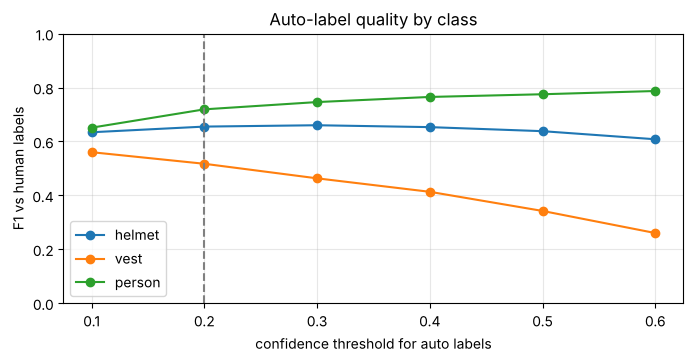
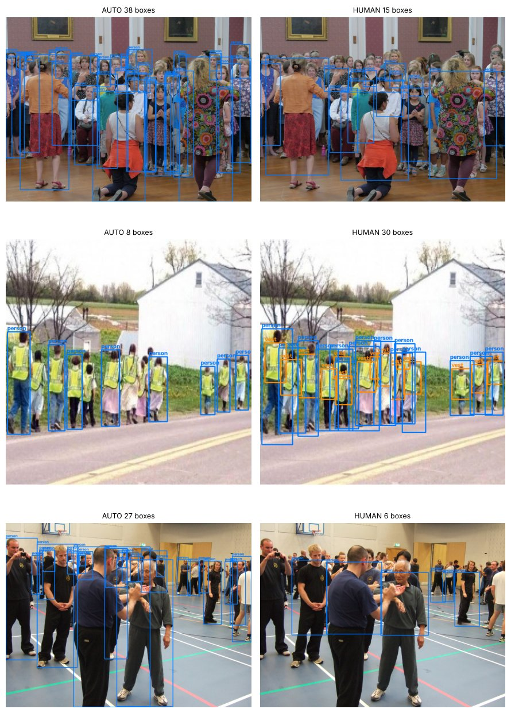
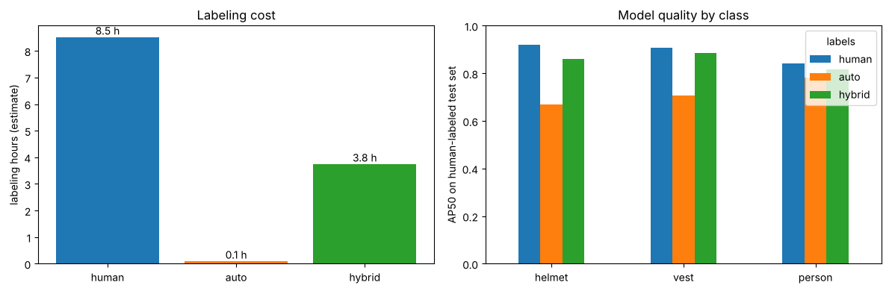

# YOLO 2회차 추가 실습 — 오토 라벨링 공장

노트북: [`06_yolo_day2_autolabel_lab_v1.1.ipynb`](../06_yolo_day2_autolabel_lab_v1.1.ipynb) · [Colab에서 열기](https://colab.research.google.com/github/jhjwlee/yolo-training/blob/main/day2/06_yolo_day2_autolabel_lab_v1.1.ipynb)

| 항목 | 내용 |
|---|---|
| 실행 환경 | Google Colab, 런타임 유형 T4 GPU (메뉴 → 런타임 → 런타임 유형 변경). 학습이 세 번 들어가므로 GPU가 필요합니다. 결과는 Google Drive MyDrive/yolo_day2/autolabel 폴더에 저장 |
| 예상 소요 시간 | 약 30~40분 (T4 GPU, 기본 설정 기준). 시간이 부족하면 QUICK_RUN = True |
| 사용 데이터 | Ultralytics 공개 데이터셋 Construction-PPE, 자동 다운로드. 건설 현장 작업자 사진(학습 1,132장 · 검증 143장 · 테스트 141장). 원본 11개 클래스 중 helmet·vest·Person 3종만 사용 |
| 주요 결과 파일 | label_battle.csv(라벨 방식별 성능), label_cost.csv(라벨 방식별 비용과 성능), label_report.png(비용·성능 비교 그림). 모두 MyDrive/yolo_day2/autolabel에 저장. 실습용 데이터셋 폴더 ppe3/human · ppe3/auto · ppe3/hybrid는 런타임 로컬 디스크에 생성 |

## 목차

- [0. 준비](#0-준비)
- [Step 1. 목표 정하기 — 안전모·조끼·사람](#step-1-목표-정하기--안전모조끼사람)
- [Step 2. 자동 라벨링](#step-2-자동-라벨링)
- [Step 3. 라벨 품질 검사와 임계값 고르기](#step-3-라벨-품질-검사와-임계값-고르기)
- [Step 4. 공장 가동 — 두 모델 학습과 대결](#step-4-공장-가동--두-모델-학습과-대결)
- [Step 5. 하이브리드 검수와 비용 계산](#step-5-하이브리드-검수와-비용-계산)
- [도전 과제](#도전-과제) · [자주 겪는 문제](#자주-겪는-문제) · [용어 정리](#용어-정리)

## 이 실습에서 배우는 것

- 오픈 보캐뷸러리 모델 YOLOE를 라벨링 도구로 써서 학습 이미지 전체에 YOLO 형식 자동 라벨을 만드는 방법
- 낮은 신뢰도(0.05)로 예측 캐시를 만들어 두고, 모델을 다시 돌리지 않고 신뢰도 기준만 바꿔 보는 방법
- 자동 라벨을 사람 라벨과 IoU 0.5 기준으로 맞춰 클래스별 정밀도·재현율·F1을 재고, F1로 신뢰도 기준(AUTO_CONF)을 고르는 방법
- 학습 라벨만 다르게 하고 나머지 조건은 같게 둔 비교 실험으로 자동 라벨 모델과 사람 라벨 모델을 공정하게 비교하는 방법
- 성적은 항상 사람이 확인한 검증·테스트 라벨로 매겨야 하는 이유
- 애매한 박스만 사람이 고치는 하이브리드 검수의 효과를 라벨링 시간(가정값)과 mAP50으로 함께 따지는 방법

## 실습 흐름

| 단계 | 만드는 것 | 결과물 |
|---|---|---|
| Step 1 | 목표 정하기 — 원본 11개 클래스에서 안전모·조끼·사람 3종만 남긴 데이터 만들기 | 사람 라벨 데이터셋 (ppe3/human) |
| Step 2 | 자동 라벨링 — YOLOE로 학습 이미지 1,132장 전체를 예측 | 예측 캐시 (CACHE) |
| Step 3 | 라벨 품질 검사 — 사람 라벨과 비교해 클래스별 F1을 재고 신뢰도 기준 고르기 | 품질표·F1 그래프, 자동 라벨 데이터셋 (ppe3/auto) |
| Step 4 | 공장 가동 — 사람 라벨 모델 vs 자동 라벨 모델 학습·평가 | 성능 비교표 (CSV 저장은 Step 5에서 hybrid까지 모은 뒤) |
| Step 5 | 하이브리드 검수와 비용 계산 | label_battle.csv, label_cost.csv, label_report.png |

각 셀은 **위에서부터 순서대로** 실행합니다. 셀마다 코드 원문, 코드 설명, 실행 결과, 막혔을 때 확인할 점을 차례로 정리했습니다.

---

## 0. 준비

**목표** 패키지를 설치하고, 결과 저장 폴더와 도우미 함수, 학습 설정(CFG)을 준비합니다.

이 실습은 모델 두 종류를 씁니다. 라벨을 만드는 YOLOE와, 그 라벨로 학습하는 YOLO26n입니다. YOLOE가 단어를 이해하려면 텍스트 인코더용 CLIP 패키지가 필요해 따로 설치합니다. 결과 CSV와 그림은 save_out()으로 Drive의 MyDrive/yolo_day2/autolabel 폴더에 복사합니다. 반면 새로 만드는 데이터셋 폴더 ppe3는 런타임 로컬 디스크에 두므로, 런타임이 끊기면 사라집니다. 이 해설서의 수치는 QUICK_RUN = True(5 epoch, imgsz 416)로 GPU 없이 실행한 검증 실행 예시입니다. 기본 설정(30 epoch, imgsz 640)과 T4 GPU에서는 수치와 시간이 달라집니다.

### 셀 1. Ultralytics와 CLIP 패키지 설치

```python
# !로 시작하는 줄은 파이썬이 아닌 셸 명령
# YOLO·YOLOE 모델과 학습·평가 도구 설치 (-q: 설치 메시지 줄임)
!pip -q install ultralytics
# YOLOE가 단어를 벡터로 바꿀 때 쓰는 CLIP 패키지 설치
!pip -q install git+https://github.com/ultralytics/CLIP.git
```

**코드 설명**

- `!pip -q install ultralytics` — YOLO·YOLOE 모델과 학습·평가 도구를 설치합니다. `-q`는 설치 메시지를 줄입니다.
- `!pip -q install git+https://github.com/ultralytics/CLIP.git` — GitHub 저장소에서 CLIP 패키지를 직접 설치합니다. YOLOE가 단어를 벡터로 바꿀 때 이 패키지를 씁니다.
- `!`로 시작하는 줄은 파이썬이 아니라 셸 명령으로 실행됩니다.

**실행 결과**

설치 진행 표시 외에는 특별한 출력이 없습니다. 오류 없이 끝나면 다음 셀로 넘어갑니다.

> **막혔을 때** Colab은 런타임이 끊기면 설치한 패키지가 사라집니다. 런타임을 다시 연결했다면 이 셀부터 다시 실행하세요.

### 셀 2. 라이브러리 불러오기, Drive 연결, 저장 폴더와 도우미 함수 정의

```python
# 필요한 라이브러리 불러오기
import os, json, time, shutil
from pathlib import Path
from collections import Counter  # 항목별 개수를 세는 도구

import cv2
import numpy as np
import pandas as pd
import matplotlib.pyplot as plt
import torch
from IPython.display import display
from ultralytics import YOLO, YOLOE  # YOLO: 학습할 모델, YOLOE: 라벨링에 쓸 모델
from ultralytics.data.utils import check_det_dataset  # 데이터셋 내려받기 + 경로·클래스 정보 반환

print('GPU 사용 가능:', torch.cuda.is_available())  # T4 GPU 런타임이면 True

# Colab에서만 성공하는 import로 실행 환경 구분
try:
    from google.colab import drive
    IN_COLAB = True
except ImportError:
    IN_COLAB = False

USE_DRIVE = True  # False: Drive 대신 로컬 outputs/autolabel에 저장
if IN_COLAB and USE_DRIVE:
    drive.mount('/content/drive')  # Google 계정 권한 창이 뜨면 허용
    SAVE_DIR = Path('/content/drive/MyDrive/yolo_day2/autolabel')  # 결과 파일을 모을 Drive 폴더
else:
    SAVE_DIR = Path('outputs/autolabel')
SAVE_DIR.mkdir(parents=True, exist_ok=True)  # 상위 폴더까지 생성, 이미 있어도 오류 없음
WORK = Path('ppe3')            # 데이터셋 3개(human·auto·hybrid)를 만들 폴더 (런타임 로컬 디스크)
print('결과 저장 위치:', SAVE_DIR.resolve())

# 결과 파일을 SAVE_DIR(Drive)로 복사하고 복사된 경로 반환
def save_out(path):
    dst = SAVE_DIR / Path(path).name
    if Path(path).resolve() != dst.resolve():  # 이미 같은 파일이면 복사 생략
        shutil.copy(path, dst)
    return dst

# OpenCV BGR 이미지 여러 장을 cols열 격자로 표시
def show_grid(imgs, titles=None, cols=3, size=4):
    rows = (len(imgs) + cols - 1) // cols  # 필요한 행 수 (올림 나눗셈)
    fig, axes = plt.subplots(rows, cols, figsize=(size * cols, size * rows))
    for ax, i in zip(np.array(axes).ravel(), range(rows * cols)):  # 2차원 칸 배열을 한 줄로 펴서 차례로 채움
        ax.axis('off')  # 축 눈금 숨김 (남는 칸은 빈칸으로)
        if i < len(imgs):
            ax.imshow(imgs[i][..., ::-1])  # [..., ::-1]: 채널 순서 BGR → RGB로 뒤집기
            if titles:
                ax.set_title(titles[i], fontsize=9)
    plt.tight_layout(); plt.show()
```

**코드 설명**

- `from ultralytics import YOLO, YOLOE` — 학습할 일반 YOLO 모델과 라벨링에 쓸 YOLOE를 함께 불러옵니다.
- `from ultralytics.data.utils import check_det_dataset` — 데이터셋 설정 이름을 주면 내려받고 경로·클래스 정보를 돌려주는 함수입니다.
- `print('GPU 사용 가능:', torch.cuda.is_available())` — GPU 연결 여부를 확인합니다. Colab T4 런타임이면 True가 나와야 합니다.
- `try: from google.colab import drive` — Colab에서만 성공하는 import로 실행 환경을 구분해 `IN_COLAB`에 담습니다.
- `USE_DRIVE = True` / `drive.mount('/content/drive')` — Drive를 연결하고 `SAVE_DIR`을 `/content/drive/MyDrive/yolo_day2/autolabel`로 정합니다. Colab이 아니면 로컬 `outputs/autolabel` 폴더를 씁니다.
- `WORK = Path('ppe3')` — 이 실습에서 만드는 데이터셋 세 개(human·auto·hybrid)를 담을 폴더입니다. Drive가 아니라 런타임 로컬 디스크에 만듭니다.
- `save_out(path)` — 파일을 `SAVE_DIR`로 복사하고 복사된 경로를 돌려줍니다. 원본과 대상이 같은 파일이면 복사하지 않습니다.
- `show_grid(imgs, titles, cols, size)` — OpenCV의 BGR 이미지를 `[..., ::-1]`로 RGB로 바꿔 격자로 보여 줍니다. 이미지 수로 행 수를 계산하고, 남는 칸은 축을 꺼서 비워 둡니다.

**실행 결과**

'GPU 사용 가능: True'와 '결과 저장 위치: /content/drive/MyDrive/yolo_day2/autolabel'이 출력됩니다. 검증 실행 예시는 GPU가 없는 로컬 환경이라 'GPU 사용 가능: False'와 outputs/autolabel 경로가 나왔습니다. Colab에서는 Drive 연결 권한 창이 뜹니다.

> **막혔을 때** GPU가 False로 나오면 런타임 유형을 T4 GPU로 바꾸고 다시 실행하세요. Drive 권한 창에서 허용하지 않으면 마운트가 실패합니다. Drive 없이 하려면 `USE_DRIVE = False`로 바꿉니다. 이때 결과 파일은 런타임이 끊기면 사라집니다.

### 셀 3. 학습 설정 CFG 정하기 (기본 / QUICK_RUN)

```python
# 학습 설정 — 시간이 부족하면 QUICK_RUN = True
QUICK_RUN = False  # True: 빨리 끝나지만 정확도가 낮아질 수 있음
# 학습 3번(사람·자동·하이브리드) 모두 같은 CFG → 라벨만 다른 비교
# epochs: 학습 데이터 반복 횟수, imgsz: 입력 크기, batch: 한 번에 넣는 장수
CFG = dict(epochs=30, imgsz=640, batch=16) if not QUICK_RUN else dict(epochs=5, imgsz=416, batch=16)
print(CFG)
```

**코드 설명**

- `QUICK_RUN = False` — 기본값은 충분히 학습하는 설정입니다. 시간이 부족하면 `True`로 바꿉니다.
- `dict(epochs=30, imgsz=640, batch=16)` — 기본 설정입니다. 학습 데이터를 30번 반복하고 입력 크기는 640입니다.
- `dict(epochs=5, imgsz=416, batch=16)` — QUICK_RUN 설정입니다. 반복 횟수와 입력 크기를 줄여 시간을 크게 줄이는 대신 정확도가 낮아질 수 있습니다.
- `CFG` — Step 4·5의 학습 세 번(사람·자동·하이브리드)이 모두 같은 CFG를 씁니다. 라벨 외의 조건을 같게 두기 위해서입니다.

**실행 결과**

기본 설정이면 `{'epochs': 30, 'imgsz': 640, 'batch': 16}`, QUICK_RUN이면 `{'epochs': 5, 'imgsz': 416, 'batch': 16}`이 출력됩니다. 검증 실행 예시는 QUICK_RUN 설정입니다.

> **막혔을 때** QUICK_RUN을 바꾼 뒤에는 이 셀을 다시 실행해야 CFG에 반영됩니다. Step 4 학습을 시작하기 전에 정해 두세요.

**정리 · 확인해 보기**

GPU가 True인지, 저장 위치가 Drive 경로인지 확인하고 넘어가세요. 이 실습은 학습을 세 번 합니다. GPU 없이 QUICK_RUN으로 실행한 검증 실행 예시에서도 학습 한 번에 약 17분이 걸렸습니다.

---

## Step 1. 목표 정하기 — 안전모·조끼·사람

**목표** Construction-PPE 원본 11개 클래스 중 helmet·vest·Person 3종만 남기고 번호를 0·1·2로 바꾼 '사람 라벨 데이터셋'(ppe3/human)을 만듭니다.

YOLO 라벨은 이미지마다 같은 이름의 .txt 파일입니다. 한 줄에 박스 하나를 '클래스 번호 cx cy w h' 형식으로 적습니다. 좌표는 이미지 너비·높이로 나눈 0~1 값입니다. 원본에서 vest는 2번, Person은 6번입니다. 그래서 SRC_TO_NEW로 0→0, 2→1, 6→2로 바꾸고 나머지 클래스 줄은 버립니다. 이미지는 복사하지 않고 심볼릭 링크(바로가기)로 연결해 디스크와 시간을 아낍니다. 이 데이터셋이 이후 모든 비교의 기준(정답)입니다.

### 셀 4. 데이터셋을 내려받고 3종 클래스만 남긴 사람 라벨 데이터셋 만들기

```python
PPE = check_det_dataset('construction-ppe.yaml')  # 데이터셋 내려받기 (처음 한 번)
SRC = Path(PPE['path'])  # 원본 데이터셋 최상위 폴더
print('원본 클래스:', PPE['names'])

# 번호 변환표: 원본 11종 중 3종만 새 번호 0·1·2로
TARGET = {0: 'helmet', 1: 'vest', 2: 'person'}  # 새 번호 → 이름
SRC_TO_NEW = {0: 0, 2: 1, 6: 2}  # 원본 번호 → 새 번호 (helmet 0, vest 2, Person 6)
PROMPTS = {0: 'helmet', 1: 'safety vest', 2: 'person'}  # 새 번호 → YOLOE에게 줄 단어
SPLITS = ['train', 'val', 'test']  # 학습·검증·테스트 분할

def read_labels(path, mapping=None):
    """YOLO 라벨 파일 → [(클래스, cx, cy, w, h)]. mapping이 있으면 번호를 바꾸고 나머지는 버림"""
    out = []
    if Path(path).exists():  # 라벨 파일이 없으면 빈 목록 반환
        for line in Path(path).read_text().strip().splitlines():
            c, *v = line.split()  # 첫 값은 클래스, 나머지(*v)는 좌표 목록
            c = int(c)
            if mapping is not None:
                if c not in mapping:  # 3종에 없는 클래스는 버림
                    continue
                c = mapping[c]  # 원본 번호 → 새 번호
            out.append((c, *map(float, v[:4])))  # (클래스, cx, cy, w, h) — 좌표는 실수로
    return out

# 라벨 목록을 YOLO 형식 텍스트로 저장 (한 줄에 박스 하나)
def write_labels(path, labels):
    Path(path).parent.mkdir(parents=True, exist_ok=True)
    Path(path).write_text(''.join(f'{c} {cx:.6f} {cy:.6f} {w:.6f} {h:.6f}\n' for c, cx, cy, w, h in labels))  # 소수 6자리, 빈 목록이면 빈 파일(배경 이미지)

def link_images(dst_root):
    """원본 이미지를 복사하지 않고 바로가기(심볼릭 링크)로 연결"""
    for split in SPLITS:
        d = dst_root / 'images' / split
        d.mkdir(parents=True, exist_ok=True)
        for p in (SRC / 'images' / split).iterdir():
            if not (d / p.name).exists():  # 이미 연결된 파일은 건너뜀
                os.symlink(p.resolve(), d / p.name)  # 원본을 가리키는 바로가기 생성

# 데이터셋 설정(data.yaml)을 쓰고 경로 반환 — JSON도 YAML로 읽힘
def write_yaml(root):
    cfg = {'path': str(root.resolve()), 'train': 'images/train', 'val': 'images/val',
           'test': 'images/test', 'names': TARGET}  # names: 새 번호 → 이름
    yml = root / 'data.yaml'
    yml.write_text(json.dumps(cfg))
    return str(yml)

# 사람 라벨 데이터셋: 원본 라벨을 새 번호로 바꿔 저장
HUMAN = WORK / 'human'  # ppe3/human
link_images(HUMAN)
for split in SPLITS:
    for p in (SRC / 'images' / split).iterdir():
        labels = read_labels(SRC / 'labels' / split / (p.stem + '.txt'), SRC_TO_NEW)  # 3종만 남기고 새 번호로
        write_labels(HUMAN / 'labels' / split / (p.stem + '.txt'), labels)
HUMAN_YAML = write_yaml(HUMAN)

# 학습 라벨의 클래스별 박스 수 세기
TRAIN_IMAGES = sorted((HUMAN / 'images' / 'train').iterdir())
cnt = Counter(c for p in TRAIN_IMAGES for c, *_ in read_labels(HUMAN / 'labels' / 'train' / (p.stem + '.txt')))  # 박스마다 클래스 번호만 꺼내 개수 집계
print('학습 이미지:', len(TRAIN_IMAGES), '장')
pd.DataFrame([{'class': TARGET[k], 'human_boxes': cnt[k]} for k in TARGET])
```

**코드 설명**

- `PPE = check_det_dataset('construction-ppe.yaml')` / `SRC = Path(PPE['path'])` — 데이터셋을 내려받고 최상위 폴더를 `SRC`에 담습니다. `PPE['names']`는 원본 클래스 번호와 이름입니다.
- `TARGET`, `SRC_TO_NEW`, `PROMPTS` — 새 번호→이름, 원본 번호→새 번호, 새 번호→YOLOE에 줄 단어입니다. vest만 YOLOE에게 'safety vest'라는 단어로 알려 줍니다.
- `read_labels(path, mapping=None)` — 인자는 라벨 파일 경로와 번호 변환표입니다. 반환값은 `[(클래스, cx, cy, w, h), ...]`입니다. 파일이 없으면 빈 목록을 돌려주고, `mapping`에 없는 클래스 줄은 `continue`로 버립니다.
- `write_labels(path, labels)` — 폴더를 만들고 박스를 소수 6자리로 한 줄씩 씁니다. 빈 목록이면 빈 파일이 생기며, 박스가 없는 배경 이미지로 처리됩니다.
- `link_images(dst_root)` — train·val·test 이미지를 `os.symlink`로 새 폴더에 연결합니다. 이미 연결된 파일은 건너뜁니다.
- `write_yaml(root)` — `path`, `train`, `val`, `test`, `names: TARGET`을 담은 설정을 `data.yaml`로 쓰고 그 경로를 반환합니다. JSON은 YAML로도 읽히므로 `json.dumps`로 씁니다.
- `for split in SPLITS: ... write_labels(HUMAN / 'labels' / split / ...)` — 세 분할의 모든 라벨을 새 번호로 바꿔 `ppe3/human/labels`에 씁니다.
- `cnt = Counter(...)` — 학습 라벨의 클래스별 박스 수를 세어 `class`, `human_boxes` 열의 표로 보여 줍니다.

**실행 결과**

원본 클래스 11개({0: 'helmet', 1: 'gloves', 2: 'vest', ... 6: 'Person', 7: 'no_helmet', ...})와 '학습 이미지: 1132 장'이 출력되고, 클래스별 박스 수 표가 나옵니다. 검증 실행 예시: helmet 1341, vest 1269, person 1770개입니다. 합계 4,380개가 Step 3에서 자동 라벨 수와 비교할 기준입니다.

> **막혔을 때** 처음 실행할 때는 데이터셋을 내려받느라 시간이 걸립니다. 런타임이 끊겼다가 다시 연결되면 ppe3 폴더가 사라지므로 이 셀부터 다시 실행하세요.

**정리 · 확인해 보기**

원본의 사람 클래스 이름은 대문자 'Person'이지만 새 데이터셋에서는 'person'입니다. 클래스별 박스 수도 기억해 두세요. 사람 라벨은 person 1,770개로 가장 많고, helmet과 vest는 1,300개 안팎입니다.

---

## Step 2. 자동 라벨링

**목표** YOLOE에 단어 세 개를 주고 학습 이미지 1,132장을 모두 예측해, 신뢰도 0.05 이상인 후보를 예측 캐시(CACHE)에 YOLO 좌표로 저장합니다.

YOLOE는 set_classes()로 받은 단어를 텍스트 벡터로 바꾸고, 이미지 영역과 비교해 물체를 찾습니다. 단어를 새 번호 순서(helmet, safety vest, person)대로 주면 YOLOE 결과의 클래스 번호가 곧 새 번호가 됩니다. 신뢰도 기준을 0.05로 아주 낮게 잡아 거의 모든 후보를 모아 둡니다. 그러면 Step 3에서 기준을 0.1~0.6으로 바꿔 볼 때 모델을 다시 돌릴 필요가 없습니다. 걸린 시간 AUTO_SEC은 Step 5에서 자동 라벨링 비용으로 씁니다.

### 셀 5. YOLOE로 학습 이미지 전체를 예측해 예측 캐시 만들기

```python
labeler = YOLOE('yoloe-26s-seg.pt')  # 라벨링 담당 YOLOE s 모델 (없으면 자동 다운로드)
labeler.set_classes([PROMPTS[k] for k in sorted(PROMPTS)])     # 결과 클래스 번호 = PROMPTS 순서 = 새 번호

# 학습 이미지 전체를 예측해 예측 캐시(CACHE)에 저장, 걸린 시간 측정
t0 = time.time()
CACHE = {}  # {파일 이름: [(클래스, 신뢰도, cx, cy, w, h), ...]}
for p in TRAIN_IMAGES:
    r = labeler.predict(str(p), conf=0.05, verbose=False)[0]  # conf=0.05: 낮은 점수 후보까지 모두 남김
    h, w = r.orig_shape  # 원본 이미지 (높이, 너비) — 높이가 먼저
    preds = []
    # xyxy: 꼭짓점 픽셀 좌표, cls: 클래스 번호, conf: 신뢰도
    for (x1, y1, x2, y2), c, cf in zip(r.boxes.xyxy.cpu().numpy(), r.boxes.cls.cpu().numpy().astype(int),
                                       r.boxes.conf.cpu().numpy()):
        preds.append((int(c), float(cf), (x1 + x2) / 2 / w, (y1 + y2) / 2 / h, (x2 - x1) / w, (y2 - y1) / h))  # 픽셀 좌표 → YOLO 형식(중심·너비·높이, 0~1)
    CACHE[p.stem] = preds  # stem: 확장자를 뺀 파일 이름
AUTO_SEC = time.time() - t0  # 자동 라벨링에 걸린 전체 시간(초)
print(f'자동 라벨링: {len(CACHE)}장, {AUTO_SEC:.0f}초 (이미지당 {AUTO_SEC / len(CACHE) * 1000:.0f}ms)')
```

**코드 설명**

- `labeler = YOLOE('yoloe-26s-seg.pt')` — YOLOE s 크기 모델을 불러옵니다. 파일이 없으면 자동으로 내려받습니다.
- `labeler.set_classes([PROMPTS[k] for k in sorted(PROMPTS)])` — 단어를 `['helmet', 'safety vest', 'person']` 순서로 줍니다. 그래서 결과 클래스 번호 0·1·2가 TARGET의 새 번호와 같습니다.
- `t0 = time.time()` … `AUTO_SEC = time.time() - t0` — 이미지 1,132장을 라벨링하는 데 걸린 전체 시간(초)을 잽니다.
- `labeler.predict(str(p), conf=0.05, verbose=False)[0]` — 신뢰도 0.05 이상인 후보를 모두 남깁니다. `[0]`은 이미지 한 장의 결과를 꺼냅니다.
- `h, w = r.orig_shape` — 원본 이미지의 높이와 너비입니다. 높이가 먼저 온다는 점에 주의하세요.
- `zip(r.boxes.xyxy..., r.boxes.cls...astype(int), r.boxes.conf...)` — 박스의 픽셀 꼭짓점 좌표, 클래스 번호, 신뢰도를 한 박스씩 꺼냅니다.
- `(x1 + x2) / 2 / w, (y1 + y2) / 2 / h, (x2 - x1) / w, (y2 - y1) / h` — 픽셀 꼭짓점 좌표를 YOLO 형식(중심 x·y, 너비, 높이, 0~1)으로 바꿉니다.
- `CACHE[p.stem] = preds` — 키는 확장자를 뺀 파일 이름, 값은 `(클래스, 신뢰도, cx, cy, w, h)` 목록입니다. 사람 라벨과 달리 두 번째 값이 신뢰도입니다.

**실행 결과**

'자동 라벨링: 1132장, 418초 (이미지당 369ms)'가 출력됩니다(검증 실행 예시, GPU 없는 CPU 환경). T4 GPU에서는 훨씬 짧게 걸립니다. torch.jit.load가 곧 없어진다는 FutureWarning이 함께 나올 수 있지만 결과에는 영향이 없습니다.

> **막혔을 때** 처음 실행할 때는 모델과 텍스트 인코더 가중치를 내려받아 더 오래 걸립니다. CLIP 관련 ImportError가 나면 0단계 설치 셀을 다시 실행하세요. CACHE는 메모리에만 있으므로 런타임이 끊기면 이 셀을 다시 실행해야 합니다.

**정리 · 확인해 보기**

사람이 박스 4,380개를 그리는 일을 모델은 이미지당 수백 ms에 처리합니다. 다만 아직 이 라벨이 맞는지는 모릅니다. CACHE에 담긴 두 번째 값(신뢰도)이 어디에 쓰이는지 Step 3에서 확인합니다.

---

## Step 3. 라벨 품질 검사와 임계값 고르기

**목표** 자동 라벨을 사람 라벨과 맞춰 클래스별 정밀도·재현율·F1을 재고, 클래스 평균 F1이 가장 높은 신뢰도 기준 AUTO_CONF를 고른 뒤 자동 라벨 데이터셋(ppe3/auto)을 만듭니다.

두 박스가 얼마나 겹치는지는 IoU(겹친 넓이 ÷ 합친 넓이)로 잽니다. 같은 클래스이고 IoU가 0.5 이상이면 '일치'입니다. 정밀도는 자동 라벨 중 일치한 비율이고, 낮으면 헛박스가 많다는 뜻입니다. 재현율은 사람 라벨 중 자동 라벨이 찾아낸 비율이고, 낮으면 빠진 라벨이 많다는 뜻입니다. 신뢰도 기준을 올리면 헛박스가 줄어 정밀도가 오르지만, 맞는 박스도 함께 버려져 재현율이 떨어집니다. F1은 둘의 조화 평균입니다. 한쪽만 높으면 낮게 나오므로 균형점을 고르는 데 씁니다. 자동 라벨 데이터셋은 학습(train) 라벨만 자동 라벨로 바꾸고, 검증(val)·테스트(test) 라벨은 사람 라벨을 그대로 둡니다.

### 셀 6. IoU 매칭 함수 정의와 신뢰도 기준별 정밀도·재현율·F1 계산

```python
# (cx, cy, w, h) → 꼭짓점 좌표 (x1, y1, x2, y2)
def to_xyxy(b):
    cx, cy, w, h = b
    return np.array([cx - w / 2, cy - h / 2, cx + w / 2, cy + h / 2])

# 두 박스(x1, y1, x2, y2)의 IoU = 겹친 넓이 ÷ 합친 넓이
def iou(a, b):
    x1, y1 = max(a[0], b[0]), max(a[1], b[1]); x2, y2 = min(a[2], b[2]), min(a[3], b[3])  # 겹친 영역: 왼쪽 위는 max, 오른쪽 아래는 min
    inter = max(0, x2 - x1) * max(0, y2 - y1)  # 안 겹치면 0
    return inter / ((a[2] - a[0]) * (a[3] - a[1]) + (b[2] - b[0]) * (b[3] - b[1]) - inter + 1e-9)  # 1e-9: 0으로 나누기 방지

def match_counts(auto, human, cls):
    """한 이미지, 한 클래스의 (일치 수, 자동 라벨 수, 사람 라벨 수)"""
    A = [to_xyxy(a[2:]) for a in sorted(auto, key=lambda a: -a[1]) if a[0] == cls]  # 해당 클래스 자동 박스, 신뢰도 높은 순
    Hb = [to_xyxy(h[1:]) for h in human if h[0] == cls]  # 해당 클래스 사람 박스
    used, tp = set(), 0  # used: 이미 짝지은 사람 박스 번호
    for a in A:
        best, j = 0, -1
        for k, hb in enumerate(Hb):
            if k not in used and iou(a, hb) > best:  # 짝 없는 사람 박스 중 가장 많이 겹치는 것
                best, j = iou(a, hb), k
        if best >= 0.5:  # IoU 0.5 이상이면 일치로 셈
            used.add(j); tp += 1
    return tp, len(A), len(Hb)

HUMAN_TRAIN = {p.stem: read_labels(HUMAN / 'labels' / 'train' / (p.stem + '.txt')) for p in TRAIN_IMAGES}  # 학습 이미지별 사람 라벨 (Step 5에서도 사용)

# 신뢰도 기준(thr)별·클래스별 정밀도·재현율·F1 계산
rows = []
for thr in [0.1, 0.2, 0.3, 0.4, 0.5, 0.6]:  # 비교할 신뢰도 기준
    for c in TARGET:
        tp = na = nh = 0
        for stem, preds in CACHE.items():
            t, a, h = match_counts([p for p in preds if p[1] >= thr], HUMAN_TRAIN[stem], c)  # 기준 이상 후보만 남겨 비교
            tp += t; na += a; nh += h
        prec, rec = tp / max(na, 1), tp / max(nh, 1)  # 정밀도, 재현율 (max(..., 1): 0 나누기 방지)
        rows.append({'conf': thr, 'class': TARGET[c], 'auto_boxes': na, 'precision': round(prec, 3),
                     'recall': round(rec, 3), 'f1': round(2 * prec * rec / max(prec + rec, 1e-9), 3)})  # F1 = 정밀도·재현율의 조화 평균
quality = pd.DataFrame(rows)

mean_f1 = quality.groupby('conf')['f1'].mean()  # 기준별로 세 클래스 F1 평균
AUTO_CONF = float(mean_f1.idxmax())  # 평균 F1이 가장 높은 기준 선택
print('클래스 평균 F1이 가장 높은 신뢰도 기준:', AUTO_CONF)
quality[quality['conf'] == AUTO_CONF]  # 고른 기준의 행만 표시
```

**코드 설명**

- `to_xyxy(b)` — `(cx, cy, w, h)`를 꼭짓점 좌표 `(x1, y1, x2, y2)` 배열로 바꿉니다. IoU를 계산하려면 꼭짓점 좌표가 필요합니다.
- `iou(a, b)` — 겹친 영역의 왼쪽 위는 `max`, 오른쪽 아래는 `min`으로 구합니다. `max(0, ...)`로 겹치지 않으면 넓이 0이 되고, 분모의 `1e-9`는 0으로 나누는 것을 막습니다.
- `match_counts(auto, human, cls)` — 인자는 한 이미지의 자동 라벨, 사람 라벨, 클래스 번호입니다. 반환값은 `(일치 수, 자동 라벨 수, 사람 라벨 수)`입니다.
- `sorted(auto, key=lambda a: -a[1])` / `used` — 신뢰도가 높은 자동 박스부터 짝을 찾습니다. 이미 짝지어진 사람 박스 번호는 `used`에 넣어, 사람 박스 하나가 두 번 일치로 세지지 않게 합니다.
- `if best >= 0.5: used.add(j); tp += 1` — 가장 많이 겹치는 사람 박스와의 IoU가 0.5 이상일 때만 일치로 셉니다.
- `HUMAN_TRAIN = {...}` — 학습 이미지별 사람 라벨을 미리 읽어 딕셔너리로 둡니다. Step 5에서도 다시 씁니다.
- `for thr in [0.1, 0.2, 0.3, 0.4, 0.5, 0.6]` — 기준마다 `p[1] >= thr`인 캐시 예측만 남겨 전체 이미지에서 일치 수를 합산합니다. `tp / max(na, 1)`이 정밀도, `tp / max(nh, 1)`이 재현율이고, 이 둘로 F1을 계산합니다.
- `quality.groupby('conf')['f1'].mean()` / `idxmax()` — 기준별로 세 클래스의 F1을 평균하고, 평균이 가장 높은 기준을 `AUTO_CONF`로 정합니다.

**실행 결과**

'클래스 평균 F1이 가장 높은 신뢰도 기준: 0.2'가 출력되고, 그 기준의 세 행 표(conf, class, auto_boxes, precision, recall, f1)가 나옵니다. 검증 실행 예시: helmet 1273개(정밀도 0.672, 재현율 0.638, F1 0.655), vest 616개(0.791, 0.384, 0.517), person 2400개(0.625, 0.847, 0.719). vest는 사람 라벨 1,269개의 절반에 못 미치게 찾았고, person은 사람 라벨 1,770개보다 630개 많습니다.

> **막혔을 때** NameError: CACHE가 나면 Step 2 셀을 실행하지 않았거나 런타임이 재시작된 것입니다. 0단계부터 순서대로 다시 실행하세요.

### 셀 7. 신뢰도 기준에 따른 클래스별 F1 변화 그래프

```python
plt.figure(figsize=(8, 3.5))
for c in TARGET.values():
    q = quality[quality['class'] == c]  # 이 클래스 행만 골라냄
    plt.plot(q['conf'], q['f1'], '-o', label=c)  # x: 신뢰도 기준, y: F1, '-o': 점+선
plt.axvline(AUTO_CONF, ls='--', c='gray')  # 고른 기준 위치에 세로 점선
plt.xlabel('confidence threshold for auto labels'); plt.ylabel('F1 vs human labels'); plt.ylim(0, 1)
plt.title('Auto-label quality by class'); plt.legend(); plt.grid(alpha=.3); plt.show()
```

**코드 설명**

- `for c in TARGET.values(): q = quality[quality['class'] == c]` — 클래스마다 품질표의 해당 행만 골라 선 하나씩 그립니다.
- `plt.plot(q['conf'], q['f1'], '-o', label=c)` — x축은 신뢰도 기준, y축은 F1입니다. `'-o'`는 점과 선을 함께 그립니다.
- `plt.axvline(AUTO_CONF, ls='--', c='gray')` — 고른 기준 위치에 회색 세로 점선을 긋습니다.
- `plt.ylim(0, 1)` — y축을 0~1로 고정해 클래스 사이 차이를 공정하게 보이게 합니다.

**실행 결과**

'Auto-label quality by class' 선 그래프가 나옵니다. 검증 실행 예시에서 person은 기준을 올릴수록 F1이 올라 0.6에서 약 0.79입니다. vest는 0.1에서 약 0.56으로 가장 높고, 기준을 올릴수록 떨어져 0.6에서는 약 0.26입니다. helmet은 0.6~0.66 사이로 거의 평평합니다. 회색 점선은 0.2에 있습니다.



### 셀 8. 자동 라벨과 사람 라벨의 박스 수 차이가 큰 이미지 3장 나란히 보기

```python
# 자동 라벨(왼쪽)과 사람 라벨(오른쪽) 나란히 보기 — 차이가 큰 이미지 3장
COLORS = {0: (0, 220, 255), 1: (0, 140, 255), 2: (255, 120, 0)}  # 클래스별 색 (BGR 순서: helmet 노랑, vest 주황, person 파랑)

# 라벨 박스를 이미지에 그림 (has_conf: 신뢰도 값 포함 여부)
def draw_labels(img, labels, has_conf):
    h, w = img.shape[:2]  # 이미지 (높이, 너비)
    for lab in labels:
        c, box = lab[0], lab[2:] if has_conf else lab[1:]  # 자동 라벨은 2번째 값이 신뢰도 → [2:]부터 좌표
        x1, y1, x2, y2 = (to_xyxy(box) * [w, h, w, h]).astype(int)  # 0~1 좌표 → 픽셀 좌표
        cv2.rectangle(img, (x1, y1), (x2, y2), COLORS[c], 2)
        cv2.putText(img, TARGET[c], (x1, max(12, y1 - 4)), cv2.FONT_HERSHEY_SIMPLEX, 0.5, COLORS[c], 2)  # max(12, ...): 글자가 위로 잘리지 않게
    return img

# 자동 박스 수와 사람 박스 수 차이가 큰 이미지 3장 고르기
diff = sorted(CACHE, key=lambda s: -abs(len([p for p in CACHE[s] if p[1] >= AUTO_CONF]) - len(HUMAN_TRAIN[s])))[:3]
imgs, titles = [], []
for stem in diff:
    p = next(x for x in TRAIN_IMAGES if x.stem == stem)  # 파일 이름으로 이미지 경로 찾기
    img = cv2.imread(str(p))
    auto = [a for a in CACHE[stem] if a[1] >= AUTO_CONF]  # 기준 이상 자동 라벨만
    imgs += [draw_labels(img.copy(), auto, True), draw_labels(img.copy(), HUMAN_TRAIN[stem], False)]  # 복사본에 각각 그림: 왼쪽 자동, 오른쪽 사람
    titles += [f'AUTO {len(auto)} boxes', f'HUMAN {len(HUMAN_TRAIN[stem])} boxes']
show_grid(imgs, titles, cols=2, size=4.5)
```

**코드 설명**

- `COLORS` — 클래스별 박스 색입니다. OpenCV 순서(BGR)라 helmet은 노랑, vest는 주황, person은 파랑으로 보입니다.
- `draw_labels(img, labels, has_conf)` — 인자는 이미지, 라벨 목록, 신뢰도 포함 여부입니다. 자동 라벨은 `(클래스, 신뢰도, 좌표 4개)`라 `lab[2:]`, 사람 라벨은 `(클래스, 좌표 4개)`라 `lab[1:]`에서 좌표를 꺼냅니다. 그린 이미지를 반환합니다.
- `to_xyxy(box) * [w, h, w, h]` — 0~1 좌표에 이미지 너비·높이를 곱해 픽셀 좌표로 바꿉니다.
- `diff = sorted(CACHE, key=lambda s: -abs(...))[:3]` — AUTO_CONF 이상인 자동 박스 수와 사람 박스 수의 차이가 큰 순으로 이미지 3장을 고릅니다.
- `next(x for x in TRAIN_IMAGES if x.stem == stem)` — 파일 이름으로 이미지 경로를 찾습니다.
- `draw_labels(img.copy(), ...)` — 같은 원본에 두 번 그리지 않도록 복사본에 각각 그립니다.
- `show_grid(imgs, titles, cols=2, size=4.5)` — 왼쪽에 자동 라벨, 오른쪽에 사람 라벨을 놓고 제목에 박스 수를 적습니다.

**실행 결과**

3행 2열 그림이 나옵니다. 검증 실행 예시: 1행 실내에 모인 사람들 AUTO 38 vs HUMAN 15, 2행 반사 조끼를 입고 걷는 사람들 AUTO 8 vs HUMAN 30, 3행 체육관 AUTO 27 vs HUMAN 6. 1행과 3행은 사람 라벨이 뒤쪽 사람들을 다 그리지 않아 자동 라벨이 더 많습니다. 2행은 모두 조끼를 입었는데 자동 라벨에는 vest 박스가 하나도 없습니다. vest 재현율 0.384를 눈으로 확인할 수 있는 사례입니다.



### 셀 9. 학습 라벨만 자동 라벨로 바꾼 데이터셋(ppe3/auto) 만들기

```python
# 학습 라벨만 바꾼 데이터셋 만들기 (val·test는 사람 라벨), data.yaml 경로 반환
def build_dataset(root, train_labels):
    link_images(root)  # 이미지는 바로가기로 연결
    for stem, labels in train_labels.items():
        write_labels(root / 'labels' / 'train' / (stem + '.txt'), labels)  # 학습 라벨은 인자로 받은 것
    for split in ['val', 'test']:
        d = root / 'labels' / split
        d.mkdir(parents=True, exist_ok=True)
        for f in (HUMAN / 'labels' / split).glob('*.txt'):
            shutil.copy(f, d / f.name)  # 검증·테스트 라벨은 사람 라벨 그대로
    return write_yaml(root)

AUTO_LABELS = {s: [(c, *b) for c, cf, *b in preds if cf >= AUTO_CONF] for s, preds in CACHE.items()}  # 기준 이상만 남기고 신뢰도(cf)는 뺌
AUTO_YAML = build_dataset(WORK / 'auto', AUTO_LABELS)  # ppe3/auto 데이터셋
n_auto = sum(len(v) for v in AUTO_LABELS.values())  # 자동 라벨 박스 총수
print(f'자동 라벨 박스 {n_auto}개 (사람 라벨 {sum(cnt.values())}개) →', AUTO_YAML)
```

**코드 설명**

- `build_dataset(root, train_labels)` — 인자는 만들 데이터셋 폴더와 `{파일 이름: 라벨 목록}` 딕셔너리입니다. 이미지를 링크하고, train 라벨은 인자로 쓰고, val·test 라벨은 `HUMAN`에서 `shutil.copy`로 복사합니다. 반환값은 `data.yaml` 경로입니다.
- `AUTO_LABELS = {s: [(c, *b) for c, cf, *b in preds if cf >= AUTO_CONF] ...}` — 신뢰도가 기준 이상인 후보만 남기고 신뢰도 값은 뺍니다. 그래서 사람 라벨과 같은 `(클래스, cx, cy, w, h)` 형식이 됩니다.
- `AUTO_YAML = build_dataset(WORK / 'auto', AUTO_LABELS)` — 자동 라벨 데이터셋을 `ppe3/auto`에 만듭니다.
- `n_auto = sum(len(v) for v in AUTO_LABELS.values())` — 자동 라벨 박스의 총수를 셉니다. `sum(cnt.values())`는 사람 라벨 총수입니다.

**실행 결과**

'자동 라벨 박스 4289개 (사람 라벨 4380개) → ppe3/auto/data.yaml'이 출력됩니다(검증 실행 예시). 총수는 비슷하지만 클래스별 구성은 다릅니다. 셀 6의 표처럼 person은 2,400 vs 1,770개, vest는 616 vs 1,269개입니다.

> **막혔을 때** 다른 기준으로 직접 해 보려면 이 셀 앞에 `AUTO_CONF = 0.3`처럼 새 셀을 넣고 이 셀부터 다시 실행합니다. 셀 6을 다시 실행하면 AUTO_CONF가 0.2로 되돌아갑니다.

**정리 · 확인해 보기**

셀 8에서 본 차이를 노트북의 '확인해 보기'처럼 ① 자동 라벨이 틀린 경우 ② 사람이 빠뜨린 경우 ③ 기준이 다른 경우로 나눠 보세요. 1행과 3행의 뒤쪽 사람들은 ②나 ③에 가깝고, 2행의 빠진 조끼는 ①(재현율 문제)입니다. 박스 총수가 사람 라벨과 비슷하다고 품질이 같다는 뜻은 아닙니다. 정밀도·재현율을 클래스별로 함께 봐야 합니다.

---

## Step 4. 공장 가동 — 두 모델 학습과 대결

**목표** 같은 모델(yolo26n.pt)·같은 설정·같은 이미지로 라벨만 다르게 두 번 학습하고, 둘 다 사람 라벨 테스트 세트(141장)로 평가해 비교합니다.

비교 실험에서는 비교하려는 것 하나만 다르게 두어야 차이의 원인을 알 수 있습니다. 여기서는 학습 라벨만 다릅니다. 모델, CFG, seed=0, 이미지, val·test 라벨은 모두 같습니다. 성적은 mAP50(IoU 0.5 기준 평균 정밀도), mAP50-95(IoU 0.5~0.95 기준의 평균), 클래스별 AP50으로 봅니다. mAP50-95는 박스 위치가 얼마나 정확한지까지 반영합니다.

### 셀 10. 학습·테스트 함수(train_and_test) 정의와 사람 라벨·자동 라벨 모델 대결

```python
# yaml_path 데이터셋으로 학습 → 사람 라벨 test로 평가, 성적 한 행(dict) 반환
def train_and_test(yaml_path, name):
    m = YOLO('yolo26n.pt')  # 매번 새 사전학습 모델 (이전 학습 결과 섞이지 않게)
    t0 = time.time()
    m.train(data=yaml_path, epochs=CFG['epochs'], imgsz=CFG['imgsz'], batch=CFG['batch'],  # CFG 값으로 학습
            project='runs_autolabel', name=name, exist_ok=True, seed=0, verbose=False, plots=False)  # seed=0: 무작위 고정, exist_ok: 같은 폴더 덮어씀
    minutes = (time.time() - t0) / 60  # 학습 시간(분)
    best = YOLO(Path(m.trainer.save_dir) / 'weights' / 'best.pt')  # val 점수가 가장 좋았던 가중치
    res = best.val(data=yaml_path, split='test', imgsz=CFG['imgsz'], batch=CFG['batch'], verbose=False, plots=False)  # test 분할(사람 라벨)로 평가
    row = {'labels': name, 'train_min': round(minutes, 1), 'map50': round(res.box.map50, 3),
           'map50_95': round(res.box.map, 3)}  # res.box.map = mAP50-95
    ap = dict(zip(res.box.ap_class_index.tolist(), res.box.ap50.tolist()))   # 클래스 번호 → AP50
    for i, c in TARGET.items():
        row[f'ap50_{c}'] = round(ap.get(i, 0.0), 3)  # test에 없는 클래스는 0
    return row

battle = [train_and_test(HUMAN_YAML, 'human'), train_and_test(AUTO_YAML, 'auto')]  # 사람 라벨 vs 자동 라벨, 학습 2번
pd.DataFrame(battle)
```

**코드 설명**

- `train_and_test(yaml_path, name)` — 인자는 데이터셋 설정 경로와 실험 이름입니다. 학습하고 테스트 세트로 평가한 뒤, 성적 한 행을 딕셔너리로 반환합니다.
- `m = YOLO('yolo26n.pt')` — 사전학습된 n 크기 모델을 매번 새로 불러옵니다. 앞 실험의 학습 결과가 섞이지 않습니다.
- `m.train(..., project='runs_autolabel', name=name, exist_ok=True, seed=0, verbose=False, plots=False)` — CFG 값으로 학습합니다. `seed=0`으로 무작위 요소를 고정하고, `exist_ok=True`로 같은 이름 폴더를 덮어쓰며, `plots=False`로 그림 저장을 생략합니다.
- `minutes = (time.time() - t0) / 60` — 학습에 걸린 시간을 분 단위로 잽니다.
- `best = YOLO(Path(m.trainer.save_dir) / 'weights' / 'best.pt')` — 실제 저장 폴더에서 val 점수가 가장 좋았던 가중치를 불러옵니다.
- `best.val(data=yaml_path, split='test', ...)` — test 분할로 평가합니다. 두 데이터셋 모두 test 라벨은 사람 라벨입니다.
- `res.box.map50`, `res.box.map` — 박스 기준 mAP50과 mAP50-95입니다. 소수 셋째 자리로 반올림합니다.
- `dict(zip(res.box.ap_class_index.tolist(), res.box.ap50.tolist()))` — 클래스 번호와 AP50을 짝지은 딕셔너리입니다. 테스트에 없는 클래스는 `ap.get(i, 0.0)`으로 0이 됩니다. `battle`에는 human, auto 두 행이 담깁니다.

**실행 결과**

학습 로그가 길게 나온 뒤 labels, train_min, map50, map50_95, ap50_helmet, ap50_vest, ap50_person 열의 표가 나옵니다. QUICK_RUN 검증 실행 예시(CPU): human은 train_min 17.4, map50 0.890, map50_95 0.518, AP50 helmet 0.919 · vest 0.906 · person 0.843입니다. auto는 17.3, 0.719, 0.305, 0.669 · 0.707 · 0.781입니다. 학습 시간은 같고 성능만 차이가 납니다. train_min은 CPU에서 잰 값이라 T4 GPU에서는 훨씬 짧습니다.

> **막혔을 때** 학습을 두 번 하므로 가장 오래 걸리는 셀입니다. 결과 폴더는 Ultralytics 버전에 따라 runs/detect/runs_autolabel/human처럼 runs/detect 아래에 생깁니다. 코드는 `m.trainer.save_dir`로 실제 위치를 읽으므로 문제없습니다. CUDA out of memory가 나면 셀 3의 `batch`를 8로 줄입니다. '1 duplicate labels removed' 경고는 같은 박스가 두 번 적힌 줄을 지웠다는 뜻으로, 무시해도 됩니다.

**정리 · 확인해 보기**

검증 실행 예시에서 자동 라벨 모델의 mAP50은 사람 라벨 모델의 약 81%(0.719 ÷ 0.890)입니다. 클래스별 AP50 차이는 helmet 0.25, vest 0.20, person 0.06입니다. F1이 가장 높았던 person의 차이가 가장 작습니다. 그런데 F1이 가장 낮았던 vest보다 helmet의 차이가 더 큽니다. helmet은 헛박스가 많고(정밀도 0.672), vest는 빠진 박스가 많습니다(재현율 0.384). 어느 쪽 오류가 학습에 더 해로운지 생각해 보세요. mAP50-95는 0.518에서 0.305로 더 크게 떨어집니다. 자동 박스의 경계가 사람이 그린 경계와 다르기 때문일 수 있습니다. QUICK_RUN(5 epoch) 결과이므로 기본 설정에서는 차이가 달라질 수 있습니다.

---

## Step 5. 하이브리드 검수와 비용 계산

**목표** 신뢰도가 애매한 박스가 있는 이미지만 사람이 검수하는 하이브리드 라벨로 세 번째 모델을 학습하고, 세 방식의 라벨링 시간(가정값)과 mAP50을 함께 비교합니다.

AUTO_CONF 이상 REVIEW_CONF(0.6) 미만인 박스는 모델도 확신하지 못한 박스입니다. 이런 박스가 하나라도 있는 이미지만 사람이 검수한다고 봅니다. 검수 결과는 그 이미지의 라벨을 사람 라벨로 바꾸는 것으로 흉내 냅니다. 이 기준은 확신 없는 박스는 잘 잡습니다. 하지만 애매한 박스가 하나도 없으면 빠진 라벨이 있어도 검수 대상이 되지 않습니다. 비용은 사람 라벨 = 박스 수 × SEC_PER_BOX, 자동 라벨 = AUTO_SEC, 하이브리드 = AUTO_SEC + 검수 이미지 수 × SEC_PER_REVIEW로 계산합니다. SEC_PER_BOX와 SEC_PER_REVIEW는 가정값이므로 결론도 이 값에 따라 달라집니다.

### 셀 11. 검수 대상 이미지 고르기, 하이브리드 데이터셋 학습, 성능표 저장

```python
REVIEW_CONF = 0.6  # 이 값 이상은 믿고 그대로 사용 (올리면 검수 이미지 늘어남)
RUN_HYBRID = True  # False: 하이브리드 학습 생략 (표·그림에서 hybrid 빠짐)

review = [s for s, preds in CACHE.items() if any(AUTO_CONF <= p[1] < REVIEW_CONF for p in preds)]  # 애매한 박스가 하나라도 있는 이미지 = 검수 대상
print(f'검수 대상 이미지: {len(review)} / {len(CACHE)} ({len(review) / len(CACHE) * 100:.0f}%)')

battle = [b for b in battle if b['labels'] != 'hybrid']   # 이 셀을 다시 실행해도 hybrid 행이 겹치지 않게
if RUN_HYBRID:
    HYB_LABELS = {s: (HUMAN_TRAIN[s] if s in review else AUTO_LABELS[s]) for s in CACHE}  # 검수 대상은 사람 라벨, 나머지는 자동 라벨
    HYB_YAML = build_dataset(WORK / 'hybrid', HYB_LABELS)  # ppe3/hybrid 데이터셋
    battle.append(train_and_test(HYB_YAML, 'hybrid'))  # 같은 조건으로 세 번째 학습·평가

battle_df = pd.DataFrame(battle)
battle_df.to_csv('label_battle.csv', index=False); save_out('label_battle.csv')  # CSV 저장 후 Drive로 복사
battle_df
```

**코드 설명**

- `REVIEW_CONF = 0.6` — 신뢰도가 이 값 이상인 박스는 믿을 만하다고 보고 검수 없이 씁니다.
- `RUN_HYBRID = True` — `False`로 바꾸면 하이브리드 학습을 건너뜁니다. 시간은 줄지만 이후 표와 그림에서 hybrid가 빠집니다.
- `battle = [b for b in battle if b['labels'] != 'hybrid']` — 이전에 만든 hybrid 결과가 있으면 지웁니다. 이 셀을 다시 실행해도 표에 hybrid가 한 줄만 남습니다.
- `review = [s for s, preds in CACHE.items() if any(AUTO_CONF <= p[1] < REVIEW_CONF for p in preds)]` — 캐시 후보 중 애매한 구간의 박스가 하나라도 있는 이미지 이름을 모읍니다.
- `HYB_LABELS = {s: (HUMAN_TRAIN[s] if s in review else AUTO_LABELS[s]) for s in CACHE}` — 검수 대상 이미지는 사람 라벨, 나머지는 자동 라벨을 씁니다.
- `build_dataset(WORK / 'hybrid', HYB_LABELS)` / `battle.append(train_and_test(HYB_YAML, 'hybrid'))` — `ppe3/hybrid` 데이터셋을 만들고 같은 조건으로 학습·평가해 성능표에 세 번째 행을 더합니다.
- `battle_df.to_csv('label_battle.csv', index=False); save_out(...)` — 세 방식의 성능표를 CSV로 저장하고 Drive로 복사합니다.

**실행 결과**

'검수 대상 이미지: 658 / 1132 (58%)'가 출력되고, 하이브리드 학습 로그가 이어진 뒤 세 행의 성능표가 나옵니다. 검증 실행 예시(QUICK 설정)에서 hybrid는 mAP50 0.855로, human 0.890과 auto 0.719 사이에서 human 쪽에 훨씬 가깝습니다. 클래스별 AP50은 helmet 0.859 · vest 0.887 · person 0.818입니다. 특히 auto에서 가장 많이 떨어졌던 vest(0.707)가 human(0.906) 수준으로 회복된 점을 확인합니다.

> **막혔을 때** 이 셀을 다시 실행하면 하이브리드 학습을 처음부터 다시 합니다(약 10분 이상). 셀 첫 부분에서 이전 hybrid 행을 지우므로 표에 hybrid가 두 줄 생기지는 않습니다. 학습 없이 표만 다시 보려면 `battle_df`만 실행하세요.

### 셀 12. 라벨 방식별 라벨링 시간과 성능 비율 계산 (label_cost.csv)

```python
SEC_PER_BOX = 7       # 가정값: 박스 1개 그리는 시간(초) — 늘리면 사람 라벨 비용 증가
SEC_PER_REVIEW = 20   # 가정값: 이미지 1장 검수 시간(초) — 하이브리드 비용에 반영

human_boxes = sum(len(v) for v in HUMAN_TRAIN.values())  # 학습 이미지의 사람 라벨 박스 총수
cost = pd.DataFrame([
    {'labels': 'human', 'label_hours': round(human_boxes * SEC_PER_BOX / 3600, 2)},  # 박스 수 × 박스당 초 ÷ 3600 → 시간
    {'labels': 'auto', 'label_hours': round(AUTO_SEC / 3600, 2)},  # 실제로 잰 YOLOE 실행 시간
    {'labels': 'hybrid', 'label_hours': round((AUTO_SEC + len(review) * SEC_PER_REVIEW) / 3600, 2)},  # 자동 라벨 시간 + 검수 시간
]).merge(battle_df[['labels', 'map50']], on='labels')  # 성능표의 map50을 라벨 방식 이름으로 붙임
base = cost.loc[cost['labels'] == 'human', 'map50'].iloc[0]  # 사람 라벨 모델의 mAP50 (기준 1.0)
cost['map50_vs_human'] = (cost['map50'] / base).round(3)  # 사람 라벨 대비 성능 비율
cost.to_csv('label_cost.csv', index=False); save_out('label_cost.csv')  # CSV 저장 후 Drive로 복사
cost
```

**코드 설명**

- `SEC_PER_BOX = 7` / `SEC_PER_REVIEW = 20` — 박스 하나를 새로 그리는 시간과 이미지 한 장을 검토·수정하는 시간(초)입니다. 둘 다 가정값이니 팀 경험에 맞게 바꿉니다.
- `human_boxes = sum(len(v) for v in HUMAN_TRAIN.values())` — 학습 이미지의 사람 라벨 박스 총수입니다(검증 실행 예시 4,380개).
- `round(human_boxes * SEC_PER_BOX / 3600, 2)` — 사람 라벨링 시간입니다. 초를 3600으로 나눠 시간 단위로 바꿉니다.
- `round(AUTO_SEC / 3600, 2)` / `round((AUTO_SEC + len(review) * SEC_PER_REVIEW) / 3600, 2)` — 자동 라벨은 실제로 잰 YOLOE 실행 시간, 하이브리드는 그 시간에 검수 시간을 더한 값입니다.
- `.merge(battle_df[['labels', 'map50']], on='labels')` — 성능표의 map50을 라벨 방식 이름으로 붙입니다. RUN_HYBRID가 False면 hybrid 행은 여기서 빠집니다.
- `base = cost.loc[cost['labels'] == 'human', 'map50'].iloc[0]` / `cost['map50_vs_human']` — 사람 라벨 모델의 mAP50을 기준(1.0)으로 각 방식의 비율을 계산합니다.
- `cost.to_csv('label_cost.csv', index=False); save_out(...)` — 비용표를 CSV로 저장하고 Drive로 복사합니다.

**실행 결과**

labels, label_hours, map50, map50_vs_human 열의 3행 표가 나옵니다. 검증 실행 예시에서 human은 8.52시간 · mAP50 0.890(1.000), auto는 0.10시간 · 0.719(0.808), hybrid는 3.75시간 · 0.855(0.961)입니다. hybrid는 사람 라벨링 시간의 약 44%로 사람 라벨 모델 성능의 96%를 냈습니다.

> **막혔을 때** 자동 라벨 시간은 실제로 잰 값이고, 사람 라벨·검수 시간은 가정값입니다. GPU 없이 실행하면 AUTO_SEC이 커져 auto·hybrid 시간이 실제 T4 GPU보다 크게 나옵니다.

### 셀 13. 비용과 클래스별 성능 비교 그림 그리기 (label_report.png)

```python
fig, axes = plt.subplots(1, 2, figsize=(12, 4))  # 그래프 2개를 가로로 나란히
cols = {'human': 'tab:blue', 'auto': 'tab:orange', 'hybrid': 'tab:green'}  # 두 그래프에서 같은 방식은 같은 색
# 왼쪽: 라벨링 시간 막대
axes[0].bar(cost['labels'], cost['label_hours'], color=[cols[l] for l in cost['labels']])
axes[0].set_ylabel('labeling hours (estimate)'); axes[0].set_title('Labeling cost')
for i, v in enumerate(cost['label_hours']):
    axes[0].text(i, v, f'{v:.1f} h', ha='center', va='bottom')  # 막대 위에 시간 표시
# 오른쪽: 클래스별 AP50 막대 (방식별 색)
per_class = battle_df.set_index('labels')[[f'ap50_{c}' for c in TARGET.values()]]  # 클래스별 AP50 열만 고름
per_class.columns = list(TARGET.values())  # 열 이름을 helmet·vest·person으로
per_class.T.plot.bar(ax=axes[1], color=[cols[l] for l in per_class.index], rot=0)  # .T(전치): x축 = 클래스, 막대 = 라벨 방식
axes[1].set_ylim(0, 1); axes[1].set_ylabel('AP50 on human-labeled test set'); axes[1].set_title('Model quality by class')
plt.tight_layout(); plt.savefig('label_report.png', dpi=120); save_out('label_report.png'); plt.show()  # show() 전에 저장 (뒤에 하면 빈 그림)
```

**코드 설명**

- `fig, axes = plt.subplots(1, 2, figsize=(12, 4))` — 그래프 두 개를 가로로 나란히 놓습니다.
- `cols = {'human': 'tab:blue', 'auto': 'tab:orange', 'hybrid': 'tab:green'}` — 두 그래프에서 같은 방식은 같은 색으로 그립니다.
- `axes[0].bar(...)` / `axes[0].text(i, v, f'{v:.1f} h', ...)` — 왼쪽은 라벨링 시간 막대 그래프이고, 막대 위에 시간을 소수 첫째 자리로 적습니다.
- `per_class = battle_df.set_index('labels')[[f'ap50_{c}' for c in TARGET.values()]]` — 성능표에서 클래스별 AP50 열만 고르고, 열 이름을 helmet·vest·person으로 바꿉니다.
- `per_class.T.plot.bar(ax=axes[1], ...)` — 표를 전치(`.T`)해 x축이 클래스, 막대가 라벨 방식이 되게 그립니다.
- `plt.savefig('label_report.png', dpi=120); save_out(...); plt.show()` — 화면에 보이기 전에 파일로 저장합니다. `show()` 뒤에 저장하면 빈 그림이 저장될 수 있습니다.

**실행 결과**

왼쪽 'Labeling cost' 막대 그래프는 세 방식의 라벨링 시간(human 8.52h, auto 0.10h, hybrid 3.75h)을, 오른쪽 'Model quality by class'는 helmet·vest·person별 AP50을 세 방식 막대로 보여 줍니다. 오른쪽에서 hybrid 막대가 모든 클래스에서 auto보다 human에 가깝다는 것을 확인합니다.



**정리 · 확인해 보기**

SEC_PER_BOX와 SEC_PER_REVIEW를 팀 경험에 맞게 바꾸고 셀 12·22만 다시 실행해 보세요. 학습은 다시 하지 않아도 됩니다. 사람이 박스를 더 빨리 그린다면 하이브리드의 이점은 줄어듭니다. REVIEW_CONF를 바꾸면 검수 비율이 달라지는데, 이때는 셀 11부터 다시 실행해야 하므로 학습도 다시 합니다.

---

## 도전 과제

1. 단어 튜닝 — PROMPTS의 'safety vest'를 'high-visibility vest', 'reflective vest'로 바꾸고 셀 5(캐시 다시 만들기)과 셀 6만 다시 실행하면 학습 없이 F1을 비교할 수 있습니다. 개선 목표는 검증 실행 예시에서 재현율 0.384에 그친 vest입니다. 클래스마다 가장 좋은 단어를 찾으면 셀 9부터 다시 실행해 공장을 돌립니다.
2. 클래스별 기준 — `quality.loc[quality.groupby('class')['f1'].idxmax()]`로 클래스마다 F1이 가장 높은 기준을 찾고, 셀 9의 AUTO_LABELS 조건을 `cf >= CONF_BY_CLASS[c]`처럼 바꿔 보세요. 셀 7 그래프에서 vest는 낮은 기준, person은 높은 기준이 유리했습니다. vest는 0.1이 시험한 가장 낮은 값이므로, 캐시 최저값인 0.05까지 기준 목록에 넣어 봅니다. 셀 11의 검수 조건도 같은 클래스별 기준으로 바꿔야 합니다.
3. 검수 대상 고르기 전략 — '애매한 신뢰도' 대신 '자동 라벨에 person은 있는데 그 박스 안에 helmet이 없는 이미지', '자동 박스가 아주 많은 이미지' 등으로 검수 대상을 골라 보세요. 실제 현장에서는 사람 라벨이 없으므로 고르는 기준에는 자동 라벨 정보만 써야 합니다. 공정하게 비교하려면 검수 이미지 수를 기본 전략과 같게(검증 실행 예시 658장) 맞춥니다.
4. 내 데이터로 — 캐글이나 공공데이터에서 라벨 없는 이미지 묶음을 구해 자동 라벨 → 학습까지 해 보세요. 성적을 매기려면 검증용 이미지 50~100장은 직접 라벨링해야 합니다. 이 소량의 사람 라벨로 셀 6처럼 F1을 재서 신뢰도 기준도 고를 수 있습니다.

## 자주 겪는 문제

| 증상 | 원인 | 해결 |
|---|---|---|
| 자동 라벨링(셀 5)과 학습(셀 10·19)이 매우 느리다 | GPU가 아닌 CPU 런타임에서 실행 중이다. 0단계에서 'GPU 사용 가능: False'가 나왔을 것이다 | 런타임 → 런타임 유형 변경에서 T4 GPU를 고르고 0단계부터 다시 실행한다. 시간이 부족하면 셀 3에서 QUICK_RUN = True로 바꾼다 |
| set_classes()에서 오래 멈추거나 CLIP 관련 ImportError가 난다 | 처음 호출 때 텍스트 인코더 가중치를 내려받는다. CLIP 패키지 설치가 실패했거나 런타임 재시작으로 사라졌다 | 잠시 기다린다. ImportError면 0단계 설치 셀을 다시 실행한 뒤 이어서 진행한다 |
| 런타임을 다시 연결한 뒤 NameError(CACHE, AUTO_CONF 등)가 나거나 ppe3 폴더가 없다 | 변수는 메모리에만 있고 ppe3 폴더는 런타임 로컬 디스크에 있어 재시작하면 모두 사라진다 | 0단계부터 순서대로 다시 실행한다. Drive의 결과 CSV·그림은 남아 있다 |
| runs_autolabel 폴더를 찾을 수 없다 | Ultralytics 버전에 따라 학습 결과가 runs/detect/runs_autolabel/human처럼 runs/detect 아래에 저장된다 | runs/detect/runs_autolabel을 찾는다. 노트북은 m.trainer.save_dir로 실제 위치를 읽으므로 실행에는 문제가 없다 |
| 성능표·비용표에 hybrid 행이 없다 | 셀 11에서 RUN_HYBRID = False로 두어 하이브리드 학습을 건너뛰었다 | RUN_HYBRID = True로 바꾸고 셀 11부터 다시 실행한다 |
| 학습 중 CUDA out of memory 오류가 난다 | 학습 배치가 GPU 메모리에 비해 크다 | 셀 3의 CFG에서 batch=16을 8로 줄이고, 셀 3와 Step 4 셀을 다시 실행한다 |
| 자동 라벨이 맞아 보이는데 정밀도가 낮게 나온다 | 사람 라벨이 뒤쪽의 작은 사람을 빠뜨렸거나, 박스를 그리는 기준(몸 전체 / 보이는 부분)이 다르다. 채점 기준이 사람 라벨이라 이런 박스도 헛박스로 세진다 | 셀 8처럼 차이가 큰 이미지를 눈으로 보고 원인을 나눈다. 정답 라벨의 품질도 수치에 영향을 준다는 점을 기억한다 |

## 용어 정리

| 용어 | 뜻 |
|---|---|
| 오토 라벨링(auto-labeling) | 사람 대신 모델이 이미지에 라벨(박스)을 다는 것. 이 실습에서는 YOLOE가 라벨링을 맡는다 |
| 사람 라벨(정답 라벨) | 사람이 직접 그린 라벨. 이 실습에서는 자동 라벨의 품질을 재고 모델 성적을 매기는 기준으로 쓴다 |
| YOLOE | 텍스트(단어)로 찾을 대상을 지정하는 오픈 보캐뷸러리 YOLO 모델. 이 실습에서는 yoloe-26s-seg.pt를 쓴다 |
| 예측 캐시(CACHE) | 낮은 신뢰도(0.05)로 예측한 모든 후보를 저장해 둔 딕셔너리. 신뢰도 기준을 바꿀 때 모델을 다시 돌리지 않아도 된다 |
| YOLO 라벨 형식 | 한 줄에 '클래스 번호 cx cy w h'를 적는 텍스트 형식. 좌표는 이미지 크기로 나눈 0~1 값이다 |
| 심볼릭 링크(symlink) | 파일을 복사하지 않고 원본을 가리키는 바로가기. 데이터셋 세 개가 같은 이미지를 공유한다 |
| IoU (Intersection over Union) | 두 박스가 겹친 넓이를 합친 넓이로 나눈 값. 이 실습에서는 0.5 이상이면 같은 물체로 본다 |
| 정밀도(precision) | 자동 라벨 중 사람 라벨과 일치한 비율. 낮으면 헛박스가 많다 |
| 재현율(recall) | 사람 라벨 중 자동 라벨이 찾아낸 비율. 낮으면 빠진 라벨이 많다 |
| F1 | 정밀도와 재현율의 조화 평균. 둘 중 하나만 높으면 낮게 나온다 |
| AUTO_CONF | 자동 라벨로 인정할 최소 신뢰도. 클래스 평균 F1이 가장 높은 값으로 고른다(검증 실행 예시 0.2) |
| REVIEW_CONF / 하이브리드 검수 | 신뢰도가 AUTO_CONF 이상 REVIEW_CONF(0.6) 미만인 박스가 있는 이미지만 사람이 검수하는 방식 |
| mAP50 | IoU 0.5 기준의 평균 정밀도를 클래스별로 구해 평균한 값. 클래스 하나의 값은 AP50이라고 한다 |
| mAP50-95 | IoU 기준을 0.5부터 0.95까지 바꿔 가며 구한 AP의 평균. 박스 위치가 얼마나 정확한지까지 반영한다 |
| 가정값(SEC_PER_BOX, SEC_PER_REVIEW) | 비용 계산에 쓰는 사람 작업 시간의 추정치. 팀 경험에 맞게 바꿔서 다시 계산한다 |
