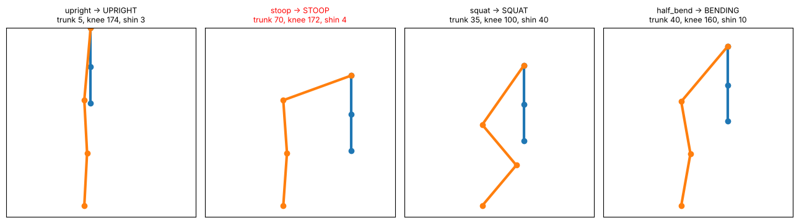

# YOLO 2회차 실습 B — 상자 들기 동작 분석과 위험 자세 리포트

노트북: [`yolo_day2_pose_lab_v1.1.ipynb`](../yolo_day2_pose_lab_v1.1.ipynb) · [Colab에서 열기](https://colab.research.google.com/github/jhjwlee/yolo-training/blob/main/day2/yolo_day2_pose_lab_v1.1.ipynb)

| 항목 | 내용 |
|---|---|
| 실행 환경 | Google Colab, 런타임 유형 T4 GPU (CPU에서도 동작하지만 영상 처리가 느림) |
| 예상 소요 시간 | 약 1시간 (T4 GPU 기준) |
| 사용 데이터 | lift_sample.mp4 — 작업자가 바닥의 상자를 들어 올리는 모습을 옆에서 찍은 실습 영상. 규칙 검증에는 코드로 만든 가상 작업자 데이터를 함께 사용 |
| 주요 결과 파일 | posture_review.mp4, posture_frames.csv, lift_events.csv, lift_rules.json, lift_report.png (모두 SAVE_DIR에도 저장) |

> **실습 영상 준비** — `lift_sample.mp4`는 따로 내려받는 파일이 아니라 직접 준비하는 영상입니다. 휴대폰으로 작업자가 바닥의 상자를 들어 올리는 모습을 **옆에서, 허리 높이로, 머리부터 발끝까지** 10~20초 찍으면 됩니다. 들기 동작을 2~4번 넣고, 무릎을 편 채 허리만 굽혀 들기와 무릎을 굽혀 들기를 섞으면 차이가 잘 드러납니다. 아이폰 `.mov` 파일도 그대로 쓸 수 있습니다.

> 영상을 넣는 방법은 두 가지입니다. ① 「0-1. 실습 영상 준비」 아래 코드 셀(이 해설서의 셀 5)을 실행하면 뜨는 파일 선택 창에서 고르기(이름은 자동으로 `lift_sample.mp4`로 바뀜) ② Google Drive의 `MyDrive/yolo_day2/` 폴더에 `lift_sample.mp4`라는 이름으로 미리 넣어 두기. 4K 영상은 업로드가 오래 걸리므로 1080p 정도로 찍는 것을 권합니다.

## 목차

- [0. 준비](#0-준비)
- [Step 1. 키포인트 추출](#step-1-키포인트-추출)
- [Step 2. 관절 각도 시계열](#step-2-관절-각도-시계열)
- [Step 3. 자세 판별 — 각도를 규칙으로](#step-3-자세-판별--각도를-규칙으로)
- [Step 4. 들기 동작 단위 분석](#step-4-들기-동작-단위-분석)
- [Step 5. 검토 영상과 리포트](#step-5-검토-영상과-리포트)
- [도전 과제](#도전-과제) · [자주 겪는 문제](#자주-겪는-문제) · [용어 정리](#용어-정리)

## 이 실습에서 배우는 것

- YOLO 포즈 모델 출력(keypoints.xy, keypoints.conf)에서 작업자 한 명의 관절 좌표를 꺼내는 방법
- 세 점의 관절 각도와 수직 기울기를 벡터 내적으로 계산하는 방법
- 결측 보간과 이동 중앙값으로 흔들리는 각도 신호를 다듬는 방법
- 각도 규칙으로 프레임마다 자세(UPRIGHT, STOOP, SQUAT 등)를 판별하고, 정답을 아는 가상 데이터로 규칙을 먼저 검증하는 습관
- 히스테리시스 방식으로 프레임을 '들기 동작' 단위로 묶고 유형과 위험 점수를 매기는 방법
- 경고 표시가 들어간 검토 영상과 한 장짜리 작업 리포트를 만드는 방법

## 실습 흐름

| 단계 | 만드는 것 | 결과물 |
|---|---|---|
| 0. 준비 | 라이브러리 설치, 저장 폴더 연결, 실습 영상 변환 | lift_input.mp4 |
| Step 1 | 키포인트 추출 — 작업자의 관절 좌표 꺼내기 | 관절 좌표 표 |
| Step 2 | 관절 각도 시계열 — 각도 계산, 결측 보간, 흔들림 줄이기 | 프레임별 각도 그래프 |
| Step 3 | 자세 판별 — 각도 규칙으로 프레임마다 자세 분류 | 자세 타임라인 |
| Step 4 | 들기 동작 단위 분석 — 동작 구간 자르기, 유형 판정, 위험 점수 | lift_events.csv, lift_rules.json |
| Step 5 | 검토 영상과 리포트 — 경고 표시, 동작별 결과 자막, 요약 그래프 | posture_review.mp4, posture_frames.csv, lift_report.png |

각 셀은 **위에서부터 순서대로** 실행합니다. 셀마다 코드 원문, 코드 설명, 실행 결과, 막혔을 때 확인할 점을 차례로 정리했습니다.

---

## 0. 준비

**목표** 실습에 필요한 라이브러리를 불러오고, 결과 저장 위치와 분석할 영상을 준비합니다.

이 실습은 영상을 한 번만 모델에 통과시키고, 이후 단계는 저장한 기록으로 처리합니다. 그래서 준비 단계에서 영상 크기와 형식을 통일해 두는 것이 중요합니다. 원본 영상은 긴 변 1280픽셀 이하, 소리 없는 H.264 영상(lift_input.mp4)으로 바꿔 씁니다. 휴대폰 세로 영상의 회전 정보도 이 변환에서 반영됩니다.

### 셀 1. ultralytics 라이브러리 설치

```python
!pip -q install ultralytics
```

**코드 설명**

- `!pip -q install ultralytics` — YOLO 모델을 쓰는 ultralytics 패키지를 설치합니다. `!`는 셸 명령을 실행한다는 뜻입니다.
- `-q` — 설치 과정의 긴 로그를 줄여 줍니다.

**실행 결과**

오류 없이 끝나면 별도 출력이 거의 없습니다. 이미 설치되어 있으면 금방 끝납니다.

### 셀 2. 라이브러리 불러오기와 GPU 확인

```python
import os, json, shutil, base64, subprocess
from pathlib import Path

import cv2
import numpy as np
import pandas as pd
import matplotlib.pyplot as plt
import torch
from IPython.display import HTML, display
from ultralytics import YOLO

print('GPU 사용 가능:', torch.cuda.is_available())
if torch.cuda.is_available():
    print('GPU:', torch.cuda.get_device_name(0))
```

**코드 설명**

- `import cv2, numpy, pandas, matplotlib` — 영상 읽기(OpenCV), 수치 계산, 표, 그래프에 쓰는 라이브러리입니다.
- `from IPython.display import HTML, display` — 노트북 안에 영상과 표를 표시할 때 씁니다.
- `from ultralytics import YOLO` — 포즈 모델을 불러오는 클래스입니다.
- `torch.cuda.is_available()` — GPU를 쓸 수 있는지 True/False로 알려 줍니다.
- `torch.cuda.get_device_name(0)` — GPU가 있으면 이름(예: Tesla T4)을 출력합니다.

**실행 결과**

T4 GPU 런타임이면 'GPU 사용 가능: True'와 GPU 이름이 출력됩니다. False가 나오면 CPU로 실행되며, Step 2의 영상 처리가 느려집니다.

> **막혔을 때** False가 나오면 메뉴 → 런타임 → 런타임 유형 변경에서 T4 GPU를 고르고 처음부터 다시 실행합니다.

### 셀 3. 결과 저장 위치 정하기 (Google Drive 연결)

```python
# 결과 저장 위치 — Google Drive를 연결하면 런타임이 끊겨도 결과가 남습니다
USE_DRIVE = True

try:
    from google.colab import drive, files
    IN_COLAB = True
except ImportError:
    IN_COLAB = False

if IN_COLAB and USE_DRIVE:
    drive.mount('/content/drive')
    SAVE_DIR = Path('/content/drive/MyDrive/yolo_day2')
else:
    SAVE_DIR = Path('outputs')
SAVE_DIR.mkdir(parents=True, exist_ok=True)
print('결과 저장 위치:', SAVE_DIR.resolve())
```

**코드 설명**

- `USE_DRIVE = True` — Google Drive에 결과를 저장할지 정합니다. False로 바꾸면 Colab 임시 폴더에만 저장됩니다.
- `from google.colab import drive, files` — Colab에서만 성공합니다. 실패하면 `IN_COLAB = False`가 됩니다.
- `drive.mount('/content/drive')` — Drive 연결 권한을 묻는 창이 뜹니다.
- `SAVE_DIR = Path('/content/drive/MyDrive/yolo_day2')` — 결과 파일을 모아 둘 폴더입니다. Colab이 아니면 `outputs` 폴더를 씁니다.
- `SAVE_DIR.mkdir(parents=True, exist_ok=True)` — 폴더가 없으면 만들고, 있으면 그대로 둡니다.

**실행 결과**

'결과 저장 위치: /content/drive/MyDrive/yolo_day2'처럼 저장 폴더의 전체 경로가 출력됩니다.

> **막혔을 때** Drive 권한 창을 닫거나 거부하면 셀이 멈춥니다. 다시 실행해 허용하거나, `USE_DRIVE = False`로 바꿉니다. 이때는 런타임이 끊기면 결과가 사라집니다.

### 셀 4. 화면 표시·저장 도우미 함수 정의

```python
# 화면 표시용 도우미 함수
def show_bgr(img, title=None, size=(9, 6)):
    plt.figure(figsize=size)
    plt.imshow(img[..., ::-1]); plt.axis('off')
    if title:
        plt.title(title)
    plt.show()

def show_video(path, width=480):
    """mp4 영상을 브라우저에서 재생 가능한 H.264로 바꿔 노트북에 표시"""
    h264 = str(Path(path).with_name(Path(path).stem + '_h264.mp4'))
    subprocess.run(['ffmpeg', '-y', '-loglevel', 'error', '-i', str(path),
                    '-vcodec', 'libx264', '-pix_fmt', 'yuv420p', h264], check=True)
    data = base64.b64encode(open(h264, 'rb').read()).decode()
    display(HTML(f'<video width="{width}" controls loop autoplay muted>'
                 f'<source src="data:video/mp4;base64,{data}" type="video/mp4"></video>'))

def save_out(path):
    """결과 파일을 저장 폴더(SAVE_DIR)에 복사"""
    dst = SAVE_DIR / Path(path).name
    if Path(path).resolve() != dst.resolve():
        shutil.copy(path, dst)
    return dst
```

**코드 설명**

- `show_bgr(img, title, size)` — OpenCV 이미지(BGR)를 matplotlib(RGB)로 보여 줍니다. `img[..., ::-1]`이 색 순서를 뒤집습니다.
- `show_video(path, width)` — mp4를 ffmpeg로 브라우저가 재생할 수 있는 H.264(`libx264`, `yuv420p`)로 바꿉니다.
- `base64.b64encode(...)` — 변환한 영상을 문자열로 바꿔 `<video>` 태그 안에 넣어 노트북에 바로 재생합니다.
- `save_out(path)` — 결과 파일을 `SAVE_DIR`로 복사하고 복사된 경로를 돌려줍니다. 원본과 대상이 같으면 복사하지 않습니다.

**실행 결과**

함수만 정의하므로 출력이 없습니다.

### 셀 5. 실습 영상 찾기와 분석용 변환

```python
VIDEO_NAME = 'lift_sample.mp4'

VIDEO_SRC = next((p for p in [Path(VIDEO_NAME), SAVE_DIR / VIDEO_NAME] if p.exists()), None)
if VIDEO_SRC is None and IN_COLAB:
    uploaded = files.upload()                               # 파일 선택 창
    name = next(iter(uploaded))
    VIDEO_SRC = Path(VIDEO_NAME)
    os.replace(name, VIDEO_SRC)
assert VIDEO_SRC is not None and VIDEO_SRC.exists(), f'{VIDEO_NAME} 파일을 찾지 못했습니다'
save_out(VIDEO_SRC)

def prepare_video(src, dst='lift_input.mp4', max_side=1280):
    scale = (f"scale='if(gte(iw,ih),min({max_side},iw),-2)':'if(gte(iw,ih),-2,min({max_side},ih))'")
    subprocess.run(['ffmpeg', '-y', '-loglevel', 'error', '-i', str(src), '-vf', scale, '-an',
                    '-vcodec', 'libx264', '-pix_fmt', 'yuv420p', dst], check=True)
    cap = cv2.VideoCapture(dst)
    info = {'fps': cap.get(cv2.CAP_PROP_FPS) or 30, 'frames': int(cap.get(cv2.CAP_PROP_FRAME_COUNT)),
            'width': int(cap.get(cv2.CAP_PROP_FRAME_WIDTH)), 'height': int(cap.get(cv2.CAP_PROP_FRAME_HEIGHT))}
    cap.release()
    return dst, info

VIDEO, VINFO = prepare_video(VIDEO_SRC)
FPS = VINFO['fps']
print(f"{VIDEO}: {VINFO['width']}x{VINFO['height']}, {FPS:.1f}fps, {VINFO['frames']}프레임, "
      f"약 {VINFO['frames'] / FPS:.1f}초")
show_video(VIDEO, width=360)
```

**코드 설명**

- `VIDEO_SRC = next((p for p in [...] if p.exists()), None)` — 현재 폴더, 저장 폴더 순서로 `lift_sample.mp4`를 찾습니다.
- `files.upload()` — 두 곳 모두 없으면 파일 선택 창을 띄웁니다. 올린 파일은 `lift_sample.mp4` 이름으로 바뀝니다.
- `save_out(VIDEO_SRC)` — 원본 영상을 저장 폴더에도 복사해 둡니다. 다음 실행 때는 업로드 없이 찾습니다.
- `prepare_video(src, dst, max_side=1280)` — 긴 변이 1280픽셀을 넘으면 줄이고(`scale`), 소리를 빼고(`-an`), H.264로 저장합니다.
- `-2` — 가로세로 비율을 지키면서 짝수 크기로 맞추라는 ffmpeg 표기입니다. H.264는 짝수 크기를 요구합니다.
- `info` — 변환된 영상의 fps, 프레임 수, 가로·세로 크기를 dict로 돌려줍니다. fps를 못 읽으면 30을 씁니다.
- `VIDEO, VINFO = prepare_video(VIDEO_SRC)` — 이후 모든 단계는 `VIDEO`(lift_input.mp4)와 `FPS`를 씁니다.

**실행 결과**

'lift_input.mp4: 가로x세로, fps, 프레임 수, 약 몇 초' 형식의 한 줄이 출력되고, 아래에 영상이 재생됩니다. 작업자가 옆모습으로 바닥의 상자를 들어 올리는 장면이 보여야 합니다.

> **막혔을 때** assert 오류가 나면 파일 이름과 위치를 확인합니다. 직접 찍은 영상은 머리부터 발끝까지 옆모습이 화면에 들어와야 이후 단계가 제대로 동작합니다.

**정리 · 확인해 보기**

변환된 영상의 fps와 프레임 수를 적어 두세요. Step 2의 보간 길이(0.2초)와 Step 4의 시간 계산이 모두 fps를 기준으로 프레임 수로 바뀝니다.

---

## Step 1. 키포인트 추출

**목표** 포즈 모델로 한 프레임을 분석하고, 화면의 주 작업자 한 명의 17개 관절 좌표와 신뢰도를 표로 꺼냅니다.

포즈 모델(yolo26n-pose.pt)은 사람 박스와 함께 사람마다 COCO 형식 17개 키포인트를 출력합니다. keypoints.xy는 (사람 수, 17, 2) 모양의 좌표, keypoints.conf는 (사람 수, 17) 모양의 신뢰도입니다. 이미지 좌표는 왼쪽 위가 (0, 0)이고 y는 아래로 갈수록 커집니다. 옆에서 찍으면 카메라에서 먼 쪽 몸은 가려지므로 신뢰도가 낮게 나옵니다.

### 셀 6. 포즈 모델 불러오기와 한 프레임 분석

```python
pose_model = YOLO('yolo26n-pose.pt')   # 처음 실행 시 가중치를 자동으로 내려받습니다

def read_frame(path, idx):
    cap = cv2.VideoCapture(path); cap.set(cv2.CAP_PROP_POS_FRAMES, idx)
    ok, frame = cap.read(); cap.release()
    return frame

frame = read_frame(VIDEO, VINFO['frames'] // 3)
res = pose_model(frame, verbose=False)[0]
print('검출된 사람 수:', len(res.boxes))
print('keypoints.xy  :', tuple(res.keypoints.xy.shape))
print('keypoints.conf:', tuple(res.keypoints.conf.shape))
show_bgr(res.plot(), 'YOLO pose result', size=(6, 6))
```

**코드 설명**

- `pose_model = YOLO('yolo26n-pose.pt')` — 키포인트를 함께 출력하는 포즈 모델입니다. 처음 실행 때 가중치를 자동으로 내려받습니다.
- `read_frame(path, idx)` — `cv2.CAP_PROP_POS_FRAMES`로 원하는 프레임 번호로 이동해 한 장을 읽습니다.
- `VINFO['frames'] // 3` — 영상의 1/3 지점 프레임을 예시로 씁니다.
- `pose_model(frame, verbose=False)[0]` — 이미지 한 장의 결과 객체를 꺼냅니다.
- `res.keypoints.xy.shape`, `res.keypoints.conf.shape` — 출력 배열의 모양을 확인합니다.
- `res.plot()` — 박스와 스켈레톤이 그려진 이미지를 돌려줍니다.

**실행 결과**

검출된 사람 수와 함께 'keypoints.xy : (1, 17, 2)', 'keypoints.conf: (1, 17)'처럼 배열 모양이 출력됩니다(작업자 한 명일 때). 아래 그림에는 옆모습 작업자에게 박스와 스켈레톤이 겹쳐 보입니다.

> **막혔을 때** 검출된 사람 수가 0이면 이 프레임에서 작업자가 화면 밖이거나 너무 작습니다. `VINFO['frames'] // 3` 대신 다른 프레임 번호를 넣어 봅니다.

### 셀 7. 주 작업자 한 명의 관절 좌표 표 만들기

```python
KP_NAMES = ['nose', 'left_eye', 'right_eye', 'left_ear', 'right_ear',
            'left_shoulder', 'right_shoulder', 'left_elbow', 'right_elbow',
            'left_wrist', 'right_wrist', 'left_hip', 'right_hip',
            'left_knee', 'right_knee', 'left_ankle', 'right_ankle']

def main_person(r):
    """화면에서 가장 크게 보이는 사람 1명의 (좌표 (17,2), 신뢰도 (17,)) — 없으면 None"""
    if len(r.boxes) == 0:
        return None
    k = int(r.boxes.xywh[:, 2:].prod(1).argmax())
    return (r.keypoints.xy[k].cpu().numpy().astype(float), r.keypoints.conf[k].cpu().numpy().astype(float))

kxy, kconf = main_person(res)
pd.DataFrame({'kp_id': range(17), 'kp_name': KP_NAMES,
              'x': kxy[:, 0].round(1), 'y': kxy[:, 1].round(1), 'conf': kconf.round(2)})
```

**코드 설명**

- `KP_NAMES` — 0~16번 키포인트의 영문 이름 목록입니다(COCO 순서).
- `main_person(r)` — 결과 객체 하나를 받아 가장 크게 보이는 사람의 (좌표 (17,2), 신뢰도 (17,))를 돌려줍니다. 사람이 없으면 None입니다.
- `r.boxes.xywh[:, 2:].prod(1).argmax()` — 박스의 너비×높이(면적)가 가장 큰 사람의 번호입니다. 뒤에 지나가는 사람보다 앞의 작업자를 고르기 위함입니다.
- `.cpu().numpy().astype(float)` — GPU 텐서를 numpy 실수 배열로 바꿉니다.
- `pd.DataFrame({'kp_id', 'kp_name', 'x', 'y', 'conf'})` — 관절별 좌표와 신뢰도를 한 표로 보여 줍니다.

**실행 결과**

kp_id, kp_name, x, y, conf 다섯 열, 17행의 표가 나옵니다. 옆에서 찍은 영상이므로 카메라 쪽 몸의 conf는 높고, 반대쪽 몸의 일부 관절은 conf가 낮게 나옵니다.

### 셀 8. 자세 분석에 쓸 6개 관절을 왼쪽·오른쪽으로 나눠 그리기

```python
LEFT  = dict(shoulder=5, elbow=7, wrist=9,  hip=11, knee=13, ankle=15)
RIGHT = dict(shoulder=6, elbow=8, wrist=10, hip=12, knee=14, ankle=16)

def draw_side(img, kxy, idx, color=(0, 255, 255)):
    for chain in (['shoulder', 'elbow', 'wrist'], ['shoulder', 'hip', 'knee', 'ankle']):
        pts = [tuple(map(int, kxy[idx[n]])) for n in chain]
        for p, q in zip(pts[:-1], pts[1:]):
            cv2.line(img, p, q, color, 3)
        for n, p in zip(chain, pts):
            cv2.circle(img, p, 6, (0, 0, 255), -1)
            cv2.putText(img, n, (p[0] + 6, p[1] - 6), cv2.FONT_HERSHEY_SIMPLEX, 0.5, (255, 255, 255), 2)
    return img

canvas = frame.copy()
draw_side(canvas, kxy, LEFT, (0, 255, 255))
draw_side(canvas, kxy, RIGHT, (255, 200, 0))
show_bgr(canvas, 'Selected joints (yellow: left, blue: right)', size=(6, 6))
```

**코드 설명**

- `LEFT`, `RIGHT` — 어깨·팔꿈치·손목·엉덩이·무릎·발목의 키포인트 번호를 이름으로 찾도록 만든 dict입니다.
- `draw_side(img, kxy, idx, color)` — 팔(어깨-팔꿈치-손목)과 몸통·다리(어깨-엉덩이-무릎-발목) 두 사슬을 선으로 잇습니다.
- `cv2.circle`, `cv2.putText` — 관절마다 빨간 점과 이름을 표시합니다.
- `draw_side(canvas, kxy, LEFT, (0, 255, 255))` — 왼쪽 몸은 노란색, 오른쪽 몸은 파란색으로 그립니다(BGR 순서).

**실행 결과**

같은 프레임 위에 왼쪽(노랑)과 오른쪽(파랑) 관절 사슬이 겹쳐 보입니다. 옆모습에서는 두 사슬이 거의 겹치거나, 가려진 쪽 사슬이 어긋나게 그려집니다.

**정리 · 확인해 보기**

Step 1 표에서 왼쪽과 오른쪽 중 어느 쪽 관절의 conf가 더 높은지 확인해 보세요. Step 2의 body_angles()는 이 차이를 이용해 잘 보이는 쪽 몸만 골라 각도를 계산합니다.

---

## Step 2. 관절 각도 시계열

**목표** 관절 좌표를 각도로 바꾸는 함수를 만들고, 영상 전체 프레임의 각도를 기록한 뒤 결측과 흔들림을 다듬습니다.

자세를 좌표 대신 각도로 표현하면 사람 크기나 카메라 거리와 상관없이 비교할 수 있습니다. 관절 각도는 세 점 A-B-C에서 B를 꼭짓점으로 하는 각이며, 무릎 각도 180°는 완전히 편 상태입니다. 수직 기울기는 선분이 위쪽 수직선에서 기운 정도로, 몸통 기울기 0°는 곧게 선 상태, 90°는 수평입니다. 두 각도 모두 cos θ = (u·v) / (|u||v|) 공식으로 구합니다.

### 셀 9. 각도 계산 함수 정의와 검산

```python
def joint_angle(a, b, c):
    """b를 꼭짓점으로 하는 각 a-b-c (단위: 도)"""
    ba = np.asarray(a, float) - np.asarray(b, float)
    bc = np.asarray(c, float) - np.asarray(b, float)
    cos = np.dot(ba, bc) / (np.linalg.norm(ba) * np.linalg.norm(bc) + 1e-9)
    return float(np.degrees(np.arccos(np.clip(cos, -1.0, 1.0))))

def tilt_from_vertical(lower, upper):
    """lower→upper 선분이 '위쪽 수직선'에서 기운 각도 (단위: 도). 이미지 y축은 아래로 증가"""
    v = np.asarray(upper, float) - np.asarray(lower, float)
    cos = np.dot(v, [0.0, -1.0]) / (np.linalg.norm(v) + 1e-9)
    return float(np.degrees(np.arccos(np.clip(cos, -1.0, 1.0))))

def body_angles(kxy, kconf, min_conf=0.3):
    """한 사람의 키포인트 → 각도 묶음 (dict). 신뢰도가 높은 쪽 몸을 쓰고, 판단이 어려우면 None"""
    l_score, r_score = kconf[list(LEFT.values())].mean(), kconf[list(RIGHT.values())].mean()
    side, idx = ('L', LEFT) if l_score >= r_score else ('R', RIGHT)
    if kconf[[idx['shoulder'], idx['hip'], idx['knee'], idx['ankle']]].min() < min_conf:
        return None
    p = {name: kxy[i] for name, i in idx.items()}
    return {'side': side,
            'trunk': tilt_from_vertical(p['hip'], p['shoulder']),      # 몸통 기울기
            'knee': joint_angle(p['hip'], p['knee'], p['ankle']),       # 무릎 각도
            'hip': joint_angle(p['shoulder'], p['hip'], p['knee']),     # 엉덩이 각도
            'elbow': joint_angle(p['shoulder'], p['elbow'], p['wrist']),
            'shin': tilt_from_vertical(p['ankle'], p['knee'])}          # 정강이 기울기

# 결과를 알고 있는 점으로 먼저 검산합니다
print('직각 90 :', round(joint_angle((0, 0), (1, 0), (1, 1)), 1))
print('일직선 180 :', round(joint_angle((0, 0), (1, 0), (2, 0)), 1))
print('수직 0 :', round(tilt_from_vertical((0, 10), (0, 0)), 1))
print('수평 90 :', round(tilt_from_vertical((0, 0), (10, 0)), 1))
a = body_angles(kxy, kconf)
print('영상 프레임:', {k: (round(v, 1) if isinstance(v, float) else v) for k, v in a.items()} if a else '판단 불가')
```

**코드 설명**

- `joint_angle(a, b, c)` — 꼭짓점 b에서 b→a, b→c 두 벡터의 사잇각을 도(°) 단위로 돌려줍니다.
- `+ 1e-9` — 두 점이 겹쳐 길이가 0일 때 0으로 나누는 오류를 막습니다.
- `np.clip(cos, -1.0, 1.0)` — 반올림 오차로 cos 값이 1을 살짝 넘어 `arccos`가 NaN이 되는 것을 막습니다.
- `tilt_from_vertical(lower, upper)` — 아래 점→위 점 벡터와 위쪽 방향 `[0, -1]` 사이의 각입니다. 이미지 y축이 아래로 커지므로 위쪽은 -1입니다.
- `body_angles(kxy, kconf, min_conf=0.3)` — 왼쪽·오른쪽 6개 관절의 평균 신뢰도를 비교해 높은 쪽(`side`)을 고릅니다.
- `kconf[[shoulder, hip, knee, ankle]].min() < min_conf` — 몸통·다리 관절 중 하나라도 신뢰도가 0.3 미만이면 판단하지 않고 None을 돌려줍니다.
- 반환 dict — `side`, `trunk`(몸통 기울기), `knee`(무릎 각도), `hip`(엉덩이 각도), `elbow`(팔꿈치 각도), `shin`(정강이 기울기)입니다.

**실행 결과**

검증 실행 예시: 결과를 아는 점으로 검산한 네 줄이 '직각 90 : 90.0', '일직선 180 : 180.0', '수직 0 : 0.0', '수평 90 : 90.0'으로 나옵니다. 마지막 '영상 프레임:' 줄에는 Step 1 프레임의 side(L 또는 R)와 다섯 각도가 출력되며, 값은 그 순간 작업자 자세에 따라 달라집니다.

> **막혔을 때** '판단 불가'가 출력되면 그 프레임에서 몸통·다리 관절 하나가 가려진 것입니다. 오류가 아니며, Step 2-2에서 이런 프레임은 각도가 빈 칸으로 남습니다.

### 셀 10. 영상 전체에서 프레임별 각도와 키포인트 기록

```python
ANGLE_COLS = ['trunk', 'knee', 'hip', 'elbow', 'shin']

def extract_pose_track(path, fps):
    rows, kps = [], {}
    for i, r in enumerate(pose_model(path, stream=True, verbose=False)):
        rec = {'frame': i, 'time_s': round(i / fps, 3)}
        person = main_person(r)
        if person is not None:
            kps[i] = person
            a = body_angles(*person)
            if a:
                rec.update({k: a[k] for k in ANGLE_COLS})
        rows.append(rec)
    return pd.DataFrame(rows).reindex(columns=['frame', 'time_s'] + ANGLE_COLS), kps

raw, KPS = extract_pose_track(VIDEO, FPS)
print('프레임 수:', len(raw), '| 각도를 구하지 못한 프레임 비율:', round(raw['trunk'].isna().mean(), 3))
raw.round(1).head()
```

**코드 설명**

- `ANGLE_COLS` — 기록할 각도 열 이름 다섯 개입니다.
- `pose_model(path, stream=True, verbose=False)` — 영상을 프레임 단위로 하나씩 처리하는 생성기입니다. 긴 영상도 메모리를 적게 씁니다.
- `rec = {'frame': i, 'time_s': round(i / fps, 3)}` — 프레임 번호와 시각(초)을 먼저 기록합니다.
- `kps[i] = person` — 키포인트 원본을 프레임 번호별로 저장합니다. Step 5에서 모델을 다시 돌리지 않고 영상을 그리는 데 씁니다.
- `rec.update(...)` — 각도를 구했을 때만 각도 열을 채웁니다. 못 구한 프레임은 NaN이 됩니다.
- `.reindex(columns=[...])` — 모든 프레임에서 각도를 못 구해도 열 구성이 항상 같도록 맞춥니다.
- `raw['trunk'].isna().mean()` — 각도를 구하지 못한 프레임의 비율입니다.

**실행 결과**

'프레임 수: N | 각도를 구하지 못한 프레임 비율: 0.0xx' 형식의 한 줄과, frame, time_s, trunk, knee, hip, elbow, shin 열의 앞 5행 표가 나옵니다. 영상 시작이 곧게 선 자세라면 trunk는 작은 값, knee는 180°에 가까운 값입니다.

> **막혔을 때** 이 셀은 영상 전체를 모델에 통과시키므로 가장 오래 걸립니다. CPU 런타임이면 몇 배 느려집니다. 런타임이 끊기면 0. 준비부터 다시 실행해야 합니다.

### 셀 11. 결측 보간과 이동 중앙값으로 각도 신호 다듬기

```python
MAX_GAP_SEC = 0.2
SMOOTH_WIN = 5

def clean_angles(raw, fps, max_gap_sec=MAX_GAP_SEC, win=SMOOTH_WIN):
    out = raw.copy()
    gap = max(1, int(round(max_gap_sec * fps)))
    for c in ANGLE_COLS:
        s = raw[c].interpolate(limit=gap, limit_area='inside')
        out[c] = s.rolling(win, center=True, min_periods=1).median()
    return out

ang = clean_angles(raw, FPS)

fig, axes = plt.subplots(2, 1, figsize=(10, 5), sharex=True)
for ax, c in zip(axes, ['trunk', 'knee']):
    ax.plot(raw['time_s'], raw[c], c='lightgray', lw=1, label='raw')
    ax.plot(ang['time_s'], ang[c], c='tab:blue', lw=2, label='cleaned')
    ax.set_ylabel(f'{c} (deg)'); ax.grid(alpha=.3); ax.legend(loc='upper right')
axes[-1].set_xlabel('time (s)')
plt.suptitle('Raw vs cleaned joint angles'); plt.tight_layout(); plt.show()
```

**코드 설명**

- `MAX_GAP_SEC = 0.2`, `SMOOTH_WIN = 5` — 보간할 최대 공백(초)과 이동 중앙값 창 크기(프레임)입니다.
- `gap = max(1, int(round(max_gap_sec * fps)))` — 0.2초를 프레임 수로 바꿉니다. 30fps면 6프레임입니다.
- `interpolate(limit=gap, limit_area='inside')` — 앞뒤에 값이 있는 빈 칸만 직선으로 메우고, 긴 공백과 영상 앞뒤 끝의 빈 칸은 그대로 둡니다.
- `rolling(win, center=True, min_periods=1).median()` — 앞뒤 5프레임의 중앙값으로 바꿉니다. 평균과 달리 튀는 값 하나에 끌려가지 않습니다.
- `ang = clean_angles(raw, FPS)` — 이후 단계는 다듬은 표 `ang`를 씁니다.
- 그래프 — 위는 trunk, 아래는 knee이며, 회색은 원래 값, 파란색은 다듬은 값입니다.

**실행 결과**

두 줄짜리 그래프(Raw vs cleaned joint angles)가 나옵니다. 들기 영상에서는 trunk가 동작마다 솟았다가 내려오는 봉우리 모양이 되고, 무릎을 굽힌 동작에서는 knee가 아래로 꺼집니다. 파란 선은 회색 선의 잔떨림이 줄어든 모양입니다.

**정리 · 확인해 보기**

SMOOTH_WIN을 15로 키워 다시 실행해 보세요. 그래프가 매끄러워지는 대신 짧은 동작이 사라지고 동작 시작 시점이 늦게 잡힙니다. 흔들림과 반응 속도 사이에서 어떤 값이 적당한지 직접 판단해 보세요.

---

## Step 3. 자세 판별 — 각도를 규칙으로

**목표** 몸통 기울기, 무릎 각도, 정강이 기울기로 프레임마다 자세 상태를 정하고, 가상 작업자로 규칙을 먼저 검증한 뒤 실제 영상에 적용합니다.

규칙은 위에서부터 차례로 검사합니다. 정강이 기울기가 60°를 넘으면 서 있는 자세가 아니므로 NOT_STANDING입니다. 몸통 기울기 20° 이하는 UPRIGHT, 몸통 45° 이상이면서 무릎 150° 이상이면 위험한 STOOP입니다. 무릎이 150° 미만이면 권장 자세인 SQUAT, 나머지는 BENDING입니다. 기준값은 실습용 출발점이며 실제 현장에서는 촬영 각도와 작업 특성에 맞춰 조정해야 합니다.

### 셀 12. 자세 판별 규칙 함수 정의

```python
RULES = {'shin_standing': 60, 'trunk_upright': 20, 'trunk_stoop': 45, 'knee_straight': 150}

def classify_posture(trunk, knee, shin, rules=RULES):
    if any(v is None or np.isnan(v) for v in (trunk, knee, shin)):
        return 'UNKNOWN'
    if shin > rules['shin_standing']:
        return 'NOT_STANDING'
    if trunk <= rules['trunk_upright']:
        return 'UPRIGHT'
    if trunk >= rules['trunk_stoop'] and knee >= rules['knee_straight']:
        return 'STOOP'
    if knee < rules['knee_straight']:
        return 'SQUAT'
    return 'BENDING'
```

**코드 설명**

- `RULES` — 판별 기준값 dict입니다. `shin_standing` 60, `trunk_upright` 20, `trunk_stoop` 45, `knee_straight` 150입니다.
- `classify_posture(trunk, knee, shin, rules)` — 세 각도를 받아 상태 문자열 하나를 돌려줍니다.
- `any(v is None or np.isnan(v) ...)` — 각도가 하나라도 없으면 `UNKNOWN`입니다.
- 검사 순서 — NOT_STANDING → UPRIGHT → STOOP → SQUAT → BENDING 순서로 처음 맞는 규칙에서 멈춥니다. 순서를 바꾸면 결과가 달라집니다.
- `trunk >= 45 and knee >= 150` — 허리는 깊이 굽혔는데 무릎은 거의 편 상태, 즉 STOOP의 정의입니다.

**실행 결과**

함수만 정의하므로 출력이 없습니다.

### 셀 13. 가상 작업자 4자세로 규칙 검증

```python
SEG_LEN = dict(shin=95, thigh=95, torso=130, upper_arm=70, forearm=65)

def synth_pose(trunk_deg, bend_deg, ankle=(200, 420)):
    """몸통 기울기, 무릎 굽힘(정강이 기울기) → 오른쪽 몸 키포인트 (17,2)와 신뢰도 (17,)
    무릎 각도 = 180 - 2 × bend_deg 가 되도록 정강이는 앞으로, 허벅지는 뒤로 같은 각도만큼 기울입니다."""
    s, t = np.radians(bend_deg), np.radians(trunk_deg)
    ankle = np.array(ankle, float)
    knee = ankle + SEG_LEN['shin'] * np.array([np.sin(s), -np.cos(s)])
    hip = knee + SEG_LEN['thigh'] * np.array([-np.sin(s), -np.cos(s)])
    shoulder = hip + SEG_LEN['torso'] * np.array([np.sin(t), -np.cos(t)])
    elbow = shoulder + [0, SEG_LEN['upper_arm']]
    wrist = elbow + [0, SEG_LEN['forearm']]
    kxy, kconf = np.zeros((17, 2)), np.zeros(17)
    for name, p in dict(shoulder=shoulder, elbow=elbow, wrist=wrist, hip=hip, knee=knee, ankle=ankle).items():
        kxy[RIGHT[name]] = p; kconf[RIGHT[name]] = 1.0
    return kxy, kconf

TEST_POSES = {'upright': (5, 3, 'UPRIGHT'), 'stoop': (70, 4, 'STOOP'),
              'squat': (35, 40, 'SQUAT'), 'half_bend': (40, 10, 'BENDING')}

fig, axes = plt.subplots(1, 4, figsize=(13, 3.6))
for ax, (case, (t, b, expected)) in zip(axes, TEST_POSES.items()):
    kxy_, kconf_ = synth_pose(t, b)
    a = body_angles(kxy_, kconf_)
    state = classify_posture(a['trunk'], a['knee'], a['shin'])
    for chain in (['shoulder', 'elbow', 'wrist'], ['shoulder', 'hip', 'knee', 'ankle']):
        c = np.array([kxy_[RIGHT[n]] for n in chain])
        ax.plot(c[:, 0], c[:, 1], '-o', lw=3)
    ax.set_xlim(60, 400); ax.set_ylim(440, 100); ax.set_aspect('equal'); ax.set_xticks([]); ax.set_yticks([])
    ax.set_title(f"{case} -> {state}\ntrunk {a['trunk']:.0f}, knee {a['knee']:.0f}, shin {a['shin']:.0f}",
                 fontsize=9, color='red' if state == 'STOOP' else 'black')
    assert state == expected, f'{case}: 기대 {expected}, 결과 {state}'
plt.tight_layout(); plt.show()
print('가상 자세 4종 모두 기대한 상태로 분류되었습니다.')
```

**코드 설명**

- `SEG_LEN` — 정강이·허벅지·몸통·위팔·아래팔의 길이(픽셀)입니다.
- `synth_pose(trunk_deg, bend_deg, ankle)` — 몸통 기울기와 무릎 굽힘을 받아 오른쪽 몸 6개 관절 좌표 (17,2)와 신뢰도 (17,)를 만듭니다.
- 정강이는 앞으로, 허벅지는 뒤로 `bend_deg`만큼 기울이므로 무릎 각도는 180 - 2 × bend_deg가 됩니다.
- `np.array([np.sin(t), -np.cos(t)])` — 각도 t만큼 기운 위쪽 방향 단위 벡터입니다. y가 아래로 커지므로 cos 앞에 -가 붙습니다.
- `TEST_POSES` — (몸통, 굽힘, 기대 상태) 묶음 4개입니다. upright, stoop, squat, half_bend입니다.
- `body_angles(kxy_, kconf_)` — 실제 영상과 똑같은 함수에 가상 좌표를 넣어 각도를 구합니다.
- `assert state == expected` — 기대한 상태가 아니면 오류를 내고 멈춥니다. STOOP 결과는 제목을 빨간색으로 표시합니다.

**실행 결과**

검증 실행 예시: 네 개의 막대 인형 그림이 나옵니다. upright → UPRIGHT (trunk 5, knee 174, shin 3), stoop → STOOP (trunk 70, knee 172, shin 4), squat → SQUAT (trunk 35, knee 100, shin 40), half_bend → BENDING (trunk 40, knee 160, shin 10)입니다. 이어서 '가상 자세 4종 모두 기대한 상태로 분류되었습니다.'가 출력됩니다.



> **막혔을 때** RULES 값을 바꾼 뒤 이 셀에서 AssertionError가 나면, 바꾼 기준값이 가상 자세 중 하나의 판정을 바꾼 것입니다. 오류 메시지의 '기대 / 결과'를 보고 어느 규칙이 영향을 받았는지 확인합니다.

### 셀 14. 실제 영상에 적용 — 상태별 프레임 수와 자세 타임라인

```python
STATE_ORDER = ['UPRIGHT', 'BENDING', 'SQUAT', 'STOOP', 'NOT_STANDING', 'UNKNOWN']
STATE_HEX = {'UPRIGHT': '#4caf50', 'BENDING': '#ffb300', 'SQUAT': '#26a69a', 'STOOP': '#e53935',
             'NOT_STANDING': '#9e9e9e', 'UNKNOWN': '#e0e0e0'}

ang['state'] = [classify_posture(t, k, s) for t, k, s in zip(ang['trunk'], ang['knee'], ang['shin'])]
print(ang['state'].value_counts().reindex(STATE_ORDER, fill_value=0).to_string())

def plot_state_timeline(df, ax):
    for st in STATE_ORDER:
        m = df['state'] == st
        ax.scatter(df.loc[m, 'time_s'], [0] * int(m.sum()), c=STATE_HEX[st], marker='|', s=600, label=st)
    ax.set_yticks([]); ax.set_xlabel('time (s)')
    ax.legend(ncol=6, fontsize=8, loc='upper center', bbox_to_anchor=(0.5, -0.45), frameon=False)

fig, ax = plt.subplots(figsize=(10, 1.4)); plot_state_timeline(ang, ax)
ax.set_title('Posture state per frame'); plt.show()
```

**코드 설명**

- `STATE_ORDER`, `STATE_HEX` — 상태의 표시 순서와 색입니다. UPRIGHT 초록, STOOP 빨강, SQUAT 청록, BENDING 노랑입니다.
- `ang['state'] = [classify_posture(t, k, s) ...]` — 다듬은 각도로 프레임마다 상태를 붙입니다.
- `value_counts().reindex(STATE_ORDER, fill_value=0)` — 한 번도 나오지 않은 상태도 0으로 표시해 여섯 상태를 모두 보여 줍니다.
- `plot_state_timeline(df, ax)` — 시간축 위에 프레임마다 상태 색의 세로 막대(`marker='|'`)를 찍습니다.

**실행 결과**

여섯 상태별 프레임 수와, 시간에 따라 색이 바뀌는 띠 그림(Posture state per frame)이 나옵니다. 옆에서 찍은 들기 영상이라면 동작 사이에는 UPRIGHT(초록)가 이어지고, 동작마다 BENDING을 거쳐 STOOP(빨강) 또는 SQUAT(청록) 구간이 나타납니다. NOT_STANDING은 거의 나오지 않아야 합니다.

> **막혔을 때** NOT_STANDING이 대부분이면 작업자가 서 있지 않은 영상(엎드림·누움)이거나, 다리 관절을 잘못 잡은 것입니다. UNKNOWN이 많으면 작업자가 화면 밖으로 나가거나 다리가 가려진 구간이 깁니다.

**정리 · 확인해 보기**

프레임 상태만으로는 '이 순간 위험한가'만 알 수 있습니다. 현장에서 필요한 질문은 '오늘 상자를 몇 번 들었고, 그중 몇 번이 위험한 방식이었나'입니다. 타임라인에서 동작 하나가 몇 개의 색 구간으로 이루어지는지 세어 보면, 왜 Step 4에서 프레임을 동작 단위로 묶어야 하는지 알 수 있습니다.

---

## Step 4. 들기 동작 단위 분석

**목표** 몸통 기울기 변화로 한 번의 들기 동작 구간을 찾고, 동작마다 유형(STOOP·SQUAT·BENDING)과 위험 점수를 매겨 lift_events.csv로 저장합니다.

동작 구간은 기준을 두 개 두는 히스테리시스 방식으로 자릅니다. 몸통이 30°를 넘으면 동작 시작을 확정하고, 시작 시점은 마지막으로 20° 아래였던 순간으로 되돌려 잡습니다. 몸통이 다시 20° 아래로 내려오면 동작이 끝납니다. 시작·끝 기준이 다르므로 경계 근처에서 값이 흔들려도 동작이 쪼개지지 않습니다. 위험 점수는 몸통 굽힘(최대 50점, 20°→70°), 무릎 폄(최대 30점, 120°→170°), STOOP 지속 시간(최대 20점, 0초→2초)의 합이며, 70점 이상 HIGH, 40점 이상 MEDIUM, 그 아래 LOW입니다. 이 점수는 실습용 단순 지표이고, 실제 인간공학 평가는 REBA나 NIOSH 들기 공식 같은 표준 방법을 씁니다.

### 셀 15. 위험 점수, 동작 구간 찾기, 동작 요약 함수 정의

```python
LIFT_RULES = {'start_trunk': 30, 'end_trunk': 20, 'min_lift_s': 0.5,
              'high_risk': 70, 'medium_risk': 40, **RULES}

def risk_score(max_trunk, knee_bottom, stoop_s):
    trunk_pts = np.clip((max_trunk - 20) / 50, 0, 1) * 50
    knee_pts = np.clip((knee_bottom - 120) / 50, 0, 1) * 30
    hold_pts = np.clip(stoop_s / 2.0, 0, 1) * 20
    return int(round(trunk_pts + knee_pts + hold_pts))

def risk_grade(score, rules=LIFT_RULES):
    return 'HIGH' if score >= rules['high_risk'] else 'MEDIUM' if score >= rules['medium_risk'] else 'LOW'

def find_lift_segments(df, rules=LIFT_RULES):
    """몸통 기울기 → [(시작 행, 끝 행), ...]"""
    trunk = df['trunk'].where(df['state'] != 'NOT_STANDING').to_numpy()
    segs, start, last_low, last_valid = [], None, 0, 0
    for i, t in enumerate(trunk):
        if np.isnan(t):
            continue
        last_valid = i
        if start is None:
            if t < rules['end_trunk']:
                last_low = i
            elif t > rules['start_trunk']:
                start = last_low
        elif t < rules['end_trunk']:
            segs.append((start, i)); start, last_low = None, i
    if start is not None:
        segs.append((start, last_valid))
    return segs

def summarize_lifts(df, fps, rules=LIFT_RULES):
    rows = []
    for s, e in find_lift_segments(df, rules):
        seg = df.iloc[s:e + 1]
        if (e - s + 1) / fps < rules['min_lift_s']:
            continue
        b = int(seg['trunk'].idxmax())
        max_trunk = float(seg['trunk'].max())
        knee_b = float(df.loc[b, 'knee']) if not np.isnan(df.loc[b, 'knee']) else float(seg['knee'].median())
        stoop_s = (seg['state'] == 'STOOP').sum() / fps
        if max_trunk >= rules['trunk_stoop'] and knee_b >= rules['knee_straight']:
            lift_type = 'STOOP'
        elif knee_b < rules['knee_straight']:
            lift_type = 'SQUAT'
        else:
            lift_type = 'BENDING'
        score = risk_score(max_trunk, knee_b, stoop_s)
        rows.append({'lift_id': len(rows) + 1, 'start_frame': int(df.loc[s, 'frame']), 'end_frame': int(df.loc[e, 'frame']),
                     'start_s': round(s / fps, 2), 'bottom_s': round(b / fps, 2), 'end_s': round(e / fps, 2),
                     'duration_s': round((e - s + 1) / fps, 2), 'max_trunk_deg': round(max_trunk, 1),
                     'knee_at_bottom_deg': round(knee_b, 1), 'stoop_s': round(stoop_s, 2),
                     'lift_type': lift_type, 'risk_score': score, 'risk_grade': risk_grade(score, rules)})
    cols = ['lift_id', 'start_frame', 'end_frame', 'start_s', 'bottom_s', 'end_s', 'duration_s', 'max_trunk_deg',
            'knee_at_bottom_deg', 'stoop_s', 'lift_type', 'risk_score', 'risk_grade']
    return pd.DataFrame(rows, columns=cols)
```

**코드 설명**

- `LIFT_RULES` — 동작 기준(`start_trunk` 30, `end_trunk` 20, `min_lift_s` 0.5)과 등급 기준(`high_risk` 70, `medium_risk` 40)에 Step 3의 `RULES`를 합친 dict입니다.
- `risk_score(max_trunk, knee_bottom, stoop_s)` — 세 항목을 각각 0~1로 자른(`np.clip`) 뒤 만점(50, 30, 20)을 곱해 더한 정수를 돌려줍니다.
- `risk_grade(score)` — 점수를 HIGH / MEDIUM / LOW 문자열로 바꿉니다.
- `find_lift_segments(df)` — NOT_STANDING 프레임의 몸통 값을 NaN으로 지운 뒤 한 프레임씩 훑으며 (시작 행, 끝 행) 목록을 돌려줍니다.
- `last_low` — 동작 전 마지막으로 20° 아래였던 행입니다. 30°를 넘는 순간 `start = last_low`로 시작 시점을 되돌립니다.
- `if start is not None: segs.append((start, last_valid))` — 영상이 동작 도중에 끝나도 마지막 유효 프레임까지를 한 동작으로 남깁니다.
- `summarize_lifts(df, fps)` — 구간마다 0.5초보다 짧으면 버리고, `idxmax()`로 가장 깊이 굽힌 행(bottom)을 찾아 그 순간의 무릎 각도와 STOOP 시간을 구합니다.
- 유형 판정 — bottom에서 몸통 ≥ 45°이고 무릎 ≥ 150°면 STOOP, 무릎 < 150°면 SQUAT, 그 밖은 BENDING입니다. 결과는 13개 열의 DataFrame입니다.

**실행 결과**

함수만 정의하므로 출력이 없습니다.

> **막혔을 때** bottom 순간의 무릎 각도가 NaN이면 구간 전체 무릎 각도의 중앙값으로 대신합니다. 이 경우 유형 판정이 실제와 다를 수 있으니 영상과 함께 확인합니다.

### 셀 16. 움직이는 가상 작업자로 들기 3번 분석 검증

```python
# (시각 s, 몸통 기울기, 무릎 굽힘) 키프레임 — 사이 값은 직선으로 채웁니다
KEYFRAMES = [(0.0, 5, 3), (1.0, 5, 3), (1.8, 75, 4), (2.4, 75, 4), (3.2, 5, 3),        # 허리 굽혀 들기
             (4.2, 5, 3), (5.0, 35, 45), (5.6, 35, 45), (6.4, 5, 3),                    # 무릎 굽혀 들기
             (7.4, 5, 3), (8.2, 65, 6), (9.8, 65, 6), (10.6, 5, 3), (11.5, 5, 3)]       # 허리 굽혀 오래
EXPECTED_TYPES = ['STOOP', 'SQUAT', 'STOOP']

def synth_sequence(keyframes, fps=30, noise_px=1.5, drop_rate=0.05, seed=0):
    rng = np.random.default_rng(seed)
    ts, tr, bd = map(np.array, zip(*keyframes))
    seq = []
    for i in range(int(ts[-1] * fps) + 1):
        t = i / fps
        kxy_, kconf_ = synth_pose(np.interp(t, ts, tr), np.interp(t, ts, bd))
        kxy_ = kxy_ + rng.normal(0, noise_px, kxy_.shape)
        if rng.random() < drop_rate:
            kconf_ = kconf_ * 0                        # 관절을 놓친 프레임
        seq.append((kxy_, kconf_))
    return seq

SYN_FPS = 30
syn_seq = synth_sequence(KEYFRAMES, SYN_FPS)
syn_rows = []
for i, (kxy_, kconf_) in enumerate(syn_seq):
    a = body_angles(kxy_, kconf_)
    syn_rows.append({'frame': i, 'time_s': round(i / SYN_FPS, 3), **({k: a[k] for k in ANGLE_COLS} if a else {})})
syn_raw = pd.DataFrame(syn_rows).reindex(columns=['frame', 'time_s'] + ANGLE_COLS)
syn = clean_angles(syn_raw, SYN_FPS)
syn['state'] = [classify_posture(t, k, s) for t, k, s in zip(syn['trunk'], syn['knee'], syn['shin'])]
syn_lifts = summarize_lifts(syn, SYN_FPS)

print('놓친 프레임:', int(syn_raw['trunk'].isna().sum()), '/', len(syn_raw))
display(syn_lifts)
assert syn_lifts['lift_type'].tolist() == EXPECTED_TYPES, syn_lifts['lift_type'].tolist()
print('가상 작업자의 들기 3번이 모두 기대한 유형으로 분류되었습니다.')
```

**코드 설명**

- `KEYFRAMES` — (시각, 몸통 기울기, 무릎 굽힘) 목록입니다. 허리 굽혀 들기, 무릎 굽혀 들기, 허리 굽혀 오래 버티기 세 동작을 11.5초 동안 담았습니다.
- `EXPECTED_TYPES = ['STOOP', 'SQUAT', 'STOOP']` — 세 동작의 정답 유형입니다.
- `synth_sequence(keyframes, fps, noise_px=1.5, drop_rate=0.05, seed=0)` — 키프레임 사이를 `np.interp`로 직선 보간해 프레임마다 가상 좌표를 만듭니다.
- `rng.normal(0, noise_px, ...)` — 좌표에 1.5픽셀 정도의 흔들림을 넣습니다. `seed=0`이라 실행할 때마다 같은 결과가 나옵니다.
- `kconf_ * 0` — 약 5% 프레임은 신뢰도를 0으로 만들어 관절을 놓친 상황을 흉내 냅니다.
- `body_angles → clean_angles → classify_posture → summarize_lifts` — 실제 영상과 똑같은 함수 순서로 처리합니다.
- `assert syn_lifts['lift_type'].tolist() == EXPECTED_TYPES` — 세 동작의 유형이 정답과 다르면 멈춥니다.

**실행 결과**

검증 실행 예시: '놓친 프레임: 18 / 346'이 출력되고, 들기 동작 3행의 표가 나옵니다. 1번은 max_trunk_deg 75.5, knee_at_bottom_deg 170.0, stoop_s 1.3으로 STOOP 93점 HIGH입니다. 2번은 36.0, 89.0, 0.0으로 SQUAT 16점 LOW, 3번은 65.9, 167.2, 2.1로 STOOP 94점 HIGH입니다. 1번 점수는 몸통 50점 + 무릎 30점 + 지속 13점(1.3초/2초 × 20)의 합입니다. 마지막에 '가상 작업자의 들기 3번이 모두 기대한 유형으로 분류되었습니다.'가 출력됩니다.

> **막혔을 때** LIFT_RULES나 SMOOTH_WIN을 크게 바꾼 뒤 AssertionError가 나면, 바꾼 값이 가상 동작의 판정까지 바꾼 것입니다. 실제 영상에 맞추기 전에 이 검증부터 통과하는지 확인합니다.

### 셀 17. 가상 작업자를 영상으로 만들어 눈으로 확인

```python
# 가상 작업자 영상으로 만들어 눈으로 확인
def render_synthetic(seq, df, lifts, dst='synthetic_worker.mp4', fps=SYN_FPS):
    writer = cv2.VideoWriter(dst, cv2.VideoWriter_fourcc(*'mp4v'), fps, (480, 480))
    for i, (kxy_, _) in enumerate(seq):
        img = np.full((480, 480, 3), 255, np.uint8)
        st = df.loc[i, 'state']
        col = tuple(int(STATE_HEX[st][j:j + 2], 16) for j in (5, 3, 1))     # hex → BGR
        for chain in (['shoulder', 'elbow', 'wrist'], ['shoulder', 'hip', 'knee', 'ankle']):
            pts = [tuple(map(int, kxy_[RIGHT[n]])) for n in chain]
            for p, q in zip(pts[:-1], pts[1:]):
                cv2.line(img, p, q, col, 6)
        cv2.circle(img, tuple(map(int, kxy_[RIGHT['shoulder']] + [12, -25])), 18, col, 4)
        cv2.line(img, (0, 425), (480, 425), (120, 120, 120), 2)
        cv2.putText(img, f'{st}', (12, 34), cv2.FONT_HERSHEY_SIMPLEX, 0.9, col, 2)
        cur = lifts[(lifts['start_frame'] <= i) & (lifts['end_frame'] >= i)]
        if len(cur):
            cv2.putText(img, f"LIFT #{cur.iloc[0]['lift_id']}", (12, 68), cv2.FONT_HERSHEY_SIMPLEX, 0.8, (0, 0, 0), 2)
        writer.write(img)
    writer.release()
    return dst

show_video(render_synthetic(syn_seq, syn, syn_lifts), width=320)
```

**코드 설명**

- `render_synthetic(seq, df, lifts, dst, fps)` — 흰 배경 480×480 영상에 프레임마다 가상 작업자를 그려 mp4로 저장합니다.
- `int(STATE_HEX[st][j:j + 2], 16) for j in (5, 3, 1)` — '#rrggbb' 색 문자열을 OpenCV가 쓰는 BGR 순서 숫자로 바꿉니다.
- `cv2.circle(..., kxy_[RIGHT['shoulder']] + [12, -25], 18, ...)` — 어깨 앞 위쪽에 원을 그려 머리를 표시합니다.
- `cv2.line(img, (0, 425), (480, 425), ...)` — 회색 바닥선입니다.
- `lifts[(start_frame <= i) & (end_frame >= i)]` — 지금 프레임이 들기 동작 안에 있으면 `LIFT #n`을 표시합니다.
- `show_video(...)` — 만든 영상을 H.264로 바꿔 노트북에서 재생합니다.

**실행 결과**

약 11.5초 길이의 가상 작업자 영상이 재생됩니다. 막대 인형이 허리를 굽힐 때 왼쪽 위 상태 글자와 몸 색이 UPRIGHT(초록)에서 BENDING(노랑)을 거쳐 STOOP(빨강)으로 바뀝니다. 두 번째 동작에서는 무릎을 굽히며 SQUAT(청록)이 됩니다. 각 동작 동안 'LIFT #1'~'LIFT #3'이 표시됩니다.

### 셀 18. 실제 영상의 들기 동작 표 만들기와 저장

```python
lifts = summarize_lifts(ang, FPS)
lifts.to_csv('lift_events.csv', index=False); save_out('lift_events.csv')
json.dump(LIFT_RULES, open('lift_rules.json', 'w'), indent=2); save_out('lift_rules.json')

print('찾은 들기 동작:', len(lifts))
if len(lifts):
    print(lifts['lift_type'].value_counts().to_string())
else:
    print('들기 동작이 없습니다. 영상에 서 있는 자세에서 몸을 굽히는 장면이 있는지 확인하세요.')
lifts
```

**코드 설명**

- `lifts = summarize_lifts(ang, FPS)` — 실제 영상의 다듬은 각도 표로 들기 동작 목록을 만듭니다.
- `lifts.to_csv('lift_events.csv', index=False)` — 동작 표를 CSV로 저장하고 `save_out`으로 Drive에도 복사합니다.
- `json.dump(LIFT_RULES, ...)` — 이번 분석에 쓴 기준값을 `lift_rules.json`으로 남깁니다. 나중에 결과를 다시 만들 때 어떤 기준이었는지 알 수 있습니다.
- `lifts['lift_type'].value_counts()` — 유형별 동작 수를 출력합니다.
- `if len(lifts) ... else` — 동작을 하나도 못 찾으면 원인 확인 안내 문장을 출력합니다.

**실행 결과**

'찾은 들기 동작: N'과 유형별 개수가 출력되고, lift_id부터 risk_grade까지 13개 열의 동작 표가 나옵니다. 옆에서 찍은 들기 영상이라면 영상 속 들기 횟수만큼 행이 생기고, 무릎을 편 채 허리만 굽힌 동작은 STOOP과 높은 risk_score로, 무릎을 굽혀 든 동작은 SQUAT과 낮은 점수로 나옵니다.

> **막혔을 때** '들기 동작이 없습니다.'가 나오면 Step 3 타임라인을 먼저 봅니다. NOT_STANDING이나 UNKNOWN이 대부분이면 영상 자체를 확인하고, UPRIGHT만 계속되면 몸통 기울기가 30°를 넘지 않는 영상입니다.

### 셀 19. 동작 구간을 위험 등급 색으로 표시한 각도 그래프

```python
GRADE_HEX = {'HIGH': '#e53935', 'MEDIUM': '#ffb300', 'LOW': '#43a047'}

def plot_lift_timeline(df, lifts, ax, rules=LIFT_RULES):
    ax.plot(df['time_s'], df['trunk'], c='tab:blue', lw=2, label='trunk tilt')
    ax.plot(df['time_s'], df['knee'], c='tab:gray', lw=1, alpha=.7, label='knee angle')
    ax.axhline(rules['start_trunk'], ls=':', c='k', lw=1)
    ax.axhline(rules['end_trunk'], ls=':', c='k', lw=1)
    ax.axhline(rules['trunk_stoop'], ls='--', c='red', lw=1, label=f"stoop {rules['trunk_stoop']} deg")
    for _, l in lifts.iterrows():
        ax.axvspan(l['start_s'], l['end_s'], color=GRADE_HEX[l['risk_grade']], alpha=.18)
        ax.text((l['start_s'] + l['end_s']) / 2, 175, f"#{l['lift_id']} {l['lift_type']}\n{l['risk_score']}",
                ha='center', va='top', fontsize=8)
    ax.set_ylim(0, 185); ax.set_ylabel('deg'); ax.set_xlabel('time (s)'); ax.grid(alpha=.3)
    ax.legend(loc='center right', fontsize=8)

fig, ax = plt.subplots(figsize=(11, 3.6))
plot_lift_timeline(ang, lifts, ax); ax.set_title('Lift segments (shaded by risk grade)'); plt.show()
```

**코드 설명**

- `GRADE_HEX` — 위험 등급 색입니다. HIGH 빨강, MEDIUM 주황, LOW 초록입니다.
- `ax.plot(df['time_s'], df['trunk'])`, `ax.plot(..., df['knee'])` — 몸통 기울기(파랑)와 무릎 각도(회색)를 함께 그립니다.
- `ax.axhline(...)` — 시작 기준 30°, 끝 기준 20°는 검은 점선, STOOP 기준 45°는 빨간 파선입니다.
- `ax.axvspan(l['start_s'], l['end_s'], color=GRADE_HEX[...])` — 동작 구간마다 등급 색으로 배경을 칠합니다.
- `ax.text(...)` — 구간 위쪽에 '#번호 유형'과 위험 점수를 적습니다.

**실행 결과**

Lift segments (shaded by risk grade) 그래프가 나옵니다. 옆에서 찍은 들기 영상이라면 몸통 기울기 봉우리마다 색칠된 구간이 하나씩 생깁니다. STOOP 동작은 무릎 선이 높게 유지되고 빨간 배경, SQUAT 동작은 무릎 선이 아래로 꺼지고 초록 배경으로 보입니다.

**정리 · 확인해 보기**

영상을 다시 보면서 표의 start_s~end_s가 실제 동작 구간과 맞는지 확인해 보세요. 무릎을 굽혀 들었는데 STOOP으로 나온 동작이 있다면 knee_at_bottom_deg를 확인합니다. 카메라가 정면 쪽으로 돌아가 있으면 무릎 굽힘이 실제보다 작게 보입니다.

---

## Step 5. 검토 영상과 리포트

**목표** STOOP이 0.5초 이상 이어질 때만 켜지는 경고를 만들고, 상태·동작 판정·경고가 표시된 검토 영상과 한 장짜리 작업 리포트를 저장합니다.

프레임 판정을 그대로 경고로 쓰면 순간적인 오검출 때문에 경고가 깜빡입니다. 그래서 STOOP 상태가 일정 시간 이어질 때만 경고를 켭니다. 검토 영상은 Step 2에서 저장한 키포인트(KPS)와 Step 4의 동작 표로 다시 그리므로 모델을 다시 돌리지 않습니다.

### 셀 20. STOOP 지속 경고 클래스와 점검

```python
class StoopAlarm:
    """STOOP 상태가 hold_sec 이상 이어지면 True"""
    def __init__(self, fps, hold_sec=0.5):
        self.need = max(1, int(round(fps * hold_sec)))
        self.run = 0

    def update(self, state):
        self.run = self.run + 1 if state == 'STOOP' else 0
        return self.run >= self.need

# 점검 — 30fps에서 3프레임짜리 STOOP은 무시, 20프레임짜리는 15번째 프레임부터 경고
alarm = StoopAlarm(30)
flags = [alarm.update(s) for s in ['UPRIGHT'] * 5 + ['STOOP'] * 3 + ['UPRIGHT'] * 5 + ['STOOP'] * 20]
assert sum(flags) == 20 - 15 + 1, sum(flags)
print('경고 프레임 수:', sum(flags))
```

**코드 설명**

- `StoopAlarm(fps, hold_sec=0.5)` — 경고에 필요한 연속 프레임 수 `need`를 계산합니다. 30fps면 15프레임입니다.
- `update(state)` — STOOP이면 연속 카운터 `run`을 1 늘리고, 아니면 0으로 되돌립니다. `run >= need`일 때 True를 돌려줍니다.
- 점검 입력 — UPRIGHT 5프레임, STOOP 3프레임, UPRIGHT 5프레임, STOOP 20프레임을 차례로 넣습니다.
- `assert sum(flags) == 20 - 15 + 1` — 3프레임짜리 STOOP은 무시되고, 20프레임짜리는 15번째부터 마지막까지 6프레임만 경고여야 합니다.

**실행 결과**

검증 실행 예시: '경고 프레임 수: 6'이 출력됩니다.

### 셀 21. 검토 영상 만들기와 프레임별 기록 저장

```python
SKELETON = [(5, 7), (7, 9), (6, 8), (8, 10), (5, 6), (5, 11), (6, 12), (11, 12),
            (11, 13), (13, 15), (12, 14), (14, 16), (0, 5), (0, 6)]
hex2bgr = lambda h: tuple(int(h[j:j + 2], 16) for j in (5, 3, 1))

def draw_skeleton(img, kxy, kconf, color, min_conf=0.3):
    for a, b in SKELETON:
        if kconf[a] > min_conf and kconf[b] > min_conf:
            cv2.line(img, tuple(map(int, kxy[a])), tuple(map(int, kxy[b])), color, 3)
    for p, c in zip(kxy, kconf):
        if c > min_conf:
            cv2.circle(img, tuple(map(int, p)), 4, (255, 255, 255), -1)

def put_label(img, text, org, color, scale=0.7):
    (tw, th), _ = cv2.getTextSize(text, cv2.FONT_HERSHEY_SIMPLEX, scale, 2)
    cv2.rectangle(img, (org[0] - 6, org[1] - th - 8), (org[0] + tw + 6, org[1] + 8), (0, 0, 0), -1)
    cv2.putText(img, text, org, cv2.FONT_HERSHEY_SIMPLEX, scale, color, 2)

def render_review(src, df, kps, lifts, fps, dst='posture_review.mp4', banner_sec=1.5):
    cap = cv2.VideoCapture(src)
    w, h = int(cap.get(cv2.CAP_PROP_FRAME_WIDTH)), int(cap.get(cv2.CAP_PROP_FRAME_HEIGHT))
    writer = cv2.VideoWriter(dst, cv2.VideoWriter_fourcc(*'mp4v'), fps, (w, h))
    alarm, warn_flags, lift_of = StoopAlarm(fps), [], np.zeros(len(df), int)
    for _, l in lifts.iterrows():
        lift_of[l['start_frame']:l['end_frame'] + 1] = l['lift_id']
    scale = max(0.6, min(w, h) / 720)
    i = 0
    while True:
        ok, frame = cap.read()
        if not ok or i >= len(df):
            break
        st = df.loc[i, 'state']
        warn = alarm.update(st); warn_flags.append(int(warn))
        if i in kps:
            draw_skeleton(frame, *kps[i], hex2bgr(STATE_HEX[st]))
        done = lifts[lifts['end_frame'] < i]
        lines = [(f'STATE: {st}', hex2bgr(STATE_HEX[st]))]
        if not np.isnan(df.loc[i, 'trunk']):
            lines += [(f"TRUNK {df.loc[i, 'trunk']:.0f}  KNEE {df.loc[i, 'knee']:.0f}", (255, 255, 255))]
        lines += [(f'LIFTS: {len(done)}', (255, 255, 255))]
        for j, (text, col) in enumerate(lines):
            put_label(frame, text, (16, int(36 * scale) + j * int(38 * scale)), col, 0.7 * scale)
        if lift_of[i]:
            put_label(frame, f'LIFT #{lift_of[i]}', (w - int(170 * scale), int(36 * scale)), (255, 255, 255), 0.7 * scale)
        recent = done[(i - done['end_frame']) <= banner_sec * fps]
        if len(recent):
            l = recent.iloc[-1]
            put_label(frame, f"#{l['lift_id']} {l['lift_type']} | risk {l['risk_score']} {l['risk_grade']}",
                      (16, h - int(30 * scale)), hex2bgr(GRADE_HEX[l['risk_grade']]), 0.8 * scale)
        if warn:
            cv2.rectangle(frame, (0, 0), (w - 1, h - 1), (0, 0, 255), max(8, int(12 * scale)))
            put_label(frame, 'WARNING: STOOP LIFT', (w // 2 - int(150 * scale), h // 2), (0, 0, 255), 0.9 * scale)
        writer.write(frame)
        i += 1
    cap.release(); writer.release()
    return warn_flags

warn_flags = render_review(VIDEO, ang, KPS, lifts, FPS)
ang['warning'] = pd.Series(warn_flags, dtype=float).reindex(range(len(ang))).fillna(0).astype(int)
ang['lift_id'] = 0
for _, l in lifts.iterrows():
    ang.loc[l['start_frame']:l['end_frame'], 'lift_id'] = l['lift_id']
frames_out = ang.rename(columns={'trunk': 'trunk_deg', 'knee': 'knee_deg', 'hip': 'hip_deg',
                                 'elbow': 'elbow_deg', 'shin': 'shin_deg'}).round(2)
frames_out.to_csv('posture_frames.csv', index=False); save_out('posture_frames.csv')
save_out('posture_review.mp4')
print('경고가 켜진 시간:', round(ang['warning'].sum() / FPS, 2), '초')
show_video('posture_review.mp4', width=480)
```

**코드 설명**

- `SKELETON` — 스켈레톤을 그릴 관절 쌍 목록입니다(팔, 어깨선, 몸통, 다리, 코-어깨).
- `draw_skeleton(img, kxy, kconf, color, min_conf=0.3)` — 두 관절의 신뢰도가 모두 0.3을 넘을 때만 선을 그립니다.
- `put_label(img, text, org, color, scale)` — 글자 크기를 재서(`getTextSize`) 검은 배경 상자를 깔고 글자를 씁니다. 밝은 배경에서도 읽히게 하기 위함입니다.
- `render_review(src, df, kps, lifts, fps, dst, banner_sec=1.5)` — 원본 영상을 한 프레임씩 읽어 표시를 그리고 `posture_review.mp4`로 씁니다. 프레임별 경고 여부 목록을 돌려줍니다.
- `lift_of` — 프레임마다 속한 동작 번호를 담은 배열입니다. 0이면 동작 밖입니다.
- `scale = max(0.6, min(w, h) / 720)` — 영상 크기에 맞춰 글자 크기를 조절합니다.
- `recent = done[(i - done['end_frame']) <= banner_sec * fps]` — 끝난 지 1.5초 이내의 동작이 있으면 아래쪽에 '#번호 유형 | risk 점수 등급' 자막을 등급 색으로 표시합니다.
- `ang['warning']`, `ang['lift_id']`, `rename(...)` — 경고 여부와 동작 번호를 열로 붙이고, 각도 열 이름에 `_deg`를 붙여 `posture_frames.csv`로 저장합니다.

**실행 결과**

'경고가 켜진 시간: x.xx 초'가 출력되고 검토 영상이 재생됩니다. 옆에서 찍은 들기 영상이라면 왼쪽 위에 STATE, TRUNK·KNEE 각도, 누적 LIFTS 수가 보이고, 동작 중에는 오른쪽 위에 LIFT #n이 뜹니다. 허리만 굽힌 채 0.5초 이상 머무르면 빨간 테두리와 'WARNING: STOOP LIFT'가 켜지고, 동작이 끝나면 아래쪽에 판정 자막이 1.5초 동안 보입니다.

> **막혔을 때** 영상이 재생되지 않으면 ffmpeg 변환 단계(show_video)에서 오류가 났는지 확인합니다. 저장 폴더의 posture_review.mp4를 내려받아 직접 재생해도 됩니다.

### 셀 22. 핵심 지표 표와 작업 리포트 그림 저장

```python
def lift_kpis(lifts, df, fps):
    return {'video_s': round(len(df) / fps, 1),
            'lifts': len(lifts),
            'stoop_lifts': int((lifts['lift_type'] == 'STOOP').sum()),
            'squat_lifts': int((lifts['lift_type'] == 'SQUAT').sum()),
            'high_risk_lifts': int((lifts['risk_grade'] == 'HIGH').sum()),
            'avg_risk': round(float(lifts['risk_score'].mean()), 1) if len(lifts) else 0.0,
            'stoop_time_s': round(float((df['state'] == 'STOOP').sum() / fps), 1)}

KPI = lift_kpis(lifts, ang, FPS)
display(pd.DataFrame([KPI]))

fig = plt.figure(figsize=(12, 6.2))
gs = fig.add_gridspec(2, 3, height_ratios=[1.3, 1])
ax_t = fig.add_subplot(gs[0, :]); plot_lift_timeline(ang, lifts, ax_t)
ax_t.set_title(f"Lift report | {KPI['lifts']} lifts, {KPI['stoop_lifts']} stoop, "
               f"{KPI['high_risk_lifts']} high risk | stoop time {KPI['stoop_time_s']} s")
ax_b = fig.add_subplot(gs[1, :2])
if len(lifts):
    ax_b.bar(lifts['lift_id'].astype(str), lifts['risk_score'], color=[GRADE_HEX[g] for g in lifts['risk_grade']])
else:
    ax_b.text(0.5, 50, 'no lifts detected', ha='center', color='gray')
ax_b.axhline(LIFT_RULES['high_risk'], ls='--', c='red', lw=1); ax_b.axhline(LIFT_RULES['medium_risk'], ls='--', c='orange', lw=1)
ax_b.set_ylim(0, 100); ax_b.set_xlabel('lift #'); ax_b.set_ylabel('risk score'); ax_b.set_title('Risk per lift')
ax_p = fig.add_subplot(gs[1, 2])
type_counts = lifts['lift_type'].value_counts().reindex(['STOOP', 'BENDING', 'SQUAT'], fill_value=0)
ax_p.barh(type_counts.index, type_counts.values, color=['#e53935', '#ffb300', '#26a69a'])
ax_p.set_title('Lifts by type'); ax_p.set_xlabel('count')
plt.tight_layout(); plt.savefig('lift_report.png', dpi=120); save_out('lift_report.png'); plt.show()
```

**코드 설명**

- `lift_kpis(lifts, df, fps)` — 영상 길이(`video_s`), 들기 횟수(`lifts`), STOOP·SQUAT 동작 수, HIGH 등급 동작 수, 평균 위험 점수(`avg_risk`), 전체 STOOP 시간(`stoop_time_s`)을 dict로 돌려줍니다.
- `fig.add_gridspec(2, 3, height_ratios=[1.3, 1])` — 위쪽 한 줄 전체와 아래쪽 2:1 두 칸으로 화면을 나눕니다.
- `plot_lift_timeline(ang, lifts, ax_t)` — 위쪽에 Step 4의 동작 구간 그래프를 다시 그리고, 제목에 핵심 지표를 적습니다.
- `ax_b.bar(...)` — 아래 왼쪽은 동작별 위험 점수 막대입니다. 70점(빨강)·40점(주황) 기준선을 함께 그립니다.
- `ax_p.barh(...)` — 아래 오른쪽은 STOOP·BENDING·SQUAT 유형별 동작 수입니다.
- `plt.savefig('lift_report.png', dpi=120)` — 리포트 그림을 저장하고 `save_out`으로 Drive에도 복사합니다.

**실행 결과**

video_s, lifts, stoop_lifts, squat_lifts, high_risk_lifts, avg_risk, stoop_time_s 일곱 열의 한 줄 표와 리포트 그림이 나옵니다. 옆에서 찍은 들기 영상이라면 위쪽 그래프 제목에 들기 횟수, STOOP 동작 수, HIGH 등급 수, STOOP 시간이 요약됩니다. 아래쪽 막대에서는 STOOP 동작이 70점 기준선 위로, SQUAT 동작이 그 아래로 보입니다.

**정리 · 확인해 보기**

결과 파일은 모두 SAVE_DIR에도 저장됩니다. posture_review.mp4는 검토 영상, posture_frames.csv는 프레임별 기록(frame, time_s, trunk_deg, knee_deg, hip_deg, elbow_deg, shin_deg, state, warning, lift_id), lift_events.csv는 들기 동작 목록, lift_rules.json은 판정 기준값, lift_report.png는 리포트 그림입니다. lift_sample.mp4 원본도 통합 실습에서 다시 쓰므로 저장 폴더에 남아 있는지 확인하세요.

---

## 도전 과제

1. 기준값 조정 — LIFT_RULES의 start_trunk, end_trunk, trunk_stoop, knee_straight를 바꿔 가며 영상을 눈으로 본 판단과 가장 잘 맞는 값을 찾아 표로 정리하세요. 힌트: 기준값을 바꾼 뒤 ang['state']를 다시 계산하고 summarize_lifts(ang, FPS)만 다시 실행하면 됩니다. 모델은 다시 돌릴 필요가 없습니다. 바꾼 값으로 Step 4-3 가상 작업자 검증도 통과하는지 함께 확인하세요.
2. 몸을 세운 채 쪼그려 들기 — 몸통을 30° 미만으로 세운 채 무릎만 굽혀 드는 동작은 지금 규칙으로 잡히지 않습니다. 힌트: KPS에 저장된 엉덩이 키포인트(11 또는 12번)의 y 좌표를 프레임별 열로 만들고, 서 있을 때보다 일정 비율 이상 내려간 구간을 동작으로 잡도록 find_lift_segments()를 바꿔 보세요. 사람 크기에 덜 민감하도록 다리 길이(엉덩이~발목 거리)로 나눈 값을 쓰는 방법도 있습니다.
3. 가상 작업자 시나리오 추가 — KEYFRAMES에 '허리를 굽혔다가 중간에 무릎을 굽히는 동작'을 넣어 보세요. 힌트: (시각, 70, 4) 다음에 (시각, 60, 35)처럼 몸통은 유지한 채 무릎 굽힘만 키우는 키프레임을 넣으면 됩니다. 유형은 가장 깊이 굽힌 순간(bottom)의 무릎 각도로 정해지므로, 판정이 어떻게 나오는지와 그 판정이 맞는지 생각해 보세요.
4. 위험 점수 개선 — 들기 빈도(1분당 들기 횟수)를 점수에 반영하는 방법을 설계해 보세요. 힌트: 동작마다 직전 N초 안의 들기 횟수를 세어 빈도 항목을 만들고, 기존 세 항목의 만점 배분(50·30·20)을 어떻게 나눌지 정합니다. lift_kpis()에 1분당 들기 횟수를 지표로 추가하는 것부터 시작해도 좋습니다.

## 자주 겪는 문제

| 증상 | 원인 | 해결 |
|---|---|---|
| 셀 7에서 '파일을 찾지 못했습니다' AssertionError가 납니다. | lift_sample.mp4가 현재 폴더와 저장 폴더 어디에도 없고, 파일 선택 창에서 업로드하지 않았습니다. | 셀 7을 다시 실행해 파일 선택 창에서 실습 영상을 고르거나, Drive의 MyDrive/yolo_day2 폴더에 lift_sample.mp4를 넣고 다시 실행합니다. |
| Step 3 자세 상태가 거의 모두 NOT_STANDING으로 나옵니다. | 정강이 기울기가 60°를 넘는 프레임이 대부분입니다. 엎드리거나 누운 자세의 영상이거나, 다리 관절을 잘못 잡았습니다. | 작업자가 서서 상자를 드는 영상인지 확인합니다. Step 1 그림에서 무릎·발목 위치가 맞는지 보고, 맞지 않으면 다리가 잘 보이게 다시 촬영합니다. |
| UNKNOWN 프레임이 많고 각도를 구하지 못한 비율이 높습니다. | 어깨·엉덩이·무릎·발목 중 하나라도 신뢰도가 0.3 미만이면 각도를 계산하지 않습니다. 다리가 상자나 화면 밖에 가려졌을 때 생깁니다. | 머리부터 발끝까지 화면에 들어오게 촬영합니다. 영상을 바꿀 수 없다면 body_angles()의 min_conf를 조금 낮춰 비교해 봅니다. |
| '들기 동작이 없습니다.'가 출력되고 lift_events.csv가 비어 있습니다. | 몸통 기울기가 start_trunk(30°)를 넘는 구간이 없거나, 동작 구간이 0.5초보다 짧아 버려졌습니다. | Step 2 그래프에서 trunk 최댓값을 확인합니다. 정면에서 찍은 영상이면 몸통 기울기가 작게 보이므로 옆에서 다시 찍습니다. |
| 무릎을 굽혀 들었는데 STOOP으로 판정됩니다. | 카메라가 정면 쪽으로 돌아가 있으면 무릎 굽힘이 화면에 작게 투영되어 무릎 각도가 150° 이상으로 계산됩니다. | lift_events.csv의 knee_at_bottom_deg를 확인합니다. 카메라를 작업자 바로 옆, 허리 높이에 두고 다시 촬영하는 것이 가장 확실합니다. |
| 한 번 들었는데 동작이 두 개로 쪼개져 나옵니다. | 동작 도중 몸통 기울기가 잠깐 20° 아래로 내려갔다가 다시 30°를 넘었습니다. 흔들림이 크거나 기준값이 동작과 맞지 않을 때 생깁니다. | SMOOTH_WIN을 조금 키우거나 end_trunk를 낮춰 봅니다. 바꾼 뒤에는 Step 4-3 가상 작업자 검증이 여전히 통과하는지 확인합니다. |
| 노트북 안에서 영상이 재생되지 않습니다. | OpenCV의 mp4v 코덱 영상은 브라우저가 재생하지 못합니다. show_video()의 H.264 변환이 실패했을 수 있습니다. | show_video() 실행 중 ffmpeg 오류가 있는지 확인합니다. 저장 폴더의 mp4 파일을 내려받아 컴퓨터의 플레이어로 재생해도 됩니다. |
| Step 2 영상 분석 셀이 매우 오래 걸립니다. | CPU 런타임으로 실행 중이거나 영상이 깁니다. | 셀 3에서 GPU 사용 가능이 True인지 확인합니다. False면 런타임 유형을 T4 GPU로 바꾸고 처음부터 다시 실행합니다. |

## 용어 정리

| 용어 | 뜻 |
|---|---|
| 키포인트(keypoint) | 포즈 모델이 찾는 신체 관절 위치. COCO 형식은 코·눈·귀·어깨·팔꿈치·손목·엉덩이·무릎·발목 17개입니다. |
| 신뢰도(conf) | 키포인트 위치가 맞을 가능성을 0~1로 나타낸 값. 낮으면 가려졌거나 화면 밖에 있다는 뜻입니다. |
| 관절 각도 | 세 점 A-B-C에서 B를 꼭짓점으로 하는 각. 무릎 각도 180°는 다리를 완전히 편 상태입니다. |
| 수직 기울기 | 선분이 위쪽 수직선에서 기운 각도. 몸통 기울기 0°는 곧게 선 상태, 90°는 수평입니다. |
| 벡터 내적 | 두 벡터의 성분끼리 곱해 더한 값. 두 벡터 길이의 곱으로 나누면 사잇각의 cos 값이 됩니다. |
| 결측 보간 | 값이 빠진 프레임을 앞뒤 값으로 채우는 것. 이 실습은 최대 0.2초 공백만 직선으로 채웁니다. |
| 이동 중앙값 | 앞뒤 몇 프레임 값의 중앙값으로 바꾸는 처리. 튀는 값 하나에 덜 끌려가 흔들림을 줄입니다. |
| STOOP | 무릎은 편 채 허리만 깊게 굽힌 자세. 이 실습에서는 몸통 45° 이상, 무릎 150° 이상입니다. |
| SQUAT | 무릎을 굽혀 몸을 낮춘 자세. 이 실습에서는 무릎 150° 미만이며 권장 자세입니다. |
| 히스테리시스 | 시작과 끝에 서로 다른 기준을 두는 방식. 경계 근처의 흔들림으로 상태가 깜빡이거나 쪼개지는 것을 막습니다. |
| 들기 동작(lift) | 곧게 선 자세에서 몸을 굽혔다가 다시 서기까지의 한 구간. 동작마다 유형과 위험 점수를 매깁니다. |
| bottom | 한 동작 안에서 몸통 기울기가 가장 큰 순간. 이 순간의 무릎 각도로 동작 유형을 정합니다. |
| 위험 점수(risk_score) | 몸통 굽힘 50점, 무릎 폄 30점, STOOP 지속 20점을 더한 0~100 실습용 지표. 70점 이상 HIGH, 40점 이상 MEDIUM입니다. |
| REBA / NIOSH 들기 공식 | 실제 인간공학 평가에 쓰는 표준 방법. 자세뿐 아니라 하중·빈도·비틀림까지 반영합니다. |
| 가상 작업자(synthetic worker) | 정답을 아는 자세 값으로 코드가 만든 관절 좌표. 모델 오류와 로직 오류를 나눠 검증하는 데 씁니다. |
