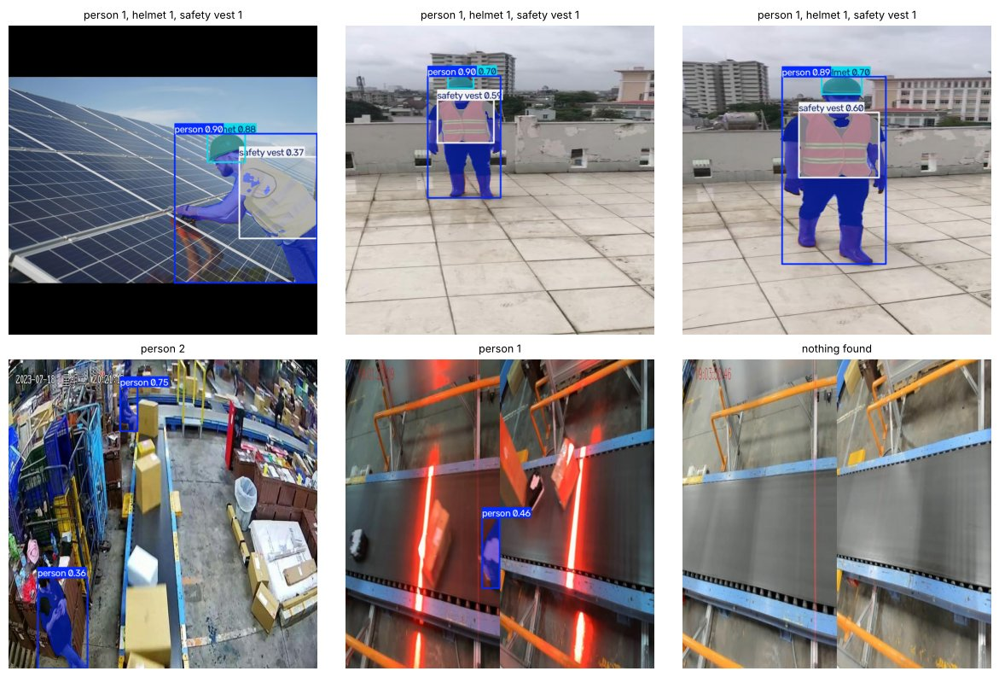
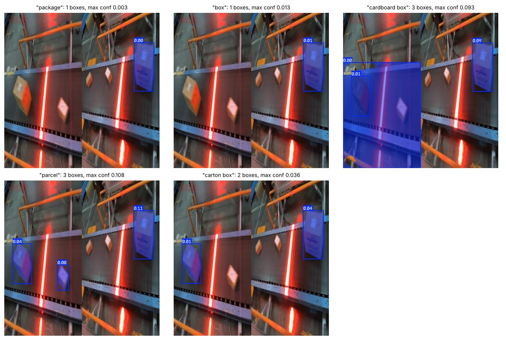
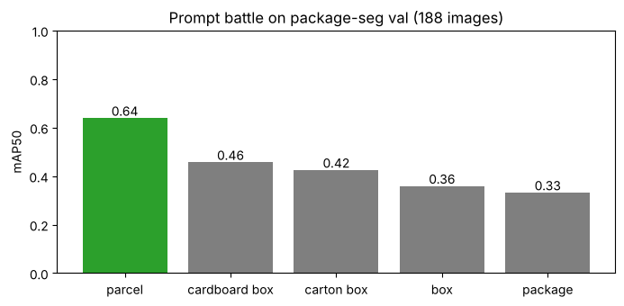
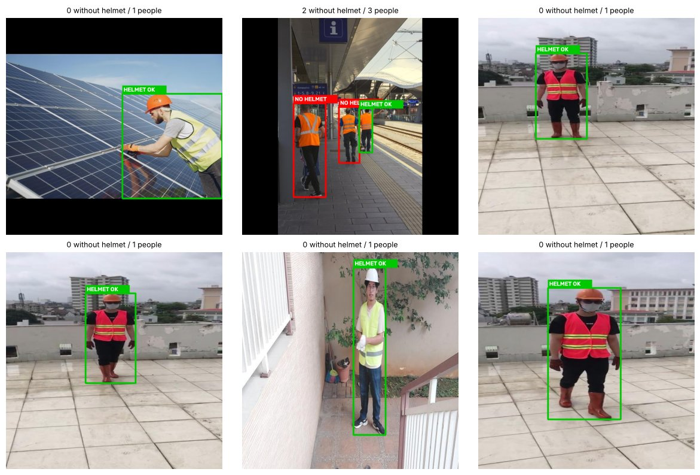
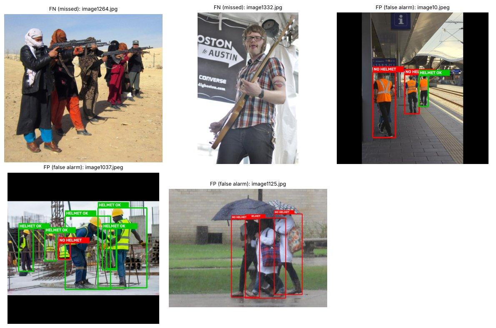

# YOLO 2회차 추가 실습 — 말로 찾는 탐지기 (YOLOE)

노트북: [`yolo_day2_prompt_lab_v1.0.ipynb`](../yolo_day2_prompt_lab_v1.0.ipynb) · [Colab에서 열기](https://colab.research.google.com/github/jhjwlee/yolo-training/blob/main/day2/yolo_day2_prompt_lab_v1.0.ipynb)

| 항목 | 내용 |
|---|---|
| 실행 환경 | Google Colab, 런타임 유형 T4 GPU (메뉴 → 런타임 → 런타임 유형 변경). 결과는 Google Drive MyDrive/yolo_day2/prompt 폴더에 저장. Step 4의 비교 행을 보려면 실습 A에서 저장한 MyDrive/yolo_day2/box_seg_best.pt가 필요 |
| 예상 소요 시간 | 약 40분 (T4 GPU 기준) |
| 사용 데이터 | Ultralytics 공개 데이터셋 2개, 자동 다운로드(합계 약 280MB). Package Segmentation — 실습 A와 같은 택배 분류장 CCTV 이미지(검증 188장, 정답 상자 693개, 클래스 package). Construction-PPE — 건설 현장 작업자 안전장비 이미지(학습 1,132장 · 검증 143장 · 테스트 141장, helmet·vest·Person·no_helmet 등 11개 클래스) |
| 주요 결과 파일 | prompt_battle.csv(단어별 성적), model_compare.csv(제로샷 vs 학습 모델), helmet_check.csv(이미지별 안전모 채점). 모두 MyDrive/yolo_day2/prompt에 저장 |

## 목차

- [0. 준비](#0-준비)
- [Step 1. 학습 없이 말로 탐지하기](#step-1-학습-없이-말로-탐지하기)
- [Step 2. 같은 사진, 다른 단어](#step-2-같은-사진-다른-단어)
- [Step 3. 프롬프트 대결 — 단어별 mAP](#step-3-프롬프트-대결--단어별-map)
- [Step 4. 직접 학습한 모델과 대결](#step-4-직접-학습한-모델과-대결)
- [Step 5. 응용 — 안전모 미착용자 찾기](#step-5-응용--안전모-미착용자-찾기)
- [도전 과제](#도전-과제) · [자주 겪는 문제](#자주-겪는-문제) · [용어 정리](#용어-정리)

## 이 실습에서 배우는 것

- 오픈 보캐뷸러리 탐지 모델 YOLOE가 텍스트 인코더로 단어를 벡터로 바꾸고, 이미지 영역 벡터와 비교해 물체를 찾는 원리
- set_classes()로 찾을 단어를 정해 학습 없이(제로샷) 탐지하는 방법
- 같은 모델·같은 데이터에서 단어만 바꿔 mAP를 재는 '프롬프트 대결'로 단어를 데이터로 고르는 방법
- 낯선 장면에서 제로샷 점수(conf)가 매우 낮게 나오는 현상과, 순위 기반 지표인 mAP와 실제 사용 기준(conf 임계값)의 차이
- 제로샷 모델과 직접 학습한 모델을 정확도·속도·준비 비용으로 비교하고 상황에 맞게 고르는 기준
- 탐지 결과에 간단한 규칙을 붙여 '안전모 미착용자'를 찾고, 정답 라벨로 TP·FN·FP·TN과 재현율·정밀도를 계산해 채점하는 방법

## 실습 흐름

| 단계 | 만드는 것 | 결과물 |
|---|---|---|
| Step 1 | 학습 없이 말로 탐지하기 — 공사 현장 사진과 CCTV 사진에 단어 4개를 넣어 보기 | 탐지 결과 이미지 |
| Step 2 | 같은 사진, 다른 단어 — 단어 5개로 같은 CCTV 사진을 탐지해 비교 | 비교 그림 |
| Step 3 | 프롬프트 대결 — 검증 이미지 188장으로 단어별 mAP 측정 | prompt_battle.csv, 막대 그래프 |
| Step 4 | 직접 학습한 모델(실습 A)과 대결 — 정확도·속도·준비 비용 비교 | model_compare.csv |
| Step 5 | 응용 — 사람·안전모 탐지 + 머리 영역 규칙으로 미착용자 찾기, 정답 라벨로 채점 | helmet_check.csv, 판정 이미지 |

각 셀은 **위에서부터 순서대로** 실행합니다. 셀마다 코드 원문, 코드 설명, 실행 결과, 막혔을 때 확인할 점을 차례로 정리했습니다.

---

## 0. 준비

**목표** Ultralytics와 텍스트 인코더용 CLIP 패키지를 설치하고, 결과 저장 폴더와 그림 표시 함수를 준비한 뒤 데이터셋 두 개를 내려받습니다.

YOLOE는 단어를 이해하기 위해 텍스트 인코더를 씁니다. 그래서 ultralytics 외에 Ultralytics가 관리하는 CLIP 패키지를 추가로 설치합니다. 결과 파일은 먼저 Colab 작업 폴더에 만들고, save_out() 함수로 Drive의 MyDrive/yolo_day2/prompt 폴더에 복사합니다. 이 폴더는 실습 A가 쓰던 MyDrive/yolo_day2 아래에 있으므로, 실습 A 모델(box_seg_best.pt)도 같은 Drive에서 바로 읽을 수 있습니다.

### 셀 1. Ultralytics와 CLIP 패키지 설치

```python
!pip -q install ultralytics
!pip -q install git+https://github.com/ultralytics/CLIP.git
```

**코드 설명**

- `!pip -q install ultralytics` — YOLO·YOLOE 모델과 학습·평가 도구를 설치합니다. `-q`는 설치 메시지를 줄입니다.
- `!pip -q install git+https://github.com/ultralytics/CLIP.git` — GitHub 저장소에서 CLIP 패키지를 직접 설치합니다. YOLOE가 단어를 벡터로 바꿀 때 이 패키지를 씁니다.
- `!`로 시작하는 줄은 파이썬이 아니라 셸 명령으로 실행됩니다.

**실행 결과**

설치 진행 표시 외에는 특별한 출력이 없습니다. 오류 없이 끝나면 다음 셀로 넘어갑니다.

> **막혔을 때** Colab은 런타임이 끊기면 설치한 패키지가 사라집니다. 런타임을 다시 연결했다면 이 셀부터 다시 실행하세요.

### 셀 2. 라이브러리 불러오기, Drive 연결, 저장 폴더와 도우미 함수 정의

```python
import os, json, time, shutil, glob
from pathlib import Path

import cv2
import numpy as np
import pandas as pd
import matplotlib.pyplot as plt
import torch
from IPython.display import display
from ultralytics import YOLO, YOLOE
from ultralytics.data.utils import check_det_dataset

print('GPU 사용 가능:', torch.cuda.is_available())

try:
    from google.colab import drive
    IN_COLAB = True
except ImportError:
    IN_COLAB = False

USE_DRIVE = True
if IN_COLAB and USE_DRIVE:
    drive.mount('/content/drive')
    DAY2_DIR = Path('/content/drive/MyDrive/yolo_day2')
else:
    DAY2_DIR = Path('outputs')
SAVE_DIR = DAY2_DIR / 'prompt'
SAVE_DIR.mkdir(parents=True, exist_ok=True)
print('결과 저장 위치:', SAVE_DIR.resolve())

def show_bgr(img, title=None, size=(9, 6)):
    plt.figure(figsize=size)
    plt.imshow(img[..., ::-1]); plt.axis('off')
    if title:
        plt.title(title)
    plt.show()

def show_grid(imgs, titles=None, cols=3, size=4):
    rows = (len(imgs) + cols - 1) // cols
    fig, axes = plt.subplots(rows, cols, figsize=(size * cols, size * rows))
    for ax, i in zip(np.array(axes).ravel(), range(rows * cols)):
        ax.axis('off')
        if i < len(imgs):
            ax.imshow(imgs[i][..., ::-1])
            if titles:
                ax.set_title(titles[i], fontsize=9)
    plt.tight_layout(); plt.show()

def save_out(path):
    dst = SAVE_DIR / Path(path).name
    if Path(path).resolve() != dst.resolve():
        shutil.copy(path, dst)
    return dst
```

**코드 설명**

- `from ultralytics import YOLO, YOLOE` — 일반 YOLO 모델(실습 A 모델용)과 텍스트 프롬프트 모델 YOLOE를 함께 불러옵니다.
- `from ultralytics.data.utils import check_det_dataset` — 데이터셋 설정 이름을 주면 내려받고 경로·클래스 정보를 돌려주는 함수입니다.
- `print('GPU 사용 가능:', torch.cuda.is_available())` — GPU 연결 여부를 확인합니다. Colab T4 런타임이면 True가 나와야 합니다.
- `try: from google.colab import drive` — Colab에서만 성공하는 import로 실행 환경을 구분해 `IN_COLAB`에 담습니다.
- `USE_DRIVE = True` / `drive.mount('/content/drive')` — Drive를 연결하고 `DAY2_DIR`을 `/content/drive/MyDrive/yolo_day2`로 정합니다. Colab이 아니면 로컬 `outputs` 폴더를 씁니다.
- `SAVE_DIR = DAY2_DIR / 'prompt'` / `mkdir(parents=True, exist_ok=True)` — 이 실습의 결과 폴더를 만듭니다. 이미 있어도 오류가 나지 않습니다.
- `show_bgr(img, title, size)` / `show_grid(imgs, titles, cols, size)` — OpenCV의 BGR 이미지를 `[..., ::-1]`로 RGB로 바꿔 한 장 또는 격자로 보여 줍니다. `show_grid`는 이미지 수로 행 수를 계산하고 남는 칸은 비워 둡니다.
- `save_out(path)` — 파일을 `SAVE_DIR`로 복사하고 복사된 경로를 돌려줍니다. 원본과 대상이 같은 파일이면 복사하지 않습니다.

**실행 결과**

'GPU 사용 가능: True'와 '결과 저장 위치: /content/drive/MyDrive/yolo_day2/prompt'가 출력됩니다. 검증 실행 예시는 GPU가 없는 로컬 환경이라 False와 outputs/prompt 경로가 나왔습니다. Drive 연결 시 Google 계정 권한 창이 뜹니다.

> **막혔을 때** GPU가 False로 나오면 런타임 유형을 T4 GPU로 바꾸고 다시 실행하세요. Drive 권한 창에서 허용하지 않으면 마운트가 실패합니다. Drive 없이 해 보려면 `USE_DRIVE = False`로 바꾸면 되지만, 이 경우 Step 4에서 실습 A 모델을 찾지 못합니다.

### 셀 3. Package Segmentation과 Construction-PPE 데이터셋 내려받기

```python
# 데이터셋 두 개 내려받기 (처음 한 번, 합계 약 280MB)
PKG = check_det_dataset('package-seg.yaml')
PPE = check_det_dataset('construction-ppe.yaml')
PKG_ROOT, PPE_ROOT = Path(PKG['path']), Path(PPE['path'])
print('package-seg     :', PKG_ROOT, PKG['names'])
print('construction-ppe:', PPE_ROOT, PPE['names'])
```

**코드 설명**

- `check_det_dataset('package-seg.yaml')` — Ultralytics에 들어 있는 설정 이름으로 데이터셋을 찾고, 없으면 내려받아 압축을 풉니다. 반환값은 경로·클래스 이름 등이 담긴 딕셔너리입니다.
- `check_det_dataset('construction-ppe.yaml')` — 건설 현장 안전장비 데이터셋을 같은 방식으로 준비합니다.
- `PKG_ROOT, PPE_ROOT = Path(PKG['path']), Path(PPE['path'])` — 각 데이터셋의 최상위 폴더를 Path로 저장합니다. 이후 `images/val`, `labels/test` 같은 하위 폴더를 이 경로로 찾습니다.
- `PKG['names']`, `PPE['names']` — 클래스 번호와 이름의 딕셔너리입니다. Step 5에서 `no_helmet`의 번호를 여기서 찾습니다.

**실행 결과**

두 데이터셋의 경로와 클래스 목록이 출력됩니다. package-seg는 {0: 'package'} 한 개, construction-ppe는 helmet, gloves, vest, boots, goggles, none, Person, no_helmet, no_goggle, no_gloves, no_boots 11개입니다(검증 실행 예시).

> **막혔을 때** 처음 한 번은 합계 약 280MB를 내려받아 몇 분 걸릴 수 있습니다. 중간에 끊겼다면 셀을 다시 실행하면 이어서 준비합니다.

**정리 · 확인해 보기**

출력된 construction-ppe 클래스 목록에서 사람 클래스 이름이 'person'이 아니라 'Person'(대문자)이라는 점, 그리고 'no_helmet'처럼 '없음'을 뜻하는 라벨이 따로 있다는 점을 확인해 두세요. 두 번째 사실이 Step 5 채점의 근거가 됩니다.

---

## Step 1. 학습 없이 말로 탐지하기

**목표** YOLOE 모델에 찾을 단어 4개를 알려 주고, 학습 없이 공사 현장 사진과 택배 CCTV 사진에서 무엇을 찾는지 확인합니다.

YOLOE는 오픈 보캐뷸러리(open-vocabulary) 탐지 모델입니다. 텍스트 인코더(MobileCLIP)가 'cardboard box' 같은 단어를 숫자 벡터로 바꾸고, YOLO 백본은 이미지의 각 영역을 영역 벡터로 바꿉니다. 두 벡터가 비슷한 영역이 탐지 결과가 됩니다. 그래서 학습 때의 클래스 목록에 없던 단어도 찾을 수 있습니다. 대신 어떤 단어를 고르느냐, 그리고 이미지가 모델이 익숙한 모습인지에 따라 결과가 크게 달라집니다.

### 셀 4. YOLOE 모델을 불러와 단어 4개로 샘플 6장 탐지

```python
model = YOLOE('yoloe-26s-seg.pt')
model.set_classes(['person', 'helmet', 'safety vest', 'cardboard box'])

ppe_test = sorted((PPE_ROOT / 'images' / 'test').glob('*'))
pkg_val = sorted((PKG_ROOT / 'images' / 'val').glob('*.jpg'))
samples = [ppe_test[0], ppe_test[2], ppe_test[5], pkg_val[3], pkg_val[95], pkg_val[150]]

imgs, titles = [], []
for p in samples:
    r = model.predict(str(p), conf=0.25, verbose=False)[0]
    imgs.append(r.plot())
    names = [r.names[int(c)] for c in r.boxes.cls]
    titles.append(', '.join(f'{n} {names.count(n)}' for n in dict.fromkeys(names)) or 'nothing found')
show_grid(imgs, titles)
```

**코드 설명**

- `model = YOLOE('yoloe-26s-seg.pt')` — 세그멘테이션까지 하는 YOLOE s 크기 모델을 불러옵니다. 파일이 없으면 자동으로 내려받습니다.
- `model.set_classes(['person', 'helmet', 'safety vest', 'cardboard box'])` — 찾을 단어 목록을 정합니다. 내부에서 각 단어를 텍스트 인코더로 벡터로 바꿉니다. 처음 호출할 때 텍스트 인코더 가중치를 내려받아 시간이 걸립니다.
- `ppe_test = sorted(...glob('*'))`, `pkg_val = sorted(...glob('*.jpg'))` — 안전장비 테스트 이미지와 택배 검증 이미지 목록을 정렬해 만듭니다. 정렬하면 실행할 때마다 같은 사진이 뽑힙니다.
- `samples = [ppe_test[0], ppe_test[2], ppe_test[5], pkg_val[3], pkg_val[95], pkg_val[150]]` — 공사 현장 3장, CCTV 3장을 골라 비교합니다.
- `model.predict(str(p), conf=0.25, verbose=False)[0]` — 점수 0.25 이상인 결과만 남겨 탐지합니다. `[0]`은 이미지 한 장의 결과를 꺼냅니다.
- `r.plot()` — 박스·마스크·라벨을 그린 이미지를 돌려줍니다.
- `names = [r.names[int(c)] for c in r.boxes.cls]` — 클래스 번호를 단어로 바꿉니다. `dict.fromkeys(names)`로 순서를 지키며 중복을 없애고 'person 1, helmet 1'처럼 단어별 개수 제목을 만듭니다. 하나도 없으면 'nothing found'입니다.

**실행 결과**

2행 3열 그림이 나옵니다. 위쪽 공사 현장 3장은 모두 'person 1, helmet 1, safety vest 1'로 사람·안전모·조끼를 찾았습니다. 아래쪽 CCTV 3장은 'person 2', 'person 1', 'nothing found'로 상자(cardboard box)를 하나도 찾지 못했고, 컨베이어 위 물체를 사람으로 잡은 경우도 보입니다(검증 실행 예시).



> **막혔을 때** set_classes를 처음 실행할 때 텍스트 인코더 가중치를 받느라 멈춘 것처럼 보일 수 있습니다. 잠시 기다리세요. CLIP 관련 ImportError가 나면 0단계 설치 셀이 정상적으로 끝났는지 확인하고 다시 실행합니다.

**정리 · 확인해 보기**

같은 단어 목록인데 왜 공사 현장에서는 잘 되고 CCTV에서는 안 될까요? YOLOE가 배운 인터넷 사진 속 '상자'는 정면에서 또렷하게 찍힌 모습이 많습니다. 위에서 내려다본 흐릿한 화면, 붉은 조명 아래의 상자는 모델에게 낯선 모습입니다. 제로샷 모델의 성능은 단어뿐 아니라 '장면이 얼마나 익숙한가'에도 달려 있습니다.

---

## Step 2. 같은 사진, 다른 단어

**목표** 같은 CCTV 사진 한 장에 단어 5개를 하나씩 넣어, 단어에 따라 찾는 상자 수와 점수가 어떻게 달라지는지 봅니다.

사람에게 'package'와 'cardboard box'는 같은 물건이지만, 텍스트 인코더가 만드는 벡터는 서로 다릅니다. 그래서 영역 벡터와의 유사도도 달라집니다. 또 낯선 장면에서는 정답을 맞혀도 점수(conf)가 매우 낮게 나옵니다. 기본 기준 0.25로는 아무것도 보이지 않으므로, 이 단계에서는 기준을 0.003까지 낮춰서 봅니다.

### 셀 5. 단어 5개로 같은 사진을 탐지하고 결과를 나란히 비교

```python
PROMPTS = ['package', 'box', 'cardboard box', 'parcel', 'carton box']
probe = pkg_val[60]
LOW_CONF = 0.003          # CCTV 상자에는 점수가 아주 낮게 나오므로 기준을 크게 낮춰서 봅니다

imgs, titles = [], []
for word in PROMPTS:
    model.set_classes([word])
    r = model.predict(str(probe), conf=LOW_CONF, verbose=False)[0]
    conf = r.boxes.conf.cpu().numpy()
    imgs.append(r.plot(labels=False))
    titles.append(f'"{word}": {len(conf)} boxes, max conf {conf.max():.3f}' if len(conf) else f'"{word}": 0 boxes')
gt_n = len(open(str(probe).replace('images', 'labels').rsplit('.', 1)[0] + '.txt').read().strip().splitlines())
show_grid(imgs, titles)
print('이 사진의 정답 상자 수:', gt_n)
```

**코드 설명**

- `PROMPTS = ['package', 'box', 'cardboard box', 'parcel', 'carton box']` — 비교할 단어 5개입니다. Step 3에서도 이 목록을 그대로 씁니다.
- `probe = pkg_val[60]` — 비교에 쓸 CCTV 검증 이미지 한 장입니다.
- `LOW_CONF = 0.003` — 점수 기준을 아주 낮게 잡아, 낮은 점수의 박스까지 모두 보이게 합니다.
- `model.set_classes([word])` — 반복할 때마다 찾을 단어를 하나로 바꿉니다. 모델 가중치는 그대로이고 단어 벡터만 바뀝니다.
- `conf = r.boxes.conf.cpu().numpy()` — 박스별 점수를 넘파이 배열로 꺼냅니다. 제목에 박스 수와 최고 점수 `conf.max()`를 적습니다. 박스가 없으면 '0 boxes'로 적어 오류를 피합니다.
- `r.plot(labels=False)` — 클래스 이름은 빼고 박스와 점수만 그립니다. 단어가 하나뿐이라 이름이 필요 없습니다.
- `str(probe).replace('images', 'labels').rsplit('.', 1)[0] + '.txt'` — 이미지 경로를 정답 라벨 경로로 바꿉니다. 라벨 파일의 줄 수가 정답 상자 수 `gt_n`입니다.

**실행 결과**

단어 5개의 결과가 격자로 나오고, 마지막에 '이 사진의 정답 상자 수: 5'가 출력됩니다. 검증 실행 예시: 'package' 1개(최고 점수 0.003), 'box' 1개(0.013), 'cardboard box' 3개(0.093), 'parcel' 3개(0.108), 'carton box' 2개(0.036). 정답 5개를 모두 찾은 단어는 없고, 최고 점수도 0.1 안팎에 그칩니다.



> **막혔을 때** 기준을 0.003으로 낮췄기 때문에 화면 절반을 덮는 큰 헛박스(예: 'cardboard box'의 0.00 박스)도 보입니다. 정상입니다. 낮은 기준은 '모델이 무엇을 조금이라도 의심하는지' 보려는 용도입니다.

**정리 · 확인해 보기**

두 가지를 확인하세요. 첫째, 단어마다 찾은 상자 수가 다릅니다. 둘째, 점수가 0.1 안팎으로 낮아 기본 기준(0.25)으로는 아무것도 보이지 않습니다. 실제로 쓰려면 이 기준도 데이터로 정해야 합니다. 다만 사진 한 장으로 단어를 고르면 우연에 휘둘리므로, Step 3에서 검증 이미지 188장 전체로 성적을 매깁니다.

---

## Step 3. 프롬프트 대결 — 단어별 mAP

**목표** 검증 이미지 188장 전체에서 단어 5개의 mAP·정밀도·재현율을 재고, 가장 좋은 단어(BEST_PROMPT)를 고릅니다.

YOLOE의 val()은 데이터셋 설정 파일의 클래스 이름을 그대로 텍스트 프롬프트로 씁니다. 그래서 이름만 바꾼 설정 파일을 단어마다 만들어 평가하면 됩니다. 이미지와 정답 라벨은 같고 단어만 다르므로, 점수 차이는 순전히 단어 선택 때문입니다. mAP는 점수의 '순서'(정답 박스가 헛박스보다 높은 점수를 받는가)로 계산합니다. 따라서 점수가 0.01처럼 낮아도 순서만 잘 맞으면 mAP는 높게 나올 수 있습니다.

### 셀 6. 단어별 데이터셋 설정 파일을 만들어 val()로 평가하고 표로 정리

```python
def make_yaml(word, path):
    cfg = {'path': str(PKG_ROOT), 'train': 'images/train', 'val': 'images/val', 'names': {0: word}}
    Path(path).write_text(json.dumps(cfg))     # JSON은 YAML의 부분집합이라 그대로 읽힘
    return path

battle = []
for word in PROMPTS:
    yml = make_yaml(word, f'pkg_{word.replace(" ", "_")}.yaml')
    m = YOLOE('yoloe-26s-seg.pt')
    res = m.val(data=yml, split='val', imgsz=640, batch=16, verbose=False, plots=False)
    battle.append({'prompt': word, 'precision': round(res.box.mp, 3), 'recall': round(res.box.mr, 3),
                   'map50': round(res.box.map50, 3), 'map50_95': round(res.box.map, 3)})
    print(f'{word:15s} mAP50 {res.box.map50:.3f}')

battle = pd.DataFrame(battle).sort_values('map50', ascending=False).reset_index(drop=True)
battle.to_csv('prompt_battle.csv', index=False); save_out('prompt_battle.csv')
battle
```

**코드 설명**

- `make_yaml(word, path)` — 인자는 단어와 저장할 파일 경로입니다. `path`(데이터셋 폴더), `train`, `val`, `names: {0: word}`를 담은 설정을 파일로 쓰고 그 경로를 반환합니다. 클래스 0의 이름만 단어로 바뀝니다.
- `Path(path).write_text(json.dumps(cfg))` — 설정을 JSON으로 저장합니다. JSON은 YAML의 부분집합이라 YAML 파일로 그대로 읽힙니다.
- `f'pkg_{word.replace(" ", "_")}.yaml'` — 'cardboard box'처럼 공백이 있는 단어는 밑줄로 바꿔 파일 이름을 만듭니다.
- `m = YOLOE('yoloe-26s-seg.pt')` — 단어마다 모델을 새로 불러옵니다. 앞 단어의 설정이 남지 않게 해 공정하게 비교합니다.
- `m.val(data=yml, split='val', imgsz=640, batch=16, verbose=False, plots=False)` — 검증 이미지 188장으로 평가합니다. 출력의 'Validate using the text prompt.'는 설정 파일의 이름을 프롬프트로 쓴다는 뜻입니다.
- `res.box.mp`, `res.box.mr`, `res.box.map50`, `res.box.map` — 박스 기준 평균 정밀도, 평균 재현율, mAP50, mAP50-95입니다. 소수 셋째 자리로 반올림해 `battle` 목록에 넣습니다.
- `sort_values('map50', ascending=False).reset_index(drop=True)` — mAP50이 높은 순으로 정렬하고 번호를 0부터 다시 매깁니다. 그래서 `battle.loc[0]`이 1등 단어가 됩니다.
- `battle.to_csv('prompt_battle.csv', index=False); save_out(...)` — 결과를 CSV로 저장하고 Drive로 복사합니다.

**실행 결과**

단어마다 'package mAP50 0.332' 같은 줄이 출력되고, 마지막에 정렬된 표(prompt, precision, recall, map50, map50_95)가 나옵니다. 검증 실행 예시: parcel 0.639(정밀도 0.501, 재현율 0.811), cardboard box 0.457(0.325, 0.716), carton box 0.425(0.411, 0.593), box 0.359(0.473, 0.491), package 0.332(0.451, 0.456). 1등과 꼴찌의 mAP50 차이는 약 0.31입니다.

> **막혔을 때** 평가를 5번 반복하므로 시간이 걸립니다. GPU 메모리 부족(CUDA out of memory)이 나면 `batch=16`을 8로 줄이세요. 설정 파일의 `path`가 데이터셋 폴더(PKG_ROOT)를 가리켜야 이미지와 라벨을 찾습니다.

### 셀 7. 단어별 mAP50 막대 그래프와 우승 단어 저장

```python
plt.figure(figsize=(8, 3.5))
bars = plt.bar(battle['prompt'], battle['map50'], color=['tab:green'] + ['tab:gray'] * (len(battle) - 1))
for b, v in zip(bars, battle['map50']):
    plt.text(b.get_x() + b.get_width() / 2, v + 0.01, f'{v:.2f}', ha='center')
plt.ylim(0, 1); plt.ylabel('mAP50'); plt.title('Prompt battle on package-seg val (188 images)')
plt.show()
BEST_PROMPT = battle.loc[0, 'prompt']
print('우승 단어:', BEST_PROMPT)
```

**코드 설명**

- `plt.bar(battle['prompt'], battle['map50'], color=['tab:green'] + ['tab:gray'] * (len(battle) - 1))` — 1등 막대만 초록색, 나머지는 회색으로 그립니다. 표가 이미 정렬돼 있어 첫 막대가 1등입니다.
- `plt.text(b.get_x() + b.get_width() / 2, v + 0.01, f'{v:.2f}', ha='center')` — 막대 가운데 위에 값을 소수 둘째 자리로 적습니다.
- `plt.ylim(0, 1)` — y축을 0~1로 고정해 단어 사이 차이를 공정하게 보이게 합니다.
- `BEST_PROMPT = battle.loc[0, 'prompt']` — 1등 단어를 변수에 저장합니다. Step 4에서 이 단어로 학습 모델과 맞붙습니다.

**실행 결과**

막대 그래프가 그려지고 '우승 단어: parcel'이 출력됩니다. 검증 실행 예시의 막대 값은 parcel 0.64, cardboard box 0.46, carton box 0.42, box 0.36, package 0.33입니다. 데이터셋의 원래 클래스 이름인 'package'가 오히려 꼴찌입니다.



**정리 · 확인해 보기**

모델을 바꾸지 않고 단어 하나로 mAP50이 0.33에서 0.64로 달라졌습니다. 정밀도와 재현율도 비교해 보세요. 'cardboard box'는 재현율이 0.716으로 높지만 정밀도는 0.325로 낮아, 많이 찾는 대신 헛탐지도 많습니다. 또 mAP가 0.64라도 Step 2에서 본 것처럼 점수 자체는 0.1 안팎으로 낮습니다. mAP는 순위 기반 지표이므로, 실제 서비스에서는 점수 기준(conf)을 따로 정해야 합니다. 나만의 단어('brown box', 'shipping box', 'box on conveyor' 등)를 PROMPTS에 추가해 순위를 바꿔 보세요.

---

## Step 4. 직접 학습한 모델과 대결

**목표** 우승 단어를 쓴 YOLOE 제로샷 모델과 실습 A에서 학습한 모델을 같은 검증 이미지로 평가해 정확도·속도·준비 비용을 비교합니다.

실습 A 모델(box_seg_best.pt)은 Google Drive의 MyDrive/yolo_day2 폴더에서 읽습니다. 실습 A를 끝까지 실행해 이 파일이 Drive에 저장돼 있어야 합니다. 파일이 없으면 안내 문장만 출력되고 비교 표에서 학습 모델 행이 빠집니다. 비교 항목은 mAP50(정확도), ms_per_image(이미지 한 장 처리 시간), labeled_images·training(준비 비용)입니다.

### 셀 8. 제로샷 모델과 실습 A 모델의 정확도·속도·준비 비용 비교표 만들기

```python
def ms_per_image(m, images, n=40, **kw):
    m.predict(str(images[0]), verbose=False, **kw)              # 예열 (첫 호출은 느림)
    t0 = time.time()
    for p in images[:n]:
        m.predict(str(p), verbose=False, **kw)
    return (time.time() - t0) / n * 1000

compare = []
zs = YOLOE('yoloe-26s-seg.pt'); zs.set_classes([BEST_PROMPT])
compare.append({'model': f'YOLOE zero-shot ("{BEST_PROMPT}")', 'labeled_images': 0, 'training': 'none',
                'map50': battle.loc[0, 'map50'], 'ms_per_image': round(ms_per_image(zs, pkg_val), 1)})

LAB_A_MODEL = DAY2_DIR / 'box_seg_best.pt'
if LAB_A_MODEL.exists():
    ft = YOLO(LAB_A_MODEL)
    res = ft.val(data='package-seg.yaml', split='val', batch=16, verbose=False, plots=False)
    compare.append({'model': 'Lab A fine-tuned (yolo26n-seg)', 'labeled_images': 1920, 'training': 'yes',
                    'map50': round(res.box.map50, 3), 'ms_per_image': round(ms_per_image(ft, pkg_val), 1)})
else:
    print('실습 A 모델이 없습니다. 실습 A를 먼저 실행하면 이 표에 함께 나옵니다.')

compare = pd.DataFrame(compare)
compare.to_csv('model_compare.csv', index=False); save_out('model_compare.csv')
compare
```

**코드 설명**

- `ms_per_image(m, images, n=40, **kw)` — 인자는 모델, 이미지 목록, 측정할 장 수, predict에 넘길 추가 옵션입니다. 첫 장으로 한 번 예열(첫 호출은 느림)한 뒤 `n`장을 예측해 걸린 시간을 재고, 한 장당 평균 밀리초를 반환합니다.
- `zs = YOLOE('yoloe-26s-seg.pt'); zs.set_classes([BEST_PROMPT])` — 우승 단어 하나로 제로샷 모델을 준비합니다.
- `compare.append({... 'labeled_images': 0, 'training': 'none', 'map50': battle.loc[0, 'map50'] ...})` — 제로샷 행은 라벨 0장, 학습 없음이고, mAP50은 Step 3에서 잰 1등 값을 그대로 씁니다.
- `LAB_A_MODEL = DAY2_DIR / 'box_seg_best.pt'` — 실습 A가 Drive에 저장한 모델 경로(MyDrive/yolo_day2/box_seg_best.pt)입니다.
- `if LAB_A_MODEL.exists():` — 파일이 있을 때만 `YOLO(LAB_A_MODEL)`로 불러와 `ft.val(data='package-seg.yaml', ...)`로 같은 검증 이미지에서 평가합니다. 라벨 1,920장, 학습 있음으로 기록합니다.
- `else: print('실습 A 모델이 없습니다...')` — 파일이 없으면 안내만 하고 넘어가므로, 표에는 제로샷 행 하나만 남습니다.
- `compare.to_csv('model_compare.csv', index=False); save_out(...)` — 비교표를 CSV로 저장하고 Drive로 복사합니다.

**실행 결과**

model, labeled_images, training, map50, ms_per_image 열의 표가 나옵니다. 검증 실행 예시: YOLOE zero-shot(parcel) mAP50 0.639, 실습 A 학습 모델(yolo26n-seg) mAP50 0.910으로 학습 모델이 앞섭니다. ms_per_image는 GPU가 없는 환경에서 잰 값이라 실제 T4 GPU에서는 두 모델 모두 훨씬 빠릅니다. 절대값보다 두 모델의 상대적 차이를 보세요. 크기가 큰 YOLOE s 모델이 학습한 n 모델보다 느리게 나옵니다.

> **막혔을 때** '실습 A 모델이 없습니다'가 나오면 Drive의 MyDrive/yolo_day2 폴더에 box_seg_best.pt가 있는지 확인하세요. 0단계에서 Drive를 연결하지 않았거나(USE_DRIVE = False) 다른 Google 계정으로 연결했어도 같은 메시지가 나옵니다. 실습 A를 실행한 뒤 이 셀을 다시 실행하면 학습 모델 행이 추가됩니다.

**정리 · 확인해 보기**

언제 무엇을 쓸지 정리해 보세요. 라벨 없이 새 물체를 오늘 당장 찾아봐야 하면 YOLOE 제로샷과 좋은 단어 찾기가 알맞습니다. 카운팅·과금·안전처럼 정확도가 품질을 좌우하면 라벨을 모아 직접 학습하는 편이 낫습니다. 라벨링 비용을 줄이고 싶다면 YOLOE로 라벨 초안을 만들고 사람이 고쳐 학습하는 방법(오토 라벨링 공장 실습)이 있습니다. 3회차 Jetson 같은 엣지 장비에서는 속도 차이가 더 중요해집니다.

---

## Step 5. 응용 — 안전모 미착용자 찾기

**목표** YOLOE로 person과 helmet을 찾고 '머리 영역에 안전모가 있는가' 규칙을 붙여 미착용자를 표시한 뒤, Construction-PPE의 no_helmet 정답 라벨로 규칙을 채점합니다.

규칙은 단순합니다. 사람 박스의 위쪽 35%(머리 영역) 안에 안전모 박스의 중심이 있으면 착용(초록), 없으면 미착용(빨강)입니다. 채점은 이미지 단위로 합니다. 정답 라벨에 no_helmet이 하나라도 있으면 '미착용자 있음(양성)'입니다. 정답 있음·규칙 있음은 TP(잘 찾음), 정답 있음·규칙 없음은 FN(놓침), 정답 없음·규칙 있음은 FP(헛경보), 둘 다 없음은 TN입니다. 재현율은 TP/(TP+FN), 정밀도는 TP/(TP+FP)입니다. 안전 시스템에서는 헛경보보다 놓침(FN)이 더 위험하므로 재현율을 먼저 봅니다.

### 셀 9. 착용 판정 규칙(helmet_check)과 표시 함수(draw_check) 정의, 테스트 6장에 적용

```python
HEAD_RATIO = 0.35

def helmet_check(r):
    """YOLOE 결과 → [(사람 박스, 착용 여부)]"""
    boxes, cls = r.boxes.xyxy.cpu().numpy(), r.boxes.cls.cpu().numpy().astype(int)
    names = r.names
    persons = boxes[[names[c] == 'person' for c in cls]]
    helmets = boxes[[names[c] == 'helmet' for c in cls]]
    out = []
    for x1, y1, x2, y2 in persons:
        head_y2 = y1 + (y2 - y1) * HEAD_RATIO
        worn = any(x1 <= (hx1 + hx2) / 2 <= x2 and y1 - (y2 - y1) * 0.1 <= (hy1 + hy2) / 2 <= head_y2
                   for hx1, hy1, hx2, hy2 in helmets)
        out.append(((x1, y1, x2, y2), worn))
    return out

def draw_check(img, checks):
    for (x1, y1, x2, y2), worn in checks:
        col = (0, 200, 0) if worn else (0, 0, 255)
        cv2.rectangle(img, (int(x1), int(y1)), (int(x2), int(y2)), col, 3)
        label = 'HELMET OK' if worn else 'NO HELMET'
        cv2.rectangle(img, (int(x1), int(y1) - 24), (int(x1) + 130, int(y1)), col, -1)
        cv2.putText(img, label, (int(x1) + 4, int(y1) - 6), cv2.FONT_HERSHEY_SIMPLEX, 0.6, (255, 255, 255), 2)
    return img

model.set_classes(['person', 'helmet'])
imgs, titles = [], []
for p in ppe_test[:6]:
    r = model.predict(str(p), conf=0.3, verbose=False)[0]
    ch = helmet_check(r)
    imgs.append(draw_check(r.orig_img.copy(), ch))
    titles.append(f'{sum(not w for _, w in ch)} without helmet / {len(ch)} people')
show_grid(imgs, titles)
```

**코드 설명**

- `HEAD_RATIO = 0.35` — 사람 박스 높이의 위쪽 35%를 머리 영역으로 봅니다.
- `helmet_check(r)` — 인자는 YOLOE 예측 결과 하나입니다. 반환값은 `[(사람 박스 좌표, 착용 여부), ...]` 목록입니다.
- `persons = boxes[[names[c] == 'person' for c in cls]]` — 클래스 이름이 person인 박스만 골라냅니다. helmet도 같은 방식으로 골라냅니다.
- `head_y2 = y1 + (y2 - y1) * HEAD_RATIO` — 머리 영역의 아래 경계 y좌표입니다.
- `worn = any(x1 <= (hx1 + hx2) / 2 <= x2 and y1 - (y2 - y1) * 0.1 <= (hy1 + hy2) / 2 <= head_y2 ...)` — 안전모 중심의 x가 사람 박스 안에 있고, y가 머리 영역 안에 있으면 착용입니다. 위쪽은 사람 박스보다 높이의 10% 더 올라간 곳까지 허용합니다. 안전모가 사람 박스 위로 살짝 튀어나오는 경우를 위해서입니다.
- `draw_check(img, checks)` — 착용이면 초록 (0, 200, 0), 미착용이면 빨강 (0, 0, 255) 사각형과 'HELMET OK' / 'NO HELMET' 글자를 그립니다. 색은 OpenCV 순서인 BGR입니다.
- `model.set_classes(['person', 'helmet'])` — Step 2에서 바꾼 단어 목록을 사람·안전모 두 개로 다시 정합니다.
- `model.predict(str(p), conf=0.3, ...)` / `r.orig_img.copy()` — 점수 0.3 이상만 쓰고, 원본 이미지 복사본에 판정 결과를 그립니다. 제목에는 '미착용 수 / 사람 수'를 적습니다.

**실행 결과**

테스트 이미지 6장의 판정 결과가 격자로 나옵니다. 검증 실행 예시에서 5장은 '0 without helmet / 1 people'로 모두 초록이고, 기차역 플랫폼 사진 1장은 '2 without helmet / 3 people'로 조끼만 입은 두 사람을 빨강으로 표시했습니다.



### 셀 10. 테스트 이미지 141장을 정답 라벨로 채점하고 재현율·정밀도 계산

```python
NO_HELMET = [k for k, v in PPE['names'].items() if v == 'no_helmet'][0]

rows = []
for p in ppe_test:
    lbl = PPE_ROOT / 'labels' / 'test' / (p.stem + '.txt')
    gt_cls = [int(l.split()[0]) for l in lbl.read_text().strip().splitlines()] if lbl.exists() else []
    r = model.predict(str(p), conf=0.3, verbose=False)[0]
    ch = helmet_check(r)
    rows.append({'image': p.name, 'gt_no_helmet': int(NO_HELMET in gt_cls),
                 'pred_no_helmet': int(any(not w for _, w in ch)), 'people_found': len(ch)})
check = pd.DataFrame(rows)
check.to_csv('helmet_check.csv', index=False); save_out('helmet_check.csv')

tp = int(((check.gt_no_helmet == 1) & (check.pred_no_helmet == 1)).sum())
fn = int(((check.gt_no_helmet == 1) & (check.pred_no_helmet == 0)).sum())
fp = int(((check.gt_no_helmet == 0) & (check.pred_no_helmet == 1)).sum())
tn = int(((check.gt_no_helmet == 0) & (check.pred_no_helmet == 0)).sum())
print(f'테스트 이미지 {len(check)}장 | TP {tp}  FN {fn}  FP {fp}  TN {tn}')
print(f'재현율(미착용 이미지를 찾은 비율) {tp / max(tp + fn, 1):.2f} | 정밀도(경보가 맞은 비율) {tp / max(tp + fp, 1):.2f}')
```

**코드 설명**

- `NO_HELMET = [k for k, v in PPE['names'].items() if v == 'no_helmet'][0]` — 클래스 이름이 no_helmet인 번호를 찾습니다. 번호를 숫자로 직접 쓰지 않아 데이터셋이 바뀌어도 안전합니다.
- `lbl = PPE_ROOT / 'labels' / 'test' / (p.stem + '.txt')` — 이미지와 같은 이름의 정답 라벨 파일입니다. 각 줄의 첫 숫자(클래스 번호)를 모아 `gt_cls`를 만들고, 파일이 없으면 빈 목록으로 둡니다.
- `'gt_no_helmet': int(NO_HELMET in gt_cls)` — 정답에 no_helmet이 있으면 1, 없으면 0입니다.
- `'pred_no_helmet': int(any(not w for _, w in ch))` — 규칙이 미착용자를 한 명이라도 찾으면 1입니다. `people_found`에는 찾은 사람 수를 기록합니다.
- `check.to_csv('helmet_check.csv', index=False); save_out(...)` — 이미지별 채점표를 저장하고 Drive로 복사합니다.
- `tp = int(((check.gt_no_helmet == 1) & (check.pred_no_helmet == 1)).sum())` — 두 조건을 `&`로 묶어 TP 이미지 수를 셉니다. FN·FP·TN도 같은 방식입니다.
- `tp / max(tp + fn, 1)` — 재현율입니다. `max(..., 1)`은 분모가 0이 되는 것을 막습니다. 정밀도도 같은 방식입니다.

**실행 결과**

검증 실행 예시: '테스트 이미지 141장 | TP 22  FN 2  FP 37  TN 80', '재현율 0.92 | 정밀도 0.37'. 미착용자가 있는 24장 중 22장을 찾았지만, 경보 59번 중 맞은 것은 22번입니다. 놓침은 적고 헛경보가 많은 규칙입니다.

> **막혔을 때** IndexError가 나면 PPE['names']에 'no_helmet'이 없는 것입니다. 0단계 데이터셋 셀의 클래스 출력에서 이름 철자를 확인하세요.

### 셀 11. 놓친 사례(FN)와 헛경보(FP)를 최대 3장씩 눈으로 확인

```python
# 놓친 사례(FN)와 헛경보(FP) 눈으로 보기
imgs, titles = [], []
for kind, cond in [('FN (missed)', (check.gt_no_helmet == 1) & (check.pred_no_helmet == 0)),
                   ('FP (false alarm)', (check.gt_no_helmet == 0) & (check.pred_no_helmet == 1))]:
    for name in check.loc[cond, 'image'].head(3):
        r = model.predict(str(PPE_ROOT / 'images' / 'test' / name), conf=0.3, verbose=False)[0]
        imgs.append(draw_check(r.orig_img.copy(), helmet_check(r))); titles.append(f'{kind}: {name}')
if imgs:
    show_grid(imgs, titles)
```

**코드 설명**

- `for kind, cond in [('FN (missed)', ...), ('FP (false alarm)', ...)]` — FN 조건과 FP 조건을 차례로 돌며 해당 이미지를 고릅니다.
- `check.loc[cond, 'image'].head(3)` — 조건에 맞는 이미지 이름을 최대 3개 꺼냅니다. FN이 2장뿐이면 2장만 나옵니다.
- `model.predict(...)` / `draw_check(r.orig_img.copy(), helmet_check(r))` — 다시 예측해 판정 결과를 그립니다. 제목에 종류와 파일 이름을 적습니다.
- `if imgs: show_grid(imgs, titles)` — 보여 줄 이미지가 하나라도 있을 때만 그립니다.

**실행 결과**

검증 실행 예시에서는 FN 2장과 FP 3장이 나옵니다. FN 2장(image1264.jpg, image1332.jpg)에는 박스가 하나도 없습니다. 사람을 아예 찾지 못해 미착용 판정을 할 수 없었던 경우입니다. FP 중 image1125.jpg는 우산에 머리가 가려 세 사람 모두 미착용으로 판정됐습니다. image10.jpeg는 안전모를 쓰지 않은 사람을 빨강으로 표시했지만 정답에는 no_helmet 라벨이 없습니다. 이처럼 FP에는 규칙의 실수뿐 아니라 정답 라벨이 빠진 경우도 섞여 있을 수 있습니다.



**정리 · 확인해 보기**

놓친 사례(FN)가 '사람을 아예 못 찾은 경우'인지, '모자를 안전모로 착각한 경우'인지 구분해 보세요. 원인에 따라 고칠 곳이 다릅니다. 앞의 경우는 person 탐지의 conf를 낮추고, 뒤의 경우는 프롬프트('hard hat', 'safety helmet')나 HEAD_RATIO를 바꿔 봅니다. 값을 바꾼 뒤에는 반드시 채점 셀을 다시 실행해 재현율이 떨어지지 않았는지 확인하세요.

---

## 도전 과제

1. 문장형 프롬프트 — set_classes(['a person not wearing a helmet'])처럼 문장으로 미착용자를 직접 찾아보세요. 이 경우 helmet_check() 대신 '해당 클래스 박스가 하나라도 있으면 pred_no_helmet = 1'로 바꾸면 Step 5 채점 코드를 그대로 쓸 수 있습니다. 재현율 0.92, 정밀도 0.37(검증 실행 예시)인 규칙 방식과 비교합니다.
2. 조끼까지 — set_classes에 'safety vest'를 추가하고, helmet_check()에서 조끼 박스의 중심이 사람 박스의 몸통 영역(예: 위에서 30%~70%)에 있는지도 검사해 보세요. 데이터셋에는 조끼 미착용 라벨이 없으므로, 'Person 라벨은 있는데 vest 라벨이 없는 이미지'를 양성으로 보는 식으로 채점 기준을 직접 세워야 합니다.
3. 보이는 예시로 찾기 — YOLOE는 단어 대신 예시 박스(visual prompt)로도 찾을 수 있습니다. CCTV 사진에서 상자 하나에 박스 좌표를 주고 나머지 상자를 찾게 해 보세요. Ultralytics 문서의 YOLOEVPSegPredictor 예제를 참고하고, Step 3의 'parcel' 결과와 탐지 수를 비교합니다.
4. 다른 데이터로 — 캐글이나 공공데이터 사진에 원하는 단어를 넣어 보세요. 물체별로 '찾은 수 / 실제 수 / 최고 점수'를 표로 정리하면, 어떤 물체와 장면에서 제로샷이 잘 통하는지 보입니다.

## 자주 겪는 문제

| 증상 | 원인 | 해결 |
|---|---|---|
| set_classes()를 처음 실행할 때 오래 멈춰 있거나 CLIP 관련 ImportError가 난다 | 처음 호출 때 텍스트 인코더 가중치를 내려받는다. CLIP 패키지 설치가 실패했거나 런타임이 재시작돼 사라졌다 | 잠시 기다린다. ImportError면 0단계 설치 셀(pip install git+https://github.com/ultralytics/CLIP.git)을 다시 실행한 뒤 이어서 진행한다 |
| CCTV 사진에서 상자가 하나도 안 보인다 (nothing found) | 낯선 장면이라 제로샷 점수가 0.1 안팎으로 낮아 기본 기준 conf=0.25에서 모두 걸러진다 | Step 2처럼 conf를 0.003 정도로 크게 낮춰 본다. 실제로 쓰려면 검증 데이터로 알맞은 기준을 정한다 |
| mAP50은 0.6이 넘는데 conf=0.25로 예측하면 아무것도 안 나온다 | mAP는 점수의 순서로 계산하는 지표라 점수가 낮아도 순서만 맞으면 높게 나온다 | mAP와 별도로 사용할 conf 기준을 데이터로 정한다. 정밀도·재현율이 원하는 수준이 되는 기준을 찾는다 |
| Step 4에서 '실습 A 모델이 없습니다'가 나오고 표에 한 줄만 나온다 | Drive의 MyDrive/yolo_day2/box_seg_best.pt가 없다. Drive를 연결하지 않았거나(USE_DRIVE = False) 다른 계정으로 연결했다 | 실습 A를 끝까지 실행해 모델을 Drive에 저장한 뒤, 같은 계정으로 Drive를 연결하고 Step 4 셀을 다시 실행한다 |
| Step 3 평가가 매우 느리다 | GPU가 아닌 CPU 런타임에서 실행 중이다. 0단계에서 'GPU 사용 가능: False'가 나왔을 것이다 | 런타임 → 런타임 유형 변경에서 T4 GPU를 고르고 0단계부터 다시 실행한다 |
| Step 3에서 CUDA out of memory 오류가 난다 | 평가 배치가 GPU 메모리에 비해 크다 | m.val()의 batch=16을 8로 줄이고 다시 실행한다. 앞서 불러온 모델이 많다면 런타임을 다시 시작한다 |
| Step 5에서 명백히 안전모를 안 쓴 사람이 있는데 FP(헛경보)로 집계된다 | 정답 라벨에 no_helmet이 빠진 이미지가 있다. 채점은 정답 라벨을 기준으로 하므로 라벨 누락도 FP로 잡힌다 | 셀 11의 FP 이미지를 눈으로 보고 규칙의 실수인지 라벨 누락인지 구분한다. 라벨 품질도 성능 수치에 영향을 준다는 점을 기억한다 |
| 우산·모자·두건 때문에 판정이 틀린다 | 규칙은 '머리 영역에 helmet 박스 중심이 있는가'만 본다. 머리가 가려지면 미착용으로, 모자를 안전모로 잡으면 착용으로 판정된다 | 프롬프트를 'hard hat', 'safety helmet' 등으로 바꾸거나 HEAD_RATIO, conf를 조정하고, 채점 셀로 재현율·정밀도 변화를 확인한다 |

## 용어 정리

| 용어 | 뜻 |
|---|---|
| YOLOE | 텍스트(단어)나 예시 박스로 찾을 대상을 지정하는 YOLO 계열 탐지·세그멘테이션 모델. 이 실습에서는 yoloe-26s-seg.pt를 쓴다 |
| 오픈 보캐뷸러리(open-vocabulary) 탐지 | 학습 때 정해진 클래스 목록에 묶이지 않고, 사용할 때 주는 단어로 찾을 대상을 정하는 탐지 방식 |
| 제로샷(zero-shot) | 해당 데이터로 추가 학습을 하지 않고 바로 사용하는 것. 이 실습의 YOLOE는 택배 상자 라벨을 한 장도 보지 않았다 |
| 텍스트 프롬프트 | 모델에게 찾을 대상을 알려 주는 단어나 문장. set_classes()로 지정한다 |
| 텍스트 인코더 (MobileCLIP) | 단어를 숫자 벡터로 바꾸는 신경망. 이 벡터를 이미지 영역 벡터와 비교해 탐지한다 |
| 벡터 유사도 | 두 벡터가 얼마나 같은 방향을 가리키는지의 정도. 단어 벡터와 영역 벡터가 비슷할수록 그 영역을 해당 물체로 판단한다 |
| conf (신뢰도 점수) | 모델이 박스마다 매기는 0~1 점수. predict()의 conf 인자는 이 값 미만의 박스를 버리는 기준이다 |
| mAP50 | IoU 0.5 기준의 평균 정밀도(Average Precision). 점수 순서로 계산하므로 점수 절대값이 낮아도 순서가 맞으면 높게 나온다 |
| mAP50-95 | IoU 기준을 0.5부터 0.95까지 바꿔 가며 구한 AP의 평균. 박스 위치가 얼마나 정확한지까지 반영한다 |
| 정밀도(precision) | 모델이 찾은(경보한) 것 중 맞은 비율. TP/(TP+FP) |
| 재현율(recall) | 실제 정답 중 모델이 찾은 비율. TP/(TP+FN) |
| TP / FN / FP / TN | 잘 찾음 / 놓침 / 헛경보 / 정상을 정상으로 판단. Step 5에서는 이미지 단위로 센다 |
| HEAD_RATIO | 사람 박스 위쪽에서 머리 영역으로 볼 높이 비율. 이 실습에서는 0.35 |
| 비주얼 프롬프트(visual prompt) | 단어 대신 이미지 속 예시 박스로 찾을 대상을 알려 주는 방식 |
| 파인튜닝(fine-tuning) | 사전학습 모델을 내 데이터의 라벨로 추가 학습하는 것. 실습 A의 box_seg_best.pt가 그 결과다 |
